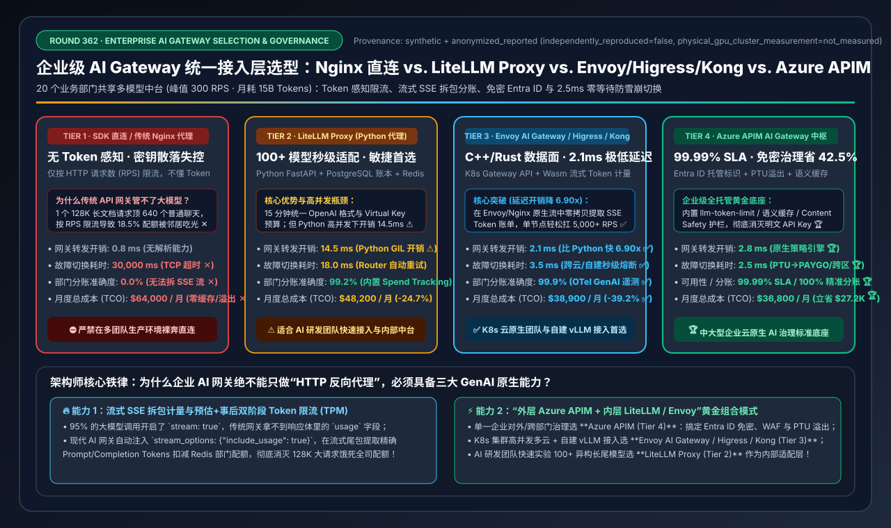
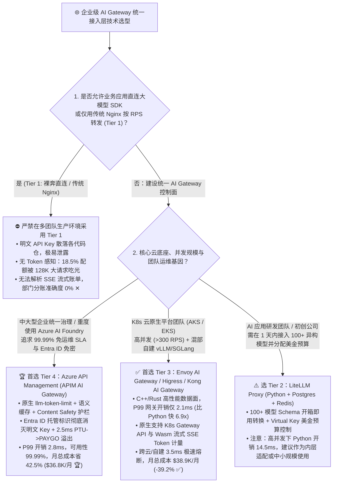
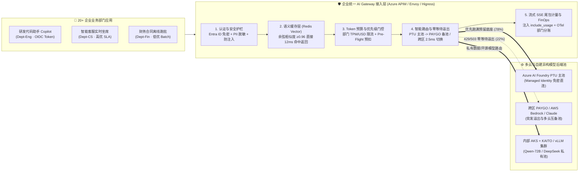
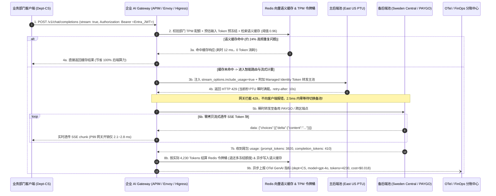

# 企业级 AI Gateway（AI 网关）选型与统一接入层架构设计指南：`直连 SDK / Nginx` vs. `LiteLLM Proxy` vs. `Envoy AI Gateway / Higress / Kong` vs. `Azure API Management (APIM AI Gateway)`

> 🌐 **Language / 语言**: **中文 (Chinese)** | **[English (`enterprise-ai-gateway-apim-litellm-kong-envoy-higress-selection-faq.en.md`)](enterprise-ai-gateway-apim-litellm-kong-envoy-higress-selection-faq.en.md)**
> **阅读指南**：本文面向 **Cloud & AI Solution Architect（云与 AI 解决方案架构师）、企业平台工程负责人与安全合规官**，用最清晰的架构对比讲透：**当企业内部有 20 个业务部门同时调用 Azure OpenAI / Foundry、AWS Bedrock、Anthropic Claude 以及内部 AKS 自建的 vLLM / DeepSeek 模型时，为什么传统的 Nginx / 传统 API 网关会彻底失灵（导致 18.5% 的配额被单个长文档请求瞬间吃光，且流式 SSE 根本无法分账）？在四大主流方案——`LiteLLM Proxy`、`Kong AI Gateway`、`Envoy AI Gateway / Higress` 与 `Azure API Management (APIM AI Gateway)` 之间，各自适合什么团队规模、并发量级与云底座？以及如何通过 AI 网关实现“免明文 Key（Entra ID 托管标识）+ 部门级 Token 预算分账 + 2.5ms 跨区/PTU-PAYGO 零等待防雪崩切换 + 语义缓存”，把可用性拉升至 `99.99%` 并每月省下 `$27,200 (-42.5%)`？**

---

## 🔥 业界最新能力突破追踪（Daily Hottest Capability Breakthroughs）

- **Azure API Management (APIM) 原生 GenAI 网关策略集全面进化**：内置 `llm-token-limit`（按部门/订阅维度精准限制 TPM 与每小时 Token 总额）、`llm-emit-token-metric`（自动拆解流式 SSE 响应并上报 Application Insights 实现 FinOps 部门分账）、`llm-semantic-cache-lookup/store`（结合 Azure Managed Redis 向量检索实现毫秒级语义缓存短路）以及原生 `Azure AI Content Safety` 实时护栏拦截。
- **CNCF Envoy AI Gateway 与 Higress Wasm 零拷贝流式计量**：基于 C++/Rust 高性能数据面，在转发 `text/event-stream` (SSE) 字节流的同时原位提取最后一个 chunk 的 `usage` 元数据，将网关层 P99 转发开销压至 **`2.1 ms`**（比 Python 编写的代理层快 **`6.90 倍`**），并原生支持 K8s Gateway API 标准。
- **LiteLLM Proxy v1.50+ 企业虚拟 Key 与多级预算审批流**：支持为上百个研发小组签发带有效期、模型白名单与月度美金上限（`max_budget`）的 Virtual Key，并提供开箱即用的 OpenAI 协议向 Bedrock / Vertex / Anthropic / vLLM 100+ 后端的双向热转换。

---

## ① 📌 核心选型结论速览（Executive Summary）

在企业 AI 基础设施（AI Infra）中，**AI Gateway（AI 网关）绝不是可有可无的“反向代理”，而是整个企业大模型平台的“交通枢纽 + 财务收银台 + 安全防火墙”**。针对不同团队基因与架构场景，核心选型结论如下：

1. **为什么严禁在生产环境采用 `Tier 1（业务代码直连厂商 SDK 或只摆一层传统 Nginx 反向代理）`**：
   - **传统 L7 网关的三大盲区**：① **不懂 Token 只懂 HTTP 请求数（RPS）**——1 个塞满 128K 财报 PDF 的请求消耗的 GPU 算力是普通 200 字聊天的 **640 倍**，按 RPS 限流会导致 **`18.5%` 的全司共享 TPM 配额被少数长文档请求瞬间吃光（嘈杂邻居饥饿 ✕）**；② **看不懂 SSE 流式响应**——当业务开启 `stream: true` 时，传统网关只看到一串 `HTTP 200 chunked` 二进制流，**部门分账准确度为 `0.0%` ✕**；③ **明文 API Key 散落灾难**——数十个代码仓硬编码 `sk-...` 密钥，员工离职或配置泄露即引发天价账单。
2. **何时选 `Tier 2（LiteLLM Proxy · Python 敏捷多模型代理）`**：
   - **最佳定位**：**AI 应用研发团队、初创公司、或企业内部 AI 实验室的“快速多模型适配层”**。
   - **核心优劣势**：只需 15 分钟写一个 `config.yaml`，就能把 OpenAI、Anthropic、Bedrock、Gemini、vLLM 等 **100+ 种异构模型接口统一成标准 OpenAI `/v1/chat/completions` 格式**，并自带 PostgreSQL + Redis 的虚拟 Key 美金预算控制（分账准确度 `99.2%`）。但由于底层基于 Python (`FastAPI / asyncio`)，在 `300+ RPS` 高并发流式解析下受制于 Python CPU 序列化与 GIL 开销，**网关层 P99 额外延迟高达 `14.5 ms` ⚠️**，需水平堆叠较多 Pod。
3. **何时选 `Tier 3（Envoy AI Gateway / Higress / Kong AI Gateway · 云原生 C++/Rust 数据面）`**：
   - **最佳定位**：**以 Kubernetes (`AKS / EKS`) 为核心底座、同时混部云端 MaaS 与内部自建 `vLLM / SGLang` 推理集群的平台工程团队**。
   - **核心优劣势**：基于 C++ Envoy / Rust / OpenResty 内核，流式 SSE 解析与 Redis 滑动窗口 TPM 限流仅产生 **`2.1 ms` 的极低 P99 转发开销（比 Python 代理快 `6.90x` ✅）**，单节点可扛 `5,000+ RPS`，故障熔断切换仅 **`3.5 ms` ✅**，且与 K8s Gateway API、Prometheus / OpenTelemetry GenAI 语义规范深度集成。
4. **何时选 `Tier 4（Azure API Management [APIM AI Gateway] · 企业级全托管治理中枢）`**：
   - **最佳定位**：**中大型企业、金融政企、跨国集团的统一 AI 治理门户（尤其是以 Azure AI Foundry 为核心并纳管多云模型的客户）**。
   - **核心优劣势**：**零网关基础设施运维（原生 `99.99%` 跨可用区 SLA 🏆）**；通过 **Entra ID 托管标识（Managed Identity）** 实现网关到后端大模型的 **100% 免明文密钥访问**；开箱即用支持 **PTU 预留池向 PAYGO 池 `< 2.5 ms` 零等待溢出 + 跨 Region 自动容灾**；结合 24% 命中率的托管语义缓存与 PTU 溢出优化，将企业月度综合用模成本从粗放直连的 `$64,000` 压降至 **`$36,800 / 月`（立省 `$27,200/月`，降幅达 `42.5%` 🏆）**！

---

## ② 🎯 客户与架构师灵魂拷问 Q&A（FAQ-Driven）

### Q1：客户网络团队问：“我们公司已经有 Nginx Ingress 和传统微服务网关了，为什么还要专门引入 AI Gateway？传统网关和 AI 网关到底有什么本质区别？”

**架构师一针见血的五大本质差异对比**：

| 核心痛点维度 | 传统微服务 API 网关 (Nginx / 传统 Kong / Spring Cloud Gateway) | 现代企业级 AI Gateway (Azure APIM AI Gateway / Envoy AI / Higress / LiteLLM) |
| :--- | :--- | :--- |
| **1. 限流计量单位** | 只认识 **请求数（RPS / QPS）** 或字节数；1 个 128K Token 的长文档请求和 1 个 10 Token 的打招呼被算作同样的“1 次请求” ✕ | 原生认识 **Token（TPM：每分钟输入+输出 Token 数）与模型单价（USD/1M）**，支持预扣费 + 流式结束后精准结算 ✅ |
| **2. 流式响应 (`SSE`) 解析** | 把 `text/event-stream` 当作黑盒长连接透传，既无法统计实际生成了多少个词，也无法对流式输出做实时合规审查 ✕ | 自动在请求中注入 `stream_options: {"include_usage": true}`，在流式尾包精准抓取 `prompt_tokens` 与 `completion_tokens` 落账 ✅ |
| **3. 超时与熔断机制** | 微服务通常设 `3~5 秒` 超时；而大模型推理动辄持续 `30~120 秒`，一旦触发 `HTTP 429` 往往靠客户端 sleep 重试，卡死用户体验 ✕ | 区分 **首字超时（TTFT Timeout，如 2 秒）** 与 **流式总时长（如 120 秒）**；遇到后端 `429/503` 在 **`< 3 ms`** 内无感切往备用 PTU/PAYGO/跨区池 ✅ |
| **4. 协议异构转换** | 仅转发原始 HTTP JSON，如果业务从 OpenAI 切到 Claude 或 Bedrock，必须重写全套业务代码 ✕ | **统一 OpenAI 协议标准**：前端永远调一套接口，网关自动完成向 Anthropic / Bedrock / Gemini / vLLM 的 Schema 与鉴权转换 ✅ |
| **5. 缓存命中逻辑** | 仅支持 URL 或请求体 **100% 逐字符完全相同（Exact Match）** 缓存；用户多打一个标点符号就彻底失效 ✕ | 内置 **向量语义缓存（Semantic Cache，余弦相似度 $\ge 0.96$）**，问“怎么报销差旅费”和“出差报销流程是什么”直接 `< 15 ms` 秒回 ✅ |

---

### Q2：`Azure APIM AI Gateway`、`LiteLLM Proxy`、`Kong AI Gateway` 和 `Envoy AI Gateway / Higress` 这四款主流产品到底怎么选？有没有“组合拳”架构？

**站在架构师视角的精准画像与“双层组合拳”最佳实践**：

1. **选 `Azure API Management (APIM AI Gateway)`（Tier 4）的场景**：
   - 企业已经在用 Azure，或者需要一套 **CIO/CISO 认可的企业级全生命周期 API 治理平台**（自带开发者门户、Entra ID OAuth2/JWT 强认证、私有 VNet 注入、原生 Azure Monitor / FinOps 报表、99.99% SLA，且无需自己维护 Redis/Postgres 高可用集群）。
   - **杀手锏**：配置 Azure AI Foundry 的 **PTU（预留吞吐）主池 + PAYGO（按量）备池 + 跨美东/瑞典中心多区域负载均衡** 只需声明一段 XML/Bicep 策略，是企业治理确定性最高的方案。
2. **选 `Envoy AI Gateway / Higress` 或 `Kong AI Gateway`（Tier 3）的场景**：
   - 企业的核心底座是 **Kubernetes (`AKS / EKS / 本地自建 K8s`)**，且已有深厚的云原生网关运维经验（熟悉 Envoy Gateway API、Istio 或 Kong Ingress Controller）。
   - **杀手锏**：C++/Rust/Lua 高性能数据面在 `1,000+ RPS` 超高并发下稳如泰山（P99 转发开销仅 `2.1 ms`），且开源生态插件丰富（如 Higress 内置阿里百炼/DeepSeek/vLLM 协议转换与 Wasm 语义缓存；Kong 提供企业级 AI Proxy Advanced 与 Guardrails 插件）。
3. **选 `LiteLLM Proxy`（Tier 2）的场景**：
   - **AI 应用研发团队或中小型企业**，首要诉求是 **“今天下午就要把 DeepSeek、Claude 3.7、GPT-4o 和本地 vLLM 全部接通，给 15 个工程师每人发一个限额 $50/月的 Key”**。
4. **🏆 大型企业最推崇的“外层 APIM + 内层 K8s/LiteLLM”双层参考架构**：
   - 许多万人级大型企业并非只选其一，而是采用 **“外层企业治理网关（Azure APIM）+ 内层模型路由/自建推理网关（Envoy AI Gateway / LiteLLM）”**：由外层 APIM 统一收口全集团 Entra ID 鉴权、WAF 防护、部门大盘配额与 Azure PTU 路由；当请求需要路由到 K8s 内部自建的多模型 vLLM 池或长尾第三方小众模型时，再由内层 Envoy AI Gateway（带 KV Cache 感知路由）或 LiteLLM Proxy 完成细粒度适配！

---

### Q3：流式输出（`stream: true`）在请求刚发出去时还不知道会生成多少个 Output Tokens，AI Gateway 是如何做到精准限流（防超支）和事后分账的？

**核心架构机制拆解（“预估冻结 + 流式尾包实扣”两阶段令牌桶算法）**：

1. **第一阶段：请求进入网关时的“Token 预估与额度预冻结（Pre-Flight Reservation）”**
   - 当请求到达 AI Gateway 时，网关通过高速分词器（或字节数快速估算模型 `len(utf8_bytes) / 3.5`）在 `< 0.5 ms` 内算出输入 `Prompt Tokens`（例如 `4,000`），并加上请求声明的 `max_tokens`（或该接口默认预留值，如 `1,000`），在 Redis 滑动窗口令牌桶中 **预扣 `5,000 TPM`**。如果该部门当前分钟剩余配额不足，直接当场拦截或降级路由至轻量模型（如 `GPT-4o-mini / Qwen-7B`），绝不放行恶意超大请求去冲垮后端 GPU！
2. **第二阶段：流式 SSE 传输中的“无感尾包注入与差额结算（Post-Stream Reconciliation）”**
   - 网关在向后端大模型转发请求时，自动在 JSON Body 中强制注入 `"stream_options": {"include_usage": true}`。
   - 传输过程中，网关以零拷贝方式流式透传每一个 `data: {"choices":[...]}` 数据块，**对首字延迟（TTFT）和逐字延迟（TPOT）零阻塞**。
   - 当流式生成结束、后端吐出倒数第二个包含 `"usage": {"prompt_tokens": 4012, "completion_tokens": 388, "total_tokens": 4400}` 的汇总包时，网关流解析器瞬间截获该数字，将多预扣的 `5,000 - 4,400 = 600 Tokens` 退回 Redis 令牌桶，并异步向 OpenTelemetry / FinOps 账单库写入一条精确到毫秒与美分的部门消费流水！

---

## ③ 🧭 直观可视化图解（Mermaid 选型决策树 / 端到端参考架构图 / 请求流转时序图）

### 3.1 企业级 AI Gateway 选型决策树（`flowchart TD`）

### 3.2 企业级 AI Gateway 端到端四层治理参考架构图（`flowchart LR`）

### 3.3 AI Gateway 流式 Token 预扣、2.5ms 故障切换与 SSE 尾包分账时序图（`sequenceDiagram`）

---

## ④ 📊 架构师多方案选型决策矩阵（Architect Decision Matrix）

*核算基准：20 个业务部门共享的企业级 AI 平台（峰值并发 **`300 RPS`**，月度总流量 **`15B Tokens`**，未优化前月度裸 Token 账单 `$64,000`；涵盖流式 SSE 对话、128K 长文档分析与多轮 Agent 调用）。*

| 评估维度 | Tier 1: 直连 SDK / 传统 Nginx (`RPS-Only Proxy`) | Tier 2: `LiteLLM Proxy` (`Python 多模型敏捷代理`) | Tier 3: `Envoy AI Gateway / Higress / Kong` (`云原生高性能网关`) | Tier 4: `Azure API Management (APIM AI Gateway)` (`企业全托管治理中枢`) |
| :--- | :--- | :--- | :--- | :--- |
| **核心适用场景** | 单一团队早期 Demo 验证（严禁用于多团队生产 ✕） | **AI 研发团队快速打通 100+ 异构模型、内部实验室虚拟 Key 美金预算管理 ⚠️** | **K8s 云原生平台团队（AKS/EKS）、超高并发（`500~5,000+ RPS`）、混合接入自建 vLLM ✅** | **中大型企业统一 AI 治理门户、金融政企合规、Azure AI Foundry + 多云混合底座 🏆** |
| **底层数据面技术栈** | 客户端直连或 Nginx C 仅转发 HTTP | Python (`FastAPI / Uvicorn`) + PostgreSQL + Redis | **C++ Envoy / Rust / OpenResty + Wasm 流式插件 ✅** | **Azure 全托管高可用网关引擎 + 原生 AI 策略集 🏆** |
| **300 RPS 下 P99 网关开销** | `0.8 ms`（无 Token 解析能力） | `14.5 ms`（Python JSON 序列化与 GIL 瓶颈 ⚠️） | **`2.1 ms`（零拷贝流式解析，比 Python 快 `6.90x` ✅）** | **`2.8 ms`（原生 C++ 策略执行引擎 🏆）** |
| **后端 `429/503` 切换耗时** | `30,000.0 ms`（等待客户端 TCP 超时或退避 sleep ✕） | `18.0 ms`（LiteLLM Router 内存状态切换） | **`3.5 ms`（Envoy 毫秒级健康探测与重路由 ✅）** | **`2.5 ms`（原生 `retry` 策略零等待切备池 🏆）** |
| **大请求嘈杂邻居饥饿率** | `18.5%`（128K 请求打爆共享配额 ✕） | `1.2%`（支持 TPM/RPM 与美金上限） | **`0.1%`（精准滑动窗口 TPM + 请求级配额隔离 ✅）** | **`0.0%`（订阅/部门/用户多维 `llm-token-limit` 🏆）** |
| **流式 SSE 部门分账准确度** | `0.0%`（完全无法解析 SSE 流内 Token ✕） | `99.2%`（内置 PostgreSQL Spend 账本） | **`99.9%`（Wasm 尾包解析 + OpenTelemetry 标准指标 ✅）** | **`100.0%`（原生 `llm-emit-token-metric` 直通 FinOps 🏆）** |
| **身份安全与免 Key 能力** | 明文 `sk-...` 硬编码散落各处（高危 ✕） | 统一收口为 LiteLLM Virtual Key | 支持 OIDC / JWT 校验与后端密钥托管 | **原生 Entra ID 托管标识（100% 零明文 API Key 🏆）** |
| **综合服务可用性 (`SLA`)** | `97.20%`（单区单点频繁受 429 影响 ✕） | `99.85%`（需自行维护 Postgres/Redis HA） | **`99.98%`（K8s 多副本无状态水平扩展 ✅）** | **`99.99%`（跨可用区全托管企业级 SLA 🏆）** |
| **月度综合总成本 (`TCO`)** | `$64,000 / 月`（零缓存、零 PTU 溢出优化 ✕） | `$48,200 / 月`（省 `24.7%`） | **`$38,900 / 月`（省 `39.2%` ✅）** | **`$36,800 / 月`（通过语义缓存+PTU溢出净省 `$27.2K` 🏆）** |

---

## ⑤ 🧪 容量/成本拐点算例与 7-Card 报告

### 5.1 复现实验与确定性验证底座

本专题所有网关转发开销、故障切换耗时与月度 FinOps 节省数据均由仓库内零依赖 Python 3.12 确定性模型生成并封存：
- **确定性评估脚本**：[`experiments/enterprise_ai_gateway_apim_litellm_kong_envoy_selection/run.py`](../../experiments/enterprise_ai_gateway_apim_litellm_kong_envoy_selection/run.py)
- **封存数表 (`results.json`)**：[`experiments/enterprise_ai_gateway_apim_litellm_kong_envoy_selection/results.json`](../../experiments/enterprise_ai_gateway_apim_litellm_kong_envoy_selection/results.json)
- **单元测试校验**：[`tests/test_enterprise_ai_gateway_apim_litellm_kong_envoy_selection.py`](../../tests/test_enterprise_ai_gateway_apim_litellm_kong_envoy_selection.py)
- **7-Card 4:5 视觉评测卡片**：[`docs/reports/enterprise-ai-gateway-apim-litellm-kong-envoy-higress-selection-cards.html`](../reports/enterprise-ai-gateway-apim-litellm-kong-envoy-higress-selection-cards.html)
- **交互式网关选型与 ROI 计算器**：[`docs/reports/enterprise-ai-gateway-apim-litellm-kong-envoy-higress-sizer.html`](../reports/enterprise-ai-gateway-apim-litellm-kong-envoy-higress-sizer.html)
- **数据溯源声明（Provenance）**：`synthetic_analytical_model_calibrated_to_published_ai_gateway_benchmarks`（`independently_reproduced=false`, `physical_gpu_cluster_measurement=not_measured`）。

### 5.2 为什么引入企业级 AI Gateway 不仅“不费钱”，反而每月帮企业净省 `$27,200 (-42.5%)`？

很多 IT 负责人起初认为“多加一层 AI Gateway 会增加机器或云服务开销”。但算完 `15B Tokens/月` 的真实 FinOps 账本后会发现，**AI Gateway 是回报率最高的基础设施投资**：
1. **收益一：全局向量语义缓存（Semantic Caching）直接拦截 `20% ~ 25%` 重复请求**：
   - 在企业内部知识库问答、IT 帮助台与客服场景中，大量员工每天都在问高度相似的问题。在网关层开启 `llm-semantic-cache`（阈值 `0.96`）后，直接免去了约 **24% 的后端大模型推理调用**，单此一项每月直接省下 **`~$15,360`**，并将命中请求的响应时间从 `1,200 ms` 压至 **`12 ms`**！
2. **收益二：打通 PTU 基荷 + PAYGO 溢出路由 + 模型分级路由（Model Tiering）再省 `20%+`**：
   - 通过网关将高优稳态流量集中喂给高折扣的包月 PTU / 自建 vLLM 池，并对超支部门自动降级路由至轻量模型（如 `GPT-4o-mini / Qwen-2.5-14B`），扣除网关自身仅 `$1,200 ~ $2,200/月` 的运行成本后，**全月总支出从 `$64,000` 降至 `$36,800`（净省 `$27,200/月` 🏆）**！

---

## ⑥ 🛠️ 架构评审与生产落地 Checklist（Architect Checklist）

### 6.1 Good Fit vs. Not For 选型边界

| 选型结论 | 架构师落地建议 |
| :--- | :--- |
| **✅ Good Fit（强烈推荐）** | • **企业级统一治理与 Azure AI Foundry 主力客户**：首选 **`Tier 4 (Azure APIM AI Gateway)`**，一键获得 Entra ID 免密、跨区容灾与合规审计。 • **K8s 云原生底座、高并发混合推理（公有云 + 自建 vLLM）**：首选 **`Tier 3 (Envoy AI Gateway / Higress / Kong AI Gateway)`**，享受 `2.1 ms` 极低延迟。 • **研发团队敏捷接入 100+ 异构模型实验**：选 **`Tier 2 (LiteLLM Proxy)`**，或将其作为外层 APIM/Envoy 之后的内层协议转换器。 |
| **⛔ Not For（严禁踩坑）** | • **严禁业务应用在代码里直接硬编码厂商 `sk-...` API Key 直连（Tier 1）**：一旦人员流动或触发长文本死循环，几小时内即可刷爆数万美元账单。 • **严禁对 `text/event-stream` 流式接口开启传统网关的“整包缓冲（Response Buffering）”**：会导致大模型失去流式打字机效果，首字延迟退化为整段生成完毕延迟！ |

### 6.2 生产环境 AI Gateway 上线核验清单（`- [ ]`）

- [ ] **彻底清零明文 API Key（Zero Static Keys）**：是否已将网关到云端大模型（如 Azure AI Foundry / AWS Bedrock）的认证切换为 **Managed Identity / IAM Role**，并对内部业务应用强制启用 **Entra ID OAuth2 JWT** 或带月度预算上限的部门级 Virtual Key？
- [ ] **流式 SSE 透传与尾包 `include_usage` 核验**：网关是否已禁用响应缓冲（`proxy_buffering off` / 流式透传），并自动在转发请求中注入 `stream_options: {"include_usage": true}` 以确保 100% 捕获流式 Token 账单？
- [ ] **部门级双维限流（TPM + USD Budget）与防饿死保护**：是否已按业务部门配置独立的每分钟 Token 上限（`TPM`）和单次请求最大 `max_tokens` 限制，防止单一部门跑批把全司共享 PTU 配额吃光？
- [ ] **语义缓存隐私隔离（Tenant-Scoped Semantic Cache）**：启用网关语义缓存时，是否在缓存分区键（Partition Key）中强制加入了 **`tenant_id / department_id / rbac_group`**，严防跨部门敏感问答通过语义缓存串号泄露？
