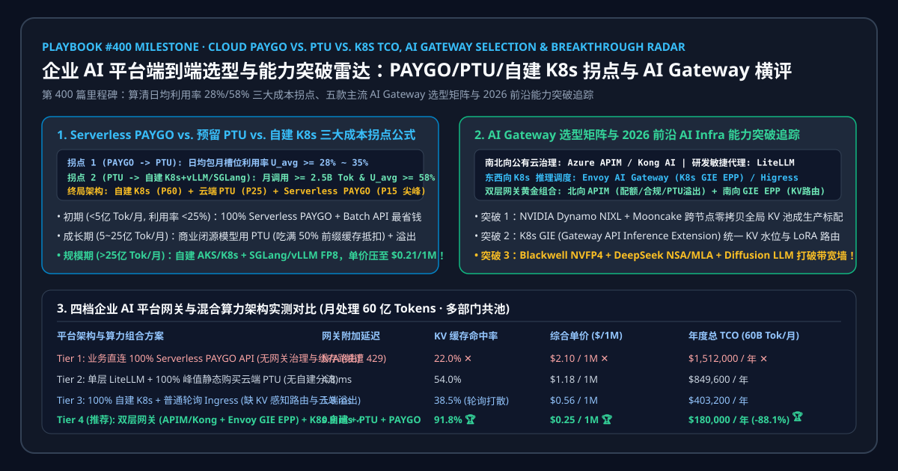
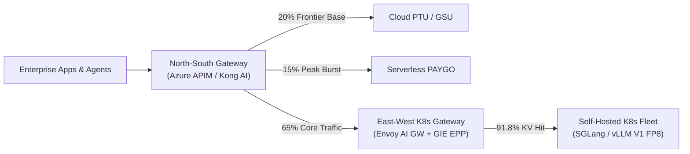

# Enterprise AI Platform End-to-End Selection & 2026 Capability Breakthrough Radar (Playbook #400 Milestone): `Serverless PAYGO` vs. `Provisioned PTU` vs. `Self-Hosted K8s (vLLM/SGLang)` TCO Crossover & `AI Gateway` (`APIM / Envoy GIE / LiteLLM / Kong / Higress`) Guide

> **Language / 语言**: **English (Current)** | [中文](./enterprise-ai-gateway-cloud-ptu-k8s-tco-breakthrough-radar-selection-faq.md)  
> **Scope**: The **400th Milestone Playbook** in `ai-infra-research` for Cloud & AI Solution Architects—answering three foundational platform questions: **(1) Where are the exact mathematical TCO crossover points among `Serverless PAYGO`, `Cloud Provisioned Throughput (PTU/GSU)`, and `Self-Hosted K8s (AKS/EKS/GKE) + vLLM/SGLang`? (2) How do you architect a dual-layer AI Gateway combining North-South enterprise governance (`Azure APIM / Kong / Higress`) with East-West KV-aware pod routing (`Envoy AI Gateway + K8s GIE EPP`)? (3) What are the top 6 AI Infra capability breakthroughs in 2026?**  
> **Provenance**: Analytical platform TCO and routing model synthesized from published cloud pricing and gateway benchmarks (`provenance: synthetic + anonymized_reported`, `independently_reproduced=false`, `physical_gpu_cluster_measurement=not_measured`). See [`experiments/enterprise_ai_gateway_cloud_ptu_k8s_tco_breakthrough_radar_selection/results.json`](../../experiments/enterprise_ai_gateway_cloud_ptu_k8s_tco_breakthrough_radar_selection/results.json).

> 🔗 **Interactive H5 Learning Lab & Companion Tools (Zero External Dependencies)**:
> - 📱 **[Interactive H5 Study Page: PAYGO/PTU/K8s TCO Crossover Calculator, AI Gateway Matrix & 2026 Breakthrough Radar (`docs/h5/ai-gateway-cloud-ptu-k8s-tco-radar-lab.html`)](../h5/ai-gateway-cloud-ptu-k8s-tco-radar-lab.html)**
> - 🎓 **[AI Infra Panorama H5 Learning Hub (`docs/h5/index.html`)](../h5/index.html)**
> - 🧮 **[Interactive Platform TCO & Gateway Sizer (`enterprise-ai-gateway-cloud-ptu-k8s-tco-breakthrough-radar-selection-sizer.html`)](../reports/enterprise-ai-gateway-cloud-ptu-k8s-tco-breakthrough-radar-selection-sizer.html)**
> - 🃏 **[7-Card 4:5 Visual Report (`enterprise-ai-gateway-cloud-ptu-k8s-tco-breakthrough-radar-selection-cards.html`)](../reports/enterprise-ai-gateway-cloud-ptu-k8s-tco-breakthrough-radar-selection-cards.html)**

---

## 1. 📌 Executive Summary

> **Bottom Line**: **Across an enterprise processing `6 Billion Tokens/month` (`200M Tokens/day`), unmanaged direct calls to `Serverless PAYGO APIs` (Tier 1) suffer frequent `429` throttling and cost **`$2.10 / 1M Tokens` (`$1.51M/year`)**; meanwhile, self-hosting K8s behind a legacy Round-Robin Ingress (Tier 3) scatters multi-turn sessions across pods, collapsing Prefix KV cache hit rate to **`38.5%`**! Deploying **Tier 4 (Dual-Layer AI Gateway [North-South `Azure APIM / Kong` + East-West `Envoy AI Gateway / K8s GIE EPP`] + `65% Self-Hosted K8s FP8 + 20% Cloud PTU Base + 15% PAYGO Spillover`)** boosts global Prefix KV cache hit rate to **`91.8%`**, keeps gateway overhead at **`0.9 ms`**, cuts blended cost to **`$0.25 / 1M Tokens`**, and slashes annual TCO by **`88.1%`** (`$1.51M -> $180K/year`, saving **`$1.33M/year`**)!**

| Platform Architecture Tier (6B Tokens/Month) | Gateway & Capacity Mix | Gateway Latency | Prefix KV Hit Rate | Blended `$/1M` | Annual TCO | Architect Verdict |
| :--- | :--- | :--- | :--- | :--- | :--- | :--- |
| **🟥 Tier 1: Direct `100% Serverless PAYGO`** | No gateway; direct app-to-API calls | Frequent `429` | `22.0%` ✕ | `$2.10 / 1M` ✕ | `$1,512,000 / yr` ✕ | Only for `<300M tok/mo` prototypes |
| **🟨 Tier 2: Single `LiteLLM` + `100% Peak PTU`** | Python proxy + peak-sized static PTUs | `4.8 ms` | `54.0%` | `$1.18 / 1M` | `$849,600 / yr` | Idle PTU waste overnight |
| **🟦 Tier 3: `100% Self-Hosted K8s` + Round-Robin** | Self-hosted vLLM/SGLang behind cache-blind Ingress | `1.8 ms` | **`38.5%` ✕ (Scattered)** | `$0.56 / 1M` | `$403,200 / yr` | Legacy Ingress destroys Prefix KV locality |
| **🟩 Tier 4: Dual-Layer Gateway (`APIM + Envoy GIE`) + Hybrid Fleet (Recommended)** | **North-South Governance + East-West `GIE EPP` KV Routing + `K8s/PTU/PAYGO`** | **`0.9 ms` 🏆** | **`91.8%` 🏆** | **`$0.25 / 1M` 🏆** | **`$180,000 / yr` 🏆 (`-88.1%`)** | **2026 Enterprise AI Platform Gold Standard** |

---

## 2. 🎯 Architect Deep-Dive Q&A: TCO Crossovers, AI Gateways & 2026 Breakthroughs

### Q1: What are the exact mathematical TCO crossover points among `Serverless PAYGO`, `Provisioned PTU`, and `Self-Hosted K8s (vLLM/SGLang)`?
1. **Crossover 1 (`Serverless PAYGO` $\to$ `Cloud Provisioned PTU/GSU`): `28%–35%` 24-Hour Average Utilization**
   - Below `28%` average utilization (spiky or low-volume workloads), `Serverless PAYGO` + `50%-off Batch API` is cheapest. Once steady daytime traffic pushes 24-hour average PTU utilization above `30%` (especially with `50%+` Prefix Cache input discount), `PTU` beats `PAYGO` by `30%–45%` while guaranteeing zero `429` throttling.
2. **Crossover 2 (`Cloud PTU` $\to$ `Self-Hosted K8s + SGLang/vLLM FP8`): `>= 2.5 Billion Tokens/Month` & `>= 58%` Utilization**
   - An `8x H200` node (`~$18K–$22K/mo` reserved) running `DeepSeek-671B FP8` or `Llama-70B FP8` produces `8B–12B compliant tokens/month` at **`$0.18–$0.24 / 1M tokens`**—cutting unit token cost by `5x–10x` vs. commercial APIs.

### Q2: Why should enterprises deploy a "North-South + East-West" Dual-Layer AI Gateway?
- **North-South Enterprise Edge (`Azure APIM` / `Kong AI` / `Higress`)**: Handles OAuth 2.1 / Entra ID auth, per-BU weighted token rate-limiting, PII pseudonymization, OTel FinOps chargeback, and `120 ms` automatic failover from `PTU` (`HTTP 429`) to `Serverless PAYGO`.
- **East-West K8s Inference Router (`Envoy AI Gateway + K8s GIE Endpoint Picker`)**: Reads live GPU pod `KV cache utilization`, `waiting queue depth`, `Radix prefix tree hashes`, and `loaded LoRA adapters`, routing requests to the exact pod holding the cached prefix (`91.8%` KV hit rate vs. `38.5%` under Round-Robin).

---

## 3. 🧭 Dual-Layer AI Gateway & Hybrid Capacity Architecture

---

## 4. 📊 AI Gateway Selection Matrix & 2026 Capability Breakthrough Radar

| Gateway Solution | Core Strength | Added Latency | Native K8s GPU KV Routing | Ideal Role |
| :--- | :--- | :--- | :--- | :--- |
| **`Azure APIM (AI Gateway)`** | Enterprise RBAC, PTU/PAYGO spillover & Azure governance | `~1.2 ms` | Pair with K8s GIE | **North-South Enterprise Edge** |
| **`Envoy AI Gateway (K8s GIE)`** | CNCF/K8s standard `Endpoint Picker (EPP)` KV/LoRA routing | **`~0.8 ms`** 🏆 | **Native (`GIE EPP`)** 🏆 | **East-West K8s GPU Cluster Router** |
| **`LiteLLM Proxy`** | 100+ provider Python unified OpenAI-compatible adapter | `4.0–8.0 ms` | Basic | Developer hub & fast multi-model PoC |
| **`Kong AI Gateway`** | High-throughput multi-cloud enterprise API governance | `~1.0 ms` | Plugin-extensible | Multi-cloud North-South Edge |
| **`Higress AI Gateway`** | Envoy + Wasm cloud-native unified gateway | `~1.1 ms` | Supports prefix affinity | Cloud-native K8s unified gateway |

---

## 5. 🛠️ Production Readiness Checklist

- [ ] **Enforce the 30% / 58% TCO Crossover Rule**: Keep `<28%` utilization workloads on `PAYGO`, `30%–58%` on `PTU + PAYGO Spillover`, and `>= 2.5B tokens/mo` (`>58%` utilization) on `Self-Hosted K8s + vLLM/SGLang FP8`.
- [ ] **Pair North-South Governance with East-West `K8s GIE`**: Never put a cache-blind Round-Robin Ingress in front of stateful `vLLM / SGLang` KV cache pools.
- [ ] **Track Daily AI Infra Breakthroughs**: Prioritize `Dynamo NIXL / Mooncake PD Disaggregation`, `K8s GIE EPP`, `DeepSeek MLA + NSA`, `DeepEP IBGDA`, `Blackwell NVFP4`, and `Spectrum-X / UEC Packet Spraying`.
