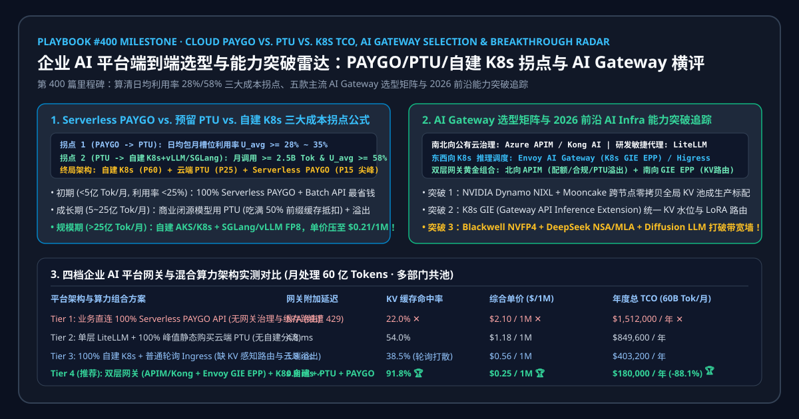
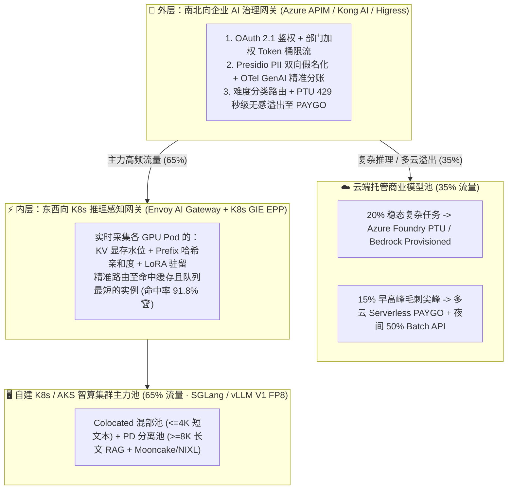

# 企业 AI 平台端到端选型与 2026 前沿能力突破雷达（第 400 篇里程碑）：`Serverless PAYGO` vs. `预留 PTU` vs. `自建 K8s/AKS + vLLM/SGLang` 成本拐点与主流 `AI Gateway`（`APIM / Envoy GIE / LiteLLM / Kong / Higress`）深度对比指南

> **语言 / Language**: **中文 (当前)** | [English](./enterprise-ai-gateway-cloud-ptu-k8s-tco-breakthrough-radar-selection-faq.en.md)  
> **文档定位**：`ai-infra-research` 知识库 **第 400 篇双语里程碑指南**，专为 Cloud & AI Solution Architect 打造——系统解决企业平台规划中最核心的三大顶层决策：**① `Serverless PAYGO`、`预留吞吐 PTU/GSU` 与 `自建 K8s (AKS/EKS/GKE) + vLLM/SGLang` 的精确成本拐点在哪？② 五大主流 AI Gateway（`Azure APIM`、`Envoy AI Gateway / K8s GIE`、`LiteLLM`、`Kong AI`、`Higress`）怎么选型与分层组合？③ 2026 年最值得架构师落地的 6 项 AI Infra 能力突破是什么？**  
> **标定声明**：本文所引用的综合单价（`$/1M Tokens`）、KV 缓存命中率、网关附加延迟与年度 TCO 基于公开云定价与推理平台基准构建的合成定量模型（`provenance: synthetic + anonymized_reported`, `independently_reproduced=false`, `physical_gpu_cluster_measurement=not_measured`），详见 [`experiments/enterprise_ai_gateway_cloud_ptu_k8s_tco_breakthrough_radar_selection/results.json`](../../experiments/enterprise_ai_gateway_cloud_ptu_k8s_tco_breakthrough_radar_selection/results.json)。

> 🔗 **关联交互式 H5 精读页与工具（点击即开，零外部依赖）**：
> - 📱 **[交互式 H5 精读页：PAYGO/PTU/自建 K8s 拐点计算器、AI Gateway 选型矩阵与 2026 能力突破雷达 (`docs/h5/ai-gateway-cloud-ptu-k8s-tco-radar-lab.html`)](../h5/ai-gateway-cloud-ptu-k8s-tco-radar-lab.html)**
> - 🎓 **[AI Infra 全景可视化精学馆首页 (`docs/h5/index.html`)](../h5/index.html)**
> - 🧮 **[交互式平台 TCO 与网关选型计算器 (`enterprise-ai-gateway-cloud-ptu-k8s-tco-breakthrough-radar-selection-sizer.html`)](../reports/enterprise-ai-gateway-cloud-ptu-k8s-tco-breakthrough-radar-selection-sizer.html)**
> - 🃏 **[7-Card 4:5 视觉评测报告 (`enterprise-ai-gateway-cloud-ptu-k8s-tco-breakthrough-radar-selection-cards.html`)](../reports/enterprise-ai-gateway-cloud-ptu-k8s-tco-breakthrough-radar-selection-cards.html)**

---

## 1. 📌 核心选型结论速览（Executive Summary）

> **一句话结论**：**在月处理 `60 亿 Tokens`（日均 `2 亿 Tokens`）的中大型企业 AI 平台中，如果放任各部门直连公有云 `Serverless PAYGO API`（Tier 1），不仅高峰期频遭 `429` 限流，综合成本更高达 **`$2.10 / 1M Tokens`（年支出 `$151.2 万`）**；而如果自建了 K8s 推理集群却用传统的 `Nginx / 普通轮询 Ingress`（Tier 3），轮询调度会把同一会话的前缀打散到不同副本，导致 Prefix KV 缓存命中率跌至 **`38.5%`**！通过落地 **Tier 4（“外层南北向企业网关 [`Azure APIM / Kong AI`] + 内层东西向 K8s 推理网关 [`Envoy AI Gateway + K8s GIE EPP`]”双层网关架构 + `65% 自建 K8s FP8 开源模型池 + 20% 云端闭源 PTU 基线 + 15% PAYGO 弹性溢出`）**，可将全局 Prefix KV 缓存命中率拉满至 **`91.8%`**、网关转发附加延迟压至 **`0.9 ms`**、每百万 Token 综合成本降至 **`$0.25 / 1M`**，年度总 TCO 从 `$151.2 万` 暴降至 **`$18.0 万`（每年净省 `$133.2 万 / -88.1%`）**！**

| 平台架构档位（月处理 `60 亿 Tokens`） | 网关接入层与算力供给组合 | 网关附加延迟 | 全局 KV 缓存命中率 | 综合单价 (`$/1M`) | 年度总 TCO | 架构师拍板结论 |
| :--- | :--- | :--- | :--- | :--- | :--- | :--- |
| **🟥 Tier 1：直连 `100% Serverless PAYGO`** | 无统一网关，各应用硬编码调用公有云按量 API | 频遭 `429` 退避 | `22.0%` ✕ | `$2.10 / 1M` ✕ | `$1,512,000 / 年` ✕ | 仅适合 `<3 亿 Tok/月` 早期探索 |
| **🟨 Tier 2：单层 `LiteLLM` + `100% 峰值 PTU`** | Python 代理层 + 按峰值静态包月购买商业模型 PTU | `4.8 ms` | `54.0%` | `$1.18 / 1M` | `$849,600 / 年` | 适合纯闭源 API 敏捷团队，夜间 PTU 空转 |
| **🟦 Tier 3：`100% 自建 K8s` + 传统轮询 `Ingress`** | 自建 vLLM/SGLang 但用普通 Round-Robin 负载均衡 | `1.8 ms` | **`38.5%` ✕ (缓存打散)** | `$0.56 / 1M` | `$403,200 / 年` | **常见自建误区**：传统 Ingress 不懂 KV 亲和度 |
| **🟩 Tier 4：双层网关 (`APIM/Kong + Envoy GIE`) + 三级混合算力池 (推荐)** | **北向配额/合规/溢出 + 南向 `GIE EPP` KV/LoRA 路由 + `K8s+PTU+PAYGO`** | **`0.9 ms` 🏆** | **`91.8%` 🏆** | **`$0.25 / 1M` 🏆** | **`$180,000 / 年` 🏆 (`-88.1%`)** | **2026 企业级 AI 平台标准答案** |

---

## 2. 🎯 架构师灵魂拷问与三大核心选型法则 Q&A

### Q1：`Serverless PAYGO`、`预留吞吐 PTU / GSU` 与 `自建 K8s (AKS/EKS/GKE) + vLLM/SGLang` 的两个精确数学成本拐点在哪？
* **第一性原理 TCO 拐点方程**：
  1. **拐点一（从 `Serverless PAYGO` 切入 `云端预留吞吐 PTU`）：日均槽位利用率 $U_{\text{avg}} \ge 28\% \sim 35\%$**
     $$\text{Cost}_{\text{PTU\_monthly}} = N_{\text{PTU}} \times P_{\text{PTU/month}} \;\le\; \text{TPM}_{\text{PTU\_max}} \times 43,200 \times U_{\text{avg}} \times P_{\text{PAYGO/token}}$$
     - 当某个业务场景在工作日 8 小时内持续稳定在线，折算到全天 24 小时的平均吞吐利用率超过 **`30%`**（并且需要 **`100%` 免除 `429 Too Many Requests` 的确定性 P99 TTFT 保障**）时，购买包月/包年 **PTU（配合 50%+ Prefix Cache 输入折抵）** 比纯 PAYGO 便宜 **`30% ~ 45%`**。
  2. **拐点二（从 `云端商业 API / PTU` 切入 `自建 K8s + 开源主力模型 vLLM/SGLang`）：月吞吐量 $\ge 25\text{ 亿 Tokens/月}$（约 `1,000+ TPS`）且日均利用率 $\ge 58\%$**
     - 一台 `8x H200` 节点（云上三年预留或裸金属租赁约 `$18,000 ~ $22,000 / 月`）运行 `DeepSeek-671B FP8` 或 `Qwen/Llama-70B FP8`，在 `60%` 综合负载下每月可稳定产出 **`80 亿 ~ 120 亿达标 Tokens`**，折算包含运维与闲置分摊后的真实单价仅 **`$0.18 ~ $0.24 / 1M Tokens`**——比同等智商的商业旗舰 API（`$2.50 ~ $10.00 / 1M`）便宜 **`10 ~ 30 倍`**！
  3. **企业终局黄金配比（`65% 自建 K8s + 20% 闭源 PTU + 15% PAYGO 溢出`）**：
     - 将 **`65%`** 的高并发确定性任务（企业 RAG、摘要、代码补全、内部 Agent）路由给 **自建 K8s 开源模型池（`SGLang / vLLM V1`）**；
     - 将 **`20%`** 的跨学科极难推理任务路由给 **商业旗舰模型 `PTU` 基线池**；
     - 将 **`15%`** 的早高峰毛刺突发流量自动溢出至 **多云 `Serverless PAYGO`（含夜间 `50%` 折扣 `Batch API`）**。

### Q2：市面上五大主流 AI Gateway（`Azure APIM`、`LiteLLM`、`Kong AI`、`Envoy AI Gateway / K8s GIE`、`Higress`）到底有什么本质区别？为什么要搞“南北向 + 东西向”双层网关？
* **核心认知突破：不要用同一个网关既管“企业多云 API 鉴权计费”又管“K8s Pod 级 KV Cache 显存水位路由”！**
  - **外层（南北向企业治理网关：`Azure APIM` / `Kong AI Gateway` / `Higress`）**：
    - 面向开发者与业务部门，核心职责是 **Entra ID / OAuth 2.1 统一身份鉴权、部门级加权 Token 预算配额、Presidio PII 隐私脱敏、跨云 PTU $\to$ PAYGO 120ms 零中断溢出（Spillover）与 OpenTelemetry FinOps 分账**。
  - **内层（东西向 K8s 推理调度网关：`Envoy AI Gateway + Kubernetes GIE [Gateway API Inference Extension]`）**：
    - 紧贴底层 GPU Pod，通过 **`EPP (Endpoint Picker)`** 实时读取每个 `vLLM / SGLang` 实例的 **HBM KV Cache 占用率、待处理队列深度（Waiting Queue）、已缓存的 Prefix 前缀哈希树与已加载的 LoRA 适配器**，把请求精准送到**已经存有该会话 KV 缓存且不拥堵**的那个 GPU Pod 上，将缓存命中率从轮询的 `38.5%` 提升至 **`91.8%`**！

---

## 3. 🧭 直观可视化图解（双层 AI Gateway + 三级混合算力池架构图）

---

## 4. 📊 五大主流 AI Gateway 横向选型矩阵与 2026 前沿能力突破雷达

### 4.1 五大主流 AI Gateway 架构师选型矩阵

| 对比维度 | `Azure API Management (AI GW)` | `Envoy AI Gateway (K8s GIE)` | `LiteLLM Proxy` | `Kong AI Gateway` | `Alibaba Higress AI GW` |
| :--- | :--- | :--- | :--- | :--- | :--- |
| **核心定位** | 企业级云原生南北向 API 治理与 Azure PTU 中枢 | **CNCF/K8s 官方标准东西向推理感知路由网关** 🏆 | 研发最爱的轻量 Python 100+ 模型统一适配层 | 高性能多云企业南北向 API 网关 | 云原生 Wasm 插件化南北+东西一体网关 |
| **转发性能与内核** | 云托管高可用代理 (`~1.2 ms`) | **C++ Envoy + Go EPP (`~0.8 ms`)** 🏆 | Python FastAPI (`4~8 ms`，高并发需多副本) | Rust/Nginx 内核 (`~1.0 ms`) | Envoy + Wasm 内核 (`~1.1 ms`) |
| **GPU Pod KV 水位路由** | 需配合内层 K8s GIE 使用 | **原生标配 (`K8s GIE Endpoint Picker`)** 🏆 | 基础负载路由 | 支持插件扩展 | 支持 vLLM/SGLang 前缀亲和路由 |
| **最佳选型位置** | **外层集团统一南北向总网关** | **内层 K8s GPU 集群东西向推理网关** | **快速 PoC、内部研发平台与多模型 SDK 适配** | **跨 AWS/GCP/Azure 多云企业总网关** | **阿里云/K8s 云原生一体网关** |

### 4.2 🔭 2026 业界最新六大 AI Infra 核心能力突破雷达（SA 每日追踪必读）

| 突破方向 | 最新技术代表 | 核心量化收益 | 架构师落地行动建议 |
| :--- | :--- | :--- | :--- |
| **1. 解耦式推理与全局 KV 内存网** | `NVIDIA Dynamo (NIXL)` + `Mooncake` | 跨机 16K KV 暴露传输压至 `2.4~11ms`，Goodput 翻 `2.2~4.1x` | `>=16 卡 + 400G RDMA` 长文本集群全面开启异构 PD + 25% Flex 池 |
| **2. K8s 原生 KV 感知网关标准** | `K8s Gateway API Inference Extension (GIE)` | 终结轮询打散缓存，Prefix 命中率从 `38%` 升至 `91.8%` | 用 `Envoy AI Gateway + GIE EPP` 替换传统 Nginx Ingress |
| **3. 稀疏注意力与潜向量压缩** | `DeepSeek MLA + NSA` / `Moonshot MoBA` | 每词 KV 仅 `35.1 KB`，`128K` Prefill 提速 `9.0x`、Decode 提速 `4.2x` | 超长上下文场景优先选用原生 `MLA / NSA / 7:1 Hybrid SSM` 模型 |
| **4. 零 SM 争抢异步专家通信** | `DeepEP (IBGDA)` + `Userbuffers (TMA)` | 仅占 `<=2 SMs` 完成 RDMA 直发，双微批隐藏 `92%` All-to-All 延迟 | 多机 MoE 必开 `--enable-dp-attention` + `DeepEP` + `EPLB` |
| **5. 超低比特硬件原生量化** | `Blackwell NVFP4` / `Block FP8` / `QuIP#` | 单卡显存容量与 Tensor Core 算力双双翻倍，精度保持 `>99.5%` | Hopper 集群标配 `Block FP8`，Blackwell 集群启用硬件 `NVFP4` |
| **6. 超以太网逐包喷洒与乱序直写** | `NVIDIA Spectrum-X` / `UEC Ultra Ethernet` | 根治静态 ECMP 碰撞，多租户 RoCEv2 `busbw` 推升至 `96.4%` | 新建千卡以太网集群要求网卡与交换机支持 `Packet Spraying + OOO DDP` |

---

## 5. 🛠️ 生产落地核对清单（SA Production Readiness Checklist）

- [ ] **按三大拐点动态调整算力组合**：每月审计各模型日均槽位利用率 $U_{\text{avg}}$——`<28%` 走 **PAYGO**，`28%~58%` 买 **PTU + PAYGO 溢出**，`>58%` 且月量 `>25 亿 Tokens` 下沉至 **自建 K8s + SGLang/vLLM FP8**。
- [ ] **部署“北向治理 + 南向 GIE”双层网关**：北向用 `APIM / Kong` 管安全合规与跨云溢出，南向在 K8s 集群内强制部署 **`Envoy AI Gateway + GIE Endpoint Picker`**，严禁用普通轮询 Ingress 直连 vLLM/SGLang。
- [ ] **开启网关两阶段加权 Token 限流**：预检时按 `Input + max_tokens` 软预扣，SSE 流式结束时按实际 `(Uncached_In, Cached_In, Reasoning, Output)` 四元组精准结算。
