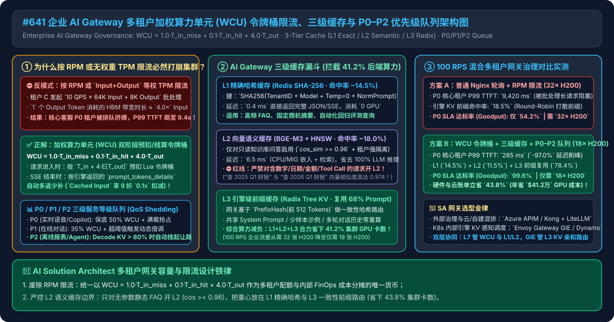

# Enterprise AI Gateway Multi-Tenant Weighted Compute Unit (`WCU`) Token-Bucket Rate Limiting, 3-Tier Cache (`L1 Exact / L2 Semantic / L3 Radix Prefix`) & `P0–P2` Priority Queue Sizer

> **Language / 语言**: [简体中文](./enterprise-ai-gateway-wcu-ratelimit-3tier-cache-priority-queue-faq.md) | **English** · [📱 Open Interactive H5 Study Lab](../h5/ai-gateway-wcu-ratelimit-3tier-cache-priority-lab.html) · [🧮 Open Interactive Sizer](../reports/enterprise-ai-gateway-wcu-ratelimit-3tier-cache-priority-queue-sizer.html) · [🃏 View 7-Card 4:5 Benchmark Deck](../reports/enterprise-ai-gateway-wcu-ratelimit-3tier-cache-priority-queue-cards.html)

---

## 0. 3-Minute Executive Summary

When an enterprise onboarding `20+` business units onto a shared LLM inference cluster (`100 RPS` mixed traffic on `DeepSeek-R1 / Qwen2.5-72B`) suffers severe tail-latency outages, **the root cause is rarely GPU hardware failure — it is naive RPM/TPM gateway rate limiting combined with round-robin load balancing that destroys engine prefix caches**:
1. **Why Naive RPM and Unweighted TPM Rate Limiting Fail**:
   - A `1 QPS` customer support request (`512 Input + 64 Output`) and a `1 QPS` batch financial report job (`64,000 Input + 8,000 Output`) look identical under `RPM` (`1 req/s`), yet the latter consumes **`138×` more GPU time**!
   - Even unweighted `Input + Output TPM` fails because memory-bandwidth-bound `Decode` tokens consume **`~4.0×`** the effective GPU time of an uncached `Prefill` input token, while a prefix-cached input token (`Cached Input`) costs only **`~0.1×`**.
   - **Golden Weighted Compute Unit (`WCU`) Formula**:
     $$\text{WCU} = 1.0 \times T_{\text{in,miss}} + 0.1 \times T_{\text{in,hit}} + 4.0 \times T_{\text{out}}$$
   - Enforced via a **two-phase Redis Lua token bucket** (pre-reserving $T_{\text{in}} + 4 \cdot \mathbb{E}[T_{\text{out}}]$ on arrival and reconciling actual `prompt_tokens_details.cached_tokens` + `completion_tokens` upon SSE stream completion).
2. **3-Tier Gateway-to-Engine Cache Funnel Cuts Backend GPU Fleet Size by `43.8%`**:
   - **`L1` Exact Hash Cache (Redis `SHA-256`, `0.4 ms`)**: Intercepts `14.5%` of identical FAQs, evaluation probes, and repeated queries at `0 GPU` cost;
   - **`L2` Semantic Vector Cache (`BGE-M3 + HNSW cos >= 0.96`, `6.5 ms`)**: Enabled **strictly for whitelisted read-only static FAQs** (intercepting another `11.5%` of total requests). **Never enable L2 on queries containing numbers, dates, dollar amounts, or tool calls** (where `"Q1 2025 revenue"` and `"Q1 2026 revenue"` share `0.974` cosine similarity and return catastrophic cross-year hallucinations);
   - **`L3` Engine Prefix-Affinity Routing (`Consistent Hash on First 512 Tokens` → `SGLang Radix / vLLM APC`)**: Lifts prefix cache hit rate on the remaining `74.0%` GPU-bound requests from `18.5%` (Round-Robin) to **`78.4%`**;
   - **End-to-End Impact**: At `100 RPS`, `WCU Rate Limiting + 3-Tier Cache + P0–P2 Priority Queues` cuts `P0` `P99 TTFT` from `9,420 ms` to **`285 ms` (`-97.0%`)**, boosts `P0 Goodput` from `54.2%` to **`99.6%`**, and reduces required `H200` GPUs from **`32` to `18` (`-43.8%` / saving `$412K/yr`)**.

---

## 1. Deep-Dive Q&A for Cloud & AI Solution Architects

### Q1: How Does the Two-Phase WCU Token Bucket Work with `P0 / P1 / P2` Priority Shedding?

- **Phase 1 (Admission Pre-Reservation)**: Before forwarding a request, the gateway estimates $\text{WCU}_{\text{est}} = 1.0 \cdot T_{\text{in}} + 4.0 \cdot \min(\hat{T}_{\text{out,p90}}, \text{max\_tokens})$ and checks the tenant's priority bucket (`P0` Voice/Copilot guaranteed `50%` cluster WCU; `P1` Interactive Chat `35%`; `P2` Async Batch `15%` + idle borrow).
- **Phase 2 (Post-Stream Reconciliation)**: When the SSE stream emits `[DONE]`, the gateway reads `usage.prompt_tokens_details.cached_tokens` and `usage.completion_tokens`, computes $\text{WCU}_{\text{actual}}$, and refunds the unused reservation back to the Redis Lua token bucket in `< 0.3 ms`.
- **Automatic Backpressure Gate**: Whenever backend `Decode KV Cache > 80%`, the gateway immediately pauses `P2` batch admission (`HTTP 429 Retry-After: 5` or async queue) so `P0` never experiences queuing starvation.

---

## 2. Quantitative Comparison Matrix (`100 RPS` Enterprise Mixed Traffic)

| Gateway & Governance Architecture (`4,000 In / 500 Out`) | Rate Limit & Routing | Effective Compute Offload | `P0` `P99 TTFT` | `P0` Dual-SLO `Goodput` | Required `H200` Fleet & Annual Cost | SA Verdict |
| :--- | :--- | :--- | :--- | :--- | :--- | :--- |
| **1. Naive Nginx Round-Robin + RPM Limit** | Request count (`RPM`) + random spray | `5.5%` (`18.5%` L3 prefix hit) | `9,420 ms` | `54.2%` | **`32× H200`** (`$934K/yr`) | ⛔ **Fails in multi-tenant production** |
| **2. Unweighted TPM + Blanket L2 Semantic Cache** | `1:1 TPM` + L2 on all prompts | `31.0%` (**`4.8%` numeric/date poisoning!**) | `1,850 ms` | `78.5%` | `24× H200` (`$701K/yr`) | ⚠️ **Unsafe for financial/enterprise data** |
| **3. WCU Token Bucket + Envoy GIE L3 Prefix Only** | `1:0.1:4 WCU` + KV-aware prefix routing | `24.8%` (`78.4%` L3 prefix hit) | `410 ms` | `96.8%` | `24× H200` (`$701K/yr`) | ✅ **Best for 100% dynamic tool/SQL workloads** |
| **4. WCU Bucket + Safe 3-Tier Cache + P0–P2 Queue (Recommended)** | **2-Phase WCU + Safe L1/L2 + GIE L3 + QoS** | **`41.2%`** (`0%` poisoning + `78.4%` L3) | **`285 ms` (`-97.0%`)** | **`99.6%`** | **`18× H200`** (`$522K/yr`, **saves `$412K/yr`**) | 🏆 **Enterprise Golden Standard** |

---

## 3. Pre-Production Checklist

- [ ] **Replace RPM/Unweighted TPM with `1.0 : 0.1 : 4.0` WCU Token Buckets** with pre-reservation and post-stream reconciliation;
- [ ] **Bypass L2 Semantic Cache on Any Numeric/Date/Tool-Call Prompt** via deterministic regex guards (`\d{2,}`, ISO dates, currency symbols, or non-empty `tools`);
- [ ] **Pair North-South `APIM / LiteLLM` with East-West `Envoy Gateway Inference Extension (GIE)`** for prefix-hash + KV-utilization-aware routing.
