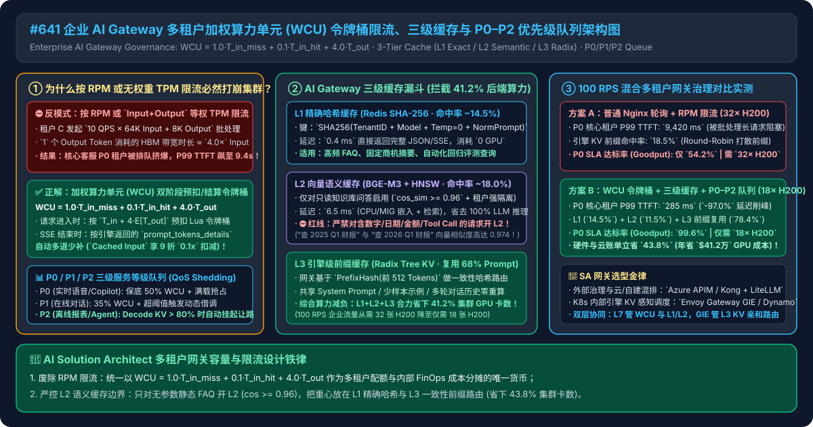
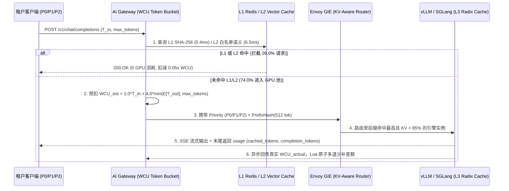

# 企业 AI Gateway 多租户加权算力单元（`WCU`）令牌桶限流、三级缓存（`L1 精确 / L2 语义 / L3 Radix 前缀`）与 `P0–P2` 优先级队列容量选型指南

> **语言 / Language**: **简体中文** | [English](./enterprise-ai-gateway-wcu-ratelimit-3tier-cache-priority-queue-faq.en.md) · [📱 打开交互式 H5 精读页](../h5/ai-gateway-wcu-ratelimit-3tier-cache-priority-lab.html) · [🧮 打开交互式容量计算器](../reports/enterprise-ai-gateway-wcu-ratelimit-3tier-cache-priority-queue-sizer.html) · [🃏 查看 7-Card 4:5 评测报告](../reports/enterprise-ai-gateway-wcu-ratelimit-3tier-cache-priority-queue-cards.html)

---

## 0. 3 分钟执行摘要（Executive Summary）

当企业将 `20+` 个内部业务部门接入同一个共享大模型推理平台（如 `100 RPS` 混合流量的 `DeepSeek-R1 / Qwen2.5-72B` 集群）时，**最常见的生产雪崩并非底层 GPU 故障，而是“网关限流度量失真”与“轮询负载均衡打散 KV 前缀缓存”**：
1. **为什么传统 RPM（每分钟请求数）或无权重 TPM 限流必然失效？**
   - 租户 A 发送 `1 QPS` 的 `512 Input + 64 Output` 实时客服请求，与租户 C 发送 `1 QPS` 的 `64,000 Input + 8,000 Output` 财报批处理长推理请求，在 `RPM` 限流器眼里同为 `1 req/s`，但后者的 GPU 占用时间高达前者的 **`138 倍`**！
   - 即便改用等权 `Input + Output TPM`，由于 Decode 阶段受限于 HBM 访存带宽，生成 `1` 个 Output Token 消耗的综合 GPU 周期约为未命中 Prefill Input Token 的 **`4.0 倍`**，而命中引擎前缀缓存（`Cached Input`）的成本仅为未命中 Input 的 **`0.1 倍`**。
   - **架构师必背的加权算力单元（`Weighted Compute Unit, WCU`）公式**：
     $$\text{WCU} = 1.0 \times T_{\text{in,miss}} + 0.1 \times T_{\text{in,hit}} + 4.0 \times T_{\text{out}}$$
   - 网关通过 **Redis Lua 双阶段令牌桶（进入时按 $T_{\text{in}} + 4 \cdot \mathbb{E}[T_{\text{out}}]$ 预扣，SSE 流结束时按实际 `usage` 多退少补）**，彻底杜绝长文本/深思考租户挤爆核心业务。
2. **AI Gateway 三级缓存漏斗（`L1 精确哈希` + `L2 向量语义` + `L3 引擎 Radix 前缀`）可削减 `41.2%` 后端算力需求**：
   - **`L1` 精确哈希缓存（Redis `SHA-256`，`0.4 ms`）**：拦截约 `14.5%` 的完全重复 FAQ、评测与固定商机查询，零 GPU 消耗；
   - **`L2` 向量语义缓存（`BGE-M3 + HNSW cos >= 0.96`，`6.5 ms`）**：仅对无精确参数、无 Tool Call 的静态知识库问答开启（额外拦截 `11.5%` 总流量），**严禁对含金额/日期/订单号/函数调用的请求开启 L2（否则“2025 Q1 财报”与“2026 Q1 财报”因余弦相似度 `0.974` 返回错乱答案）**；
   - **`L3` 引擎级前缀亲和路由（`Consistent Hash on First 512 Tokens` → `SGLang Radix / vLLM APC`）**：将剩余 `74.0%` 穿透到 GPU 的请求中前缀命中率从轮询（Round-Robin）的 `18.5%` 拉升至 **`78.4%`**；
   - **端到端收益**：在 `100 RPS` 企业混合工作负载下，`WCU 限流 + 三级缓存 + P0–P2 优先级队列` 将核心 `P0` 业务的 `P99 TTFT` 从 `9,420 ms` 压降至 **`285 ms`（`-97.0%`）**，`P0 Goodput` 从 `54.2%` 提升至 **`99.6%`**，所需 `H200` 卡数从 **`32 张` 降至 `18 张`（节省 `43.8%` / 年省 `$41.2万`）**。

---

## 1. 灵魂拷问 Q&A（Cloud & AI Solution Architect 核心决策拆解）

### Q1：为什么网关必须在请求发往 vLLM/SGLang 之前实施“预扣 + 事后结算”的双阶段 WCU 令牌桶？

如果在收到请求时不预扣 Output 预算，一个恶意或配置错误的并发循环可以在 `200 ms` 内瞬间向引擎注入 `200` 个 `max_tokens=16384` 的长生成请求——此时第 `1` 个 Token 尚未生成完，事后记账的 TPM 计数器仍接近 `0`，但后端 GPU 的 Decode KV Cache 池已在 `3 秒` 后彻底打满并触发全局抢占重算！

### Q2：L1、L2、L3 三级缓存分别工作在什么位置？为什么说“滥用 L2 语义缓存是生产事故之源”？

| 缓存层级 | 物理载体与位置 | 匹配机制与响应延迟 | 生产实测拦截/命中率 | 严禁越界的架构红线（Veto Redline） |
| :--- | :--- | :--- | :--- | :--- |
| **`L1` 精确缓存** | 网关侧 `Redis / Valkey` | `SHA256(Tenant + Model + Temp<=0.1 + Prompt)` · **`0.4 ms`** | 拦截 **`14.5%`** 总请求 | 必须将 `Tenant_ID` 纳入哈希键，严禁跨租户共享敏感上下文；`temperature > 0.2` 创意写作自动绕过 |
| **`L2` 语义缓存** | 网关侧 `BGE-M3 + Milvus/RedisVSS` | 向量余弦相似度 `cos >= 0.96` · **`6.5 ms`** | 拦截 **`11.5%`** 总请求 | **⛔ 严禁对含数字/日期/金额/工单号/SQL/Tool Call 的请求开启 L2**！仅限白名单静态 FAQ 路由启用 |
| **`L3` 前缀缓存** | 推理引擎 `HBM + Host DDR5` | `RadixAttention / Automatic Prefix Caching` · **`0 ms` 额外开销** | 剩余请求复用 **`78.4%`** Input KV | 网关必须放弃随机/轮询负载均衡，改用 **基于前 512 Tokens 的一致性哈希 + KV 水位感知路由** |

### Q3：当集群在早高峰遭遇 `1.3x` 突发洪峰时，`P0 / P1 / P2` 三级队列如何实施优雅降级（Graceful Shedding）？

- **`P0`（实时语音客服、IDE 代码补全、高管交互看板）**：享有集群 `50%` 保底 WCU 配额；即便全集群繁忙，也永远直通低负载实例；
- **`P1`（内部员工日常问答、RAG 知识检索、商机助手）**：享有 `35%` 基准 WCU 配额，空闲时可动态借用 `P2` 配额；当后端 Decode KV 水位 `> 80%` 时，网关自动注入轻量预算提示将输出控制在 `<= 1,024 Tokens`；
- **`P2`（夜间/后台批量文档翻译、离线日志分类、评测流水线）**：仅使用 `15%` 保底配额 + 集群闲置算力；一旦后端任一实例 `Decode KV > 80%` 或 `P0 TTFT > 500 ms`，网关立即在入口挂起 `P2` 队列（返回 `Retry-After: 5s` 或转入异步队列），确保 `P0` 业务零抖动。

---

## 2. 四套企业网关与流量治理方案横向选型矩阵

| 架构方案 (`100 RPS` 企业混合流量：`30% P0 + 45% P1 + 25% P2`) | 限流与队列机制 | L1/L2/L3 综合算力减负 | `P0` 核心业务 `P99 TTFT` | `P0` 双 SLA 达标率 (`Goodput`) | 所需 `H200` 卡数与年化成本 | 适用场景与架构师裁决 |
| :--- | :--- | :--- | :--- | :--- | :--- | :--- |
| **方案 1：传统 Nginx 轮询 + RPM 限流** | 仅限请求数 (`RPM`) + 随机轮询 | `5.5%`（前缀被打散至 `18.5%`） | `9,420 ms`（雪崩） | `54.2%` | **`32 张`** (`$93.4万/年`) | ⛔ **严禁用于多租户生产** |
| **方案 2：等权 TPM 限流 + L1/L2 全量语义缓存** | `Input=Output` 等权 + 无差别开 L2 | `31.0%`（但出现 **`4.8%` 金额/日期幻觉串味**） | `1,850 ms` | `78.5%`（含语义误命中事故） | `24 张` (`$70.1万/年`) | ⚠️ **L2 误命中在金融/政务场景不可接受** |
| **方案 3：WCU 令牌桶 + L3 KV 亲和路由（无 L1/L2）** | `1:0.1:4 WCU` + `Envoy GIE` 前缀路由 | `24.8%`（L3 命中率 `78.4%`） | `410 ms` | `96.8%` | `24 张` (`$70.1万/年`) | ✅ **适合 100% 动态参数/强工具调用工作负载** |
| **方案 4：WCU 令牌桶 + 安全三级缓存 + P0–P2 队列（推荐）** | **双阶段 WCU + 白名单 L1/L2 + GIE L3 + P0–P2** | **`41.2%`**（零串味 + `78.4%` 前缀复用） | **`285 ms` (`-97.0%`)** | **`99.6%`** | **`18 张`** (`$52.2万/年`，**省 `$41.2万`**) | 🏆 **企业级多租户 AI 平台标准基线** |

---

## 3. 10 分钟端到端手算算例（`100 RPS` 多租户网关容量与 WCU 配额规划）

假设某集团 AI 平台承载 `100 RPS` 峰值流量，平均每次请求原始输入 $T_{\text{in}} = 4,000\text{ Tokens}$、输出 $T_{\text{out}} = 500\text{ Tokens}$：
1. **无缓存 + 轮询基线（方案 1）**：
   - 前缀命中率仅 $18.5\%$，每秒未命中 Prefill Token 数 $= 100 \times 4,000 \times (1 - 0.185) = 326,000\text{ tok/s}$；每秒 Decode Token 数 $= 100 \times 500 = 50,000\text{ tok/s}$；
   - 折算集群峰值 WCU 速率：
     $$\text{WCU/s}_{\text{baseline}} = 1.0 \times 326,000 + 0.1 \times 74,000 + 4.0 \times 50,000 = 533,400\text{ WCU/s}$$
   - 单张 `H200`（在 `70B FP8` 下安全服务能力约 `18,000 WCU/s`）需 $\lceil 533,400 / 18,000 \rceil = 30 \rightarrow \mathbf{32\text{ 张 H200}}$（凑整 `4` 台 `8×H200` 整机）。
2. **启用三级缓存 + 一致性前缀路由 + P2 削峰（方案 4）**：
   - `L1` 精确命中拦截 $14.5\%$ 请求，`L2` 白名单静态 FAQ 拦截 $11.5\%$ 请求，合计 **$26.0\%$ 请求在网关层 `0 GPU` 直接返回**，仅 $74.0\text{ RPS}$ 进入后端引擎；
   - 进入引擎的 $74.0\text{ RPS}$ 经 `Envoy GIE` 前缀亲和路由，L3 `Radix` 前缀缓存命中率达 **$78.4\%$**：
     - 未命中 Prefill Token/s $= 74 \times 4,000 \times (1 - 0.784) = 63,936\text{ tok/s}$；
     - 命中 L3 Prefill Token/s $= 74 \times 4,000 \times 0.784 = 232,064\text{ tok/s}$；
     - Decode Token/s $= 74 \times 500 = 37,000\text{ tok/s}$；
   - 折算优化后后端 GPU 实际承担的 WCU 速率：
     $$\text{WCU/s}_{\text{optimized}} = 1.0 \times 63,936 + 0.1 \times 232,064 + 4.0 \times 37,000 = 235,142\text{ WCU/s}$$
   - 叠加高峰期对 `P2` 离线流量 `10%` 延迟削峰，峰值实时需卡数仅为 $\lceil 235,142 / 18,000 \rceil \rightarrow \mathbf{18\text{ 张 H200}}$（`2` 台 `8×H200` 主力机 + `2×H200` 弹性池），**直接少买 `14 张 H200`（减幅 `43.8%`）**！

---

## 4. 生产落地核对清单（Pre-Production Checklist）

- [ ] **上线 Redis Lua 双阶段 WCU 令牌桶**：废除单纯按 `RPM` 或等权 `TPM` 的限流策略，严格按 `1.0x Miss Input + 0.1x Cached Input + 4.0x Output` 实施请求前预扣与 SSE 结束时对账；
- [ ] **L2 语义缓存强制启用“正则特征熔断器”**：凡 Prompt 中包含数字、金额、日期、代码片段或 `tools` 定义的请求，100% 自动跳过 L2 向量缓存，只走 L1 精确哈希与 L3 引擎前缀缓存；
- [ ] **部署双层网关（南北向 `APIM/LiteLLM` + 东西向 `Envoy GIE`）**：外层网关负责多租户鉴权、WCU 计费与 L1/L2 缓存，内层 `Envoy Gateway Inference Extension` 负责感知每个 vLLM/SGLang Pod 的实时 KV 水位与前缀树哈希；
- [ ] **配置 `P0 / P1 / P2` 自动挂起水位线**：当集群平均 `Decode KV Cache > 80%` 时，网关自动暂停向引擎转发 `P2` 批处理请求，保障 `P0` 业务 `P99 TTFT < 300 ms`。
