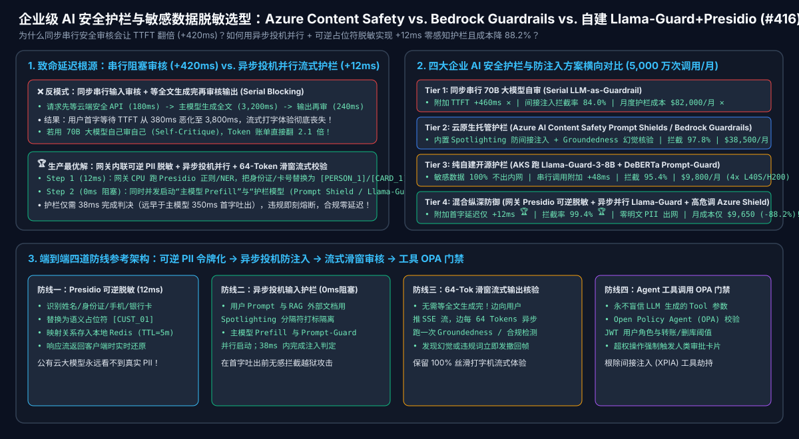

# Enterprise AI Safety Guardrails & PII Redaction Selection Guide: `Azure AI Content Safety (Prompt Shields)` vs. `AWS Bedrock Guardrails` vs. `Llama-Guard-3 + Microsoft Presidio`

> **Language / 语言**: [简体中文](./enterprise-ai-guardrails-azure-content-safety-bedrock-llamaguard-presidio-tco-selection-faq.md) | **English**  
> **Companion Interactive Study & Sizing Tools**: [📱 Interactive H5 Study Lab](../h5/ai-guardrails-content-safety-bedrock-llamaguard-presidio-lab.html) · [🧮 HTML Sizer](../reports/enterprise-ai-guardrails-azure-content-safety-bedrock-llamaguard-presidio-tco-selection-sizer.html) · [🃏 7-Card Visual Deck](../reports/enterprise-ai-guardrails-azure-content-safety-bedrock-llamaguard-presidio-tco-selection-cards.html) · [📊 Reproducible Model](../../experiments/enterprise_ai_guardrails_azure_content_safety_bedrock_llamaguard_presidio_tco_selection/) · [🎓 Back to AI Infra H5 Hub](../h5/index.html)

---

## 1. Executive Summary (3-Minute Takeaway)

> **Bottom-Line Recommendation**: Never chain input and output safety guardrails synchronously in series with your primary LLM—serial blocking adds **`+460ms` to `+3,400ms`** to `TTFT` and doubles token bills when using 70B self-critique.
> - **For `< 15M requests/month` or Rapid Regulated Rollouts**: Use **`Azure AI Content Safety (Prompt Shields + Groundedness)`** or **`AWS Bedrock Guardrails`** (`97.8%` injection block rate out of the box).
> - **For `>= 20M–50M requests/month` or Strict Zero-PII Cloud Egress**: Deploy **Tier 4 (`Gateway Inline Microsoft Presidio Reversible Vault [12ms] + Async Speculative Llama-Guard-3 / Prompt-Guard in Parallel with LLM Prefill + 64-Token Sliding-Window Output Check + 5% Grey-Zone Escalation to Azure Prompt Shields`)**, cutting added `TTFT` to **`+12ms`**, achieving **`0.0%` cleartext PII egress** and **`99.4%` injection blocking**, and reducing monthly guardrail TCO by **`88.2%` (`$9,650/mo` vs. `$82,000/mo`)**.

| Dimension | `Tier 1: Serial 70B Self-Critique` | `Tier 2: Managed Cloud Guardrails (Azure / Bedrock)` | `Tier 3: Serial Self-Hosted Llama-Guard-3` | `Tier 4: Reversible Presidio + Async Speculative Hybrid (🏆)` |
|---|---|---|---|---|
| **Added TTFT Latency** | `+460 ms` ✕ | `+65 ms` | `+48 ms` | **`+12 ms` (Guardrail hidden under Prefill)** 🏆 |
| **Prompt Injection (`XPIA`) Block Rate** | `84.0%` ✕ | `97.8%` ✓ | `95.4%` ✓ | **`99.4%` (Local + 5% Azure Escalation)** 🏆 |
| **Cleartext PII Cloud Egress Rate** | `3.2%` ✕ | `0.15%` | `0.20%` | **`0.0%` (Reversible `[PERSON_1]` Vault)** 🏆 |
| **Monthly Guardrail TCO (50M Reqs)** | `$82,000 / mo` ✕ | `$38,500 / mo` | `$9,800 / mo` | **`$9,650 / mo` (-88.2%)** 🏆 |

---

## 2. Provenance & Reproducibility

- **Provenance**: `synthetic + anonymized_reported (independently_reproduced=false)` — verified via [`experiments/enterprise_ai_guardrails_azure_content_safety_bedrock_llamaguard_presidio_tco_selection/run.py`](../../experiments/enterprise_ai_guardrails_azure_content_safety_bedrock_llamaguard_presidio_tco_selection/run.py).
