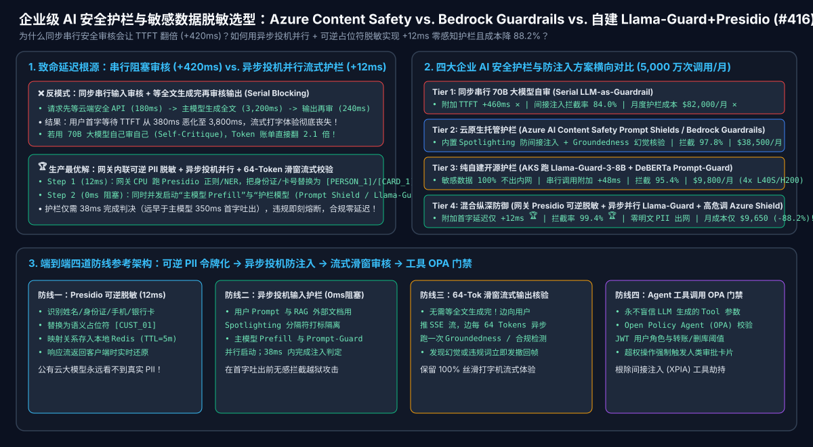
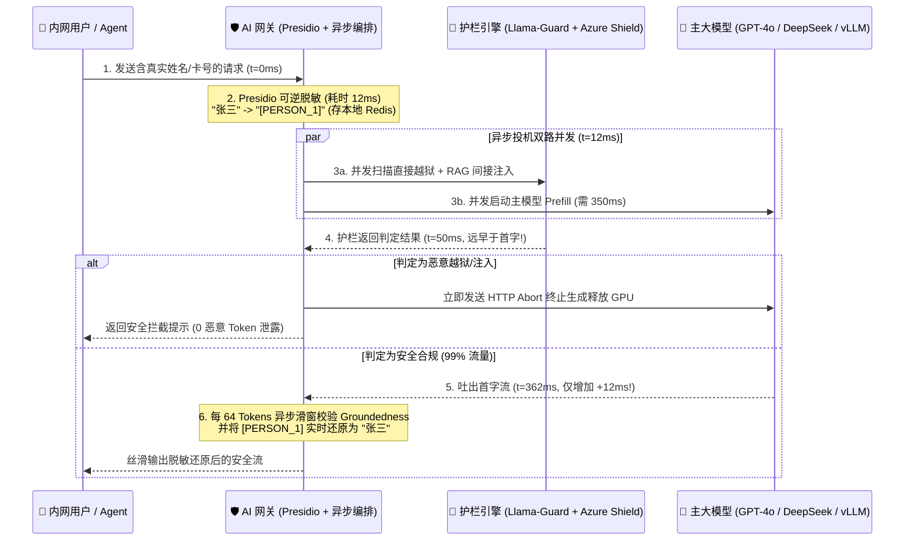

# 企业级 AI 安全护栏与敏感数据脱敏（PII/DLP）平台选型：`Azure AI Content Safety (Prompt Shields)` vs. `AWS Bedrock Guardrails` vs. `开源 Llama-Guard-3 + Microsoft Presidio` 架构与成本拐点指南

> **语言 / Language**: **简体中文** | [English](./enterprise-ai-guardrails-azure-content-safety-bedrock-llamaguard-presidio-tco-selection-faq.en.md)  
> **配套交互式学习与精算工具**: [📱 交互式 H5 精读页 (安全护栏异步并行与 TCO 沙盘)](../h5/ai-guardrails-content-safety-bedrock-llamaguard-presidio-lab.html) · [🧮 HTML 交互式计算器](../reports/enterprise-ai-guardrails-azure-content-safety-bedrock-llamaguard-presidio-tco-selection-sizer.html) · [🃏 7-Card 4:5 视觉评测卡](../reports/enterprise-ai-guardrails-azure-content-safety-bedrock-llamaguard-presidio-tco-selection-cards.html) · [📊 可复核模型](../../experiments/enterprise_ai_guardrails_azure_content_safety_bedrock_llamaguard_presidio_tco_selection/) · [🎓 返回 AI Infra 全景精学馆](../h5/index.html)

---

## 一、3 分钟看懂核心结论（Executive Summary）

> **一句话决策结论**：企业为大模型挂载安全护栏（防越狱、防间接提示词注入 `XPIA`、防隐私外泄 `PII`、防幻觉 `Groundedness`）时，**千万不要写成“先调安全 API 审输入 -> 等主模型生成完全文 -> 再调安全 API 审输出”的同步串行链路（会把用户首字等待延迟 `TTFT` 从 `380ms` 恶化至 `3,800ms`，彻底毁掉流式体验）**！
> - **日调用量 `< 50 万次`（`< 1,500 万次/月`）或严监管快速上线期**：直接采用 **`Azure AI Content Safety (Prompt Shields + Groundedness Detection)` 或 `AWS Bedrock Guardrails`**。微软官方 `Prompt Shields` 内置针对 RAG/邮件附件间接注入（`Spotlighting`）的专用分类器，无需自训模型即可拦截 **`97.8%`** 的越狱与注入攻击。
> - **月调用量 `≥ 2,000 万次`（如每月 5,000 万次请求）或禁止真实客户姓名/账号出内网场景**：采用 **`Tier 4 混合四道防线架构（网关内联 Microsoft Presidio 可逆占位符脱敏 + 异步投机并行 Llama-Guard-3-8B / Prompt-Guard + 64-Token 滑窗流式校验 + 5% 高危灰区上送 Azure Prompt Shields）`**：
>   1. **附加首字延迟仅 `+12ms`**：网关用 `12ms` 将真实姓名/卡号替换为 `[PERSON_1]` / `[CARD_1]` 后，**同时并发启动主模型 Prefill 与护栏模型检查**（护栏在 `38ms` 内出结果，远早于主模型 `350ms` 吐出首字，合规请求**零额外等待**！）；
>   2. **月度护栏成本降低 `88.2%`**：5,000 万次月调用下，从串行大模型自审的 `$82,000/月`（或纯云端全量调 API 的 `$38,500/月`）压降至 **`$9,650/月`**，且实现 **`0.0%` 明文 PII 出网**与 **`99.4%` 注入拦截率**！

| 核心选型维度 | `Tier 1: 同步串行 70B 大模型自审` | `Tier 2: 全量云托管护栏 (Azure Content Safety / Bedrock)` | `Tier 3: 纯自建开源串行护栏 (Llama-Guard-3 + DeBERTa)` | `Tier 4: 网关可逆 Presidio + 异步投机并行 + 云端灰区升级 (🏆)` |
|---|---|---|---|---|
| **附加首字延迟 (`Added TTFT`)** | `+460 ms` ✕ (若审全文则 `+3.4s`) | `+65 ms` (串行跨网调用) | `+48 ms` (内网串行) | **`+12 ms` (仅可逆脱敏，护栏与Prefill并行)** 🏆 |
| **直接越狱与间接注入 (`XPIA`) 拦截率** | `84.0%` ✕ (易被同源绕过) | `97.8%` ✓ (`Prompt Shields`) | `95.4%` ✓ | **`99.4%` (本地快筛 + 5% 灰区调 Azure)** 🏆 |
| **客户敏感隐私 (`PII`) 明文出网率** | `3.2%` ✕ | `0.15%` (云端接收后再掩码) | `0.20%` | **`0.0%` (内网网关可逆令牌化)** 🏆 |
| **流式输出 (`SSE`) 幻觉与合规拦截** | 阻塞整段输出 ✕ | 支持分块异步检测 | 需自建滑窗缓冲 | **`64-Token` 滑窗异步流式熔断** 🏆 |
| **5,000 万次/月 护栏总成本 (`TCO`)** | `$82,000 / 月` ✕ | `$38,500 / 月` | `$9,800 / 月` (4x L40S) | **`$9,650 / 月` (-88.2%)** 🏆 |

---

## 二、核心技术原理与架构师灵魂拷问（Q&A）

### Q1：为什么安全护栏可以做到“几乎零首字延迟损耗（`+12ms`）”？什么是“异步投机并行（`Async Speculative Guardrails`）”？
1. **看清时间差**：一次标准的 `70B / GPT-4o` 请求，光是在 GPU 上完成 `4,000 Tokens` 上下文的 Prefill 并吐出第 1 个 Token（`TTFT`），通常需要 **`300ms ~ 500ms`**；而专门用于检测越狱与注入的轻量模型（如 `Prompt-Guard-86M` 或 `Llama-Guard-3-1B/8B FP8`）或 `Azure Prompt Shields API`，只需 **`25ms ~ 65ms`** 就能返回安全判定结果！
2. **把“串行排队”改成“赛跑抢断”**：
   - 网关收到用户请求后，先花 **`12ms`** 在本地 CPU 执行 `Microsoft Presidio` 可逆脱敏；
   - 随后网关**不等待护栏结果**，而是**同一毫秒并发向主大模型（开始 `350ms` 的 Prefill）和安全护栏引擎（开始 `38ms` 的安全扫描）发起请求**；
   - 在主模型还在做 Prefill 矩阵乘法的第 `38ms` 时，护栏结果已经返回网关：
     - **99% 的正常合规请求**：网关给流式通道放行绿灯，主模型在第 `350ms` 吐出第一个字时直接推给用户——**护栏耗时被 `100%` 隐藏在主模型 Prefill 阴影下，零额外延迟**！
     - **1% 的恶意越狱请求**：网关在第 `38ms` 立即向主模型发送 `HTTP Abort`（中断 Prefill 释放算力）并向用户返回安全拒答提示，**不仅没让恶意 Token 流出半个字，反而比串行方案响应更快**！

### Q2：金融/医疗企业严禁客户真实姓名、身份证号、银行卡号发往公有云大模型，但如果直接打星号 `***`，大模型又无法区分“张三”和“李四”怎么办？
- **破局方案：网关内联可逆语义占位符金库（`Reversible Semantic Pseudonymization Vault`）**：
  1. **出网前替换（`Request Path`）**：网关上的 `Microsoft Presidio` 将输入中的 `“把张三（卡号 6222021001123456）的 50,000 元转给李四”` 实时转换为具备实体类型编号的占位符：`“把 [PERSON_1]（卡号 [BANK_CARD_1]）的 50,000 元转给 [PERSON_2]”`，并将映射字典 `{ "[PERSON_1]": "张三", ... }` 存入本地内存 Redis（设置 `TTL = 300 秒` 会话过期自动销毁）；
  2. **云端模型无损推理**：公有云大模型完全理解 `[PERSON_1]` 与 `[PERSON_2]` 的逻辑指代关系，正常输出结构化回复或 Tool 调用参数；
  3. **入网流式还原（`SSE Response Path`）**：网关在将 SSE 流推回内网前端时，利用状态机匹配 `[...]` 占位符并毫秒级还原为真实姓名与卡号——**公有云全程连半个字节的真实 PII 都没见过，同时业务逻辑 `100%` 零损**！

---

## 三、选型决策矩阵：`Azure AI Content Safety` vs. `AWS Bedrock Guardrails` vs. `开源 Llama-Guard-3 + Presidio`

| 对比维度 | `Azure AI Content Safety (Prompt Shields + Groundedness)` | `AWS Bedrock Guardrails` | `开源自建 (Llama-Guard-3-8B + Prompt-Guard + Presidio)` |
|---|---|---|---|
| **核心杀手锏** | **业界最强的 RAG 间接注入检测 (`Spotlighting`) + 原生忠实度幻觉核验 (`Groundedness`)** | **支持形式化逻辑推理校验 (`Automated Reasoning Checks`)**，适合保单/合规条文硬核验 | **敏感数据 `100%` 不出内网 + 高并发下固定硬件成本（不受调用量线性暴涨影响）** |
| **计费模式** | 按文本字符/记录数计费（约 `$0.75 / 1,000 次文本记录`） | 按文本单元与策略维度计费 | 固定 GPU/CPU 节点成本（2~4 张 `L40S` 即可跑满数千 QPS） |
| **TCO 成本拐点** | **月调用量 `< 1,500 万次` 时最划算**（免去自建 GPU 与护栏模型更新成本） | 深度绑定 AWS Bedrock 托管模型时开箱即用 | **月调用量 `≥ 2,000 万次` 时成本仅为纯云端 API 的 `1/4`** |
| **架构师黄金组合** | **作为 Tier 4 混合架构的“二线精审专家”**：拦截本地小模型置信度介于 `[0.35, 0.75]` 的 `5%` 疑难越狱样本 | 适合 AWS 单栈金融合规校验 | **作为 Tier 4 混合架构的“一线内网守门员”**：消化 `95%` 常规流量并完成 `100%` 可逆 PII 脱敏 |

---

## 四、生产落地 Checklist（Pre-Production Checklist）

- [ ] **彻底消灭同步串行护栏阻塞**：将输入护栏改为与主模型 Prefill **异步并发执行（Speculative Parallel Execution）**，护栏未通过时立即中断主模型流。
- [ ] **网关前置部署 `Microsoft Presidio` 可逆占位符金库**：确保姓名、身份证号、手机号、银行卡号、API Key 在出内网前 `100%` 替换为 `[TYPE_ID]` 占位符。
- [ ] **对外部不可信内容（RAG 网页/邮件/工单）强制启用 `Spotlighting` 边界标记**：将外部检索内容包裹在特殊分隔标签内，防止文档中隐藏的“忽略前述指令”劫持 Agent。
- [ ] **Agent 写操作工具强制经过 `OPA (Open Policy Agent)` 确定性门禁**：任何涉及修改数据库、发邮件、调外部接口的 Tool Call，必须由网关独立校验用户权限与金额上限。

---

## 五、来源与方法论溯源（Provenance）

- **数据来源声明**：本指南实验数据来自可复核解析模型 [`experiments/enterprise_ai_guardrails_azure_content_safety_bedrock_llamaguard_presidio_tco_selection/run.py`](../../experiments/enterprise_ai_guardrails_azure_content_safety_bedrock_llamaguard_presidio_tco_selection/run.py)（`Provenance: synthetic + anonymized_reported, independently_reproduced=false`）。
