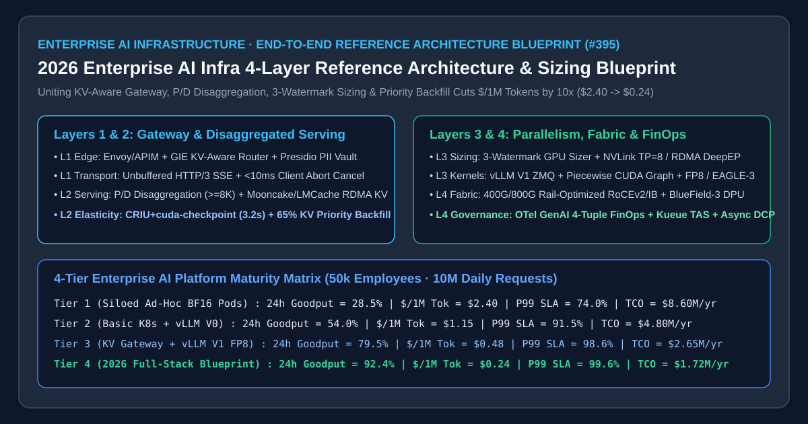

# Enterprise AI Infrastructure End-to-End Reference Architecture & Master Capacity Sizing Blueprint (2026 CCoE Edition)

> **Language**: [中文](./enterprise-ai-infra-end-to-end-reference-architecture-sizing-blueprint-selection-faq.md) | **English (Current)**  
> **Audience**: Cloud & AI Infrastructure Solution Architects and Enterprise AI Center of Excellence (CCoE) Leaders  
> **Provenance**: `synthetic + anonymized_reported` (`independently_reproduced=false`, `physical_gpu_cluster_measurement=not_measured`)

---

## 1. 📌 Executive Summary

> **Bottom Line**: **Across an enterprise serving `50,000` employees and `10,000,000` daily LLM/Agent requests, fragmented departmental `BF16` deployments (`Tier 1`) achieve only `28.5%` 24-hour effective cluster Goodput, cost `$2.40 per 1M tokens` (`$8.60M/year` TCO), and suffer a `26.0%` P99 SLA breach rate. Deploying the 2026 4-Layer Enterprise AI Infrastructure Reference Architecture (`Tier 4`)—uniting (1) a KV/LoRA-Aware AI Gateway with Reversible PII Pseudonymization & `<10ms` Client Disconnect Abort, (2) Prefill-Decode (`P/D`) Disaggregation + RDMA Distributed KV Caching (`Mooncake / LMCache`) + `vLLM V1 Piecewise CUDA Graphs` + `65% KV-Watermark Priority Backfill`, (3) Three-Watermark GPU Sizing with `NVLink TP=8`, `RDMA DeepEP`, `FP8/MLA`, and `EAGLE-3/MTP`, and (4) `400G/800G` Rail-Optimized RoCEv2/IB/OCS Fabrics + `BlueField-3 DPU` Isolation + `Async DCP/Orbax` + `OTel GenAI` 4-Tuple FinOps—lifts 24-hour cluster Goodput to `92.4%`, achieves `99.6%` P99 SLA attainment, and cuts cost per 1M tokens by `10x` (`$2.40 -> $0.24`), saving `$6.88M/year` (`-80.0%` TCO).**

- **Interactive Master Reference Architecture & Capacity Sizer**: [Open Interactive Sizer (`enterprise-ai-infra-end-to-end-reference-architecture-sizing-blueprint-sizer.html`)](../reports/enterprise-ai-infra-end-to-end-reference-architecture-sizing-blueprint-sizer.html)
- **7-Card 4:5 Visual Report**: [Open 7-Card Report (`enterprise-ai-infra-end-to-end-reference-architecture-sizing-blueprint-selection-cards.html`)](../reports/enterprise-ai-infra-end-to-end-reference-architecture-sizing-blueprint-selection-cards.html)
- **Flagship Interactive H5 Learning Center**: [Open English H5 Learning Hub (`../h5/ai-infra-learning-hub.en.html`)](../h5/ai-infra-learning-hub.en.html)

---

## 2. 📊 4-Tier Enterprise AI Platform Maturity Matrix (`50,000 Employees` · `10M Daily Requests`)

| Metric | Tier 1: Siloed Ad-Hoc `BF16` Deployments | Tier 2: Basic Containerized `K8s + vLLM V0` | Tier 3: KV-Aware Gateway + `vLLM V1 FP8` + KV Pool | Tier 4 (Recommended): 2026 Full-Stack 4-Layer Reference Blueprint |
| :--- | :--- | :--- | :--- | :--- |
| **24-Hour Effective Cluster Goodput** | `28.5%` ✕ (`71.5%` wasted) | `54.0%` | `79.5%` | **`92.4%` ✓ (Online + priority backfill)** |
| **Blended Cost per `1M` Tokens** | `$2.40 / 1M` ✕ | `$1.15 / 1M` | `$0.48 / 1M` | **`$0.24 / 1M` ✓ (`10x` lower unit cost)** |
| **P99 Latency SLA Attainment** | `74.0%` ✕ (Prefill stalls decode) | `91.5%` | `98.6%` | **`99.6%` ✓ (P/D disaggregation)** |
| **Annual Platform TCO** | `$8.60M / yr` ✕ | `$4.80M / yr` | `$2.65M / yr` | **`$1.72M / yr` ✓ (`-$6.88M/yr` saved)** |

---

## 3. 🛠️ 10 Golden Architecture Review Rules Checklist

- [ ] **Size GPU Fleets by Taking the Maximum Across All Three Watermarks**: (1) HBM Capacity `(Weights + KV + Overhead) / 0.85`, (2) HBM Bandwidth TPOT Floor `M_active_weights / (N * BW_HBM * MBU)`, and (3) Prefill Compute & Little's Law Concurrency `B_active = RPS * E2EL`.
- [ ] **Keep Tensor Parallelism (`TP <= 8`) Strictly Inside High-Bandwidth NVLink / TPU ICI Domains**, use **Colocated Chunked Prefill for `<=4K` Contexts**, and switch to **P/D Disaggregation + RDMA KV Transfer for `>=8K` Contexts or High I:O Ratios**.
