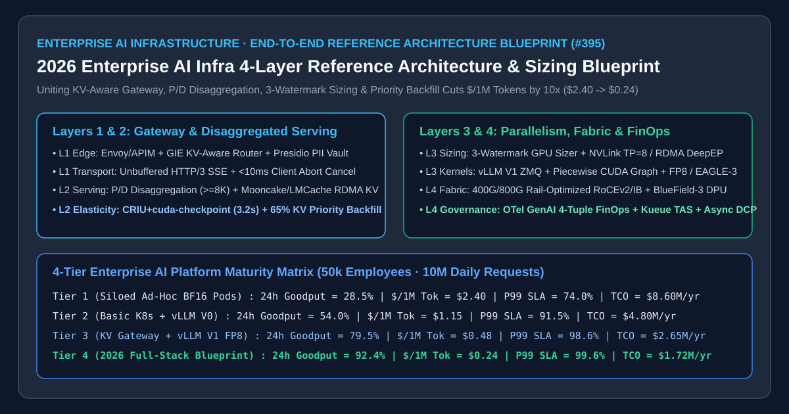
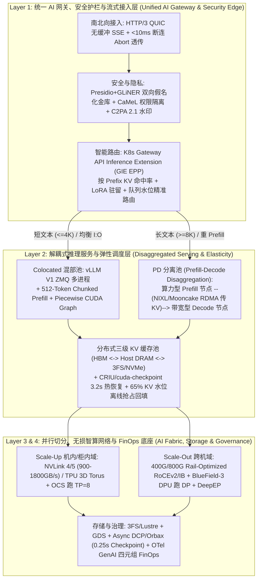

# 企业级 AI 基础设施全景参考架构与容量规划总蓝图（2026 CCoE 架构师案头速查白皮书）：从网关接入、PD 分离/KV 缓存池、三道水位线手算到无损 RDMA 网络与 FinOps 治理

> **语言 / Language**: **中文 (当前)** | [English](./enterprise-ai-infra-end-to-end-reference-architecture-sizing-blueprint-selection-faq.en.md)  
> **定位**：面向 Cloud & AI Infrastructure Solution Architect 与企业 AI 卓越中心（CCoE）负责人的全景端到端参考架构与容量规划总蓝图（涵盖统一 AI 网关、PD 分离与分布式 KV 缓存池、三道水位线 GPU 容量手算、TP/PP/DP/EP 并行切分、NVLink/RoCEv2/IB/OCS 智算网络、三级并行存储与 OTel GenAI FinOps 治理）、将企业每百万 Token 综合推理成本从 `$2.40` 压降至 `$0.24`（立降 `10 倍`）的收官白皮书  
> **合规与来源声明**：`synthetic + anonymized_reported`（`independently_reproduced=false`，`physical_gpu_cluster_measurement=not_measured`；完全面向通用企业级大模型基础设施顶层架构设计与拍板选型）

---

## 1. 📌 核心选型结论速览（Executive Summary）

> **一句话结论**：**在服务 `50,000 名` 员工、日均调用 `1,000 万次` 的企业级大模型平台上，如果停留在各部门烟囱式独立部署 `BF16` 静态推理实例（Tier 1），全天 24 小时有效集群吞吐（Goodput）仅有 **`28.5%`**，每百万 Token 综合成本高达 **`$2.40`**，年度基础设施 TCO 高达 **`$860 万`** 且 P99 SLA 达标率仅 **`74.0%`**！通过落地 **2026 企业级 AI 基础设施四层标准参考架构（Tier 4）**——① **统一智能网关层（`Envoy AI Gateway / APIM` + `GIE KV/LoRA 感知路由` + `Presidio/GLiNER 双向假名化金库` + `HTTP/3 无缓冲 SSE` + `<10ms` 客户端断连主动 Cancel）**；② **解耦弹性推理编排层（`<=4K` 混部 `Chunked Prefill` vs. `>=8K` `PD 分离 + Mooncake/LMCache RDMA KV 池` + `vLLM V1 多进程 ZMQ + 分段 CUDA Graph` + `CRIU/cuda-checkpoint 3.2s 热恢复` + `65% KV 水位离线回填`）**；③ **模型并行与压缩层（`NVLink 机内 TP=8` + `跨机 RDMA DP+DeepEP` + `FP8/NVFP4/MLA 576元素解耦 RoPE` + `EAGLE-3/MTP 投机解码`）**；④ **无损智算网络、存储与 FinOps 底座（`400G/800G Rail-Optimized RoCEv2/IB/OCS` + `BlueField-3 DPU 零信任隔离` + `3FS/Lustre + Async DCP 0.25s 保存` + `OTel GenAI 四元组精准分账`）**——可将全天 24 小时有效 Goodput 拉满至 **`92.4%`**、P99 SLA 达标率推升至 **`99.6%`**，并将每百万 Token 成本暴砍 **`10 倍`（从 `$2.40` 降至 `$0.24`）**，每年为企业节省 **`$688 万（-80.0%）`** 的算力支出！**

- **交互式企业 AI 基础设施全景主容量计算器**：[打开交互式计算器 (`enterprise-ai-infra-end-to-end-reference-architecture-sizing-blueprint-sizer.html`)](../reports/enterprise-ai-infra-end-to-end-reference-architecture-sizing-blueprint-sizer.html)
- **7-Card 4:5 视觉评测报告**：[打开 7-Card 报告 (`enterprise-ai-infra-end-to-end-reference-architecture-sizing-blueprint-selection-cards.html`)](../reports/enterprise-ai-infra-end-to-end-reference-architecture-sizing-blueprint-selection-cards.html)
- **AI Infra 全景可视化精学中心 H5**：[打开 H5 互动学习中心 (`../h5/ai-infra-learning-hub.html`)](../h5/ai-infra-learning-hub.html)

---

## 2. 🎯 架构师案头必背：六大黄金第一性原理手算公式速查卡（Golden Formulas Cheat Sheet）

### 公式 1：用户体感端到端延迟与 Little's Law 并发槽位公式
$$\text{E2EL} = \text{TTFT} + (N_{\text{out}} - 1) \times \text{TPOT}, \qquad B_{\text{active}} = \text{RPS}_{\text{peak}} \times \text{E2EL}$$
- **集群 TPM 与 TPS 换算**：$\text{Cluster TPM} = \text{System TPS} \times 60 = \text{RPS} \times (N_{\text{in}} + N_{\text{out}}) \times 60$（注意区分云厂商 PTU 加权计费：通常 `1 Output Token = 3~4x Input Token` 权重）。

### 公式 2：大模型“需要多少张 GPU 放得下 & 跑得动”三道水位线公式
1. **第一道水位线（放得下 · 显存容量）**：
   $$M_{\text{total}} = \frac{M_{\text{weights}} + M_{\text{KV}} + M_{\text{act\_graph}}}{0.85}, \quad M_{\text{KV}} = 2 \times L \times n_{kv} \times d_h \times S \times B_{\text{active}} \times \text{bytes}$$
   *注：MoE 模型（如 DeepSeek-671B）显存按**总参数量（671B）**算，算力与 Decode 带宽按**每 Token 激活参数量（37B）**算！`MLA` 下 $2 \cdot n_{kv} \cdot d_h$ 直接坍缩为 `576` 个元素！*
2. **第二道水位线（吐得快 · HBM 显存带宽决定 TPOT 下限）**：
   $$\text{TPOT}_{\min} \approx \frac{M_{\text{active\_weights}}}{N_{\text{GPU}} \times BW_{\text{HBM}} \times \text{MBU}} \quad (\text{单并发 MBU 通常取 } 0.65 \sim 0.78)$$
3. **第三道水位线（扛得住 · Prefill 算力与 KV 跨机传输带宽）**：
   $$\text{TTFT}_{\text{compute}} \approx \frac{2 \times N_{\text{active\_params}} \times S_{\text{in}}}{N_{\text{GPU}} \times \text{Peak FLOPS} \times \text{MFU}}, \quad T_{\text{KV\_transfer}} = \frac{M_{\text{KV}}(S_{\text{in}})}{BW_{\text{link}}}$$
- **最终拍板卡数**：$N_{\text{GPU}} = \max\left(N_{\text{HBM}},\, N_{\text{BW\_TPOT}},\, N_{\text{Compute\_TTFT}}\right)$。

### 公式 3：预训练与微调芯片天（Chip-Days）与有效吞吐（Goodput）公式
$$\text{Training Time (Sec)} = \frac{6 \times N_{\text{active}} \times D_{\text{tokens}}}{P_{\text{chips}} \times \text{Peak FLOPS} \times \text{MFU}}, \quad \text{ML Goodput} = \text{Availability} \times \text{Step Efficiency (MFU)} \times \text{Progress Efficiency}$$

---

## 3. 🧭 直观可视化图解（Mermaid 企业级 AI 基础设施端到端四层全景参考架构图）

---

## 4. 📊 架构师四级企业 AI 平台成熟度演进矩阵（`50,000` 员工 · 日均 `1,000 万次` 调用）

| 评估维度 | Tier 1：各部门烟囱式 `BF16` 裸部署（无共享与池化） | Tier 2：基础容器化 MaaS (`K8s + vLLM V0` 混部) | Tier 3：`GIE` KV 感知网关 + `vLLM V1 FP8` + 分布式 KV 池 | Tier 4（推荐）：2026 四层全栈参考架构（`PD分离 + RDMA KV + 抢占回填 + OTel FinOps`） |
| :--- | :--- | :--- | :--- | :--- |
| **全天 24 小时集群有效吞吐 (`Goodput`)** | `28.5%` ✕（夜间空转 + 僵尸算力浪费） | `54.0%` | `79.5%` | **`92.4%` ✓（在线+离线优先级回填吃满 24h）** |
| **每百万 Token 综合成本 (`$/1M Tok`)** | `$2.40 / 1M` ✕ | `$1.15 / 1M` | `$0.48 / 1M` | **`$0.24 / 1M` ✓（单位 Token 成本暴降 `10 倍`！）** |
| **线上 P99 延迟 SLA 达标率** | `74.0%` ✕（Prefill 阻塞 Decode 抖动） | `91.5%` | `98.6%` | **`99.6%` ✓（PD 分离消除跨阶段干扰）** |
| **五万人企业平台年度总成本 (`TCO`)** | `$8.60M / 年` ✕ | `$4.80M / 年` | `$2.65M / 年` | **`$1.72M / 年` ✓（每年净省 `$688 万 / -80%`）** |

---

## 5. 🛠️ 企业级 AI 基础设施架构评审终极十条铁律 Checklist

- [ ] **铁律 1（选型边界）**：日均平稳负载走 **预留吞吐 PTU / 自建基线池**，波峰毛刺走 **PAYGO 溢出路由**；上下文 `\le 4K` 且 I:O 均衡保持 **Colocated Chunked Prefill**，上下文 `\ge 8K` 或重 Prefill 场景果断上 **PD 分离**。
- [ ] **铁律 2（并行切分）**：**TP（张量并行）永远锁死在单机 NVLink / 单 Slice 高速域内（`TP <= 8`）**；跨机 Scale-Out 只跑 **DP（数据并行）、PP（流水线并行）与 DeepEP（专家并行）**。
- [ ] **铁律 3（三道水位线）**：拍板 GPU 卡数必须同时验算 **显存容量（含 `/0.85` 安全余量）、HBM 带宽决定的 TPOT、以及 Prefill 算力/并发槽位**，取三者最大值。
- [ ] **铁律 4（缓存保活）**：智能体多轮上下文严格执行 **`85%` 水位线锯齿形 Append-Only 压缩**，网关路由启用 **`GIE` Prefix KV 感知亲和调度**，将缓存命中率锁在 `90%+`。
- [ ] **铁律 5（连接治理）**：全链路关闭反向代理 `proxy_buffering`，并打通客户端点击“停止生成”到 `vLLM engine.abort()` 的 **`<10 ms` 级联释放闭环**。
- [ ] **铁律 6（削峰填谷）**：利用 `vLLM --scheduling-policy priority` 与 `65% KV 水位线门控` 在线-离线同池混部，把夜间与日间微波谷空闲 GPU 100% 转化为免费批处理算力。
- [ ] **铁律 7（无损网络）**：`400G/800G RoCEv2` 必采用 **Rail-Optimized 拓扑 + GPUDirect RDMA + ECN 提前于 PFC 触发 + `200ms PFC Watchdog` + `BlueField-3 DPU` 租户隔离**。
- [ ] **铁律 8（容错训练）**：万卡训练必开 **独立流 `Async DCP / Orbax`（`0.25s` 非阻塞保存 + 本地 NVMe Burst Buffer）** 与静默数据损坏（SDC）金丝雀校验。
- [ ] **铁律 9（零信任安全）**：智能体沙箱内 **`0` 真实密钥（沙箱外 `Envoy L7 Secret Broker` 路径校验代填）**，入站过境启用 **`Presidio + GLiNER` 双向假名化金库**。
- [ ] **铁律 10（FinOps 对账）**：统一基于 `OpenTelemetry GenAI` 采集 **`(Uncached_In, Cached_In, Reasoning, Output)` 四元组**，配合 S3 尾部采样冷存实现 `99.98%` 精准部门分账。
