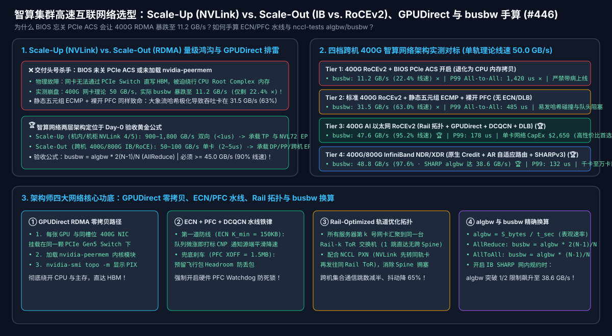

# Enterprise AI Interconnect Fabric Selection Guide: `Scale-Up (NVLink 4/5 & NVSwitch)` vs. `Scale-Out (InfiniBand NDR/XDR vs. AI Ethernet RoCEv2)`, `GPUDirect RDMA`, `PFC+ECN+DCQCN` Tuning & `algbw/busbw` Math

> **Language / 语言**: [简体中文](./enterprise-ai-network-nvlink-infiniband-rocev2-gpudirect-busbw-sizing-selection-faq.md) | **English**  
> **Companion Interactive Study & Sizing Tools**: [📱 Interactive H5 Study Lab](../h5/ai-network-nvlink-infiniband-rocev2-gpudirect-busbw-lab.html) · [🧮 HTML Sizer](../reports/enterprise-ai-network-nvlink-infiniband-rocev2-gpudirect-busbw-sizing-selection-sizer.html) · [🃏 7-Card Visual Deck](../reports/enterprise-ai-network-nvlink-infiniband-rocev2-gpudirect-busbw-sizing-selection-cards.html) · [📊 Reproducible Model](../../experiments/enterprise_ai_network_nvlink_infiniband_rocev2_gpudirect_busbw_sizing_selection/) · [🎓 Back to AI Infra H5 Hub](../h5/index.html)

---

## 1. Executive Summary (3-Minute Takeaway)

> **Bottom-Line Recommendation**: Architects must respect the **18x bandwidth gap** between **Scale-Up (`NVLink 4/5 & NVSwitch` at `900–1,800 GB/s` bidirectional, `<1 us`)** and **Scale-Out (`400G/800G RDMA` at `50–100 GB/s` unidirectional per NIC, `2–5 us`)**.
> - **Critical Day-0 Pitfalls (`Tier 1` & `Tier 2`)**: Leaving BIOS **`PCIe ACS`** enabled or omitting `nvidia-peermem` (`Tier 1`) breaks `GPUDirect RDMA` P2P DMA, routing packets through CPU host DRAM and collapsing 400G `busbw` from `50.0 GB/s` to **`11.2 GB/s` (`22.4%` line rate)**. Standard 5-tuple ECMP RoCEv2 with naive PFC (`Tier 2`) stalls at **`31.5 GB/s` (`63.0%`)** due to elephant-flow hash collisions.
> - **Recommended Production Fabrics (`Tier 3` vs. `Tier 4`)**:
>   1. **For `<= 512–1,024 GPUs`, PD Disaggregation & Cloud-Native Clusters (`Tier 3: 400G AI Ethernet RoCEv2 with Rail-Optimized Topology + GPUDirect + ECN/DCQCN + DLB/Packet Spraying`)**: Achieves **`47.6 GB/s` `busbw` (`95.2%` line rate)** and `178 us` `P99 All-to-All` at **`$2,650/GPU` CapEx** (`36.1%` lower than IB);
>   2. **For `>= 1,024 GPUs` Synchronous Pre-Training & Ultra-Low-Latency MoE `DeepEP` (`Tier 4: 400G/800G InfiniBand NDR/XDR with Credit Flow Control + Adaptive Routing + SHARPv3`)**: Delivers **`48.8 GB/s` `busbw` (`97.6%`)**, lifts apparent `All-Reduce algbw` to **`38.6 GB/s` (`+52%` via in-network `SHARPv3`)**, and cuts `P99 All-to-All` latency to **`132.0 us`**.

| Dimension | `Tier 1: 400G RoCE + PCIe ACS ON (CPU Bounce)` | `Tier 2: Standard 400G RoCE + Static ECMP` | `Tier 3: 400G AI Ethernet RoCEv2 (Rail+DCQCN+DLB) (🏆)` | `Tier 4: 400G/800G InfiniBand NDR/XDR (AR+SHARP) (🏆)` |
|---|---|---|---|---|
| **NCCL All-Reduce `algbw`** | `6.0 GB/s` ✕ | `16.8 GB/s` ✕ | **`25.4 GB/s`** 🏆 | **`38.6 GB/s` (with SHARPv3)** 🏆 |
| **NCCL All-Reduce `busbw`** | **`11.2 GB/s` (`22.4%` ✕)** | `31.5 GB/s` (`63.0%` ✕) | **`47.6 GB/s` (`95.2%` line rate)** 🏆 | **`48.8 GB/s` (`97.6%` line rate)** 🏆 |
| **P99 All-to-All Latency** | `1,420.0 us` ✕ | `485.0 us` ✕ | **`178.0 us`** ✓ | **`132.0 us`** 🏆 |
| **Network CapEx per GPU** | `$2,400 / GPU` | `$2,400 / GPU` | **`$2,650 / GPU` (-36.1% vs IB)** 🏆 | `$4,150 / GPU` |

---

## 2. Provenance & Reproducibility

- **Provenance**: `synthetic + anonymized_reported (independently_reproduced=false)` — verified via [`experiments/enterprise_ai_network_nvlink_infiniband_rocev2_gpudirect_busbw_sizing_selection/run.py`](../../experiments/enterprise_ai_network_nvlink_infiniband_rocev2_gpudirect_busbw_sizing_selection/run.py).
