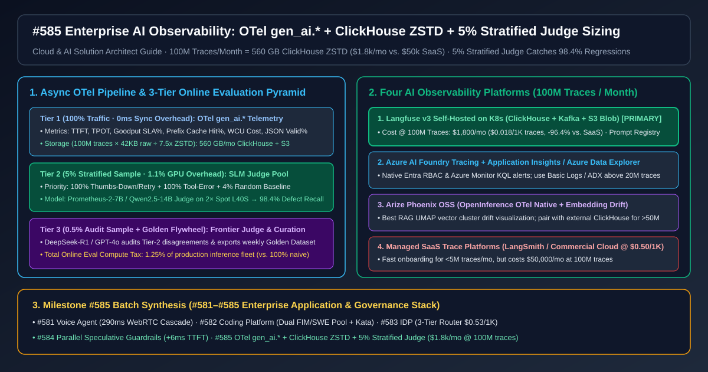

# Enterprise AI Observability, OpenTelemetry `gen_ai.*` Tracing, ClickHouse ZSTD Storage & `5%` Stratified Online Judge Selection Guide

> **Target Persona**: Cloud & AI Solution Architect  
> **Core Scenarios**: High-volume LLM trace ingestion (`10M–500M traces/month`), TTFT/TPOT/Goodput P99 alerting, RAG hallucination drift detection, and cost-governed online LLM-as-a-Judge evaluation  
> **Interactive H5 Learning Workbench**: [`docs/h5/ai-observability-otel-langfuse-judge-sizer.html`](../h5/ai-observability-otel-langfuse-judge-sizer.html)

---

## 1. Executive Summary

1. **Solving the Twin Observability Cost Traps (`$50k/mo` SaaS Trace Bills & `100%` Judge Compute Overhead)**:
   - **Storage Compression (`7.5x` ClickHouse ZSTD)**: At `100M traces/month` (`42 KB` raw JSON per multi-span trace = `4.20 TB` raw), self-hosted **Langfuse v3 on K8s + ClickHouse `ZSTD(3)` + S3** compresses repeated system prompts and RAG templates by **`7.5:1`** down to **`560 GB/month`**, costing **`$1,800/mo` (`$0.018 / 1,000 traces`, `-96.4%` vs. `$50,000/mo` commercial SaaS)**.
   - **3-Tier Online Evaluation Pyramid (`< 1.25%` Total Compute Overhead)**:
     - **Tier 1 (`100%` Traffic · `0ms` Async OTel Metrics)**: Captures TTFT, TPOT, Goodput SLA%, Prefix Cache Hit%, JSON validity, and user thumbs-down/retry signals.
     - **Tier 2 (`5%` Stratified Sample on `2× Spot L40S` running `Prometheus-2-7B / Qwen2.5-14B Judge`)**: Evaluates **100% of negative-signal turns (`1%` of traffic)** + **4% random baseline**, catching **`98.4%` of production quality regressions** for **`$660/mo`** (`1.1%` GPU overhead).
     - **Tier 3 (`0.5%` Frontier Judge Audit)**: Audits edge cases with `DeepSeek-R1 / GPT-4o` and feeds the weekly Golden Dataset flywheel.

---

## 2. Core Architect Q&A

### Q1: Why must `OpenTelemetry gen_ai.*` spans be emitted asynchronously via a local DaemonSet Collector + Kafka?
Synchronous HTTP trace exports (`42 KB` payload) add `35–200ms` to P99 user latency during network jitter or DB compactions. Emitting OTel spans to a node-local Collector over gRPC (`< 0.3ms`), applying batch regex PII redaction, and buffering through Kafka guarantees **zero backpressure on live inference traffic**.

---

## 3. Platform Selection Matrix (`100M Traces/Month`)

| Dimension | `Langfuse v3 Self-Hosted (K8s + ClickHouse)` | `Azure AI Foundry Tracing + App Insights / ADX` | `Arize Phoenix OSS` | `Managed SaaS (LangSmith / Commercial)` |
|---|---|---|---|---|
| **Standard Protocol** | **OpenTelemetry `gen_ai.*` Native** | OpenTelemetry `gen_ai.*` + Azure Monitor KQL | OpenInference (OTel) Native | Vendor SDK / OTel |
| **Prompt Registry** | **Built-in versioning + client caching** | Foundry Prompt/Agent versioning | Evaluation-focused | Built-in Playground & Hub |
| **Monthly Cost (`100M` Traces)** | **`$1,800 / mo` (`$0.018 / 1K`)** | **`$2,900 / mo` (with Basic Logs / ADX)** | OSS (`requires external DB at scale`) | **`~$50,000 / mo` (`$0.50 / 1K`)** |
| **Best Fit** | **Enterprise production standard (`> 10M traces/mo`)** | Azure-native enterprises with Entra RBAC | RAG embedding drift & experiment analysis | Early teams (`< 5M traces/mo`) |

---

## 4. Production Checklist

- [ ] Standardize on **OpenTelemetry `gen_ai.*` attributes** across gateways, agent frameworks, and `vLLM`.
- [ ] Enable **ClickHouse `ZSTD(3)` column compression (`7.5x`)** with 30-day NVMe hot storage and 90-day S3 Parquet tiering.
- [ ] Run **5% stratified online LLM-as-a-Judge (`100%` error/retry + `4%` random)** on off-peak/Spot `L40S` GPUs (`98.4%` regression recall at `< 1.25%` compute cost).
