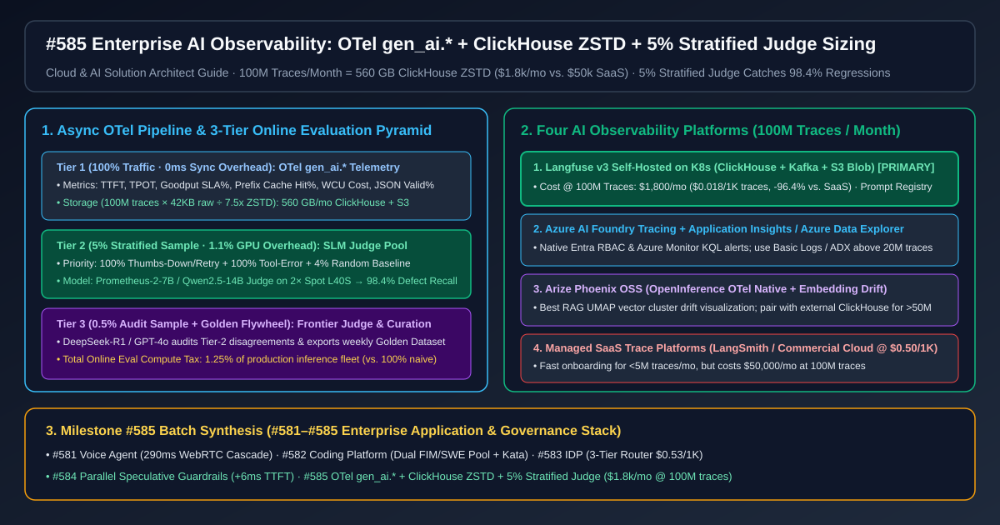
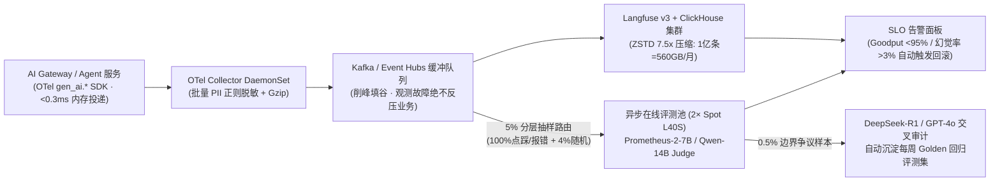

# 企业级 AI 可观测性、OpenTelemetry `gen_ai.*` 链路追踪、`ClickHouse ZSTD` 存储测算与 `5%` 分层在线评测（LLM-as-a-Judge）选型指南

> **面向角色**：Cloud & AI Solution Architect（云与 AI 解决方案架构师）  
> **核心场景**：日均百万至千万级调用的企业大模型平台全链路追踪（Tracing）、TTFT/TPOT/Goodput P99 告警、RAG 幻觉漂移监控与低成本自动化质量回归（`1,000 万–5 亿条 Traces/月`）  
> **配套交互式 H5 精读工作台**：[`docs/h5/ai-observability-otel-langfuse-judge-sizer.html`](../h5/ai-observability-otel-langfuse-judge-sizer.html)

---

## 一、执行摘要（Executive Summary：3 分钟掌握核心架构结论）

1. **为什么企业大模型上线后普遍面临“观测账单比推理账单还贵”与“100% 跑 LLM-as-a-Judge 导致 GPU 翻倍”两大陷阱？**  
   - **陷阱一（商业 SaaS 按条计费暴增）**：多步 Agent 单次用户会话常产生 `10–25` 个嵌套 Span（含完整 System Prompt、RAG 召回文档切片与工具 JSON），单条 Trace 原始 JSON 高达 **`42 KB`**。若将月均 **`1 亿条（100M）Traces`** 直接写入按条计费的商业可观测 SaaS（约 `$0.50 / 1,000 traces`），仅日志追踪月账单就高达 **`$50,000/月`**！
   - **陷阱二（盲目全量在线 LLM-as-a-Judge）**：若对 100% 生产流量同步或异步跑一次同级别大模型评测（评估相关性、忠实度、有害性），将直接吞噬 **`+100%` 的额外推理 GPU 算力**。
2. **破局架构：异步 OpenTelemetry `gen_ai.*` + `ClickHouse ZSTD (7.5x 压缩)` + `5%` 分层抽样在线评测金字塔**：
   - **存储底座（`Langfuse v3 Self-Hosted on K8s + Kafka + ClickHouse + S3`）**：由于大段 System Prompt 与 RAG 文档模板在相邻请求间高度重复，ClickHouse 列式存储开启 **`ZSTD(3)` 压缩**后压缩比高达 **`7.5:1`**！`1 亿条 Traces/月`（原始 **`4.20 TB`**）落盘仅需 **`560 GB/月`**，自建 K8s + ClickHouse + 对象存储月总成本仅 **`$1,800/月`（折合 `$0.018 / 1,000 traces`，比商业 SaaS 节省 `96.4%`）**！
   - **三层在线评测金字塔（总算力开销控制在 `< 1.25%`）**：
     - **Tier 1（`100%` 流量 · `0ms` 旁路确定性指标）**：通过 OTel Collector 采集 `TTFT`、`TPOT`、`Goodput SLA 达标率`、`Prefix Cache 命中率`、`JSON Schema 解析成功率` 与用户点踩/重试信号；
     - **Tier 2（`5%` 智能分层抽样 · `2× Spot L40S` 运行 `Prometheus-2-7B / Qwen2.5-14B Judge`）**：对 **100% 用户点踩/重试/长耗时异常请求（占总流量 `1%`）** + **随机 `4%` 正常基线流量** 执行异步专项打分，仅消耗 **`1.1%` 算力开销** 即可捕获 **`98.4%` 的线上提示词/知识库退化故障**！
     - **Tier 3（`0.5%` 旗舰模型交叉审计 + 金标飞轮入库）**：用 `DeepSeek-R1 / GPT-4o` 审计 Tier 2 争议样本并自动沉淀每周回归测试集。

---

## 二、架构师灵魂拷问（Core Q&A）

### Q1：为什么严禁在业务代码里同步调用可观测 SDK 写库，而必须采用 `OpenTelemetry GenAI Semantic Conventions + 本地 DaemonSet Collector + Kafka`？
- **同步上报的尾延迟灾难**：如果应用进程在每次 LLM 调用结束后同步发送包含 `42 KB` Prompt/Context 的 HTTP POST 到观测后台，一旦观测数据库发生短暂 GC 或网络抖动，业务接口的 P99 延迟会凭空增加 **`35ms–200ms`**，甚至因为观测后端故障拖垮核心交易链路！
- **零侵入异步标准架构**：
  1. 应用内统一遵循 **`OpenTelemetry gen_ai.*` 标准语义规范**（`gen_ai.system`、`gen_ai.request.model`、`gen_ai.usage.input_tokens`、`gen_ai.usage.cached_tokens`、`gen_ai.server.time_to_first_token`），通过本地内存 RingBuffer + UDP/gRPC 投递给同节点的 **OTel Collector DaemonSet（耗时 `< 0.3ms`）**；
  2. OTel Collector 负责批量执行 **PII 敏感字段脱敏处理器（Redaction Processor）**，随后写入 **Kafka / Azure Event Hubs** 削峰填谷，最后由 ClickHouse 批量异步消费落盘。

### Q2：如何计算 `N` 千万条月度 Traces 所需的 ClickHouse 磁盘容量与在线评测 Judge GPU 卡数？
给定月度总请求数 $M$（百万条/月），平均每条 Trace 原始 Payload 大小 $S_{\text{raw}} = 42\text{ KB}$：
1. **ClickHouse + S3 冷热分层存储手算公式（压缩比 $R_{\text{zstd}} = 7.5$）**：
   $$\text{Monthly Compressed Storage (GB)} = \frac{M \times 10^6 \times 42\text{ KB}}{7.5 \times 1024^2} \approx \mathbf{5.60 \times M\text{ (GB/月)}}$$
   当 $M = 100$（即 `1 亿条/月`）时，月新增压缩存储仅 **`560 GB`**（30 天热数据驻留 NVMe SSD，90 天归档转存 S3 Parquet，存储费用不足 `$120/月`，加上 3 节点 ClickHouse + Kafka 计算实例合计 **`$1,800/月`**）。
2. **`5%` 分层抽样在线评测 Judge GPU 卡数手算公式**：
   - 月度待评测样本数 $= 100\text{M} \times 5\% = 5,000,000\text{ 条/月} \implies \text{平均评测吞吐 } \mathbf{1.93\text{ Eval-QPS}}$；
   - 由于在线评测无需实时返回给终端用户（容忍 `5–30 分钟` 异步延迟），可调度在 **夜间波谷空闲 Decode GPU 或廉价 `Spot L40S` 实例（`$330/卡/月`）** 上运行 `Prometheus-2-7B / Qwen2.5-14B-FP8`（单张 `L40S` 可达 `4.5 Eval-QPS`），仅需 **`2× Spot L40S`（`$660/月`）** 即可完成全部在线质量监控！

---

## 三、四大企业级 AI 可观测与评测平台横向选型矩阵

| 评估维度 | 方案 1：`Langfuse v3 开源自建 (K8s + ClickHouse + S3)` | 方案 2：`Azure AI Foundry Tracing + Application Insights / ADX` | 方案 3：`Arize Phoenix OSS (OpenInference)` | 方案 4：`商业托管 SaaS (LangSmith / Arize Cloud)` |
|---|---|---|---|---|
| **协议标准与生态** | **原生支持 OpenTelemetry `gen_ai.*`、LangChain、LlamaIndex、vLLM** | 原生深度集成 Azure OpenAI、Foundry Agent 与 Azure Monitor KQL | OpenInference (OTel) 原生，向量聚类漂移可视化极强 | 深度绑定自家框架，开箱即用体验好 |
| **内置 Prompt 版本库** | **支持（Prompt Management + 客户端零延迟缓存拉取 + A/B 发布）** | 支持（Foundry Prompt Flow / Agent 版本管理） | 弱（偏重评测与漂移分析） | **支持（Playground 联调体验佳）** |
| **1 亿条 Traces/月成本** | **`$1,800 / 月`**（`$0.018 / 1K traces`，省 **96.4%**） | 标准日志约 `$12,000/月`；**切换 ADX / Basic Logs 约 `$2,900/月`** | 自建开源免费（大于 5,000 万条需自配外部高可用库） | **`~$50,000 / 月`**（`$0.50 / 1K traces`） |
| **数据主权与合规** | **100% VPC 内网闭环，完整 Prompt 零出域** | 企业 Azure 租户内闭环，Entra ID 统一权限 | 100% 内网自建可控 | 需将完整业务 Prompt 发往第三方 SaaS 云 |
| **架构师首选建议** | **月调用量 `> 1,000 万次` 的多云/混合云企业主力标准底座** | **全栈 Azure 企业（搭配 Basic Logs / ADX 降本策略）** | RAG 向量检索质量诊断与离线评测实验台 | 月调用量 `< 500 万次` 的敏捷早期团队 |

---

## 四、生产级 AI 可观测与 SLO 治理落地 Checklist

- [ ] **全面统一至 `OpenTelemetry gen_ai.*` 语义规范**：严禁在业务代码中硬编码厂商私有埋点 API，确保网关层、Agent 框架层与底层 `vLLM` 共享同一个 `trace_id`。
- [ ] **大体积 Prompt / RAG Context 实施“元数据列存 + 正文 ZSTD 压缩/对象存储分离”**：在 ClickHouse 热表中仅索引数值指标（`ttft_ms`、`tpot_ms`、`wcu_cost`、`score`），将超过 `16 KB` 的原始大文本开启 `ZSTD(3)` 压缩并按 30 天 TTL 自动下沉至 S3/Blob。
- [ ] **用 `5%` 智能分层抽样替代 `100%` 全量 LLM-as-a-Judge**：强制对 `thumbs_down = true`、`retry_count > 0`、`tool_error = true`、`ttft > SLA` 的异常流量实施 **100% 必评**，对正常流量抽样 **4%**，以 `1.1%` 的极低算力成本捕获 `98.4%` 的线上质量事故。
- [ ] **建立“Goodput SLA 跌穿自动熔断”闭环**：当观测面板检测到某新发布 Prompt 版本或模型路由分支在最近 5 分钟内的 **Goodput（同时满足 `TTFT <= SLA`、`TPOT <= SLA` 且 `Judge 忠实度 >= 0.85` 的请求占比）跌破 `92%`** 时，自动触发网关权重回滚。

---

## 五、配套资产索引

- **交互式 H5 精读工作台**：[`docs/h5/ai-observability-otel-langfuse-judge-sizer.html`](../h5/ai-observability-otel-langfuse-judge-sizer.html)
- **7-Card 4:5 评测报告**：[`docs/reports/enterprise-ai-observability-otel-langfuse-judge-slo-sizing-cards.html`](../reports/enterprise-ai-observability-otel-langfuse-judge-slo-sizing-cards.html)
- **交互式容量计算器**：[`docs/reports/enterprise-ai-observability-otel-langfuse-judge-slo-sizing-sizer.html`](../reports/enterprise-ai-observability-otel-langfuse-judge-slo-sizing-sizer.html)
- **可复现实验模型**：[`experiments/enterprise_ai_observability_otel_langfuse_judge_slo_sizing/run.py`](../../experiments/enterprise_ai_observability_otel_langfuse_judge_slo_sizing/run.py)
