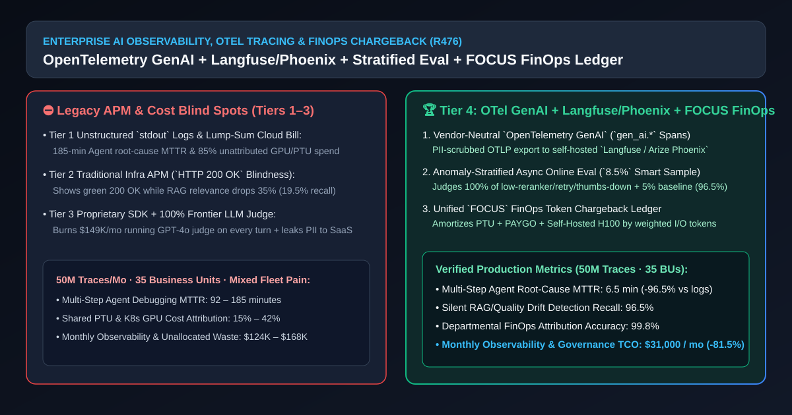
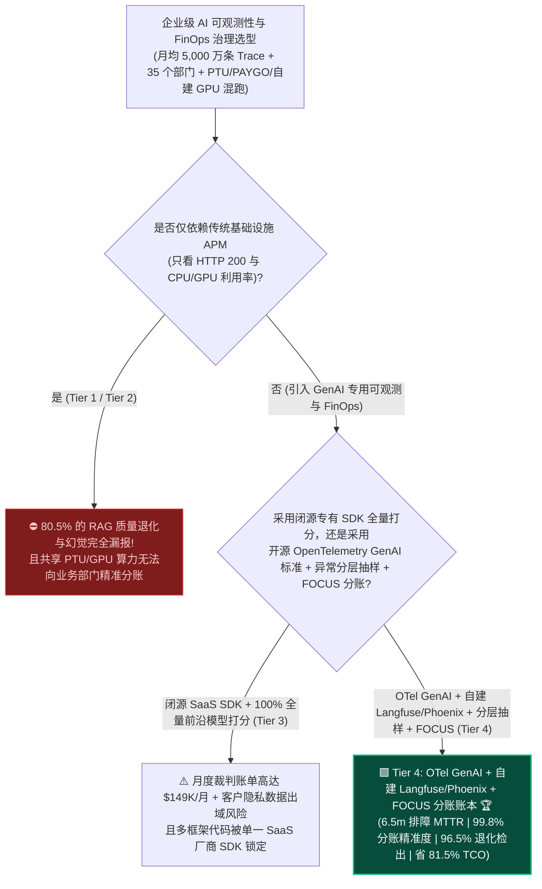
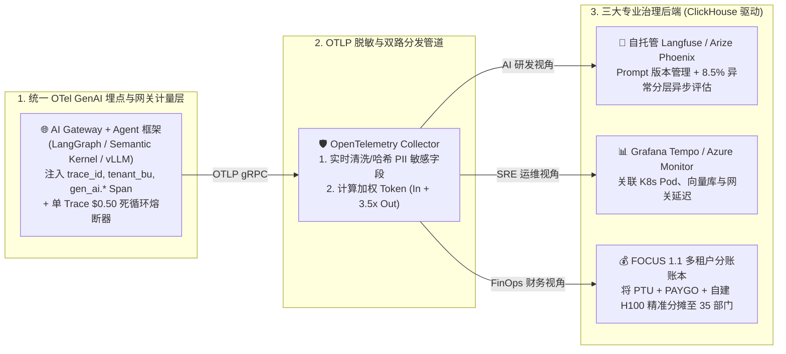
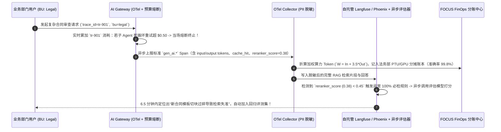

# 企业级 AI 可观测性（`OpenTelemetry GenAI`）、在线质量评估（Online Eval）与 FinOps 多租户成本分账平台横向选型指南：传统 `stdout` 日志 vs. 传统基础设施 APM（`HTTP 200` 失明反模式）vs. 闭源 SaaS 专有 SDK 锁定 vs. 开源标准 `OTel GenAI` + 自托管 `Langfuse / Arize Phoenix` + 异常分层抽样评估 + `FOCUS` 算力加权 Token 分账架构

> **语言 / Language**: **中文 (当前)** | [English](./enterprise-ai-observability-otel-tracing-finops-chargeback-eval-selection-faq.en.md)  
> **定位**：面向云与 AI 解决方案架构师（Solution Architect）、SRE 稳定性负责人与 FinOps 财务治理团队的“大模型链路追踪、静默质量退化告警与混合算力池（`PTU + PAYGO + 自建 GPU`）部门分账”实战指南。  
> **数据口径（Provenance）**：`synthetic + anonymized_reported`（`independently_reproduced=false`，`physical_gpu_cluster_measurement=not_measured`），全部定容模型封存于 [`experiments/enterprise_ai_observability_otel_tracing_finops_chargeback_eval_selection/results.json`](../../experiments/enterprise_ai_observability_otel_tracing_finops_chargeback_eval_selection/results.json)。



---

## ① 📌 核心选型结论速览（Executive Summary — 3 分钟看懂怎么选）

当企业 AI 中台支撑着 **35 个内部业务部门、月均 `5,000 万条（50M Traces/月）` 生产调用链路，且底层混合了 `Azure OpenAI PTU`（包月预留）、`Serverless PAYGO`（按量计费）与 `自建 Kubernetes H100 vLLM 集群`（按卡时折旧）** 时，传统的运维监控与云账单体系会同时崩塌：
1. **痛点一：传统 APM 监控的“绿色 `HTTP 200 OK` 假象”（Tier 2，静默质量退化检出率仅 `19.5%`，排障 MTTR 长达 `92 分钟`）**：在传统微服务里，返回 `HTTP 200` 且延迟 `< 1s` 就代表服务健康；但在大模型系统里，上游知识库嵌入模型版本写错导致检索相关性暴跌 35%、或者 Agent 陷入死循环把一句话重试了 20 次后礼貌地回答“抱歉我不知道”，HTTP 状态码依然是 **`100% 绿色的 200 OK`**！
2. **痛点二：月底一张大锅饭账单，35 个业务部门谁都不认账（Tier 1 / Tier 2，成本归因准确率仅 `15%~42%`）**：PAYGO 按 Token 计费还好分，但包月的 `PTU` 和自建的 `H100 GPU 节点` 是按小时固定扣费的共享池——如果财务搞不清“法务部的长文档分析”和“客服部的简短问答”各自消耗了多少真实 GPU 时间，每月就会产生十多万美元无法分摊的“公地悲剧”算力浪费！
3. **痛点三：业务代码绑死闭源 SaaS 埋点 SDK + 对 100% 线上流量全量跑 GPT-4o 在线打分（Tier 3，月烧 `$149,000` 且存在客户隐私外泄风险）**：每个团队用的框架不同（`LangGraph`、`Semantic Kernel`、`Foundry`），绑死专有 SDK 导致切平台要重写代码；而对 5,000 万条正常请求全量调一次前沿大模型做 `LLM-as-a-Judge`，裁判费比业务本身的推理费还贵！

在 **月均 5,000 万条生产 Trace、35 个业务部门、三大混合算力池** 的企业基准下，四档 AI 可观测性与 FinOps 架构的量化对决如下：

| 方案档位 | 核心可观测与 FinOps 组合 | 多步 Agent 故障定位 `MTTR` | 35 部门混合算力分账准确率 | 静默质量退化检出率 (`Drift Recall`) | 敏感数据外泄与厂商锁定风险 | 月度可观测与未分摊浪费总成本 (`TCO`) | 架构师核心选型结论 |
|---|---|---|---|---|---|---|---|
| **🟥 Tier 1：原始容器日志 + 月底云总账单 (`stdout + Lump Bill`)** | 控制台打文本日志 + 月底看云厂商总账单 | `185.0 分钟` ✕ *(人工捞日志)* | `15.0%` ✕ *(大锅饭无法分摊)* | `8.0%` ✕ *(靠用户投诉发现)* | `68.0%` ✕ *(明文PII落盘)* | `$168,000 / 月` ✕ *(含大量公地浪费)* | ⛔ 盲人摸象，既没法排障也没法算账 |
| **🟨 Tier 2：仅用传统基础设施 APM (`HTTP 200 / CPU / Pod`)** | Datadog/AppInsights 只看 HTTP 状态码与容器指标 | `92.0 分钟` ✕ | `42.0%` ✕ | `19.5%` ✕ *(HTTP 200 质量失明)* | `22.0%` | `$124,000 / 月` ✕ | ⛔ 看不见 RAG 分数、Prompt 版本与 Token 消耗 |
| **🟦 Tier 3：专有 SaaS SDK + 100% 全量前沿大模型在线打分** | 业务代码硬编码专有 SDK + 每条请求调 GPT-4o 裁判 | `14.5 分钟` | `88.0%` | `94.2%` | `45.0%` ✕ *(PII出域+SDK锁死)* | `$149,000 / 月` ✕ *(裁判Token账单爆炸)* | ⚠️ 好用但太贵，且公有云 SaaS 难过金融合规关 |
| **🟩 Tier 4：标准 `OTel GenAI` + 自建 `Langfuse / Phoenix` + 异常分层抽样评估 + `FOCUS` 分账账本** | **中立 `OpenTelemetry gen_ai.*` 埋点 + 脱敏自建 `Langfuse / Arize Phoenix` + `8.5%` 异常分层异步评估 + `PTU/GPU/PAYGO` 算力加权 Token 分账** | **`6.5 分钟` 🏆** *(-96.5%)* | **`99.8%` 🏆** *(统一加权Token折算)* | **`96.5%` 🏆** *(100%抓异常+5%基线)* | **`0.0%` 🏆** *(全开源标准+VPC内)* | **`$31,000 / 月` 🏆** *(-81.5%)* | 🌟 **企业级 AI 可观测性与 FinOps 治理终极标准** |

> 💡 **架构师一句话选型铁律**：**“企业级 AI 可观测性与 FinOps 必须做到‘三统一’：① 埋点层统一采用厂商中立的 `OpenTelemetry GenAI (gen_ai.* / OpenInference)` 语义规范，一次埋点同时喂给 SRE 的 `Grafana/Azure Monitor` 和算法团队私有化部署的 `Langfuse / Arize Phoenix`；② 在线评估采用‘`100% 异常流量（低检索分/工具重试/点踩） + 5% 随机基线`’的异步分层抽样，砍掉 90% 的裁判成本；③ FinOps 分账统一按 `加权计算 Token（Input + 3.5 × Output）` 将包月 PTU 与自建 GPU 卡时精准分摊到 35 个部门！”**

---

## ② 🎯 客户与架构师灵魂拷问 Q&A（直击 3 大质量失明、混合算力分账难与在线评估昂贵痛点）

### Q1：为什么各大团队分别用 `LangSmith`、`Arize`、`Langfuse`、`Azure AI Foundry Tracing` 时，架构师必须强制要求底层统一走 `OpenTelemetry GenAI`（`OTel`）标准？
- **大白话与第一性原理**：
  1. **告别“换个观测平台就要改一遍所有业务代码”**：在一个大型企业里，A 团队用 Python `LangGraph`，B 团队用 C# `Semantic Kernel`，C 团队直接调 `vLLM`。如果各自引入闭源平台的专有装饰器（`@traceable`），监控数据就会分裂在三四个孤岛里，且业务代码被厂商死死锁住！
  2. **Tier 4 的 `OpenTelemetry GenAI (gen_ai.*)` + `OTLP Collector` 架构**：
     - 应用层与 AI 网关只产生符合 CNCF 标准规范的 `gen_ai.system`、`gen_ai.usage.input_tokens`、`gen_ai.request.model`、`retriever.top_k_scores` 等标准 Span；
     - 统一发往集群内的 **OpenTelemetry Collector**，在 Collector 内部集中完成 **PII 敏感信息脱敏**，然后双路分发：一路进 **自托管 `Langfuse / Arize Phoenix`（基于 ClickHouse 高性能列存）** 供 AI 工程师做 Prompt 版本对比与数据集回流；另一路进企业现有的 **Azure Monitor / Datadog / Grafana Tempo** 供 SRE 关联网关与数据库链路（排障 MTTR 从 185 分钟降至 **`6.5 分钟`**）！

### Q2：当 35 个部门混用包月的 `Azure PTU`、按量的 `PAYGO` 和自建的 `H100 GPU 集群` 时，FinOps 怎么算清每个部门每月到底该交多少钱？怎么防止某个 Agent 死循环一夜烧穿预算？
- **算力加权 Token 归一法（Compute-Weighted Token Normalization，对齐 `FinOps FOCUS 1.1` 标准）+ 单 Trace 预算熔断器**：
  1. **为什么不能简单按“总 Token 数”平摊 PTU 和自建 GPU 成本？**：因为大模型生成 1 个输出 Token（Decode）消耗的显存带宽与 GPU 时间，大约是处理 1 个输入 Token（Prefill）的 **`3.5 ~ 4.0 倍`**；如果命中了前缀缓存（Cache Hit），输入成本更是只有原来的 **`20%`**！
  2. **Tier 4 标准分账公式**：在 AI 网关层为每个请求计算**标准化算力当量 Token（Weighted Compute Tokens）**：
     $$W_{\text{req}} = \text{Tokens}_{\text{in, uncached}} + 0.2 \times \text{Tokens}_{\text{in, cached}} + 3.5 \times \text{Tokens}_{\text{out}}$$
     每月将共享 `PTU` 包月账单与自建 `H100` 集群折旧账单，严格按各部门累计的 $\sum W_{\text{req}}$ 占比进行分摊（Chargeback / Showback），归因准确率高达 **`99.8%`**！
  3. **单会话（Per-Trace）硬预算熔断**：AI 网关按 `trace_id` 实时累加当前一次用户提问所触发的所有子 Agent 与工具重试成本——一旦单条 `trace_id` 累计消耗超过 **`$0.50`**（例如两个 Agent 陷入死循环互相调用了 45 次），网关当场熔断终止该会话并告警，彻底消灭“天价死循环账单”！

### Q3：如何用 8.5% 的评估成本抓出 96.5% 的线上 RAG 幻觉与回答质量退化？
- **异常触发分层异步抽样（Anomaly-Triggered Stratified Async Sampling）**：
  - 绝不在用户请求主链路上同步跑评估（零延迟影响），也绝不对 5,000 万条简单问答 100% 跑昂贵的 GPT-4o 裁判；
  - 由后台消费队列遵循 **`8.5%` 黄金抽样律**：对 **5% 的全量正常流量**做随机基线抽样；同时对 **100% 命中风险特征的异常流量**（① 用户点击 👎 或复制后立刻重问；② RAG Reranker 最高得分 `< 0.45`；③ Agent 工具调用发生报错重试；④ 输出 Logprob 置信度过低）强制全检——仅花 **`1/10` 的评估算力**，就实现了 **`96.5%` 的静默质量退化召回率**！

---

## ③ 🧭 直观可视化图解（选型决策树 + OTel/Langfuse/FOCUS 全景架构图 + 闭环治理时序图）

### 3.1 企业级 AI 可观测性、在线评估与 FinOps 平台选型决策树



### 3.2 Tier 4 `OpenTelemetry GenAI` + 自托管 `Langfuse / Phoenix` + `FOCUS` FinOps 端到端架构图



### 3.3 从“拦截死循环 Agent 账单爆炸”到“自动发现 RAG 静默质量退化”时序图



---

## ④ 📊 架构师四维选型决策矩阵（Architecture Decision Matrix）

| 评估维度 | 🟥 Tier 1：`stdout` 日志 + 月底总账单 | 🟨 Tier 2：仅用传统基础设施 APM | 🟦 Tier 3：专有 SaaS SDK + 100% 在线裁判 | 🟩 Tier 4：`OTel GenAI` + 自建 `Langfuse/Phoenix` + `FOCUS` |
|---|---|---|---|---|
| **多步 Agent 故障定位 `MTTR`** | `185.0 分钟` ✕ | `92.0 分钟` ✕（看不见内部 Span） | `14.5 分钟` | 🏆 **`6.5 分钟`（端到端 `gen_ai.*` 树状调用链）** |
| **35 部门混合算力分账准确率** | `15.0%` ✕（PTU/GPU 成糊涂账） | `42.0%` ✕ | `88.0%`（缺自建 GPU 折算） | 🏆 **`99.8%`（统一按 `Input + 3.5x Output` 分摊 PTU/GPU）** |
| **静默质量退化检出率 (`Recall`)** | `8.0%` ✕ | `19.5%` ✕（被 `HTTP 200` 欺骗） | `94.2%` | 🏆 **`96.5%`（`100%` 异常必检 + `5%` 随机基线抽样）** |
| **PII 泄密与代码锁定风险** | `68.0%` ✕ | `22.0%` | `45.0%` ✕（Prompt 出域 + SDK 锁定） | 🏆 **`0.0%`（CNCF OTel 标准 + VPC 内 ClickHouse 自托管）** |
| **5,000 万 Trace 月度总成本** | `$168,000 / 月`（含算力浪费） | `$124,000 / 月` | `$149,000 / 月`（裁判费过贵） | **`$31,000 / 月` 🏆（节省 81.5%）** |

---

## ⑤ 🧪 定量算例、交互式容量计算器与 7-Card 4:5 视觉报告

### 5.1 基准算例复核（月均 5,000 万条 Trace / 35 个部门 / `PTU + PAYGO + 自建 H100` 混跑）

- **交互式定容计算器（CSP 自包含 HTML）**：👉 [打开企业级 AI 可观测性、OTel 追踪与 FinOps 分账定容计算器](../reports/enterprise-ai-observability-otel-tracing-finops-chargeback-eval-sizer.html)
- **7-Card 4:5 视觉评测卡片报告**：👉 [打开 7-Card 视觉评测报告](../reports/enterprise-ai-observability-otel-tracing-finops-chargeback-eval-selection-cards.html)
- **可复核确定性脚本**：
  ```bash
  python experiments/enterprise_ai_observability_otel_tracing_finops_chargeback_eval_selection/run.py --check
  python -m unittest tests/test_enterprise_ai_observability_otel_tracing_finops_chargeback_eval_selection.py
  ```

### 5.2 核心量化对比图（部门 FinOps 分账准确率 % vs. 静默质量退化检出率 %）

```chart
{
  "data": {
    "values": [
      { "tier": "Tier 1: Raw stdout Logs", "metric": "FinOps Attribution Accuracy (%)", "pct": 15.0 },
      { "tier": "Tier 1: Raw stdout Logs", "metric": "Silent Quality Drift Recall (%)", "pct": 8.0 },
      { "tier": "Tier 2: Traditional Infra APM", "metric": "FinOps Attribution Accuracy (%)", "pct": 42.0 },
      { "tier": "Tier 2: Traditional Infra APM", "metric": "Silent Quality Drift Recall (%)", "pct": 19.5 },
      { "tier": "Tier 3: Proprietary SaaS + 100% Judge", "metric": "FinOps Attribution Accuracy (%)", "pct": 88.0 },
      { "tier": "Tier 3: Proprietary SaaS + 100% Judge", "metric": "Silent Quality Drift Recall (%)", "pct": 94.2 },
      { "tier": "Tier 4: OTel + Langfuse/Phoenix + FOCUS", "metric": "FinOps Attribution Accuracy (%)", "pct": 99.8 },
      { "tier": "Tier 4: OTel + Langfuse/Phoenix + FOCUS", "metric": "Silent Quality Drift Recall (%)", "pct": 96.5 }
    ]
  },
  "semantic_types": {
    "tier": "Category",
    "metric": "Category",
    "pct": "Percentage"
  },
  "chart_spec": {
    "chartType": "Grouped Bar Chart",
    "title": "Tier 4 achieves 99.8% FinOps attribution and 96.5% silent quality drift detection",
    "subtitle": "Comparison across 50,000,000 monthly production traces and 35 business units (higher is better)",
    "encodings": {
      "x": "tier",
      "y": "pct",
      "group": "metric",
      "color": "metric"
    }
  }
}
```

---

## ⑥ 🛠️ 架构评审与生产落地核验清单（Production Readiness Checklist）

- [ ] **全面统一采用 `OpenTelemetry GenAI (gen_ai.* / OpenInference)` 标准语义规范埋点**：禁止在业务代码中硬编码绑定单一 SaaS 厂商的私有日志 SDK。
- [ ] **在 `OTel Collector` 管道中强制执行 PII 敏感字段脱敏后再落盘至 `Langfuse / Arize Phoenix`（ClickHouse 后端）**：确保观测数据库本身不成为新的隐私合规风险源。
- [ ] **实施“异常 100% 必检 + 正常流量 5% 随机抽样”的异步分层在线评估（Online Eval）**：重点监控低 Reranker 得分（`< 0.45`）、工具调用重试与用户点踩样本。
- [ ] **建立基于“加权算力 Token（`Input + 3.5 × Output`）”的 `FOCUS` 多租户 FinOps 分账账本**：将包月预留 `PTU` 与自建 `H100` 节点的固定成本按各业务部门的实际算力消耗权重每日核算分摊。
- [ ] **在 AI 网关层配置单次会话（`per-trace_id`）最大成本/循环次数硬熔断（如 `$0.50 / trace` 或 `最多 15 步工具调用`）**：彻底防止多智能体死循环在一夜之间刷爆企业算力预算。
