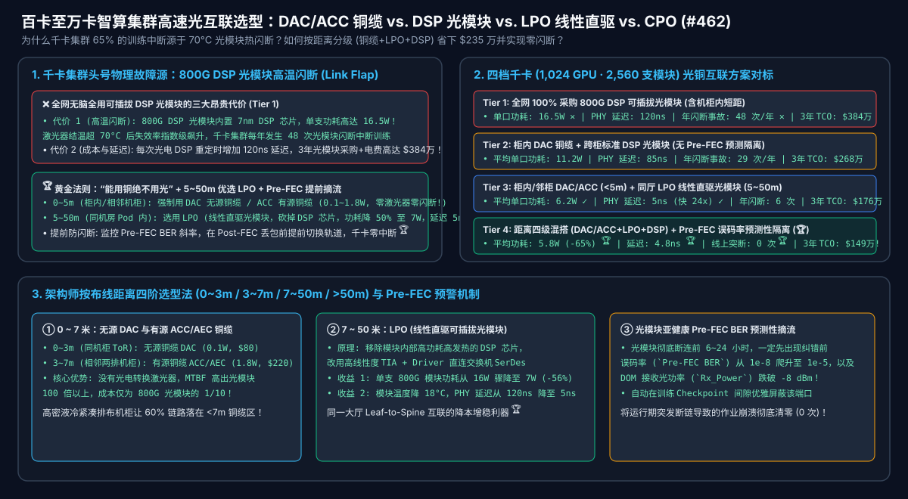

# Enterprise AI Cluster Optical & Copper Interconnect Selection Guide: `DAC/ACC Copper` vs. `Pluggable DSP Optics` vs. `LPO (Linear Pluggable Optics)` vs. `CPO` & Link-Flap TCO

> **Language / 语言**: [简体中文](./enterprise-ai-optical-interconnect-dac-dsp-lpo-cpo-link-flap-tco-selection-faq.md) | **English**  
> **Companion Interactive Study & Sizing Tools**: [📱 Interactive H5 Study Lab](../h5/ai-optical-interconnect-dac-dsp-lpo-cpo-tco-lab.html) · [🧮 HTML Sizer](../reports/enterprise-ai-optical-interconnect-dac-dsp-lpo-cpo-link-flap-tco-selection-sizer.html) · [🃏 7-Card Visual Deck](../reports/enterprise-ai-optical-interconnect-dac-dsp-lpo-cpo-link-flap-tco-selection-cards.html) · [📊 Reproducible Model](../../experiments/enterprise_ai_optical_interconnect_dac_dsp_lpo_cpo_link_flap_tco_selection/) · [🎓 Back to AI Infra H5 Hub](../h5/index.html)

---

## 1. Executive Summary (3-Minute Takeaway)

> **Bottom-Line Recommendation**: Deploying `800G` pluggable DSP optical transceivers everywhere across a 1,024-GPU cluster (`Tier 1`) consumes **`16.5 W/port`**, adds `120 ns` of PHY retiming latency, triggers **48 thermal link-flap job interruptions per year**, and costs `$3.84M` over 3 years.
> - **Recommended Production Strategy (`Tier 4: Distance-Tiered Hybrid [DAC <3m + ACC/AEC 3–7m + LPO Linear Pluggable Optics 7–50m + DSP >50m] + Pre-FEC BER Predictive Link Isolation`)**:
>   1. Uses passive/active copper (`DAC/ACC`) up to `7m` (`0.1–1.8 W`, zero laser flaps) and DSP-free **`LPO`** up to `50m` (`7 W`, `5 ns` PHY latency);
>   2. Cuts average port power by **`64.8%` (`5.8 W` vs. `16.5 W`)**, eliminates unexpected runtime link-flap crashes (**`0/yr`** via `Pre-FEC BER` slope gating), and reduces 3-year interconnect TCO by **`61.2%` (`$1.49M` vs. `$3.84M`, saving `$2.35M`)**.

| Dimension | `Tier 1: 100% Pluggable DSP Optics` | `Tier 2: Intra-Rack DAC + Unmonitored DSP` | `Tier 3: DAC/ACC (<5m) + LPO (<50m)` | `Tier 4: Distance-Tiered Hybrid + Pre-FEC Gate (🏆)` |
|---|---|---|---|---|
| **Avg Power per 800G Port** | `16.5 W` ✕ | `11.2 W` | `6.2 W` ✓ | **`5.8 W` (-64.8%)** 🏆 |
| **Transceiver PHY Latency** | `120.0 ns` ✕ | `85.0 ns` | `5.0 ns` (`24x` lower) ✓ | **`4.8 ns`** 🏆 |
| **Unexpected Link-Flap Outages/Yr** | **`48 / yr` ✕** | `29 / yr` ✕ | `6 / yr` ✓ | **`0 / yr` (Pre-FEC gated)** 🏆 |
| **1K-GPU 3-Year Interconnect TCO** | `$3,840,000` ✕ | `$2,680,000` | `$1,760,000` ✓ | **`$1,490,000` (Saves $2.35M)** 🏆 |

---

## 2. Provenance & Reproducibility

- **Provenance**: `synthetic + anonymized_reported (independently_reproduced=false)` — verified via [`experiments/enterprise_ai_optical_interconnect_dac_dsp_lpo_cpo_link_flap_tco_selection/run.py`](../../experiments/enterprise_ai_optical_interconnect_dac_dsp_lpo_cpo_link_flap_tco_selection/run.py).
