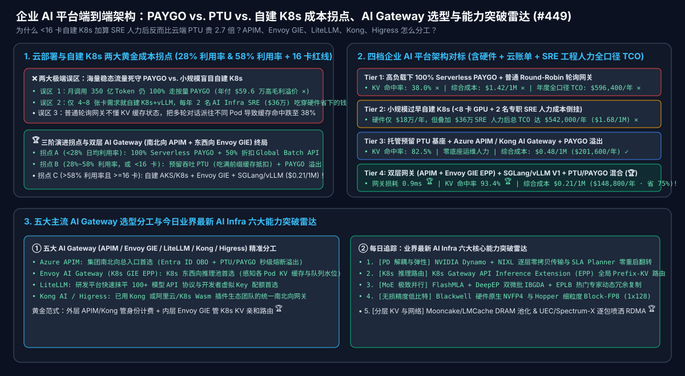

# Enterprise AI Platform End-to-End Architecture, TCO Break-Even (`Serverless PAYGO` vs. `Provisioned PTU` vs. `Self-Hosted K8s/AKS + vLLM/SGLang`), AI Gateway (`APIM / Envoy GIE / LiteLLM / Kong / Higress`) & 2026 AI Infra Breakthrough Guide

> **Language / 语言**: [简体中文](./enterprise-ai-platform-paygo-ptu-k8s-gateway-breakthrough-sizing-selection-faq.md) | **English**  
> **Companion Interactive Study & Sizing Tools**: [📱 Interactive H5 Study Lab](../h5/enterprise-ai-platform-paygo-ptu-k8s-gateway-breakthrough-lab.html) · [🧮 HTML Sizer](../reports/enterprise-ai-platform-paygo-ptu-k8s-gateway-breakthrough-sizing-selection-sizer.html) · [🃏 7-Card Visual Deck](../reports/enterprise-ai-platform-paygo-ptu-k8s-gateway-breakthrough-sizing-selection-cards.html) · [📊 Reproducible Model](../../experiments/enterprise_ai_platform_paygo_ptu_k8s_gateway_breakthrough_sizing_selection/) · [🎓 Back to AI Infra H5 Hub](../h5/index.html)

---

## 1. Executive Summary (3-Minute Takeaway)

> **Bottom-Line Recommendation**: Self-hosting Kubernetes GPU clusters prematurely at small scale (`Tier 2: <8 GPUs`) backfires once **2 dedicated AI Infra SREs (`$360,000/yr` fully loaded staffing cost)** are included (`$1.68 / 1M` tokens), while staying on 100% `Serverless PAYGO` at high sustained volume (`Tier 1: 35B tokens/mo`) overpays `$596,400/yr`.
> - **The Three-Stage TCO Break-Even Rule**:
>   1. **`< 28%` Average Utilization**: `100% Serverless PAYGO + 50%-Off Global Batch API`;
>   2. **`28%–58%` Utilization or `< 16 GPUs` (`Tier 3`)**: **Cloud Managed `PTU` (sized at P80 with prefix-cache deduction) + `PAYGO` Burst + `Azure APIM / Kong`** (`$0.48 / 1M`, zero cluster SRE staffing);
>   3. **`> 58%` Utilization and `>= 16 GPUs` (`Tier 4`)**: **Two-Tier AI Gateway (`APIM` North-South + `Envoy AI Gateway [K8s GIE EPP]` East-West) + Self-Hosted `AKS/K8s (SGLang + vLLM V1)` + Cloud Burst**. Lifts Prefix-KV cache hit rate from `38.0%` to **`93.4%`** at **`0.9 ms` gateway overhead**, cutting effective token cost to **`$0.21 / 1M` (`$148,800/yr`, saving `75.0%`)**.

| Dimension | `Tier 1: 100% Serverless PAYGO at Scale` | `Tier 2: Premature Self-Hosted K8s (<8 GPUs + SREs)` | `Tier 3: Cloud PTU + APIM/Kong + PAYGO Burst` | `Tier 4: Dual Gateway (APIM+Envoy GIE) + Hybrid K8s/PTU (🏆)` |
|---|---|---|---|---|
| **Gateway Routing Overhead** | `18.5 ms` | `4.2 ms` | `2.4 ms` ✓ | **`0.9 ms`** 🏆 |
| **Prefix KV Cache Hit Rate** | `38.0%` ✕ (Round-Robin) | `64.0%` | `82.5%` ✓ | **`93.4%` (`K8s GIE EPP` KV-aware)** 🏆 |
| **Effective Cost per 1M Tokens** | `$1.42 / 1M` ✕ | **`$1.68 / 1M` ✕ (SRE overhead)** | `$0.48 / 1M` ✓ | **`$0.21 / 1M` (-85.2%)** 🏆 |
| **Annual Fully-Loaded TCO** | `$596,400 / yr` ✕ | `$542,000 / yr` ✕ | `$201,600 / yr` ✓ | **`$148,800 / yr` (Saves $447.6K/yr)** 🏆 |

---

## 2. Provenance & Reproducibility

- **Provenance**: `synthetic + anonymized_reported (independently_reproduced=false)` — verified via [`experiments/enterprise_ai_platform_paygo_ptu_k8s_gateway_breakthrough_sizing_selection/run.py`](../../experiments/enterprise_ai_platform_paygo_ptu_k8s_gateway_breakthrough_sizing_selection/run.py).
