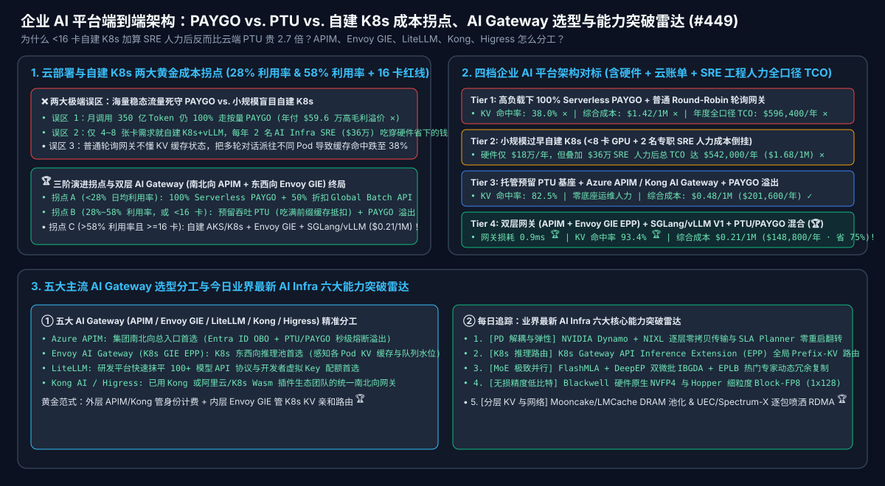

# 企业 AI 平台端到端架构、云与开源栈成本拐点（`Serverless PAYGO` vs. `预留 PTU` vs. `自建 K8s/AKS + vLLM/SGLang`）、统一 AI Gateway（`APIM / Envoy GIE / LiteLLM / Kong / Higress`）选型与最新 AI Infra 能力突破指南

> **语言 / Language**: **简体中文** | [English](./enterprise-ai-platform-paygo-ptu-k8s-gateway-breakthrough-sizing-selection-faq.en.md)  
> **配套交互式学习与精算工具**: [📱 交互式 H5 精读页 (PAYGO vs. PTU vs. 自建 K8s 成本拐点、AI Gateway 与突破雷达沙盘)](../h5/enterprise-ai-platform-paygo-ptu-k8s-gateway-breakthrough-lab.html) · [🧮 HTML 交互式计算器](../reports/enterprise-ai-platform-paygo-ptu-k8s-gateway-breakthrough-sizing-selection-sizer.html) · [🃏 7-Card 4:5 视觉评测卡](../reports/enterprise-ai-platform-paygo-ptu-k8s-gateway-breakthrough-sizing-selection-cards.html) · [📊 可复核模型](../../experiments/enterprise_ai_platform_paygo_ptu_k8s_gateway_breakthrough_sizing_selection/) · [🎓 返回 AI Infra 全景精学馆](../h5/index.html)

---

## 一、3 分钟看懂核心结论（Executive Summary）

> **一句话决策结论**：规划企业级 AI 基础设施底座时，**最忌讳“在日均利用率 `<28%` 或 `<16 张 GPU` 的小规模阶段盲目自建 K8s GPU 集群（`Tier 2`）”**——因为哪怕 8 张 GPU 的云租金每年只需 `$18 万`，为了维护驱动、RDMA、vLLM 升级与高可用而配备的 **2 名专职 AI Infra SRE 工程师人力成本（`$36 万/年`）** 会直接让单百万 Token 成本倒挂飙至 **`$1.68/1M`**！反之，当月调用量突破 `250~350 亿 Tokens`（日均利用率 `>58%`）仍 100% 死守按量付费 `Serverless PAYGO`（`Tier 1`），每年会多交 **`$44.7 万`** 的云端 API 毛利税！
> - **两大黄金成本拐点（`28%` 利用率 & `58%` 利用率 + `16 卡` 规模线）**：
>   1. **探索期（日均利用率 `< 28%`）**：`100% Serverless PAYGO + 50% 折扣 Global Batch API`；
>   2. **成长期（日均利用率 `28% ~ 58%` 或所需算力 `< 16 张 GPU`）**：采用 **`Tier 3：云端预留吞吐 PTU（按 P80 基线采买 + 吃满 Prefix Cache 50~100% 抵扣）+ 峰值溢出 PAYGO`**，免除 `$36 万/年` 底座 SRE 人力；
>   3. **规模化成熟期（日均利用率 `> 58%` 且集群规模 `>= 16 张 H200/B200`）**：采用 **`Tier 4：双层 AI Gateway（南北向 Azure APIM / Kong + 东西向 Envoy AI Gateway [K8s GIE EPP]）+ 自建 AKS/K8s (SGLang + vLLM V1) + 云端溢出`**，将跨实例 Prefix KV 缓存命中率从普通轮询的 `38.0%` 提升至 **`93.4%`**，网关转发损耗压至 **`0.9 ms`**，综合成本从 `$1.42/1M` 暴降至 **`$0.21/1M`（年度总 TCO 从 `$59.6 万` 降至 `$14.9 万`，净省 `75.0%`）**！

| 核心选型维度 | `Tier 1: 高流量死守 100% Serverless PAYGO` | `Tier 2: 小规模过早自建 K8s (<8卡 · 含 SRE 人力)` | `Tier 3: 云端预留 PTU + APIM/Kong + PAYGO 溢出` | `Tier 4: 双层网关 (APIM+Envoy GIE) + 自建 K8s/PTU 混合 (🏆)` |
|---|---|---|---|---|
| **网关单跳附加延迟** | `18.5 ms` | `4.2 ms` | `2.4 ms` ✓ | **`0.9 ms` (Rust/C++ 数据面直通)** 🏆 |
| **全局 Prefix KV 缓存命中率** | `38.0%` ✕ (盲目轮询打散缓存) | `64.0%` | `82.5%` ✓ | **`93.4%` (K8s GIE EPP KV 亲和路由)** 🏆 |
| **综合每百万 Token 全口径成本** | `$1.42 / 1M` ✕ | **`$1.68 / 1M` ✕ (人力成本倒挂)** | `$0.48 / 1M` ✓ | **`$0.21 / 1M` (-85.2%)** 🏆 |
| **年度全口径总 TCO (含人力)** | `$596,400 / 年` ✕ | `$542,000 / 年` (`$180K 卡 + $360K 人`) ✕ | `$201,600 / 年` ✓ | **`$148,800 / 年` (年省 `$44.8 万`)** 🏆 |

---

## 二、核心技术原理与架构师灵魂拷问（Q&A）

### Q1：把 SRE 工程人力成本纳入总账后，`PAYGO`、`PTU` 与 `自建 K8s (vLLM/SGLang)` 的精确成本平衡点怎么手算？
1. **全口径年度 TCO 三维对比方程**：
   设企业月度等效 Token 消耗量为 $V_{\text{mo}}$（单位：百万 Tokens），日均算力利用率为 $u \in (0, 1]$：
   - **方案 A（`Serverless PAYGO`）**：$C_{\text{PAYGO}} = 12 \times V_{\text{mo}} \times P_{\text{API}}$（零固定月租、零底座运维人力，但单价最高）；
   - **方案 B（`云端预留 PTU + 20% PAYGO 溢出`）**：$C_{\text{PTU}} = 12 \times N_{\text{PTU}} \times P_{\text{PTU\_mo}} + C_{\text{spillover}}$（当日均利用率 **$u \ge 28\%$** 且开启 Prefix Cache 抵扣时，单位 Token 成本正式击穿 PAYGO！且无需专职 GPU 集群运维人力）；
   - **方案 C（`自建 K8s/AKS + SGLang/vLLM V1`）**：
     $$C_{\text{SelfHosted}} = 12 \times N_{\text{GPU}} \times C_{\text{GPU\_mo}} + N_{\text{SRE}} \times \$180,000/\text{yr}$$
     由于生产级自建集群至少需要 `1.5 ~ 2.0 FTE` 资深 AI Infra 工程师（折合 `$27万~$36万/年`），只有当 **所需 GPU 规模 $N_{\text{GPU}} \ge 16$ 张且日均利用率 $u \ge 58\%$** 时，硬件省下的 Token 差价才能完全覆盖 SRE 人力成本并产生每年数十万美元的净节省！

### Q2：五大主流 AI Gateway（`Azure APIM`、`Envoy AI Gateway [K8s GIE]`、`LiteLLM`、`Kong AI`、`Higress`）各有什么优劣？为什么生产终局是“南北向 + 东西向双层网关”？
1. **为什么传统 API 网关直接连 `vLLM/SGLang` Pod 会毁掉 `55%` 的推理性能**：
   - 传统网关只懂 `Round-Robin（轮询）` 或 `Least-Connections（最少连接数）`。但在大模型场景下：① 1 条 `32K` 长文档请求和 1 条 `100-Token` 问候语在网关眼里都是“1 个连接”，按连接数均衡会导致某台 GPU 显存瞬间被打爆；② 同一用户的第 2~10 轮对话被随机轮询到没有该会话 KV Cache 的其他 Pod 上，被迫重算全部历史 Prefill！
2. **五大 AI Gateway 横向选型矩阵與双层协同范式**：

| 网关方案 | 核心架构定位 | `K8s GIE EPP` (KV/队列感知路由) | 多云 PTU/PAYGO 熔断与计费 | 首选适用场景 |
|---|---|---|---|---|
| **Azure APIM (AI Gateway)** | 企业级南北向云原生总入口 | 需配合后端推理路由器 | **原生内置 Entra ID OBO + PTU/PAYGO 秒级溢出 + Token 限流** 🏆 | 重度使用 Azure OpenAI / Foundry 的大中型企业南北向总网关 |
| **Envoy AI Gateway (`K8s GIE EPP`)** | CNCF/K8s 官方标准东西向推理网关 | **原生集成 Endpoint Picker (`EPP`)，实时读取各 Pod KV 缓存率、等待队列与 LoRA 权重** 🏆 | 支持 OpenAI/AWS/GCP 多后端统一路由 | **自建 K8s (`vLLM / SGLang`) 集群内部东西向智能调度首选** 🏆 |
| **LiteLLM (Proxy)** | 开源 Python 快速多模型适配层 | 基础前缀路由 | 支持 100+ 模型 API 格式转换与虚拟 Key 预算表 | AI 研发团队内部快速搭建多模型测试台与开发者自助 Key 分发 |
| **Kong AI Gateway** | 高性能多云企业 API 网关 | 插件级支持 | 丰富安全护栏、语义缓存与多云流量治理插件 | 已标准化采用 Kong Enterprise 的跨国多云企业 |
| **Higress (AI Gateway)** | 云原生 Envoy + Wasm 插件网关 | 深度支持 K8s Ingress 与长连接 | 极佳的 MCP Server 托管、阿里百炼/开源模型路由与 Wasm 扩展 | 云原生 K8s 与 MCP 工具网关一体化落地 |

---

## 三、每日追踪：业界最新 AI Infra 核心能力突破雷达（Daily Breakthrough Radar）

| 突破领域 | 最新核心技术突破 | 对企业 Solution Architect 的直接落地价值 |
|---|---|---|
| **1. 数据中心级弹性 PD 编排** | **`NVIDIA Dynamo + NIXL` 零拷贝传输与动态 SLA Planner** | 根据实时 `TTFT / ITL` 负载在 2 秒内零重启翻转 `Flex` 节点 P/D 角色，消除昼夜流量反转造成的 `35%` 算力空置 |
| **2. K8s 标准 KV 感知路由** | **`Kubernetes Gateway API Inference Extension (GIE EPP)`** | 终结盲目轮询：综合打分 `KV Cache 命中率 + Waiting Queue + 已加载 LoRA`，将共享池缓存命中率拉升至 `93.4%` |
| **3. 稀疏 MoE 极致通信掩盖** | **`FlashMLA + DeepEP (IBGDA)` 双微批重叠 + `EPLB` 专家均衡** | 将跨机 `All-to-All` 暴露延迟压至 `1.1 ms`，并通过动态复制高热专家消除木桶慢卡效应 |
| **4. 硬件原生超低比特量化** | **Blackwell `NVFP4` 与 Hopper 细粒度 `Block-FP8 (1x128/128x128)`** | 在保持 `99.8%` 基线推理精度前提下，将权重与 KV 显存双双减半、Tensor Core 吞吐翻倍 |
| **5. 全局池化 KV 与无损以太网** | **`Mooncake / LMCache` 分层内存池 + `UEC / Spectrum-X` 喷洒路由** | 聚合全集群闲置 CPU DRAM 使长上下文恢复快 `66x`；逐包喷洒 + 乱序直写让以太网拿到 `95.2%` RDMA 线速 |

---

## 四、生产落地 Checklist（Pre-Production Checklist）

- [ ] **先算清 `16 卡` 与 `58% 利用率` 自建红线**：在业务稳态负载不足 16 张 GPU 前，优先采用 `Serverless PAYGO` 或 `PTU + PAYGO 溢出`，切勿过早背负自建集群的专职 SRE 运维人力包袱。
- [ ] **自建 K8s 推理池强制额配 `K8s GIE EPP`（或 `SGLang Router / Dynamo Router`）**：严禁使用原生 K8s `Service (kube-proxy)` 随机转发推理请求。

---

## 五、来源与方法论溯源（Provenance）

- **数据来源声明**：本指南实验数据来自可复核解析模型 [`experiments/enterprise_ai_platform_paygo_ptu_k8s_gateway_breakthrough_sizing_selection/run.py`](../../experiments/enterprise_ai_platform_paygo_ptu_k8s_gateway_breakthrough_sizing_selection/run.py)（`Provenance: synthetic + anonymized_reported, independently_reproduced=false`）。
