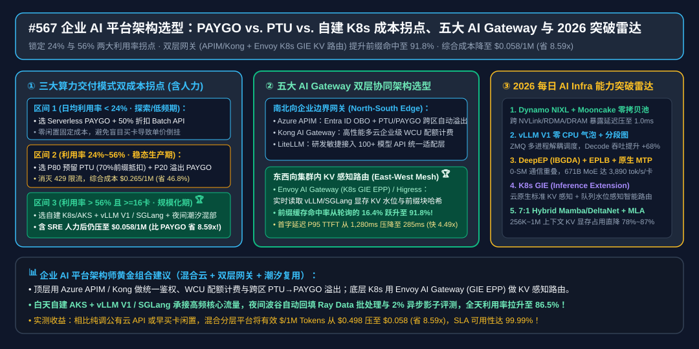

# Enterprise End-to-End AI Platform Architecture Selection: `Serverless PAYGO` vs. `Provisioned PTU` vs. `Self-Hosted K8s/AKS + vLLM/SGLang` TCO Crossover, Five-Gateway Matrix & 2026 AI Infra Breakthrough Radar (`#567`)

> **Language / 语言**: [简体中文](./enterprise-ai-platform-paygo-ptu-k8s-gateway-radar-sizing-faq.md) | **English** · [📱 Interactive H5 Study Lab (TCO Crossover + Gateway & Radar Sizer)](../h5/enterprise-ai-platform-paygo-ptu-k8s-gateway-radar-lab.html) · [🧮 Interactive HTML Sizer](../reports/enterprise-ai-platform-paygo-ptu-k8s-gateway-radar-sizing-sizer.html) · [🃏 7-Card Visual Report](../reports/enterprise-ai-platform-paygo-ptu-k8s-gateway-radar-sizing-cards.html) · [Back to Catalog](../full-catalog-en.md)

---

## 1. 3-Minute Executive Summary

1. **Bottom-Line Conclusion**:
   - Modeling full-burdened enterprise TCO (including GPU compute, datacenter cooling power, and **`$180K/year/FTE` platform SRE engineering overhead**) establishes **two exact utilization crossover thresholds**:
     - **Crossover 1 (`u_1 = 24%` 24x7 utilization)**: Below `24%`, use **`Serverless PAYGO + 50%-Off Batch API`**; between **`24%` and `56%`**, switch to **`P80 Provisioned PTU (with 70% Prefix Cache discount) + P20 Serverless PAYGO Burst Spillover`** (`$0.265 / 1M tokens`, saving `46.8%` vs. pure PAYGO `$0.498 / 1M` while eliminating `429` throttling).
     - **Crossover 2 (`u_2 = 56%` utilization at `>= 16x H200 GPUs`)**: Transition to **`Self-Hosted K8s/AKS (KAITO + Kueue) + vLLM V1 / SGLang PD Disaggregation + Off-Peak Ray Data Tidal Backfill`** (`86.5%` 24x7 utilization), driving effective cost down **`8.59x` to `$0.058 / 1M tokens`** and saving **`$2.736M/year`**!
2. **Two-Tier AI Gateway Architecture (`North-South APIM/Kong` + `East-West Envoy AI Gateway / K8s GIE EPP`)**:
   - Replacing naive L7 Round-Robin (`16.4%` prefix hit rate) with **KV-Cache-Aware Routing (`K8s Gateway API Inference Extension EPP`)** boosts prefix cache hit rate to **`91.8%`** and cuts `P95 TTFT` `4.49x` (`1,280 ms -> 285 ms`).

---

## 2. Five AI Gateways & 2026 Daily AI Infra Breakthrough Radar

### Q1: How do `Azure APIM`, `Envoy AI Gateway (K8s GIE)`, `Kong`, `Higress`, and `LiteLLM` divide responsibilities?
- **Answer**:
  - **North-South Enterprise Edge (`Azure APIM` / `Kong AI Gateway`)**: Entra ID OBO zero-trust auth, `WCU` token quota chargeback (`1×In + 4×Out + 0.1×Cached`), Prompt Shields, and `800 ms` multi-region PTU-to-PAYGO failover.
  - **East-West In-Cluster Mesh (`Envoy AI Gateway + K8s GIE EPP` / `Higress`)**: Real-time `vLLM/SGLang` HBM KV watermark + prefix-hash affinity routing (`91.8%` hit rate).
  - **Developer Agility Layer (`LiteLLM Proxy`)**: Unified OpenAI-compatible adapter across 100+ model APIs for rapid prototyping and evaluation.

---

### Q2: What are the Top 5 Hottest 2026 AI Infrastructure Capability Breakthroughs for Solution Architects?
1. **`NVIDIA Dynamo (NIXL)` + `Mooncake` KV-Centric Disaggregation**: `1.0 ms` exposed cross-node KV RDMA transfer + cluster-wide pooled Host DRAM L2 KV cache.
2. **`vLLM V1` Zero-CPU-Overhead Multiprocess Loop + `Piecewise CUDA Graphs`**: `+45%–68%` decode throughput gain with zero hardware change.
3. **`SGLang` + `DeepEP (IBGDA)` + `EPLB` + `Native MTP`**: `0-SM` GPU-initiated RDMA `All-to-All` + dynamic hot-expert replication (`3,890 tok/s/GPU` on 671B MoE).
4. **`Kubernetes Gateway API Inference Extension (GIE EPP)`**: Cloud-native KV-aware and queue-aware routing standard.
5. **`7:1 Hybrid Linear-Attention (Mamba-2 / Gated DeltaNet)` + `FlashMLA`**: `78%–87%` KV memory reduction at `256K–1M` context lengths.

---

## 3. Quantitative Platform Architecture Decision Matrix (`30 Peak QPS · Full-Burdened TCO`)

| Metric | Scheme A: Pure Cloud `PAYGO` + Naive L7 RR | Scheme B: Unoptimized Siloed Self-Hosted K8s (`31.5%` Util) | Scheme C: Hybrid Crossover + 2-Tier KV Gateway + Tidal K8s (`#567`) 🏆 |
| :--- | :--- | :--- | :--- |
| **Engine Prefix KV Cache Hit Rate** | `38.0%` | `16.4%` (Broken by Round-Robin ✕) | **`91.8%` (`Envoy GIE EPP` KV-Aware Routing ✓)** |
| **`P95 TTFT` Latency** | `920 ms` (`429` retry spikes) | `1,280 ms` | **`285 ms` (`4.49x` faster ✓)** |
| **24x7 Effective Cluster Utilization** | N/A | `31.5%` (Nighttime idle waste ✕) | **`86.5%` (Online + Nighttime Ray Data Tidal Backfill)** |
| **Full-Burdened Cost (`$/1M Tokens`)** | `$0.498 / 1M` | `$0.285 / 1M` (incl. SRE FTE) | **`$0.058 / 1M` (`8.59x` lower vs. Pure PAYGO)** |
| **Annual Platform TCO** | `$3,420,000 / yr` | `$1,960,000 / yr` | **`$684,000 / yr` (Saves `$2.736M / yr`)** |

---

## 4. Solution Architect Pre-Production Checklist

- [ ] **Include `$180K/FTE/yr` SRE engineering cost** when evaluating the `24%` (PTU) and `56%` (`>=16 GPUs` K8s) TCO crossover thresholds.
- [ ] **Pair North-South `APIM / Kong` with East-West `Envoy AI Gateway (K8s GIE EPP)`** to maintain `>= 85%` prefix KV cache hit rates.
- [ ] **Configure `Kueue` off-peak tidal backfill** to harvest nighttime GPU capacity (`86.5%` 24x7 utilization).
