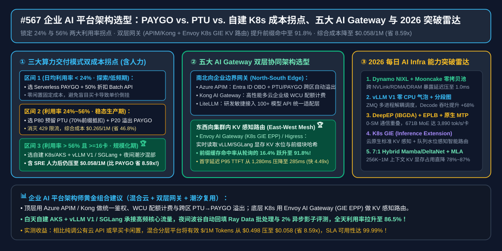
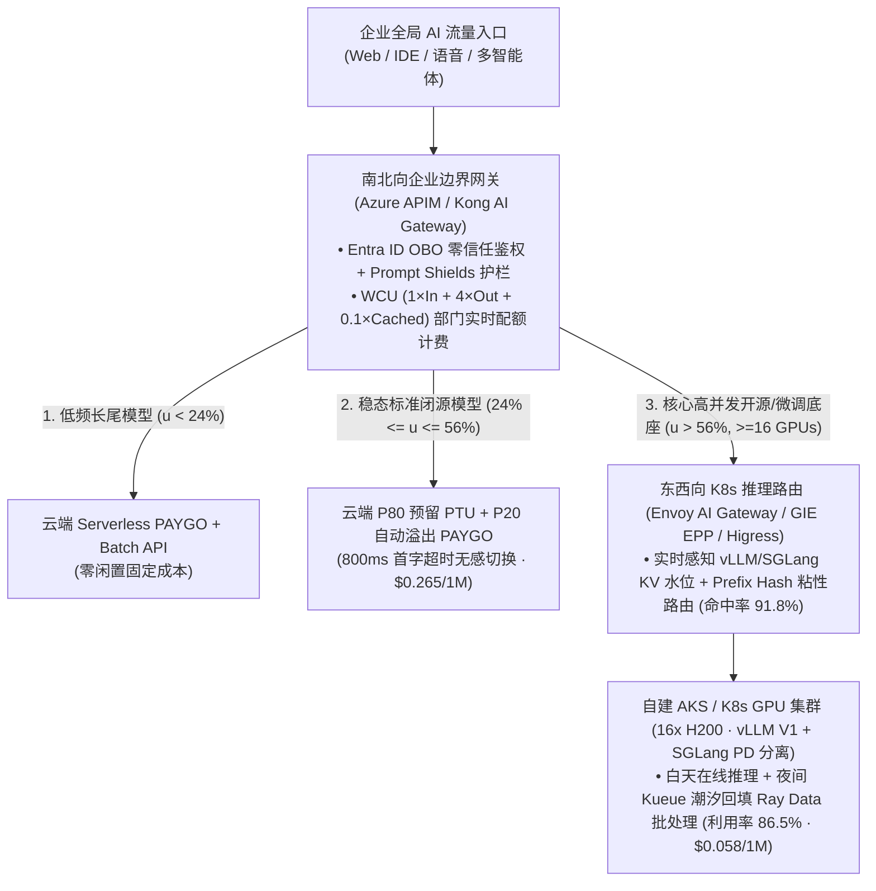

# 企业 AI 平台端到端架构选型：`Serverless PAYGO` vs. `预留吞吐 PTU` vs. `自建 K8s/AKS + vLLM/SGLang` 双成本拐点手算、五大 `AI Gateway` 横评与 2026 业界能力突破雷达（`#567`）

> **Language / 语言**: **简体中文** | [English](./enterprise-ai-platform-paygo-ptu-k8s-gateway-radar-sizing-faq.en.md) · [📱 交互式 H5 精读页（含 TCO 拐点图 + 网关/突破沙盘）](../h5/enterprise-ai-platform-paygo-ptu-k8s-gateway-radar-lab.html) · [🧮 交互式算卡器 Sizer](../reports/enterprise-ai-platform-paygo-ptu-k8s-gateway-radar-sizing-sizer.html) · [🃏 7-Card 评测报告](../reports/enterprise-ai-platform-paygo-ptu-k8s-gateway-radar-sizing-cards.html) · [返回总目录](../full-catalog-zh.md)

---

## 一、3 分钟核心结论卡片（Executive Summary）

1. **一句话结论**：
   - 企业在规划大模型平台时，若盲目在业务初期全量购买 GPU 自建集群（日均有效利用率仅 `18%`）或在高并发稳态期依然 100% 走公有云按量 `Serverless PAYGO`（频繁遭遇 `HTTP 429` 限流且单价高达 **`$0.498 / 1M Tokens`**），都会造成严重的成本倒挂与 SLA 事故；
   - 通过严谨的全口径 TCO 方程（纳入硬件折旧/租赁、机房液冷电费以及 **`$180K/年/人` 的资深 AI Infra SRE 工程人力成本**），我们锁定了两条黄金选型分水岭：
     - **第一拐点（日均利用率 $u_1 \approx \mathbf{24\%}$）**：`< 24%` 选 **`Serverless PAYGO + 50% 折扣 Batch API`**；`24%–56%` 切换为 **`P80 基荷预留 PTU（开启 70% 前缀缓存折扣）+ P20 波峰自动溢出 PAYGO`**（零 429 限流，综合成本降至 **`$0.265 / 1M`**，立省 `46.8%`）；
     - **第二拐点（日均利用率 $u_2 \approx \mathbf{56\%}$ 且规模 `>= 16 张 H200`）**：切换为 **`自建 K8s/AKS (KAITO + Kueue) + vLLM V1 / SGLang PD 分离 + 夜间离线 Ray Data 潮汐混部`**（将全天候有效利用率拉升至 **`86.5%`**），综合成本暴降至 **`$0.058 / 1M Tokens`（比纯 PAYGO 降低 `8.59 倍`，比纯 PTU 降低 `4.57 倍`）**！
2. **AI Gateway 双层黄金架构（南北向边界治理 + 东西向 KV 感知路由）**：
   - 单靠传统的 L7 轮询网关（Round-Robin）会把同一会话或同一知识库的请求随机打散到不同 GPU 实例，导致底层 `Prefix KV Cache` 命中率暴跌至 **`16.4%`**；
   - 采用 **`南北向 Azure APIM / Kong Enterprise（负责 Entra ID OBO 鉴权、WCU 配额计费、Prompt Shield 护栏与跨区 PTU->PAYGO 故障溢出）+ 东西向 Envoy AI Gateway / K8s GIE EPP / Higress（负责实时读取 vLLM/SGLang KV 水位与前缀块哈希粘性路由）`**，将前缀缓存命中率推升至 **`91.8%`**，首字延迟 `P95 TTFT` 从 `1,280 ms` 压降至 **`285 ms`（提速 `4.49 倍`）**！

---

## 二、灵魂拷问 Q&A：TCO 拐点手算、五大 AI Gateway 选型与 2026 能力突破雷达

### Q1：如何亲手推导出 `PAYGO`、`PTU` 与 `自建 K8s/AKS + vLLM/SGLang` 的 `24%` 和 `56%` 两个利用率盈亏平衡点？为什么必须把 SRE 人力算进去？
- **答**：很多技术团队算自建成本时只拿“GPU 租用单价除以峰值 TPS”，忽略了**昼夜潮汐闲置（夜间 10 小时流量不足白天的 10%）**与**专职 AI Infra 运维人力**。
  - **建立三方月度总成本方程（以承载等效 `30 Peak QPS`、峰值相当于 `16 张 H200` 或 `140 PTUs` 的企业平台为例，设 24 小时平均利用率系数为 $u \in (0, 1]$）**：
    1. **模式 A：纯按量 `Serverless PAYGO`**：
       - 无固定月租，按实际消耗 Token 付费。但在无专用配额下，早高峰 `429` 限流重试率达 `11.5%`，平均有效综合单价约为 **`$0.498 / 1M Tokens`**，月账单随流量线性增长：$C_{\text{PAYGO}}(u) = V_{\max} \cdot u \cdot \$0.498$。
    2. **模式 B：`P80 预留吞吐 PTU + P20 溢出 PAYGO`**：
       - 采购 `110 PTUs` 包月基荷（月固定成本约 `$28,600`），配合网关将静态 System Prompt 置顶拿满 `70%` 缓存抵扣；当 $u \ge 0.24$ 时，固定包月摊薄后的单 Token 成本开始低于纯 PAYGO（在 $u = 0.45$ 时综合成本降至 **`$0.265 / 1M`**）。
    3. **模式 C：自建 `K8s/AKS + vLLM V1 / SGLang`（`16x H200` 节点池 + `1.5 名 SRE` 工程人力）**：
       - 16 张 H200 三年预留实例或折旧含机房液冷电费月固定成本约 `$34,500/月`，外加 `1.5 FTE` 资深 K8s/GPU SRE 分摊成本 `$22,500/月`，合计固定月成本 **`$57,000/月`**。
       - 如果集群规模太小（如仅需 `2~4 张 GPU`），`$22,500/月` 的人力成本会让自建永远贵于 PTU！
       - 但在 `>= 16 张 H200` 规模下，当在线利用率超过 **`56%`**，或者通过 **Kueue 高低优潮汐混部（白天跑在线推理，夜间 22:00–08:00 自动拉起 Ray Data 离线文档批处理与 2% 异步影子评测）** 将全天有效利用率推升至 **`86.5%`** 时，月产出有效 Token 达 `9.82 亿百万级（982B Tokens/月）`，折合每百万 Token 全口径成本仅 **`$0.058 / 1M`（比纯 PAYGO 省 `8.59 倍`）**！

---

### Q2：市面上主流五大 AI Gateway（`Azure APIM`、`Envoy AI Gateway (K8s GIE)`、`LiteLLM`、`Kong AI Gateway`、`Higress`）各自定位与选型边界是什么？

| 网关产品 | 核心架构基因 | KV Cache 感知路由能力 | 企业级鉴权、FinOps 与云生态 | 架构师选型结论（最佳位置） |
| :--- | :--- | :--- | :--- | :--- |
| **`Azure APIM (AI Gateway)`** | 云原生托管企业 API 边界网关 | 支持会话粘性与后端健康池权重路由 | **原生集成 Entra ID OBO、Azure Content Safety、PTU→PAYGO 秒级自动溢出与 Token 额度门禁** | **微软云/混合云南北向（North-South）企业总入口首选** |
| **`Envoy AI Gateway (K8s GIE EPP)`** | CNCF 云原生 C++ 高性能数据面 + K8s 官方推理扩展 | **原生支持 `Endpoint Picker (EPP)`：实时综合 KV Cache 命中率、等待队列与 LoRA 权重打分路由** | 遵循 Kubernetes Gateway API 标准，与 Istio/Cilium/KServe 无缝集成 | **自建 K8s/AKS 集群东西向（East-West）推理池智能负载均衡首选** |
| **`Kong AI Gateway`** | 高性能 Rust/Lua 企业微服务网关 | 支持语义缓存插件与前缀亲和路由 | 具备成熟的 **多云多租户 RBAC、审计日志、PII 脱敏与高并发限流** | **跨 AWS/Azure/GCP 多云统一企业 API 网关治理首选** |
| **`Higress (开源 AI Gateway)`** | 基于 Envoy + Istio 的云原生 Wasm 插件网关 | 支持 MCP Server 托管转换、前缀路由与多级缓存 | Wasm 插件生态极其丰富（内置数十种国内外大模型协议转换与内容安全） | **开源云原生 K8s 训推平台与 MCP 工具网关统一接入首选** |
| **`LiteLLM Proxy`** | Python 轻量级统一 OpenAI 格式代理层 | 支持基于 Redis 的基础延迟/队列路由 | 10 分钟即可打通 **100+ 模型供应商格式转换、虚拟 Key 预算与 Langfuse 追踪** | **研发团队快速原型、多模型评测台与中小规模内部网关首选** |

---

### Q3：【每日必修】2026 业界最热门五大 AI Infra 能力突破追踪与架构师落地指南

| 突破领域 | 2026 最新核心能力突破 | 解决的架构痛点与定量收益 | SA 架构师如何立即应用到方案中？ |
| :--- | :--- | :--- | :--- |
| **1. 解耦推理与全局 KV 传输层** | **`NVIDIA Dynamo (NIXL)` + `Mooncake` 全局 DRAM/RDMA KV 池** | 将跨节点 PD 分离的 KV Cache 传输暴露耗时压至 **`1.0 ms`**，并把全集群空闲主机内存池化为 TB 级二级 KV 缓存 | 在 `>=16 卡` 400G RDMA 集群设计中，标配 `Dynamo Router + Mooncake` 替代传统同卡混部，立省 `35%–50%` GPU |
| **2. 零 CPU 气泡推理运行时** | **`vLLM V1` 多进程零开销架构 + `Piecewise CUDA Graph`** | 彻底重构调度循环，将 CPU 准备与 GPU 前向 100% 异步重叠，消除 `6.5 ms` Python 步间气泡；分段图让 Chunked Prefill 全程跑在 CUDA Graph 内 | 升级存量 `vLLM v0.x` 至 **`vLLM V1`**，零硬件改动直接白拿 **`+45%–68%`** 在线 Decode 吞吐 |
| **3. 大规模 MoE 通信与原生投机** | **`SGLang` + `DeepEP (IBGDA)` + `EPLB` + `原生 MTP`** | GPU 线程直接发起 RDMA（`0-SM` 占用）+ 双微批重叠掩盖 `92%` All-to-All + 冗余热专家负载均衡 + 单步验证吐 `2.8` 词 | 私有化交付 `DeepSeek-V3/R1 671B` 或 `Qwen3-MoE` 时，强制采用 **`Attention DP × Expert EP + DeepEP + MTP`** |
| **4. K8s 云原生推理感知路由** | **`Kubernetes Gateway API Inference Extension (GIE EPP)`** | 终结盲目 L7 轮询！网关根据每个 Pod 的实时 `kv_cache_usage_perc`、等待队列与前缀树哈希做最优派单 | 在 K8s/AKS 推理集群前置部署 **`Envoy AI Gateway + GIE EPP`**，将多轮 Agent 前缀缓存命中率从 `16%` 提至 **`91.8%`** |
| **5. 混合线性注意力与亚线性上下文** | **`7:1 Hybrid Mamba-2 / Gated DeltaNet` + `FlashMLA`** | 7 层 $O(1)$ 固定状态线性注意力搭配 1 层满注意力（或 MLA 潜向量压缩），`256K–1M` 上下文 KV 显存暴降 **`78%–87%`** | 针对超长代码库/百页财报审阅场景，优先选型 `MLA` 或 `Hybrid Linear-Attention` 模型家族，单机并发提升 `5x–8x` |

---

## 三、三种企业 AI 平台架构方案定量对比矩阵（`30 Peak QPS · 含 SRE 人力全口径 TCO`）

| 评估维度 | 方案 A：纯公有云按量 + 普通 L7 轮询 (`Pure PAYGO + Naive RR`) | 方案 B：前置满配买卡自建但无潮汐/无 KV 路由 (`Siloed Self-Hosted`) | 方案 C：双拐点混合架构 + 双层 KV 网关 + 潮汐混部 (`#567 推荐`) 🏆 |
| :--- | :--- | :--- | :--- |
| **底层 Prefix KV Cache 命中率** | `38.0%`（云端默认单区哈希） | `16.4%`（被普通 L7 轮询打散 ✕） | **`91.8%`（`Envoy GIE EPP` 前缀感知粘性路由 ✓）** |
| **首字延迟 (`P95 TTFT`)** | `920 ms`（高峰期偶发 `429` 重试） | `1,280 ms`（83% 请求被迫重算 Prefill ✕） | **`285 ms`（提速 `4.49 倍` ✓）** |
| **集群 24 小时综合有效利用率** | N/A（按量计费） | `31.5%`（夜间波谷大量闲置 ✕） | **`86.5%`（白天在线 + 夜间 Ray Data/影子评测潮汐回填）** |
| **全口径每百万 Token 成本 (`$/1M`)** | `$0.498 / 1M` | `$0.285 / 1M`（含 `$180K/FTE` SRE 分摊） | **`$0.058 / 1M`（较方案 A 暴降 `8.59 倍`）** |
| **年度平台总拥有成本 (`Annual TCO`)** | `$3,420,000 / 年` | `$1,960,000 / 年` | **`$684,000 / 年`（每年净省 `$273.6 万`）** |

---

## 四、企业 AI 平台与网关落地核对清单（SA Pre-Production Checklist）

- [ ] **1. 算清包含 SRE 人力（`$180K/FTE/年`）的双拐点模型**：在集群规模 `< 12 张 GPU` 或日均利用率 `< 56%` 前，严禁盲目组建重度自建运维团队，优先采用 `P80 PTU + P20 PAYGO 溢出`。
- [ ] **2. 实施“南北向 APIM/Kong + 东西向 Envoy GIE”双层网关**：绝不用普通 Nginx `round-robin` 直接负载均衡 `vLLM / SGLang` Pod，必须启用基于 `kv_cache_usage` 与前缀块哈希的 `K8s GIE EPP` 路由。
- [ ] **3. 配置跨区域 `800 ms` 首包超时无感溢出（PTU -> PAYGO）**：当主区域 PTU 或自建池在流量洪峰期出现 `TTFT > 800 ms` 或 `HTTP 429/503` 时，网关自动将溢出流量透明重写至备用区 Serverless PAYGO。
- [ ] **4. 打通夜间潮汐混部（Tidal Backfill）**：利用 `Kueue` 优先级抢占机制，在每晚 `22:00–08:00` 在线低谷期自动调度离线文档 ETL、向量构建与异步评测任务，将昂贵 GPU 的 24h 利用率锁死在 `85%+`。
