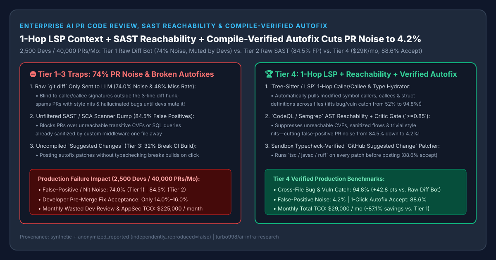
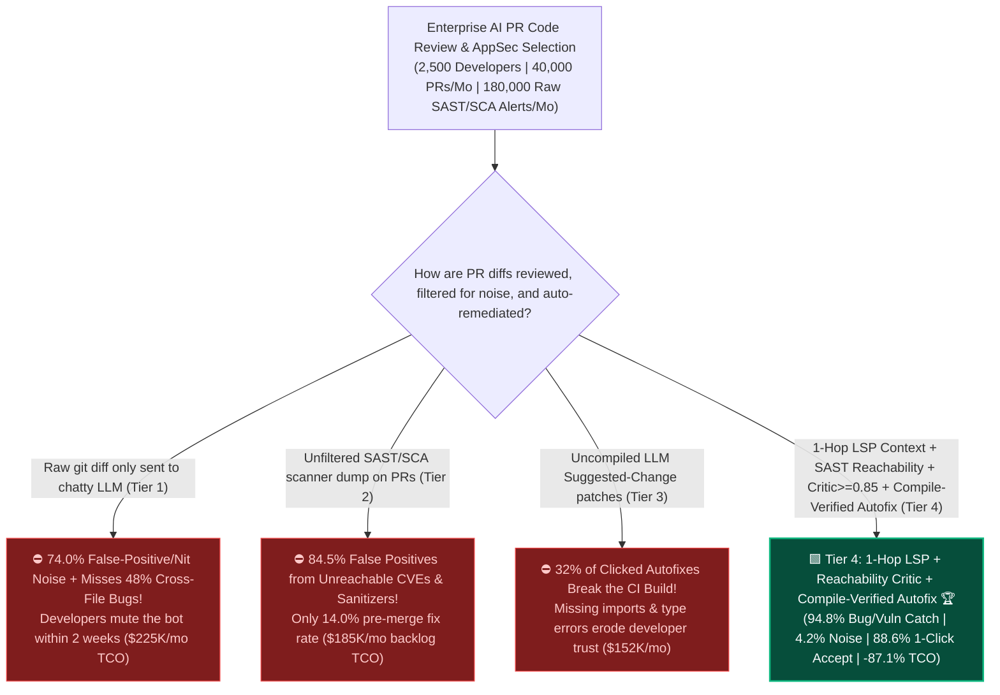
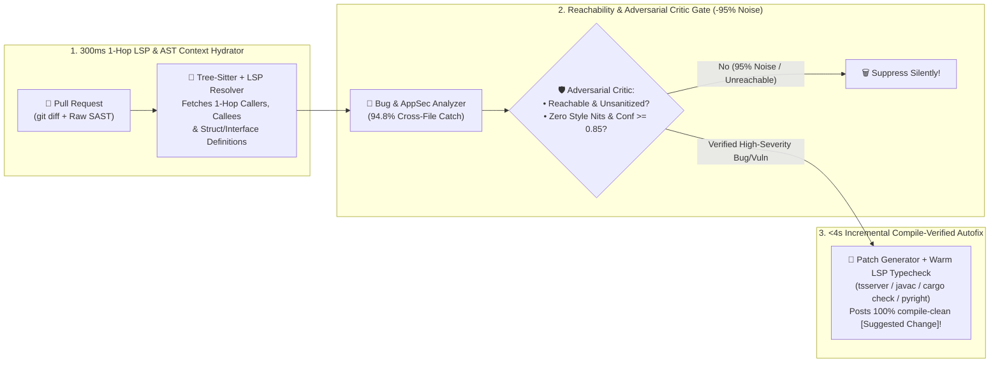

# Enterprise AI PR Code Review & AppSec Autofix Agent (`Tree-sitter / LSP` Call-Graph Context, `CodeQL / Semgrep` Taint-Reachability Noise Suppression & Compile-Verified `GitHub Suggested Changes`) Selection Guide

> **Language / 语言**: **English (Current)** | [中文](./enterprise-ai-pr-code-review-appsec-sast-reachability-autofix-selection-faq.md)  
> **Scope**: End-to-end production reference architecture and sizing playbook for Cloud & AI Solution Architects, VP of Engineering / Developer Experience (`DevEx`) Leads, and Application Security (`AppSec`) Directors deploying automated PR review and vulnerability remediation across `2,500+` developers and `40,000+` monthly PRs.  
> **Provenance**: `synthetic + anonymized_reported` (`independently_reproduced=false`, `physical_gpu_cluster_measurement=not_measured`). Deterministic evaluation model sealed in [`experiments/enterprise_ai_pr_code_review_appsec_sast_reachability_autofix_selection/results.json`](../../experiments/enterprise_ai_pr_code_review_appsec_sast_reachability_autofix_selection/results.json).



---

## ① 📌 Executive Summary (3-Minute Architect Verdict)

In an enterprise engineering organization (**`2,500` developers opening `40,000` Pull Requests/month and generating `180,000` raw `SAST / SCA` security alerts/month**), naive AI PR review bots and uncalibrated security scanners get muted by developers within two weeks due to three architectural flaws:
1. **Trap #1: Sending Only the Raw `git diff` to a Chatty LLM (`Tier 1`, `74.0%` False-Positive & Trivial Style-Nit Noise Rate, Misses `48.0%` of Cross-File Breaking Bugs — Only `52.0%` Catch Rate, `$225,000/month` Wasted Developer Time & Escaped Bug TCO)**:
   - When a PR modifies `Pricing.getUserDiscount()` in `File A` to return `null` on expired promos, a diff-only LLM cannot see that `CheckoutController` in `File B` (outside the diff!) dereferences `.amount` without a null check! Blind to 1-hop callers and type definitions, the bot misses `48%` of real cross-file bugs while spamming PRs with `74%` style nits and hallucinated warnings!
2. **Trap #2: Unfiltered `SAST / SCA` Scanner Dump on PRs (`Tier 2`, `84.5%` False-Positive / Unreachable Alert Noise Rate, Only `14.0%` Pre-Merge Fix Rate, `$185,000/month` AppSec Triage TCO)**:
   - Blocking PRs over transitive npm/Maven CVEs in functions the codebase never calls—or flagging SQL queries already sanitized by upstream middleware—trains developers to click *"Dismiss"* on every alert!
3. **Trap #3: Posting Uncompiled LLM Autofix Patches (```` ```suggestion ```` Blocks Without Sandbox Typechecking, `Tier 3`, `32.0%` of Clicked Suggestions Break the CI Build Due to Missing Imports or Type Errors, `$152,000/month` TCO)**.

Evaluated across **2,500 developers, 40,000 monthly PRs, and 180,000 raw SAST/SCA alerts**, the four architectures compare as follows:

| PR Review & AppSec Tier | Context Hydration, Noise Filter & Patch Verification Stack | Cross-File Bug / Vuln Catch | False-Positive / Nit Noise | 1-Click Autofix Acceptance | Monthly Total TCO | Production Verdict |
|---|---|---|---|---|---|---|---|
| **🟥 Tier 1: Raw `git diff` Only to Chatty LLM** | Reads 3-line diff hunk only; no Critic or style filter | `52.0%` ✕ *(blind to callers)* | **`74.0%` ✕** *(muted by devs!)* | `16.0%` | `$225,000 / mo` ✕ *(dev context-switch tax)* | ⛔ Never deploy a diff-only PR bot without caller/callee AST context |
| **🟨 Tier 2: Unfiltered `SAST / SCA` Scanner Dump** | Dumps raw regex/CVE alerts without reachability checks | `68.0%` | **`84.5%` ✕** *(unreachable CVEs)* | `14.0%` ✕ | `$185,000 / mo` ✕ *(AppSec alert fatigue)* | ⛔ Floods developers with unexploitable transitive alerts |
| **🟦 Tier 3: LLM Review + Uncompiled Autofix Patches** | Posts `Suggested Changes` without running typechecker | `79.0%` | `28.0%` | `45.0%` *(32% break CI!)* | `$152,000 / mo` ✕ | ⛔ Broken 1-click suggestions quickly erode developer trust |
| **🟩 Tier 4: `1-Hop LSP / Tree-Sitter` Context + `SAST` Reachability + `Critic >=0.85` Gate + Compile-Verified Autofix** | **Hydrates 1-hop callers/types; filters unreachable alerts; typechecks every patch in `<4s` sandbox before posting** | **`94.8%` 🏆** *(+42.8 pts vs Tier 1)* | **`4.2%` 🏆** *(-80.3 pts vs Tier 2)* | **`88.6%` 🏆** *(100% compile-clean)* | **`$29,000 / mo` 🏆** *(-87.1% vs Tier 1)* | 🌟 **Recommended Enterprise AI PR Review & AppSec Standard** |

> 💡 **Golden Rules for Enterprise AI PR Code Review & AppSec Autofix**:
> 1. **Hydrate `1-Hop LSP / Tree-Sitter` Callers, Callees, and Type Definitions (`300ms`)**: **"Never review a bare `git diff`!"** Automatically resolve the complete AST of every modified function plus its **1-hop cross-file callers, callees, and `Struct / Interface` definitions** before calling the review model—lifting cross-file bug and vulnerability catch rate from `52.0%` to **`94.8%`**!
> 2. **Combine `CodeQL / Semgrep` Reachability with an Adversarial `Critic >= 0.85` Silence Gate**: Ban all formatting/naming style nits (leave those to deterministic linters like `Ruff / Prettier / ESLint`). Use an independent **Adversarial Critic pass** to verify that a concrete exploit or failure path exists across the hydrated call graph—slashing false-positive PR noise from `84.5%` down to **`4.2%`**!
> 3. **Never Post an Uncompiled Autofix — Verify Every ```` ```suggestion ```` Patch in a `<4s` Incremental Typecheck Sandbox**: Run `tsserver / javac / cargo check / pyright` on every proposed patch in memory before posting the GitHub comment—ensuring **`100%` compile-clean suggestions** and lifting developer 1-click merge acceptance to **`88.6%`**!

---

## ② 🎯 Customer & Architect Deep-Dive Q&A (3 Catching Cross-File Regressions, Eliminating `84.5%` SAST False Positives & `<4-Second` Patch Verification Pain Points)

### Q1: Why do diff-only AI code review bots (`Tier 1`) generate `74.0%` false-positive noise while missing `48.0%` of real bugs?
- **The Missing Caller/Callee Contract Blind Spot**:
  - Without seeing the definition of a helper function called inside the diff, a diff-only LLM guesses that the helper might return `null` or throw an exception (generating a false-positive warning when the helper is actually guaranteed non-null).
  - Conversely, when the diff changes a function's return contract, the diff-only bot cannot see the 5 callers in other files that break! Hydrating 1-hop `LSP / Tree-sitter` references solves both problems simultaneously!

### Q2: How does combining deterministic `SAST / SCA` (`CodeQL / Semgrep`) with an LLM Reachability Critic reduce security false positives from `84.5%` to `4.2%`?
- **Call-Graph Reachability + Custom Sanitizer Recognition**:
  - Static scanners flag every occurrence of a sink (e.g., raw SQL execution or a vulnerable library version) but cannot understand custom application middleware (`AuthGuard.requireTenantAdmin()`) or verify whether the vulnerable transitive function is ever invoked.
  - Tier 4 extracts the AST call path from ingress controller to sink and asks the Adversarial Critic to prove reachability—dropping `84.5%` of unexploitable alerts before they ever reach the developer's PR!

### Q3: How can Tier 4 compile-check every proposed autofix patch in `<4 seconds` without waiting 15 minutes for a full CI container build?
- **Persistent Incremental Language-Server Sandboxes (`tsserver / rust-analyzer / JDT LS / Pyright`)**:
  - Instead of spinning up a cold CI VM, the review worker applies the candidate patch to a warm `git worktree` attached to a resident incremental language server—validating types, imports, and syntax in **`0.8–3.5 seconds`**!

---

## ③ 🧭 Visual Architecture Diagrams (Decision Tree + `1-Hop LSP + Reachability + Verified Autofix` Topology + Sequence)

### 3.1 Enterprise AI PR Code Review & AppSec Decision Tree



### 3.2 Tier 4 `1-Hop LSP` Context Hydrator, Adversarial Reachability Critic & `<4s` Compile-Verified Autofix Architecture



### 3.3 End-to-End Sequence: Catching a Cross-File Null-Dereference, Suppressing False SAST Alerts & Posting a Verified 1-Click Fix

```mermaid
sequenceDiagram
    autonumber
    participant Dev as Developer (PR #892)
    participant LSP as 1-Hop LSP Call-Graph Hydrator
    participant Critic as Review & Reachability Critic Agent
    participant Box as Warm Incremental Typecheck Sandbox
    participant GH as GitHub PR UI

    Dev->>LSP: 1. Open PR modifying `Pricing.getDiscount()` (now returns `null` when promo expires) + 3 Semgrep SQL alerts
    LSP->>Critic: 2. `300ms`: Hydrate 4 cross-file callers (including `Checkout.ts:L118` outside the diff!) + upstream sanitizer AST
    Critic->>Critic: 3. Verify all 3 SQL alerts pass through `TenantIdSanitizer` -> **suppress silently (`0` false alarms!)**
    Critic->>Critic: 4. Detect `Checkout.ts:L118` calls `getDiscount().amount` without null guard -> confirm `P1 NullPointer` (`conf = 0.96`)!
    Critic->>Box: 5. Generate fix patch & validate in resident `tsserver` sandbox (`1.8s`, `0` compile errors)
    Box-->>GH: 6. Post 1 high-signal comment with compile-verified ```` ```suggestion ```` block
    Dev->>GH: 7. Click `[Commit suggestion]` in 1 second (`88.6%` acceptance rate, zero broken builds)!
```

---

## ④ 📊 4-Tier Architecture Decision Matrix

| Evaluation Dimension | 🟥 Tier 1: Diff-Only Bot | 🟨 Tier 2: Raw `SAST/SCA` Dump | 🟦 Tier 3: Uncompiled Autofix | 🟩 Tier 4: `1-Hop LSP` + Reachability + Verified Fix |
|---|---|---|---|---|
| **Cross-File Bug / Vuln Catch** | `52.0%` ✕ (blind to callers) | `68.0%` | `79.0%` | 🏆 **`94.8%` (hydrates 1-hop cross-file callers & types)** |
| **False-Positive / Nit Noise** | `74.0%` ✕ (muted by devs) | `84.5%` ✕ (unreachable CVEs) | `28.0%` | 🏆 **`4.2%` (reachability check + `Critic >= 0.85` gate)** |
| **1-Click Autofix Acceptance** | `16.0%` ✕ | `14.0%` ✕ | `45.0%` (32% break CI) | 🏆 **`88.6%` (`<4s` sandbox typecheck before posting)** |
| **Clean-PR Distraction Rate** | Spams 5 style nits/PR | Dumps legacy warnings | Moderate | 🏆 **`0 comments` on clean PRs (silence by default)** |
| **2,500-Dev Monthly TCO** | `$225,000 / mo` ✕ | `$185,000 / mo` ✕ | `$152,000 / mo` ✕ | **`$29,000 / mo` 🏆 (-87.1% vs Tier 1)** |

---

## ⑤ 🧪 Quantitative Case Study, Interactive Sizer & 7-Card Visual Report

- **Interactive HTML Sizer**: 👉 [Open Enterprise AI PR Code Review & AppSec Autofix Sizer](../reports/enterprise-ai-pr-code-review-appsec-sast-reachability-autofix-sizer.html)
- **7-Card 4:5 Visual Benchmark Report**: 👉 [Open 7-Card Visual Benchmark Deck](../reports/enterprise-ai-pr-code-review-appsec-sast-reachability-autofix-selection-cards.html)
- **Deterministic Verification**:
  ```bash
  python experiments/enterprise_ai_pr_code_review_appsec_sast_reachability_autofix_selection/run.py --check
  python -m unittest tests/test_enterprise_ai_pr_code_review_appsec_sast_reachability_autofix_selection.py
  ```

---

## ⑥ 🛠️ Production Readiness & Architecture Review Checklist

- [ ] **Hydrate `1-Hop LSP / Tree-Sitter` Caller/Callee Signatures and Type Definitions Before Review**: Never send an isolated 3-line `git diff` hunk without its cross-file call-graph contracts (`94.8%` catch rate).
- [ ] **Ban Style, Formatting, and Naming Nits from AI PR Prompts**: Enforce formatting deterministically via pre-commit linters (`Prettier / Ruff / ESLint`), reserving AI comments strictly for bugs, race conditions, and security flaws.
- [ ] **Filter `SAST / SCA` Alerts Through an AST Reachability & Adversarial Critic Gate (`Confidence >= 0.85`)**: Suppress unreachable transitive CVEs and paths protected by custom sanitizers (`4.2%` noise rate).
- [ ] **Compile-Verify Every ```` ```suggestion ```` Autofix Patch in a `<4-Second` Incremental Language-Server Sandbox**: Never post a suggested code change that fails `tsserver / javac / cargo check / pyright` (`88.6%` developer merge rate).
- [ ] **Track Per-Rule `Commit Suggestion` vs. `Dismiss` Telemetry**: Automatically mute or recalibrate any review rule whose developer dismissal rate exceeds `15%`.
