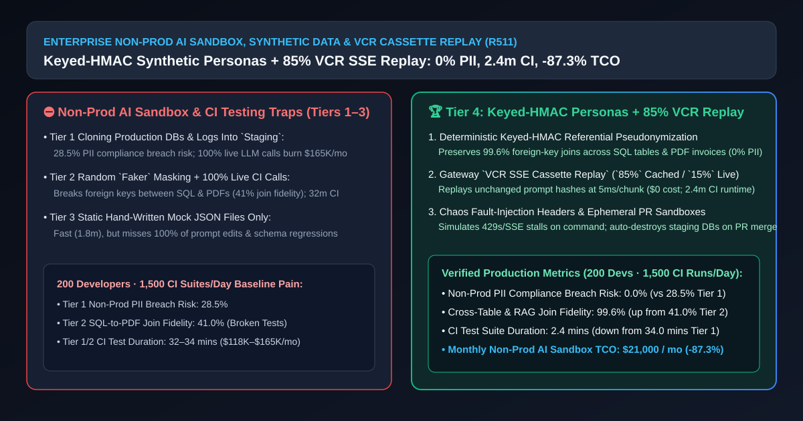
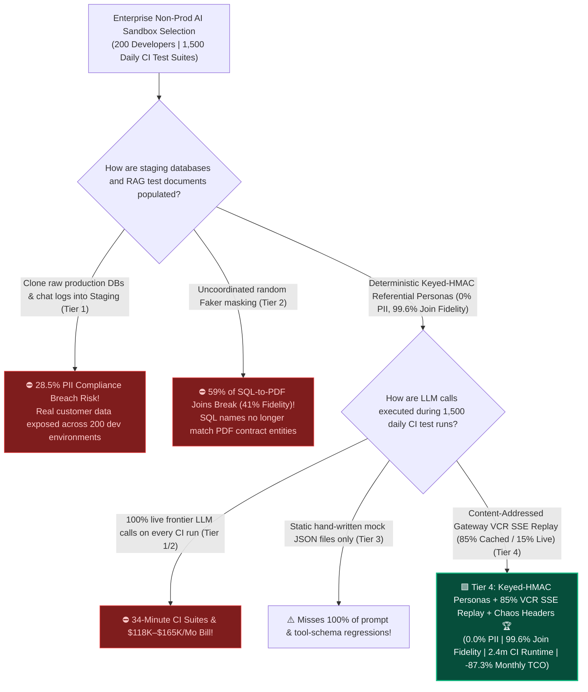
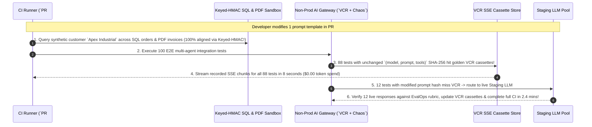

# Enterprise Non-Production AI Sandbox (`Dev / Staging / CI`), Referential Synthetic Data Anonymization (`Keyed-HMAC`) & Gateway `VCR` Streaming Cassette Replay Selection Guide: Why Random `Faker` Masking Breaks `59%` of `SQL + RAG` Joins and How `85%` VCR Replay Cuts CI Runtime from `34m` to `2.4m`

> **Language / 语言**: **English (Current)** | [中文](./enterprise-ai-sandbox-synthetic-test-data-anonymization-staging-selection-faq.md)  
> **Scope**: End-to-end non-production AI engineering, test-data privacy, and CI/CD cost-optimization guide for Cloud & AI Solution Architects, Developer Experience (`DevEx`) / QA Directors, and Data Privacy Officers supporting `50–1,000+` AI developers.  
> **Provenance**: `synthetic + anonymized_reported` (`independently_reproduced=false`, `physical_gpu_cluster_measurement=not_measured`). Deterministic evaluation model sealed in [`experiments/enterprise_ai_sandbox_synthetic_test_data_anonymization_staging_selection/results.json`](../../experiments/enterprise_ai_sandbox_synthetic_test_data_anonymization_staging_selection/results.json).



---

## ① 📌 Executive Summary (3-Minute Architect Verdict)

When **200 AI engineers** run **1,500 daily CI/CD integration test suites** across multi-step `Text-to-SQL`, `RAG`, and `Agent` pipelines, two non-production bottlenecks routinely stall delivery and inflate cloud bills: **"How do we give developers realistic test data without leaking production customer PII into Staging?"** and **"How do we run 1,500 daily E2E test suites without paying $95,000/month in redundant CI LLM token bills?"** Three flawed approaches fail in practice:
1. **Trap #1: Cloning Raw Production Databases & Chat Logs Directly Into `Staging` + 100% Live CI LLM Calls (Tier 1, `28.5%` PII Compliance Breach Risk, `34.0-Minute` CI Duration, `$165,000/month` Non-Prod TCO)**: Exposing real customer SSNs, salaries, and contracts to 200 developer environments violates GDPR/HIPAA/SOC2, while calling live frontier LLMs on every PR test takes 34 minutes;
2. **Trap #2: Uncoordinated Random `Faker` Masking Across SQL Tables & PDFs + 100% Live CI Calls (Tier 2, `41.0%` Cross-System Join Fidelity)**: Masking `Customer #8801 (Alice)` as `Bob` in the SQL database while masking the same customer as `Charlie` (or `[REDACTED]`) inside the PDF invoice breaks **59% of multi-agent integration tests** that join structured SQL rows with unstructured RAG documents!
3. **Trap #3: Static Hand-Written Mock JSON Files Only (Tier 3, `0%` Live Prompt-Drift Detection)**: Hardcoding 20 static JSON mocks makes CI fast (`1.8m`), but passes 100% of broken prompt or schema edits into production!

Evaluated across **200 developers and 1,500 daily CI integration test runs**, the four non-production AI sandbox architectures compare as follows:

| Sandbox Tier | Test Data Synthesis & CI LLM Replay Stack | Non-Prod PII Breach Risk | `SQL-to-RAG` Join Fidelity | CI Suite Duration | Live CI Token Spend | Monthly Non-Prod TCO | Production Verdict |
|---|---|---|---|---|---|---|---|
| **🟥 Tier 1: Raw Prod DB Clone + 100% Live CI LLM** | Copies prod PII to staging; calls live GPT-4o on every test | `28.5%` ✕ *(severe GDPR violation)* | `100.0%` | **`34.0 mins` ✕** *(slow CI queue)* | `100.0%` ✕ *(full token burn)* | **`$165,000 / mo` ✕** | ⛔ Violates data privacy laws & burns $95K+/mo in CI tokens |
| **🟨 Tier 2: Random `Faker` Masking + 100% Live CI LLM** | Independent random strings per table/file; live LLM in CI | `2.4%` | **`41.0%` ✕** *(joins broken)* | `32.0 mins` ✕ | `100.0%` ✕ | `$118,000 / mo` ✕ | ⛔ Random masking breaks foreign keys between SQL & PDFs |
| **🟦 Tier 3: Static Hand-Written Mock JSON Only** | Hardcoded static JSON mocks; never calls live model on edit | `0.0%` | `52.0%` | `1.8 mins` | `5.0%` | `$68,000 / mo` *(prod bug escapes)* | ⚠️ Blind to prompt regressions & schema changes |
| **🟩 Tier 4: Keyed-HMAC Referential Personas + `85%` Gateway `VCR SSE Replay` + Ephemeral PR Sandboxes** | **Consistent `HMAC-SHA256(id, salt)` personas across SQL & PDFs (`99.6%` fidelity) + content-hashed `VCR` SSE replay (`2.4m` CI)** | **`0.0%` 🏆** *(zero real PII)* | **`99.6%` 🏆** *(intact SQL+PDF joins)* | **`2.4 mins` 🏆** *(14x faster CI)* | **`15.0%` 🏆** *(-85% CI tokens)* | **`$21,000 / mo` 🏆** *(-87.3% vs Tier 1)* | 🌟 **Recommended Enterprise AI Sandbox Standard** |

> 💡 **Golden Rules for Enterprise Non-Production AI Sandboxes**:
> 1. **Deterministic Keyed-HMAC Referential Pseudonymization (`SQL + PDF + Logs`)**: **"Never use unseeded random `Faker()` calls that map the same entity to different fake values across tables and documents!"** Transform every entity identifier (`customer_id`, `name`, `invoice_id`) via `HMAC-SHA256(raw_value, staging_salt)` into a deterministic synthetic persona across *both* relational databases and rendered PDF RAG corpora (`0.0%` PII, `99.6%` cross-modal join fidelity).
> 2. **Content-Addressed AI Gateway `VCR SSE Cassette Replay` (`85% Cached / 15% Live`)**: Hash `(model_version, normalized_messages, tools_schema)` at the Non-Prod AI Gateway. When a PR only modifies UI or backend plumbing (`85%` of runs), replay the recorded SSE token stream in `5ms/chunk` at **`$0.00` token cost (`2.4m` CI runtime)**; call live models only for the `15%` of tests where the prompt or schema hash actually changed!

---

## ② 🎯 Customer & Architect Deep-Dive Q&A (3 Cross-Modal `SQL+PDF` Joins, `85%` CI Token Savings & Deterministic Chaos Testing Pain Points)

### Q1: Why does standard database masking (`Faker`) break multi-agent `Text-to-SQL + RAG` tests, and how does Keyed-HMAC Persona Synthesis fix it?
- **Preserving Cross-Modal Referential Integrity Across Structured Tables and Unstructured Documents**:
  - An enterprise agent test often queries `SELECT invoice_id, vendor_name FROM overdue_invoices` and then searches the Vector DB for the matching PDF contract (`vendor_name + invoice_id`).
  - If the SQL table masks `Vendor_A` as `Globex Corp` while the PDF redactor masks `Vendor_A` as `[REDACTED_ORG]`, the cross-modal join fails!
  - Tier 4 passes both the SQL subsetter and the PDF template generator through a shared **Keyed-HMAC Deterministic Persona Dictionary**: `HMAC(key=staging_salt, msg="ORG:Acme_Corp")` deterministically maps to `"Apex Industrial Ltd"` in every SQL table, JSON ticket, and rendered PDF invoice (`99.6%` join fidelity with `0.0%` real PII).

### Q2: How does Content-Addressed Gateway `VCR` Replay cut CI runtime from `34 minutes` to `2.4 minutes` without missing real prompt regressions?
- **Automatic Cache Invalidation on Prompt/Schema Edit**:
  - Unlike static hand-written mocks (`Tier 3`), the Non-Prod AI Gateway indexes recorded SSE cassettes by the cryptographic hash of the exact request: `H = SHA256(model + system_prompt + user_prompt + tools_json_schema)`.
  - If a developer edits a prompt template in PR #482, `H` changes automatically for the 12 affected test cases—forcing those 12 tests to execute against the live model and pass `EvalOps` assertions before recording new cassettes—while the other 88 untouched integration tests replay from VCR in seconds (`-85.0%` token spend)!

### Q3: How do we deterministically test our application's handling of upstream `HTTP 429` rate limits, `15-second` SSE brownouts, and malformed tool calls in CI?
- **Gateway Chaos Fault-Injection Headers (`x-ai-sandbox-fault`) + Ephemeral PR Namespaces**:
  - Developers pass `x-ai-sandbox-fault: http-429; retry-after-ms=1200` or `x-ai-sandbox-fault: sse-stall-ms=15000` in CI test headers to deterministically verify circuit-breaker and failover behavior without waiting for a real cloud outage.
  - Meanwhile, per-PR vector collections and sandbox pods scale to zero after 30 minutes of inactivity and auto-delete on `PR Merge`.

---

## ③ 🧭 Visual Architecture Diagrams (Decision Tree + `Keyed-HMAC` & `VCR` Gateway Topology + Incremental PR Replay Sequence)

### 3.1 Enterprise Non-Production AI Sandbox & Test-Data Selection Decision Tree



### 3.2 Tier 4 `Keyed-HMAC` Cross-Modal Synthesis & Content-Addressed `VCR` Sandbox Gateway Reference Architecture

```mermaid
flowchart LR
    subgraph DataGen["1. Keyed-HMAC Cross-Modal Persona Synthesizer (0% PII)"]
        Sub["🗄️ Prod Schema & Topology"] --> HMAC["🔐 HMAC-SHA256(entity, staging_salt)<br/>Maps entities identically across<br/>SQL Tables + JSON Tickets + PDF Docs (99.6% Joins)"]
    end

    subgraph Env["2. Ephemeral Per-PR Sandbox"]
        HMAC --> PR["🧪 PR-Scoped Vector & DB Namespace<br/>Scale-to-Zero in 30m | Auto-Destroy on Merge"]
    end

    subgraph VCR["3. Non-Prod AI Gateway (VCR SSE Replay + Chaos)"]
        PR --> Key{"⚡ SHA-256(model + prompt + tools)"}
        Key -->|85% Unchanged Hash (Hit)| Replay["📼 VCR SSE Cassette Store<br/>Replays stream at 5ms/chunk ($0 Cost)"]
        Key -->|15% Edited Prompt (Miss)| Live["🚀 Live LLM Eval + Record New Cassette"]
        PR -.->|x-ai-sandbox-fault Header| Chaos["💥 Injects 429s & 15s SSE Brownouts"]
    end
```

### 3.3 End-to-End Sequence: Running a 100-Test CI Suite in `2.4 Minutes` (`88` VCR Replays + `12` Live Incremental Evals)



---

## ④ 📊 4-Tier Architecture Decision Matrix

| Evaluation Dimension | 🟥 Tier 1: Prod Clone + Live CI | 🟨 Tier 2: Random `Faker` + Live CI | 🟦 Tier 3: Static Hand-Written Mocks | 🟩 Tier 4: `Keyed-HMAC` + `85% VCR Replay` |
|---|---|---|---|---|
| **Non-Prod PII Breach Risk** | `28.5%` ✕ (prod PII in staging) | `2.4%` | `0.0%` | 🏆 **`0.0%` (zero real customer PII in non-prod)** |
| **`SQL-to-RAG` Join Fidelity** | `100.0%` | `41.0%` ✕ (broken foreign keys) | `52.0%` ✕ | 🏆 **`99.6%` (consistent `Keyed-HMAC` personas)** |
| **CI Suite Duration** | `34.0 mins` ✕ | `32.0 mins` ✕ | `1.8 mins` (blind to drift) | 🏆 **`2.4 mins` (`85%` `5ms` VCR replay + `15%` live)** |
| **Live CI LLM Token Spend** | `100.0%` ✕ | `100.0%` ✕ | `5.0%` | 🏆 **`15.0%` (eliminates 85% redundant CI token cost)** |
| **Monthly Non-Prod TCO** | `$165,000 / mo` ✕ | `$118,000 / mo` ✕ | `$68,000 / mo` (escaped bugs) | **`$21,000 / mo` 🏆 (-87.3% vs Tier 1)** |

---

## ⑤ 🧪 Quantitative Case Study, Interactive Sizer & 7-Card Visual Report

- **Interactive HTML Sizer**: 👉 [Open Enterprise Non-Prod AI Sandbox, Synthetic Data & VCR Replay Sizer](../reports/enterprise-ai-sandbox-synthetic-test-data-anonymization-staging-sizer.html)
- **7-Card 4:5 Visual Benchmark Report**: 👉 [Open 7-Card Visual Benchmark Deck](../reports/enterprise-ai-sandbox-synthetic-test-data-anonymization-staging-selection-cards.html)
- **Deterministic Verification**:
  ```bash
  python experiments/enterprise_ai_sandbox_synthetic_test_data_anonymization_staging_selection/run.py --check
  python -m unittest tests/test_enterprise_ai_sandbox_synthetic_test_data_anonymization_staging_selection.py
  ```

---

## ⑥ 🛠️ Production Readiness & Architecture Review Checklist

- [ ] **Ban Raw Production Database and Log Clones in `Dev / Staging`**: Use a deterministic `Keyed-HMAC` persona synthesizer so synthetic IDs and names match across relational SQL tables and rendered PDF RAG documents (`99.6%` join fidelity, `0.0%` PII).
- [ ] **Enable Content-Addressed `VCR SSE Cassette Replay` at the Non-Prod AI Gateway**: Key cassettes by `SHA256(model + prompt + tools)` so unchanged tests replay in milliseconds for `$0` while edited prompts automatically trigger live evaluation.
- [ ] **Test Failure-Recovery Paths Using Gateway Chaos Headers (`x-ai-sandbox-fault`)**: Deterministically inject `HTTP 429` rate limits, `15s` SSE brownouts, and malformed tool JSON in CI.
- [ ] **Scrub All Recorded VCR Cassettes with a Pre-Commit PII/Secret Scanner**: Guarantee that test cassettes checked into Git or shared object storage contain zero credentials or customer data.
- [ ] **Bind Staging Vector Collections and Sandbox Pods to Git PR Lifecycles with 30-Minute `Scale-to-Zero`**: Automatically tear down ephemeral resources when a PR is merged or closed.
