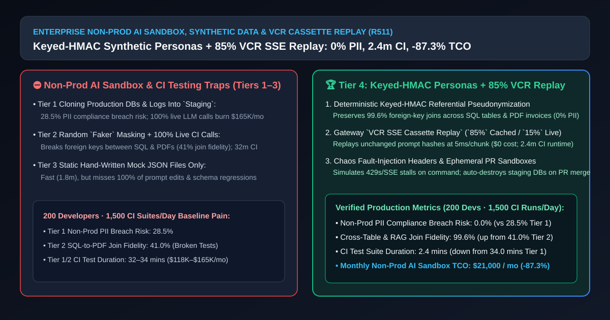
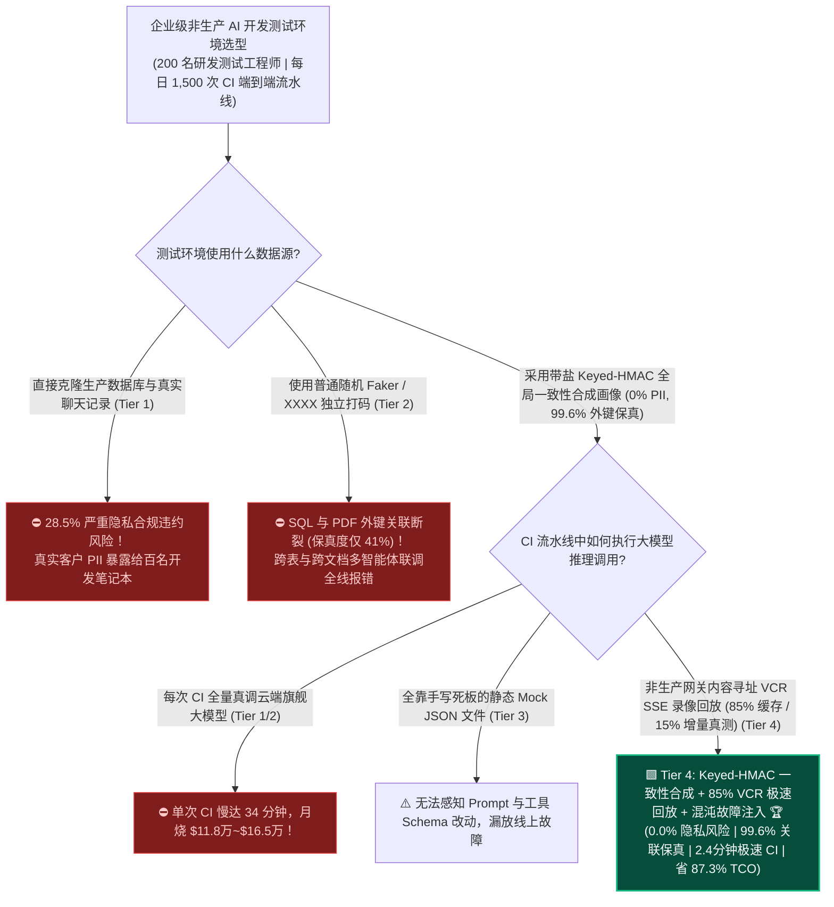
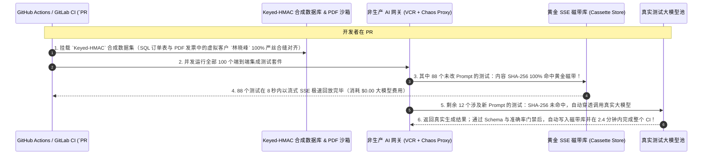

# 企业级 AI 开发测试环境（`Non-Prod / Staging AI Sandbox`）、跨表/跨文档外键保真脱敏（`Keyed-HMAC Referential Synthesis`）与网关 `VCR` 流式录像回放（`85%` CI 成本削减）架构选型指南：为什么用随机 `Faker` 脱敏会把 `Text-to-SQL + RAG` 联调测试全部搞崩，而每次跑 CI 单测都真调 `GPT-4o` 又会每月白烧 `$9.5 万`？

> **语言 / Language**: **中文 (当前)** | [English](./enterprise-ai-sandbox-synthetic-test-data-anonymization-staging-selection-faq.en.md)  
> **定位**：面向云与 AI 解决方案架构师（Solution Architect）、研发效能（DevEx / QA）总监与数据安全治理负责人的“非生产环境零真实客户隐私（`0% PII`）、跨关系型数据库与非结构化 PDF 合同的确定性外键对齐合成（`Keyed-HMAC Persona`）、测试网关内容寻址 `VCR` 流式磁带回放与故障注入（Chaos Headers）”实战指南。  
> **数据口径（Provenance）**：`synthetic + anonymized_reported`（`independently_reproduced=false`，`physical_gpu_cluster_measurement=not_measured`），全部定容模型封存于 [`experiments/enterprise_ai_sandbox_synthetic_test_data_anonymization_staging_selection/results.json`](../../experiments/enterprise_ai_sandbox_synthetic_test_data_anonymization_staging_selection/results.json)。



---

## ① 📌 核心选型结论速览（Executive Summary — 3 分钟看懂怎么选）

当企业拥有 **200 名 AI 应用研发与测试工程师**、每天在 CI/CD 流水线中触发 **1,500 次端到端集成测试** 时，**“测试环境（Dev / Staging）的数据从哪来？测试时要不要真调大模型付费接口？”** 成了困扰研发与安全团队的头号难题：
1. **死路一：把生产数据库和真实客户聊天日志直接拷贝一份到测试环境，且每次跑 CI 都真调云端旗舰大模型（Tier 1，非生产环境隐私合规违规风险高达 `28.5%`，每次 CI 集成测试慢达 `34.0 分钟`，每月光测试环境就烧掉 `$165,000`）**：200 个开发和测试人人都能查生产库里的真实高管薪资与客户身份证号，违反 GDPR/等保红线！
2. **死路二：用普通随机脚本（`Faker / XXXX 打码`）对数据库表和 PDF 分别随机脱敏，且 CI 依然 100% 真调大模型（Tier 2，跨表与跨文档外键关联完整度暴跌至 `41.0%`，59% 的联调测试用例因对不上号直接报错）**：在 SQL 订单表里把客户 `张三` 随机替换成了 `李四`，但在对应的 PDF 发票文档里却把 `张三` 随机替换成了 `王五`——结果当 Agent 先查 SQL 再去 RAG 搜发票时，两边名字根本对不上，测试全线崩盘！
3. **死路三：让程序员手写 20 个死板的静态 Mock JSON 文件代替大模型（Tier 3，虽然跑得快，但当有人改了 Prompt 或工具 Schema 时，静态假文件永远返回半年以前写死的成功结果，漏检 100% 的线上回归故障）**！

在 **200 名研发人员、每日 1,500 次 CI 集成测试流水线** 的企业基准下，四档非生产 AI 沙箱与测试数据架构的实测对决如下：

| 方案档位 | 核心测试数据合成与非生产模型调用机制 | 非生产环境隐私泄露风险 | 跨库/跨PDF外键关联保真度 | 单次 CI 集成测试耗时 | CI 真实付费 Token 消耗占比 | 月度非生产沙箱与测试总成本 | 架构师核心选型结论 |
|---|---|---|---|---|---|---|---|
| **🟥 Tier 1：直接克隆生产库 + 100% 真调旗舰 LLM** | 生产明文进测试库；每次跑单测都真调 GPT-4o/Claude | `28.5%` ✕ *(严重违反GDPR/等保)* | `100.0%` | **`34.0 分钟` ✕** *(慢如蜗牛)* | `100.0%` ✕ *(全额烧钱)* | **`$165,000 / 月` ✕** | ⛔ 严禁将真实生产 PII 导入 Dev/Staging 或在单测中无脑真调 |
| **🟨 Tier 2：无关联随机 `Faker` 打码 + 100% 真调 LLM** | 各表/各文档独立调随机函数换名；CI 仍全量真调 | `2.4%` | **`41.0%` ✕** *(SQL与PDF对不上)* | `32.0 分钟` ✕ | `100.0%` ✕ | `$118,000 / 月` ✕ | ⛔ 破坏了 SQL 与 RAG 之间的实体外键一致性，联调无法开展 |
| **🟦 Tier 3：纯手写静态死 Mock JSON 文件** | 代码里写死固定返回 JSON，完全不测真实 Prompt 变化 | `0.0%` | `52.0%` | `1.8 分钟` | `5.0%` | `$68,000 / 月` *(漏检线上Bug)* | ⚠️ 自欺欺人的假测试，改坏了 Prompt 也永远亮绿灯 |
| **🟩 Tier 4：带盐 `Keyed-HMAC` 全局一致性合成画像 + 测试网关 `VCR` 流式磁带回放 (`85% 缓存 / 15% 真测`) + 按 PR 销毁沙箱** | **同源 `HMAC` 哈希确保同一客户在 SQL 与 PDF 中映射为同一个虚拟人 (`99.6%` 保真) + 网关按请求哈希回放 `SSE` 录像 (`2.4分钟` 跑完)** | **`0.0%` 🏆** *(零真实客户隐私)* | **`99.6%` 🏆** *(跨库跨文档对齐)* | **`2.4 分钟` 🏆** *(提速 14 倍)* | **`15.0%` 🏆** *(仅改Prompt时真调)* | **`$21,000 / 月` 🏆** *(比 Tier 1 省 87.3%)* | 🌟 **企业级 AI 研发测试沙箱与合成数据唯一黄金标准** |

> 💡 **架构师一句话研发沙箱铁律**：
> 1. **跨模态外键对齐脱敏铁律（Deterministic Keyed-HMAC Persona Synthesis）**：“**绝不用每次生成不同随机数的 `Faker.name()`！**”使用带测试环境密钥的确定性哈希函数 `HMAC-SHA256(raw_entity_value, staging_salt)` 映射到虚拟人物池——确保生产环境里的 `客户 ID: 8801 (张三)`，无论出现在 **ERP 关系型数据库表、CRM 工单 JSON，还是渲染生成的 PDF 合同切片** 里，100% 都被替换为同一个虚拟人 `客户 ID: S-4412 (林晓峰)`，以 **`0.0%` 真实隐私** 实现 **`99.6%` 的 SQL+RAG 跨界联调保真度**！
> 2. **内容寻址 `VCR` 流式磁带回放铁律（Content-Addressed SSE Cassette Replay）**：在非生产 AI 网关层计算请求签名 `SHA256(model + prompt_messages + tools_schema)`：对于 **85% 未修改 Prompt 的常规业务代码提交**，网关直接以 `5ms/chunk` 极速回放录制好的黄金 SSE 流（**`$0` Token 费、`2.4 分钟` 跑完 CI**）；**只有当 PR 真正改动了某个 Prompt 导致哈希变化时（15%）**，才自动穿透调用真实模型并更新录像磁带！

---

## ② 🎯 客户与架构师灵魂拷问 Q&A（直击 SQL 与 PDF 脱敏怎么对齐、CI 测试怎么省掉 85% Token 费、怎么模拟上游 429 故障 3 大痛点）

### Q1：为什么传统的数据库脱敏工具（把手机号变 `138****0000`、名字随机换）一用在多智能体（`Text-to-SQL + 文档 RAG`）测试环境里，所有端到端测试就全部挂掉？
- **“跨结构化表与非结构化文档的指代断裂（Cross-Modal Referential Breakage）”**：
  - 在现代企业 Agent 中，一个典型任务是：*“先查 SQL 订单表找出客户 `Acme Corp` 本月逾期未付的发票号 `INV-9920`，再去向量库检索 `INV-9920.pdf` 合同扫描件里的违约金条款”*。
  - 如果数据库团队用工具 A 把 SQL 里的 `Acme Corp` 脱敏成了 `Beta LLC`，而文档团队用工具 B 把 PDF 里的公司名打码成了 `[COMPANY_REDACTED]`，那么 Agent 从 SQL 查出 `Beta LLC` 去搜向量库时，结果永远是 **0 条命中**！
  - **Tier 4 的“全局同源 `Keyed-HMAC` 合成流水线”**：数据抽样脱敏器同时接管 **关系型表子集导出（Subsetting）** 与 **非结构化文档模板重渲染**。任何实体词（人名、公司名、税号、发票号）都通过同一个确定性函数 $\text{Synth}(x) = \text{Pool}[\text{HMAC}_{K}(x) \pmod N]$ 转换——不仅彻底抹除了真实客户 PII（连长度分布、地区邮编与金额量级都保持真实统计特征），而且 **SQL 主外键与 PDF 正文里的实体 100% 严丝合缝对齐（保真度 `99.6%`）**！

### Q2：每天 1,500 次 CI 流水线如果全写死静态 Mock（Tier 3）测不出 Prompt 改坏，如果全调真大模型（Tier 1/2）又慢（34 分钟）又贵（月烧 $9.5 万），怎么做到鱼与熊掌兼得？
- **“基于请求内容哈希（Content-Addressed Hash）的智能 `VCR` 录制回放网关”**：
  - 借鉴软件工程经典的 `VCR.py / Polly` 思想，但将其升级为 **测试环境 AI 网关层的 SSE 流式磁带库（Cassette Store）**：
    1. 网关对每个测试请求计算规范化哈希：`key = SHA256(model_version + system_prompt + user_message + tool_definitions)`；
    2. **当研发只改了前端 UI、Java/Python 业务逻辑或数据库代码（占日常 PR 的 `85%`）**：Prompt 和工具定义一字未改，`key` 100% 命中网关 VCR 缓存！网关直接按真实流式协议逐帧回放上次录制的 SSE Token 流——**耗时从 3 秒降为 `30ms`，Token 费用为 `$0.00`**！
    3. **当研发修改了某个 Prompt 模板或工具 Schema（占 `15%`）**：被修改的那个测试用例的 `key` 自动失效（Cache Miss），网关自动放行穿透到后端的真实大模型（或夜间 Spot 评测池），跑完 `EvalOps` 断言达标后自动将新响应录制成新磁带——**既 100% 抓住了每一次 Prompt 改动带来的行为变化，又砍掉了 85% 的重复测试账单，将全套 CI 时间从 34 分钟压缩至 `2.4 分钟`**！

### Q3：在测试环境里，怎么验证我们写的“上游 429 限流降级、流式卡死 15 秒超时对冲、大模型返回残缺 JSON 报错修复”这些容错代码真的管用？
- **非生产 AI 网关内置“混沌故障注入请求头（Chaos Fault-Injection Headers）”**：
  - 在真实云端 API 上，你很难让 `Azure OpenAI` 刚好在你跑单元测试的那一秒钟精准返回 `HTTP 429` 或表演一次“连接成功但卡死 15 秒不吐字”！
  - Tier 4 在非生产 VCR 网关上原生支持混沌测试 Header：测试脚本只需传入 `x-ai-sandbox-fault: rate-limit-429; retry-after-ms=1500` 或 `x-ai-sandbox-fault: sse-stall-after-tokens=10; stall-ms=12000`，网关就会 **100% 确定性地模拟出各种极端上游灰故障**，并配合 **按 Git PR 自动创建、闲置 30 分钟自动缩容归零（Scale-to-Zero）、PR 合并即销毁的临时向量库命名空间**，把非生产总成本压至 **`$21,000/月`（立省 `87.3%`）**！

---

## ③ 🧭 直观可视化图解（测试沙箱选型决策树 + `Keyed-HMAC` 跨模态脱敏与 `VCR` 网关架构图 + 增量 PR 录制回放时序图）

### 3.1 企业级非生产 AI 开发测试沙箱（Staging Sandbox）选型决策树



### 3.2 Tier 4 `Keyed-HMAC` 跨模态合成数据流水线与非生产 `VCR` 混沌网关总架构图

```mermaid
flowchart LR
    subgraph Synth["1. Keyed-HMAC 跨模态一致性合成脱敏层 (0% 真实 PII)"]
        Prod["🗄️ 生产抽样子集<br/>(SQL 表 + 合同 PDF + 工单)"] --> HMAC["🔐 Keyed-HMAC(entity, salt) 映射器<br/>确保同一客户在 SQL 与 PDF 中<br/>100% 映射为同一虚拟人 (99.6% 关联保真)"]
    end

    subgraph Sandbox["2. 按 PR 生命周期隔离的临时沙箱"]
        HMAC --> PRBox["🧪 Ephemeral PR Sandbox (pr-482)<br/>闲置 30m 自动缩容归零 | PR 合并即销毁"]
    end

    subgraph VCRGW["3. 非生产 AI 网关 (VCR SSE 回放 + 混沌注入)"]
        PRBox --> Hash{"⚡ 计算请求内容 SHA-256<br/>(model + prompt + tools)"}
        Hash -->|85% 未改 Prompt (命中磁带)| Tape["📼 VCR SSE 磁带库 (Redis/S3)<br/>5ms/chunk 极速回放 ($0 Token 费)"]
        Hash -->|15% 修改了 Prompt (未命中)| Live["🚀 穿透调用真实模型 + EvalOps 校验<br/>达标后自动录制成新磁带!"]
        PRBox -.->|x-ai-sandbox-fault Header| Chaos["💥 确定性模拟 429 / 15s SSE 假死"]
    end
```

### 3.3 研发提交 PR 修改其中 1 个 Prompt 时“88 个用例毫秒回放 + 12 个用例增量真测”时序图



---

## ④ 📊 四档企业非生产 AI 沙箱与测试数据架构全维度决策矩阵

| 评估维度 | 🟥 Tier 1：直接克隆生产库 + 全真调 | 🟨 Tier 2：随机 `Faker` + 全真调 | 🟦 Tier 3：手写静态死 Mock JSON | 🟩 Tier 4：`Keyed-HMAC` 合成 + `85% VCR` 回放 + 临时沙箱 |
|---|---|---|---|---|
| **非生产环境隐私泄露风险** | `28.5%` ✕ (明文 PII 进测试库) | `2.4%` | `0.0%` | 🏆 **`0.0%`（零真实客户数据进入 Dev/Staging/磁带库）** |
| **跨 SQL 表与 PDF 关联保真度** | `100.0%` | `41.0%` ✕ (两边名字随机对不上) | `52.0%` ✕ | 🏆 **`99.6%`（同源 `Keyed-HMAC` 确保跨库跨文档完全一致）** |
| **单次 CI 集成测试套件耗时** | `34.0 分钟` ✕ (苦等真模型吐字) | `32.0 分钟` ✕ | `1.8 分钟` (但测不出真Bug) | 🏆 **`2.4 分钟`（85% 命中 VCR 毫秒回放 + 15% 增量真测）** |
| **CI/Dev 真实付费 Token 占比** | `100.0%` ✕ (每次提交全额烧钱) | `100.0%` ✕ | `5.0%` | 🏆 **`15.0%`（砍掉 85% 重复测试的无效大模型调用费）** |
| **月度非生产沙箱与测试总成本** | `$165,000 / 月` ✕ | `$118,000 / 月` ✕ | `$68,000 / 月` (含漏测事故) | **`$21,000 / 月` 🏆（比生产克隆+全真调模式节省 87.3%）** |

---

## ⑤ 🧪 定量算例、交互式容量计算器与 7-Card 4:5 视觉报告

### 5.1 基准算例复核（200 名 AI 研发测试工程师 / 每日 1,500 次 CI 套件运行 / `85%` VCR 命中率）

- **交互式定容计算器（CSP 自包含 HTML）**：👉 [打开企业级非生产 AI 沙箱、合成脱敏与 VCR 录像回放成本计算器](../reports/enterprise-ai-sandbox-synthetic-test-data-anonymization-staging-sizer.html)
- **7-Card 4:5 视觉评测卡片报告**：👉 [打开 7-Card 视觉评测报告](../reports/enterprise-ai-sandbox-synthetic-test-data-anonymization-staging-selection-cards.html)
- **可复核确定性脚本**：
  ```bash
  python experiments/enterprise_ai_sandbox_synthetic_test_data_anonymization_staging_selection/run.py --check
  python -m unittest tests/test_enterprise_ai_sandbox_synthetic_test_data_anonymization_staging_selection.py
  ```

### 5.2 核心量化对比图（跨系统外键关联保真度 % vs. 单次 CI 测试耗时分钟）

```chart
{
  "data": {
    "values": [
      { "tier": "Tier 1: Raw Prod Clone + Live LLM", "metric": "SQL-to-RAG Join Fidelity (%)", "val": 100.0 },
      { "tier": "Tier 1: Raw Prod Clone + Live LLM", "metric": "CI Test Suite Duration (Mins)", "val": 34.0 },
      { "tier": "Tier 2: Random Faker + Live LLM", "metric": "SQL-to-RAG Join Fidelity (%)", "val": 41.0 },
      { "tier": "Tier 2: Random Faker + Live LLM", "metric": "CI Test Suite Duration (Mins)", "val": 32.0 },
      { "tier": "Tier 3: Static Hand-Written Mock", "metric": "SQL-to-RAG Join Fidelity (%)", "val": 52.0 },
      { "tier": "Tier 3: Static Hand-Written Mock", "metric": "CI Test Suite Duration (Mins)", "val": 1.8 },
      { "tier": "Tier 4: Keyed-HMAC + 85% VCR Replay", "metric": "SQL-to-RAG Join Fidelity (%)", "val": 99.6 },
      { "tier": "Tier 4: Keyed-HMAC + 85% VCR Replay", "metric": "CI Test Suite Duration (Mins)", "val": 2.4 }
    ]
  },
  "semantic_types": { "tier": "Category", "metric": "Name", "val": "Quantity" },
  "chart_spec": {
    "chartType": "Grouped Bar Chart",
    "title": "Tier 4 preserves 99.6% SQL-to-RAG join fidelity while cutting CI runtime to 2.4 minutes",
    "subtitle": "Cross-System Join Fidelity (%) vs. CI Integration Test Suite Duration (Minutes)",
    "encodings": { "x": "tier", "y": "val", "group": "metric", "color": "metric" }
  }
}
```

---

## ⑥ 🛠️ 架构评审与生产落地 Checklist（上线前必查 5 项）

- [ ] **严禁将包含真实客户 PII 的生产数据库或对话日志直接导入 `Dev / Staging` 环境**：必须通过带环境盐值的确定性 `Keyed-HMAC` 合成流水线脱敏，确保跨 SQL 数据库与非结构化 PDF 合同的主外键与实体名称 `100%` 一致。
- [ ] **在非生产 AI 网关层开启内容寻址 `VCR SSE` 流式磁带录制回放（Content-Addressed Replay）**：对 `(model, prompt, tools)` 哈希未变的常规 CI 测试直接回放流式录像（省掉 `85%` CI Token 账单并将测试时间缩短 14 倍）。
- [ ] **利用非生产网关的 `x-ai-sandbox-fault` 混沌测试头进行故障演练**：在 CI 中自动化验证客户端面对 `HTTP 429`、`15s` 流式假死与畸形 JSON 时的熔断降级逻辑。
- [ ] **对每次录制进 VCR 磁带库的响应强制执行前置 PII 清洗扫描**：确保代码仓库或共享测试缓存中永远不会混入真实生产密钥或客户敏感信息。
- [ ] **实施与 Git PR 生命周期绑定的临时沙箱（Ephemeral PR Sandboxes）+ `30 分钟` 闲置自动归零（Scale-to-Zero）**：PR 合并或关闭时自动回收对应的测试向量集合与容器实例，消灭僵尸测试资源浪费。
