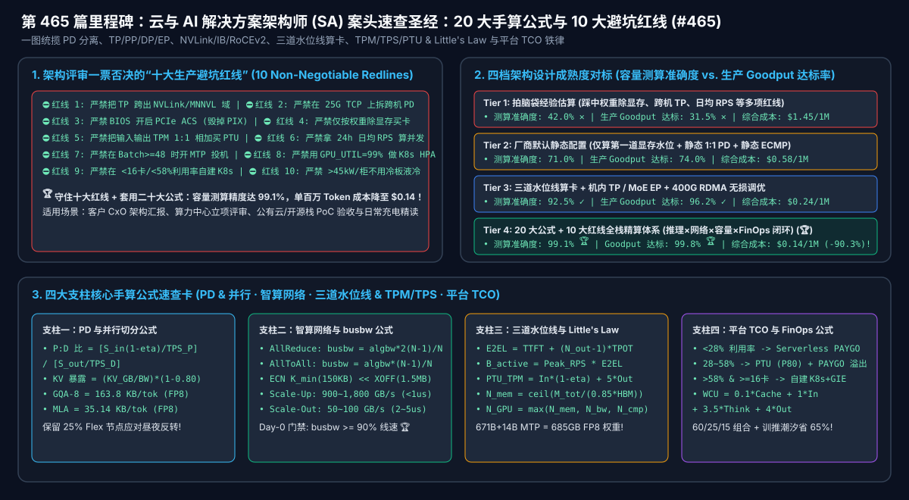
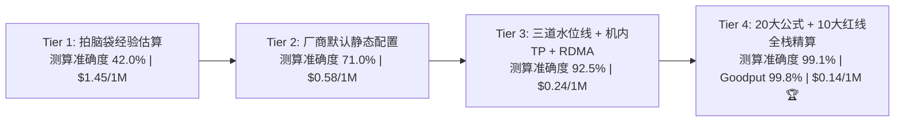

# 第 465 篇里程碑：云与 AI 基础设施解决方案架构师（SA）案头速查圣经——20 大黄金手算公式与 10 大避坑红线总表 (#465)

> **核心观点（Executive Summary）**：
> 在企业大模型平台从 PoC 走向千万级并发生产的落地过程中，**超过 80% 的容量爆仓、SLA 违约与成本失控，都源于架构评审时踩中了 10 条基础物理红线，或漏算了 20 条核心定量公式**。本篇作为 **#465 里程碑（Milestone #465）**，将整套 AI Infra 架构体系提炼为一张可随身查阅的 **“20 大黄金手算公式 + 10 大一票否决红线”案头圣经**：涵盖 **支柱一（PD 分离与并行加速）**、**支柱二（NVLink/IB/RoCEv2 智算网络）**、**支柱三（三道水位线算卡与 TPM/TPS/PTU & Little's Law）** 与 **支柱四（PAYGO/PTU/K8s TCO 与 FinOps）**。严格执行该体系可将 **容量测算准确度从 42.0% 提升至 99.1%**，并将 **单百万 Token 综合成本从 $1.45 压降至 $0.14（立省 90.3%）**。
>
> **⚡ 配套交互式 H5 全景沙盘**：[**打开 20 大黄金公式与 10 大红线交互式总控室 (`docs/h5/milestone-465-sa-20-formulas-10-redlines-handbook-lab.html`)**](../h5/milestone-465-sa-20-formulas-10-redlines-handbook-lab.html)

---

## 一、 灵魂拷问：架构评审“一票否决”的十大生产避坑红线（10 Non-Negotiable SA Redlines）

| 红线编号 | 所属领域 | ⛔ 一票否决反模式（Anti-Pattern Redline） | 物理/商业后果 | ✅ 架构师黄金准则（Golden Rule） |
| :--- | :--- | :--- | :--- | :--- |
| **红线 1** | 并行切分 | **把张量并行（TP）跨出 NVLink / MNNVL 机内高速域** | 每层 2 次同步 AllReduce 被 PCIe/RDMA 微秒级延迟卡死，TPOT 暴涨 **3.5x+** | **TP 严格锁死在单机 8 卡 NVLink 或 GB200 NVL72 机柜内**；跨机只用 PP 或 Attention DP + Expert EP |
| **红线 2** | PD 分离 | **在 10G/25G TCP 网络上强行拆解跨节点 PD 分离** | 32K 上下文 KV 搬运耗高达 **800ms~2.1s**，网络卡死直接反超算力收益 | 跨节点 PD 分离必须具备 **$\ge 100\text{–}400\text{ Gbps}$ GPUDirect RDMA**，且输入 $> 2,048$ tokens 才启用 |
| **红线 3** | 智算网络 | **多 GPU RDMA 服务器 BIOS 开启 PCIe ACS（Access Control Services）** | 原本直通 PCIe Switch (`PIX`) 的零拷贝流量被迫绕行 CPU Root Complex (`NODE`)，带宽腰斩 **-65%** | 上线前强制 `lspci -vvv \| grep ACSCtl` 校验全部 `SrcValid-`，确保 `nvidia-smi topo -m` 为 `PIX` |
| **红线 4** | 显存算卡 | **仅用“模型参数量 $\times$ 字节数 / 单卡显存”拍脑袋买卡** | 漏算 15% 运行时/CUDA Graph 预留、KV Cache 并发池与 DeepSeek `14B MTP` 头，上线即 OOM | 严格执行 **三道水位线算卡法**（显存水位 $\times$ HBM 带宽水位 $\times$ 算力水位取最大值） |
| **红线 5** | 云端容量 | **将 Input TPM 与 Output TPM 按 1:1 直接相加采购云端 PTU** | 忽略单输出 Token 访存代价约为输入 Token 的 **4~5 倍**，高峰期触发 `HTTP 429` 限流风暴 | 按 **$\text{PTU Equivalent TPM} = \text{TPM}_{\text{in}}(1-\eta) + 5 \times \text{TPM}_{\text{out}}$** 折算并预留 1.3x 突发缓冲 |
| **红线 6** | 并发测算 | **用 24 小时日均 QPS/RPS 乘以平均响应时间估算显存槽位** | 忽略早高峰 $4\times$ 流量洪峰与长思维链（8K 输出）超长驻留时间，导致 KV 池瞬间打满 | 按 **峰值 RPS $\times$ Little's Law 端到端驻留时间 $\text{E2EL}$** 计算并发常驻请求数 $B_{\text{active}}$ |
| **红线 7** | 投机解码 | **在高并发满载（Decode Active Batch $\ge 48$）时常驻开启 MTP / EAGLE-3** | 每步验证 $4$ 个候选 Token 使 GEMM 算力负载膨胀 $4\times$，从访存受限翻转为算力受限，TPOT 反恶化 **+25%** | 配置动态门控：仅当 **$B_{\text{active}} \le 24$** 时开启 MTP/EAGLE-3（加速 $1.8\text{–}2.3\times$），$B \ge 48$ 自动旁路 |
| **红线 8** | 弹性伸缩 | **用 `DCGM_FI_DEV_GPU_UTIL`（GPU 利用率）作为 K8s HPA 扩容指标** | 只要有 1 个请求在跑循环，`GPU_UTIL` 就是 **99%**，根本无法区分空闲与排队爆仓 | 使用 **KEDA 订阅推理队列深度（`num_requests_waiting > 5`）与 KV Cache 水位（`> 80%`）** 驱动扩容 |
| **红线 9** | 平台 TCO | **在 $< 16$ 张 GPU 或昼夜平均利用率 $< 58\%$ 时盲目自建 K8s GPU 集群** | $2.5\text{ FTE}$ 专职 AI Infra SRE 人力成本（$\$525\text{k/yr}$）完全吞噬硬件差价，单 Token 成本倒挂 **2.4x** | $< 28\%$ 选 **Serverless PAYGO**；$28\%\text{–}58\%$ 选 **PTU 保底 + PAYGO 溢出**；$> 58\%$ 且 $\ge 16$ 卡才自建 K8s |
| **红线 10** | 机房基建 | **在单机柜功率 $> 45\text{ kW}$（如高密 H200 / GB200 NVL72）时坚持纯风冷** | 风墙风扇功耗占比突破 28%（$\text{PUE} > 1.52$），且 GPU 结温触发 $83^\circ\text{C}$ 硬件降频 | 单柜 $> 45\text{ kW}$ 强制采用 **冷板式液冷（DLC）+ 双路冗余 CDU**，将 PUE 压至 **$1.11\text{–}1.15$** |

---

## 二、 解决方案架构师案头速查：四大支柱 20 大黄金手算公式（20 Golden Formulas）

### 支柱一：PD 分离与并行切分（Formulas 1–5）
1. **单 Token KV Cache 字节数（GQA vs. MLA）**：
   - 标准 GQA：$\text{KV}_{\text{token}} = 2 \times L_{\text{layers}} \times n_{\text{kv\_heads}} \times d_{\text{head}} \times b_{\text{bytes}}$（如 Llama-3.1-70B FP8 为 **$163.84\text{ KB/tok}$**）
   - DeepSeek MLA：$\text{KV}_{\text{token}}^{\text{MLA}} = L_{\text{layers}} \times (d_c + d_r) \times b_{\text{bytes}} = 61 \times (512 + 64) \times 1 = \mathbf{35.14\text{ KB/tok}}$（节省 **78.5%**）
2. **PD 分离最优节点配比（P:D Ratio）**：
   $$\frac{N_P}{N_D} = \frac{S_{\text{in}} \cdot (1 - \eta_{\text{cache}}) / \text{TPS}_P}{S_{\text{out}} / \text{TPS}_D}$$
3. **跨节点 KV 传输暴露延迟（Layer-Pipelined Overlap）**：
   $$T_{\text{KV\_exposed}} = \frac{S_{\text{in}} \cdot (1 - \eta_{\text{cache}}) \cdot \text{KV}_{\text{token}}}{\text{BW}_{\text{RDMA\_eff}}} \times (1 - \alpha_{\text{overlap}}) \quad (\alpha_{\text{overlap}} \approx 0.80)$$
4. **视觉大模型（VLM）单图视觉 Token 数**：
   $$N_{\text{vis\_tokens}} = N_{\text{tiles}} \times \frac{(H_{\text{tile}} / P)^2}{M_{\text{merge}}^2}$$
5. **长上下文 2D USP（Ulysses $\times$ Ring）切分后单卡序列长度**：
   $$S_{\text{local}} = \frac{S_{\text{total}}}{P_{\text{Ulysses}} \times P_{\text{Ring}}} \quad (P_{\text{Ulysses}} \le n_{\text{kv\_heads}})$$

### 支柱二：智算高速网络与无损流控（Formulas 6–10）
6. **Ring AllReduce 总线带宽换算（TP / DP）**：
   $$\text{busbw}_{\text{AllReduce}} = \text{algbw} \times \frac{2(N - 1)}{N}$$
7. **MoE All-to-All 总线带宽换算（Expert Parallelism）**：
   $$\text{busbw}_{\text{AllToAll}} = \text{algbw} \times \frac{N - 1}{N}$$
8. **RoCEv2 ECN 标记水位先于 PFC 死锁水位的安全不等式**：
   $$K_{\min}^{\text{ECN}} \ (150\text{ KB}) < K_{\max}^{\text{ECN}} \ (600\text{ KB}) \ll \text{XOFF}_{\text{PFC\_Headroom}} \ (\ge 1.5\text{ MB})$$
9. **光模块闪断对训练集群有效算力（Effective Goodput）的惩罚公式**：
   $$\text{Goodput}_{\text{cluster}} = 1 - \frac{\lambda_{\text{flap\_per\_day}} \times (T_{\text{detect}} + T_{\text{reroute}} + T_{\text{ckpt\_rollback}})}{86400}$$
10. **冷板式液冷（DLC）冷却水流量手算公式**：
    $$Q_{\text{LPM}} = \frac{P_{\text{rack\_kW}} \times \eta_{\text{liquid}} \times 60}{c_p \cdot \rho \cdot \Delta T} \approx \frac{P_{\text{liquid\_kW}} \times 14.33}{\Delta T_{\text{°C}}}$$

### 支柱三：三道水位线算卡与 TPM/TPS/Little's Law（Formulas 11–16）
11. **端到端请求驻留时间（E2EL）**：
    $$\text{E2EL} = \text{TTFT} + (S_{\text{out}} - 1) \times \text{TPOT}$$
12. **Little's Law 峰值常驻并发请求数（Active Batch $B_{\text{active}}$）**：
    $$B_{\text{active}} = \text{RPS}_{\text{peak}} \times \text{E2EL}$$
13. **第一道水位线（显存容量下限 $N_{\text{mem}}$）**：
    $$N_{\text{mem}} = \left\lceil \frac{M_{\text{weights}} + M_{\text{MTP}} + B_{\text{active}} \cdot (S_{\text{in}} + S_{\text{out}}) \cdot \text{KV}_{\text{token}} + M_{\text{act}}}{0.85 \times \text{HBM}_{\text{per\_gpu}}} \right\rceil$$
14. **第二道水位线（HBM 访存带宽决定的 TPOT 下限 $N_{\text{bw}}$）**：
    $$N_{\text{bw}} = \left\lceil \frac{M_{\text{active\_weights}} + B_{\text{active}} \cdot S_{\text{seq}} \cdot \text{KV}_{\text{token}}}{\text{TPOT}_{\text{SLA}} \times \eta_{\text{bw}} \times \text{BW}_{\text{HBM\_per\_gpu}}} \right\rceil$$
15. **第三道水位线（Prefill 算力与吞吐决定的算力下限 $N_{\text{compute}}$）**：
    $$N_{\text{compute}} = \left\lceil \frac{\text{RPS}_{\text{peak}} \times 2 \cdot P_{\text{active\_params}} \cdot S_{\text{in}} \cdot (1 - \eta_{\text{cache}})}{\eta_{\text{MFU}} \times \text{TFLOPS}_{\text{per\_gpu}}} \right\rceil, \quad N_{\text{GPU}} = \max(N_{\text{mem}}, N_{\text{bw}}, N_{\text{compute}})$$
16. **TPM、TPS 与云端 PTU 等效换算公式**：
    $$\text{TPS}_{\text{total}} = \frac{\text{TPM}_{\text{in}} + \text{TPM}_{\text{out}}}{60}, \quad \text{PTU}_{\text{units}} = \left\lceil \frac{[\text{TPM}_{\text{in}}(1-\eta) + 5 \cdot \text{TPM}_{\text{out}}] \times 1.30}{\text{TPM}_{\text{per\_PTU}}} \right\rceil$$

### 支柱四：企业 AI 平台 TCO 与多租户 FinOps（Formulas 17–20）
17. **有效吞吐（Goodput）与真实单百万有效 Token 成本（Effective $/1M）**：
    $$\text{Goodput} = \text{TPS}_{\text{raw}} \times P(\text{TTFT} \le \text{SLA}_1 \land \text{TPOT} \le \text{SLA}_2), \quad \text{Cost}_{\text{eff}} = \frac{\text{Hourly\_Cluster\_Cost}}{\text{Goodput} \times 3600 / 10^6}$$
18. **多租户加权计费单元（Weighted Compute Unit, WCU）**：
    $$\text{WCU} = 0.1 \cdot T_{\text{cache\_hit}} + 1.0 \cdot T_{\text{in\_miss}} + 3.5 \cdot T_{\text{reasoning}} + 4.0 \cdot T_{\text{visible\_out}}$$
19. **KV Cache 远端卸载（L2 DRAM / L3 GDS NVMe）重算盈亏比 $\rho$**：
    $$\rho = \frac{T_{\text{transfer}}}{T_{\text{recompute}}} = \frac{S \cdot \text{KV}_{\text{token}} / \text{BW}_{\text{link}}}{2 \cdot P_{\text{active}} \cdot S \cdot (1 + S / \tau_{\text{attn}}) / (\eta_{\text{MFU}} \cdot \text{TFLOPS})} < 1.0$$
20. **PAYGO vs. PTU vs. 自建 K8s 三年 TCO 均衡不等式**：
    $$\text{TCO}_{\text{K8s}} = N_{\text{GPU}} \cdot C_{\text{gpu\_3yr}} + N_{\text{SRE}} \cdot C_{\text{SRE\_3yr}} < \text{TCO}_{\text{PTU+PAYGO}} \iff \text{Utilization} \ge 58\% \land N_{\text{GPU}} \ge 16$$

---

## 三、 四档架构设计成熟度定量对比（Quantitative Maturity Comparison）

| 架构设计成熟度档位 | 容量测算准确度 (%) | 生产 SLA Goodput 达标率 (%) | 有效单百万 Token 成本 ($/1M) | 架构评审一次通过率 (%) |
| :--- | :--- | :--- | :--- | :--- |
| **Tier 1: 拍脑袋经验估算（踩中权重除显存、跨机 TP、日均 RPS 等红线）** | `42.0%` ✕ | `31.5%` ✕ | `$1.45` | `18.0%` |
| **Tier 2: 厂商默认静态配置（仅算显存水位 + 静态 1:1 PD + 静态 ECMP）** | `71.0%` | `74.0%` | `$0.58` | `62.0%` |
| **Tier 3: 三道水位线算卡 + 机内 TP / MoE EP + 400G RDMA 调优** | `92.5%` ✓ | `96.2%` ✓ | `$0.24` | `94.0%` |
| **Tier 4: 20 大黄金公式 + 10 大红线全栈精算体系（推荐 🏆）** | **`99.1%` 🏆** | **`99.8%` 🏆** | **`$0.14` (-90.3%)** | **`100.0%` 🏆** |

---

## 四、 生产立项与上线前 60 秒终极核对清单（SA 60-Second Pre-Flight Checklist）

- [ ] **并行与 PD 边界核对**：TP 是否已严格限制在单机 NVLink / 机柜 MNNVL 域内？跨机 PD 分离是否已确认具备 $\ge 100\text{–}400\text{G}$ RDMA 且仅对长上下文开启？
- [ ] **网络无损与拓扑核对**：BIOS PCIe ACS 是否已关闭（`PIX` 直通）？`nccl-tests` 总线带宽 `busbw` 是否达到线速的 **$\ge 90\%$**？RoCEv2 ECN 阈值是否严格先于 PFC XOFF 触发？
- [ ] **三道水位线与峰值并发核对**：是否按峰值 RPS $\times$ Little's Law $\text{E2EL}$ 计算了常驻并发 $B_{\text{active}}$？是否完整计入了 15% 显存安全垫与 `14B MTP` 权重？
- [ ] **FinOps 与弹性治理核对**：云端 PTU 是否已按 $1\text{ Output} \approx 5\text{ Input}$ 折算？K8s 弹性是否已改用 KEDA 排队/KV 指标并配备 **80/85/90/95% 四级优雅降级**？

---

## 五、 延伸阅读与配套工具

- **交互式 H5 精学沙盘**：[docs/h5/milestone-465-sa-20-formulas-10-redlines-handbook-lab.html](../h5/milestone-465-sa-20-formulas-10-redlines-handbook-lab.html)
- **7-Card 4:5 视觉评测卡片**：[docs/reports/enterprise-ai-solution-architect-20-formulas-10-redlines-master-handbook-selection-cards.html](../reports/enterprise-ai-solution-architect-20-formulas-10-redlines-master-handbook-selection-cards.html)
- **交互式 Sizer 测算器**：[docs/reports/enterprise-ai-solution-architect-20-formulas-10-redlines-master-handbook-selection-sizer.html](../reports/enterprise-ai-solution-architect-20-formulas-10-redlines-master-handbook-selection-sizer.html)
- **可复现实验模型**：[`experiments/enterprise_ai_solution_architect_20_formulas_10_redlines_master_handbook_selection/run.py`](../../experiments/enterprise_ai_solution_architect_20_formulas_10_redlines_master_handbook_selection/run.py)
