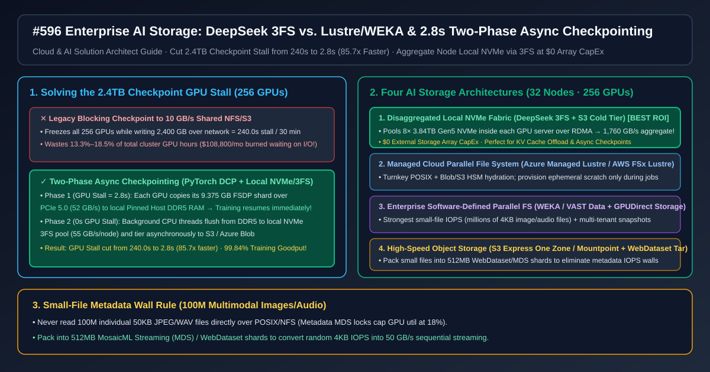

# Enterprise AI Storage Architecture: `DeepSeek 3FS Local NVMe Fabric vs. Managed Lustre / WEKA` & `2.8-Second` Two-Phase Async Checkpointing Guide

> **Target Persona**: Cloud & AI Solution Architect  
> **Core Scenarios**: Distributed training checkpointing (`2.4 TB` state dumps), Tier-3 NVMe KV Cache offloading, and 100M-file multimodal dataset streaming across `128–1,024` GPUs  
> **Interactive H5 Learning Workbench**: [`docs/h5/ai-storage-3fs-lustre-weka-checkpoint-sizer.html`](../h5/ai-storage-3fs-lustre-weka-checkpoint-sizer.html)

---

## 1. Executive Summary

1. **Eliminating the `240-Second` Checkpoint GPU Stall (`240.0s -> 2.8s`, `85.7×` Faster)**:
   - Writing a `2,400 GB` (`2.4 TB`) distributed checkpoint synchronously over `10 GB/s` shared storage freezes all `256` GPUs for `240s` every 30 minutes — burning **`13.3%–18.5%` of cluster GPU hours (`$108,800/mo` wasted)**!
   - **Two-Phase Async Checkpointing (`PyTorch DCP Async`)**:
     - **Phase 1 (`2.8s` GPU Stall)**: Each GPU copies its `9.375 GB` shard over `PCIe 5.0` into local **Pinned Host DDR5 RAM**, and training resumes immediately (**`99.84%` training goodput**).
     - **Phase 2 (`0s` GPU Stall)**: Background CPU threads flush from DDR5 to local NVMe / `3FS` and asynchronously tier to S3 / Azure Blob.
2. **Zero-CapEx High-Speed Storage via `DeepSeek 3FS` on Compute-Node Local NVMe (`1,760 GB/s`)**:
   - Standard 8-GPU `H100/H200` servers ship with `8× 3.84 TB Gen5 NVMe SSDs` (`55 GB/s/node`). Pooling `32` nodes via **`DeepSeek 3FS`** over RDMA delivers **`1,760 GB/s` aggregate throughput at `$0` external storage array CapEx** (`$2,800/mo` with S3 cold tiering vs. `$18,500–$26,000/mo` for external parallel storage arrays).

---

## 2. Storage Architecture Comparison Matrix (`32` Nodes · `256` GPUs)

| Dimension | **`DeepSeek 3FS` (Pooled Node Local NVMe + S3)** | Cloud Managed Lustre (`AMLFS / FSx`) | Enterprise Parallel FS (`WEKA / VAST`) | `S3 Express + Mountpoint` |
|---|---|---|---|---|
| **Aggregate Bandwidth** | **`1,760 GB/s` (`55 GB/s × 32` nodes)** | `100–250 GB/s` | `400–800 GB/s` | `80–160 GB/s` |
| **2.4TB Checkpoint Stall** | **`2.8 s` (Two-Phase Async)** | **`2.8 s` (Two-Phase Async)** | **`2.8 s`** | `2.8 s` (Async) / `65 s` (Sync) |
| **Monthly Storage Cost** | **`$2,800 / mo` (`$0` external array)** | `$18,500 / mo` | `$26,000 / mo` | `$6,400 / mo` |

---

## 3. Production Checklist

- [ ] Enable **Two-Phase Async Checkpointing (`PyTorch DCP Async` to Pinned Host DRAM)** so GPU stalls never exceed `3 seconds`.
- [ ] Pool compute-node local Gen5 NVMe drives via **`DeepSeek 3FS`** for hot checkpoints and Tier-3 KV Cache offloading.
- [ ] Pack 100M+ small JPEG/WAV training files into **`512 MB` `WebDataset (.tar)` or `MosaicML MDS` shards** to eliminate POSIX metadata bottlenecks.
