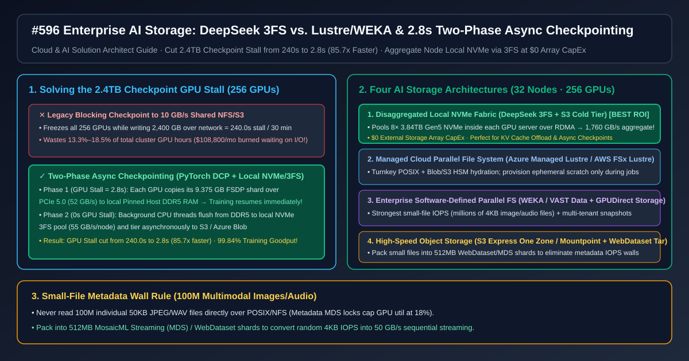
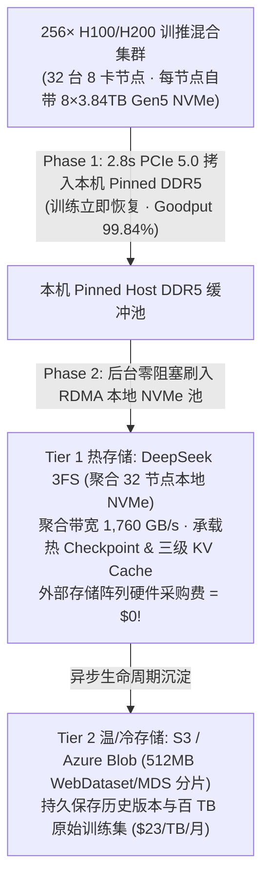

# 企业级 AI 高性能存储架构选型：`DeepSeek 3FS 本地 NVMe 池化 vs. Managed Lustre / WEKA vs. 对象存储` 与 `2.8 秒` 两阶段异步 Checkpoint 容量测算指南

> **面向角色**：Cloud & AI Solution Architect（云与 AI 解决方案架构师）  
> **核心场景**：`128–1,024` 卡集群分布式训练 Checkpoint 落盘、三级 KV Cache 卸载（HBM -> DRAM -> NVMe）、亿级多模态小文件高吞吐读取  
> **配套交互式 H5 精读工作台**：[`docs/h5/ai-storage-3fs-lustre-weka-checkpoint-sizer.html`](../h5/ai-storage-3fs-lustre-weka-checkpoint-sizer.html)

---

## 一、执行摘要（Executive Summary：3 分钟掌握核心架构结论）

1. **为什么 `256` 卡集群用传统同步阻塞方式把 `2.4 TB` Checkpoint 写往普通 `10 GB/s` 共享 NFS/对象存储，会白白烧掉 `13.3%–18.5%` 的昂贵 GPU 算力预算？**  
   - 每隔 `30 分钟（1,800s）` 保存一次 `2,400 GB` 的全量训练状态，在 `10 GB/s` 存储带宽下会导致全部 `256` 张 `H100` 同步挂起干等 **`240 秒`（占总训练时间的 `13.3%`，算上集合通信对齐与冷恢复高达 `18.5%`，相当于每月白扔 `$108,800` 显卡租金）**！
2. **破局架构一：两阶段异步 Checkpoint（`PyTorch DCP Async + Pinned Host DRAM -> 本地 NVMe/3FS -> S3`，停顿从 `240s` 压至 `2.8s`，提速 `85.7 倍`）**：
   - **第一阶段（仅冻结 GPU `2.8 秒`）**：每张 GPU 仅需将自身负责的 `FSDP2` 分片（`2,400 GB / 256 = 9.375 GB/卡`）通过机内 `PCIe 5.0` 拷入本机预留的 **Pinned Host DDR5 锁页内存**，耗时仅 **`2.8 秒`**，随后 GPU **立即恢复下一轮训练迭代（训练有效吞吐率 Goodput 达 `99.84%`）**！
   - **第二阶段（零 GPU 停顿后台落盘）**：后台独立 CPU 线程在接下来的 30–60 秒内，静默将 DDR5 中的数据刷入本地 NVMe 分布式文件池（`DeepSeek 3FS`）并异步归档至 S3/Blob。
3. **破局架构二：激活服务器内置本地 NVMe 打造零硬件溢价的 `DeepSeek 3FS` 超高速并行存储池（`1,760 GB/s`）**：
   - 每台标准 8 卡 `H100/H200` 服务器出厂即自带 **`8 块 3.84 TB PCIe Gen5 NVMe SSD`（单机本地读取带宽高达 `55 GB/s`）**，在传统架构中这些本地盘 90% 处于闲置状态；
   - 部署 **`DeepSeek 3FS (Fire-Flyer File System)`** 通过 RDMA 网络将 `32` 台 GPU 节点的本地 NVMe 聚合成统一命名空间，无需额外采购百万美元级外部全闪存储阵列（`$0` External Array CapEx），即可直接获得 **`1,760 GB/s` 的集群聚合读取带宽**，完美支撑三级 KV Cache 零拷贝卸载（`GPUDirect Storage`）与极速模型冷启动！

---

## 二、架构师灵魂拷问（Core Q&A）

### Q1：训练多模态或语音模型时，直接从 NFS/Lustre 读取 `1 亿个` `50 KB` 的独立 JPEG/WAV 小文件为什么会让 GPU 利用率暴跌至 `18%`？
- **元数据服务器（MDS）锁风暴与 `4 KB` 随机 IOPS 墙**：每次打开一个独立小文件都需要经历 `open() -> stat() -> read() -> close()` 四次 POSIX 元数据 RPC 交互。`1 亿` 个小文件会彻底打爆并行文件系统的元数据节点（MDS），此时哪怕底层存储标称带宽有 `200 GB/s`，实际测出来的有效吞吐也不足 **`1.2 GB/s`**！
- **生产铁律：小文件入湖前强制打包为 `512 MB` 的 `WebDataset (.tar)` 或 `MosaicML StreamingDataset (.mds)` 分片**：
  - 将每 `10,000` 张图片/音频连续封装为一个 `512 MB` 的顺序大文件块，并附带内存偏移索引表；
  - 读取模式瞬间从“百万次随机元数据寻址”转化为 **“100% 满带宽顺序大块流式读取（Sequential Streaming）”**，GPU 数据加载饥饿停顿直接归零！

### Q2：四大 AI 存储路线（`DeepSeek 3FS 本地 NVMe 池` vs. `Azure Managed Lustre / AWS FSx` vs. `WEKA / VAST 商业全闪` vs. `S3 Express + Mountpoint`）该如何精准选型？

---

## 三、四大企业级 AI 存储架构横向选型矩阵（`32` 节点 `256` 卡规模 · `100 TB` 热数据）

| 评估维度 | 方案 1：`DeepSeek 3FS`（聚合计算节点自带本地 NVMe + S3 冷备） | 方案 2：云原生托管 Lustre (`Azure Managed Lustre / AWS FSx`) | 方案 3：商业软件定义全闪 (`WEKA / VAST Data + GDS`) | 方案 4：高速对象存储直挂载 (`S3 Express + Mountpoint`) |
|---|---|---|---|---|
| **32 节点聚合吞吐** | **`1,760 GB/s`（`55 GB/s × 32` 节点 RDMA 直通）** | `100–250 GB/s`（取决于购买的容量档位） | `400–800 GB/s`（支持完整 GPUDirect Storage） | `80–160 GB/s`（仅适合顺序大文件） |
| **2.4TB Checkpoint 停顿** | **`2.8 秒`（两阶段 Pinned DRAM + 3FS）** | **`2.8 秒`（配合两阶段异步 DCP）** | **`2.8 秒`** | 同步写 `65s` / 两阶段异步 `2.8s` |
| **海量小文件随机 IOPS** | **极高（原生全 NVMe + Craq 强一致元数据）** | 中（受限于 MDS 节点数） | **极高（专为千万级 IOPS 优化）** | 差（必须预先打包为 `512MB` `.tar/.mds`） |
| **月度额外存储成本** | **`$2,800 / 月`**（零外部全闪阵列采购，仅付对象存储冷备费） | **`$18,500 / 月`**（按预置高吞吐 TiB 计费） | **`$26,000 / 月`**（软件授权 + 独立存储服务器） | **`$6,400 / 月`** |
| **最佳适用边界** | **拥有带本地 NVMe 的自建/长租 GPU 节点、追求极致性价比与 KV 卸载** | **公有云短期弹性大训任务（跑完即销毁 Lustre 实例）** | **几十个团队共用的PB级企业级合规 NAS/全闪数据湖** | **已做 `WebDataset/MDS` 预打包的纯流式读取任务** |

---

## 四、生产级 AI 存储与异步 Checkpoint 落地 Checklist

- [ ] **全面启用 `PyTorch Distributed Checkpointing (DCP) Async` 两阶段异步落盘**：将 GPU 侧停顿严格锁死在 `HBM -> Pinned Host DRAM` 的 `2.8 秒` 拷贝窗口内，严禁让 GPU 阻塞等待网络文件系统写完。
- [ ] **复用 GPU 服务器内置的 `8× 3.84TB Gen5 NVMe` 组建 `3FS / Local Scratch` 高速层**：将最吃带宽的最近 3 次热 Checkpoint 与推理 KV Cache 三级卸载池放在零额外硬件成本的本地 NVMe RDMA 池上。
- [ ] **小文件数据集强制转换为 `512 MB` `MosaicML MDS` 或 `WebDataset (.tar)` 格式**：彻底消灭 POSIX 元数据 `open/stat` 风暴。

---

## 五、配套资产索引

- **交互式 H5 精读工作台**：[`docs/h5/ai-storage-3fs-lustre-weka-checkpoint-sizer.html`](../h5/ai-storage-3fs-lustre-weka-checkpoint-sizer.html)
- **7-Card 4:5 评测报告**：[`docs/reports/enterprise-ai-storage-3fs-lustre-weka-checkpoint-kv-sizing-cards.html`](../reports/enterprise-ai-storage-3fs-lustre-weka-checkpoint-kv-sizing-cards.html)
- **交互式容量计算器**：[`docs/reports/enterprise-ai-storage-3fs-lustre-weka-checkpoint-kv-sizing-sizer.html`](../reports/enterprise-ai-storage-3fs-lustre-weka-checkpoint-kv-sizing-sizer.html)
- **可复现实验模型**：[`experiments/enterprise_ai_storage_3fs_lustre_weka_checkpoint_kv_sizing/run.py`](../../experiments/enterprise_ai_storage_3fs_lustre_weka_checkpoint_kv_sizing/run.py)
