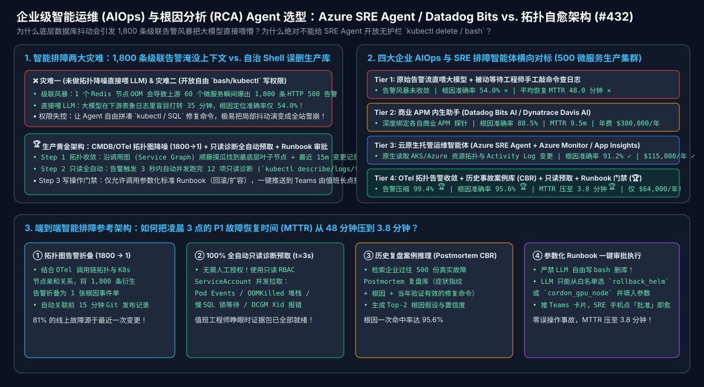

# Enterprise AIOps, Alert Storm Deduplication & Incident RCA Agent Selection Guide: `Azure SRE Agent` vs. `Datadog Bits AI` vs. `OTel Topology + Auto Read-Only Prefetch + Runbook Gate`

> **Language / 语言**: [简体中文](./enterprise-aiops-incident-rca-sre-agent-topology-runbook-tco-selection-faq.md) | **English**  
> **Companion Interactive Study & Sizing Tools**: [📱 Interactive H5 Study Lab](../h5/aiops-incident-rca-sre-agent-topology-runbook-lab.html) · [🧮 HTML Sizer](../reports/enterprise-aiops-incident-rca-sre-agent-topology-runbook-tco-selection-sizer.html) · [🃏 7-Card Visual Deck](../reports/enterprise-aiops-incident-rca-sre-agent-topology-runbook-tco-selection-cards.html) · [📊 Reproducible Model](../../experiments/enterprise_aiops_incident_rca_sre_agent_topology_runbook_tco_selection/) · [🎓 Back to AI Infra H5 Hub](../h5/index.html)

---

## 1. Executive Summary (3-Minute Takeaway)

> **Bottom-Line Recommendation**: Feeding an unfiltered `1,800-alert` cascade storm directly into an LLM yields only **`54.0%` root-cause accuracy (`48.0 min` MTTR)** because upstream HTTP 502 symptoms drown out the underlying leaf-node failure. Conversely, granting an autonomous agent unconstrained write access to `bash / kubectl` risks catastrophic production outages.
> - **For Azure / AKS-Centric Enterprises**: Deploy **`Azure SRE Agent`** (`91.2%` RCA accuracy, `5.4 min` MTTR, native Azure Monitor / Activity Log change correlation).
> - **For Multi-Cloud / OpenTelemetry Estates**: Deploy **Tier 4 (`OTel Service-Graph Alert Deduplication [99.4% noise reduction] + 15-Min Git/ArgoCD Change Correlation + 100% Automated Read-Only Diagnostic Prefetch in 3s + Postmortem Case-Based Reasoning [CBR] + Parameterized Runbook HITL Approval`)**, achieving **`95.6%` Top-1 RCA accuracy**, slashing `MTTR` from **`48.0 min` to `3.8 min`**, and cutting annual platform + downtime cost by **`90.0%` (`$64,000/yr` vs. `$640,000/yr`)**.

| Dimension | `Tier 1: Raw Alerts to LLM + Manual CLI` | `Tier 2: Commercial APM Copilot (Datadog Bits)` | `Tier 3: Cloud Managed (Azure SRE Agent)` | `Tier 4: OTel Topology + Auto Read-Only Prefetch + Runbook Gate (🏆)` |
|---|---|---|---|---|
| **Alert Storm Noise Reduction** | `0.0%` ✕ (`1,800` alerts) | `96.5%` ✓ | `98.2%` ✓ | **`99.4%` (Collapsed to 1 root incident)** 🏆 |
| **Root-Cause (`RCA Top-1`) Accuracy** | `54.0%` ✕ | `88.5%` ✓ | `91.2%` ✓ | **`95.6%` (Topology + Git Diff + CBR)** 🏆 |
| **Mean Time to Recovery (`MTTR`)** | `48.0 min` ✕ | `9.5 min` | `5.4 min` ✓ | **`3.8 min` (3s prefetch + 1-click rollback)** 🏆 |
| **Annual Total Cost & Downtime** | `$640,000 / yr` ✕ | `$380,000 / yr` | `$115,000 / yr` ✓ | **`$64,000 / yr` (-90.0%)** 🏆 |

---

## 2. Provenance & Reproducibility

- **Provenance**: `synthetic + anonymized_reported (independently_reproduced=false)` — verified via [`experiments/enterprise_aiops_incident_rca_sre_agent_topology_runbook_tco_selection/run.py`](../../experiments/enterprise_aiops_incident_rca_sre_agent_topology_runbook_tco_selection/run.py).
