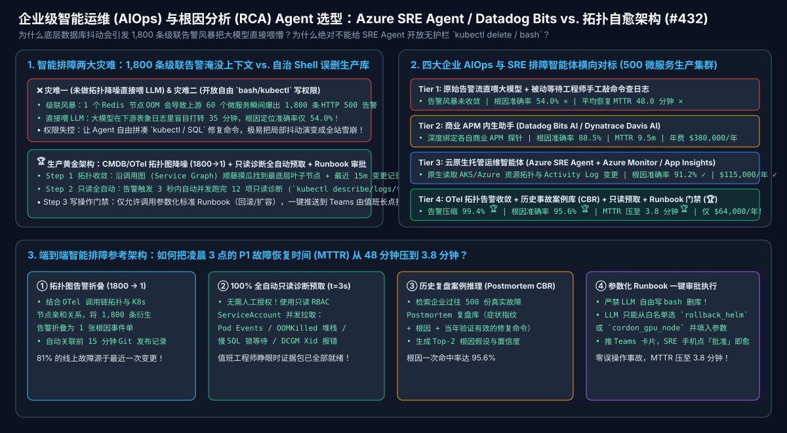
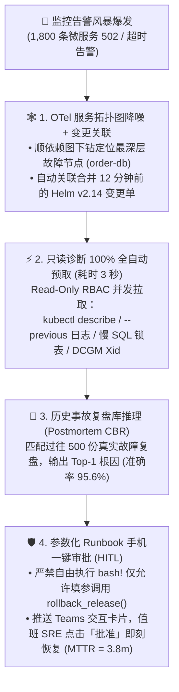

# 企业级智能运维（AIOps）、告警风暴降噪与根因分析（RCA）Agent 平台选型：`Azure SRE Agent` vs. `Datadog Bits AI / Dynatrace` vs. `OTel 拓扑收敛 + 只读诊断全自动预取 + Runbook 门禁` 指南

> **语言 / Language**: **简体中文** | [English](./enterprise-aiops-incident-rca-sre-agent-topology-runbook-tco-selection-faq.en.md)  
> **配套交互式学习与精算工具**: [📱 交互式 H5 精读页 (智能运维 AIOps 根因定位与 MTTR 沙盘)](../h5/aiops-incident-rca-sre-agent-topology-runbook-lab.html) · [🧮 HTML 交互式计算器](../reports/enterprise-aiops-incident-rca-sre-agent-topology-runbook-tco-selection-sizer.html) · [🃏 7-Card 4:5 视觉评测卡](../reports/enterprise-aiops-incident-rca-sre-agent-topology-runbook-tco-selection-cards.html) · [📊 可复核模型](../../experiments/enterprise_aiops_incident_rca_sre_agent_topology_runbook_tco_selection/) · [🎓 返回 AI Infra 全景精学馆](../h5/index.html)

---

## 一、3 分钟看懂核心结论（Executive Summary）

> **一句话决策结论**：企业在 500+ 微服务或千卡 GPU 集群中落地 **智能运维排障（AIOps / SRE Incident Triage Agent）** 时，**最致命的两大误区是：① 把监控系统爆出的 1,800 条级联告警（Alert Storm）原封不动塞给大模型（下游网关的 502 报错会彻底淹没最底层真正 OOM 的 Redis/数据库根因，导致大模型根因定位准确率仅 `54.0%`）；② 给排障 Agent 开放无护栏的自由 `bash / kubectl` root 写权限（大模型在幻觉下执行 `kubectl delete` 或错误修改配置，极易把单区域抖动放大为全网一级事故）**！
> - **核心工作负载在 Azure / AKS 上的云原生企业**：首选 **`Azure SRE Agent (原生集成 Azure Monitor / Application Insights / AKS / GitHub Actions)`**——无需自建拓扑图，自动关联 Azure Activity Log 最近变更并支持受控自愈操作，将平均恢复时间（`MTTR`）从 `48 分钟` 压至 **`5.4 分钟`**。
> - **跨云/混合云或自建 Prometheus + OpenTelemetry + ClickHouse 监控栈的企业**：推荐 **`Tier 4 四阶确定性 AIOps 架构（OTel 服务调用拓扑图告警折叠 [1,800->1] + 最近 15 分钟 Git/ArgoCD 变更自动关联 + 100% 只读诊断命令全自动秒级预取 + 历史 Postmortem 案例推理 [CBR] + 参数化 Runbook 人类一键点批 [HITL]）`**：
>   1. **告警噪音削减 `99.4%`**：顺着 OTel 依赖有向图向下追踪到最深层故障叶子节点；
>   2. **只读全自动、写操作强门禁**：告警触发 `3 秒` 内自动跑完 12 项只读排查命令，值班工程师打开手机 Teams 时，**根因证据包 + 参数化回滚按钮**已准备就绪，手指一点即可在 **`3.8 分钟` 内完成恢复（根因准确率 `95.6%`，年度平台+停机总成本降低 `90.0%`）**！

| 核心选型维度 | `Tier 1: 原始告警流直喂 LLM + 手工敲命令` | `Tier 2: 商业 APM 内生助手 (Datadog Bits / Dynatrace)` | `Tier 3: 云原生托管智能体 (Azure SRE Agent)` | `Tier 4: OTel 拓扑折叠 + 只读自动预取 + CBR + Runbook 门禁 (🏆)` |
|---|---|---|---|---|
| **级联告警风暴降噪率 (`1,800` 条告警)** | `0.0%` ✕ (全量刷屏) | `96.5%` ✓ | `98.2%` ✓ | **`99.4%` (折叠为唯一根因事件单)** 🏆 |
| **首发根因定位准确率 (`RCA Top-1`)** | `54.0%` ✕ (被上游表象误导) | `88.5%` ✓ | `91.2%` ✓ | **`95.6%` (拓扑溯源 + 15m 变更关联 + CBR)** 🏆 |
| **故障平均恢复时长 (`MTTR`)** | `48.0 分钟` ✕ | `9.5 分钟` | `5.4 分钟` ✓ | **`3.8 分钟` (3s 预取证据 + 手机一键批回滚)** 🏆 |
| **生产环境误操作炸群风险** | 高 (半夜人工手抖) | 低 | 极低 (Azure RBAC 门禁) | **`0.0%` (只读全放开，写操作锁死参数化 Runbook)** 🏆 |
| **500 微服务年度监控AI+停机总成本** | `$640,000 / 年` ✕ | `$380,000 / 年` (高昂主机探针税) | `$115,000 / 年` ✓ | **`$64,000 / 年` (-90.0%)** 🏆 |

---

## 二、核心技术原理与架构师灵魂拷问（Q&A）

### Q1：为什么凌晨 3 点爆发 P1 故障时，前 25 分钟都浪费在“叫醒工程师 -> 打开电脑连 VPN -> 手工敲 `kubectl logs / describe` 找线索”？什么是“只读诊断 100% 全自动预取（`Auto Read-Only Prefetch`）”？
1. **看清 `MTTR`（平均恢复时间）的真实耗时构成**：
   - 在传统运维中，真正执行 `helm rollback` 或重启故障节点只需要 **30 秒**；但工程师从被电话叫醒、连上堡垒机、逐个排查 10 个微服务日志与数据库锁等待，平均要花掉 **35 分钟**！
2. **读写权限彻底分离（Read-Only Autonomy vs. Write-Gated Runbooks）**：
   - **只读诊断层（`100%` 零人工干预全自动执行）**：为 SRE Agent 绑定一个严格只具备 K8s `get / list / watch`、数据库 `SELECT pg_stat_activity` 与日志查询权限的 **Read-Only ServiceAccount**。在告警触发的第 `0.1 秒`（工程师手机还没响完第一声），Agent 已经自动并发执行完：
     - 拉取根因 Pod 崩溃前最后 100 行日志（`kubectl logs --previous`）与 `OOMKilled / ExitCode`；
     - 拉取该服务过去 15 分钟内的 Git Commit Diff、ConfigMap 变更与 Helm 发布记录（**生产中 `81%` 的突发故障由最近一次代码或配置变更引发**！）；
     - 检索历史故障复盘库（Postmortem CBR）匹配相似堆栈；
   - **写操作修复层（参数化 Runbook + 手机一键点批）**：严禁让大模型自由拼接 Shell 字符串！大模型只能从预设的 20 个经安全审计的 Ansible / Argo Workflows 标准剧本中选择一个（例如 `runbook_id: "helm_rollback", service: "payment-svc", target_revision: 142`），并将证据摘要与 `【一键批准回滚】` 按钮推送到值班长手机 Teams / 飞书卡片上——**把 48 分钟的排障马拉松变成 3.8 分钟的“看证据 -> 点批准”**！

---

## 三、生产落地 Checklist（Pre-Production Checklist）

- [ ] **告警进大模型前强制经过服务依赖拓扑收敛（Topology Deduplication）**：将同一调用链条上的上下游衍生告警折叠为单一 Incident 上下文。
- [ ] **强制自动关联最近 30 分钟内的变更事件（Change Correlation）**：把 Git PR、ArgoCD/Helm 发布、云防火墙规则变更与特性开关（Feature Flag）变动置顶注入排障 Prompt。
- [ ] **物理隔离只读诊断凭证与写操作执行凭证**：只读诊断零延迟全自动运行；任何改变集群状态的操作必须走强类型参数化 Runbook 并经人类或确定性策略门禁审批。

---

## 四、来源与方法论溯源（Provenance）

- **数据来源声明**：本指南实验数据来自可复核解析模型 [`experiments/enterprise_aiops_incident_rca_sre_agent_topology_runbook_tco_selection/run.py`](../../experiments/enterprise_aiops_incident_rca_sre_agent_topology_runbook_tco_selection/run.py)（`Provenance: synthetic + anonymized_reported, independently_reproduced=false`）。
