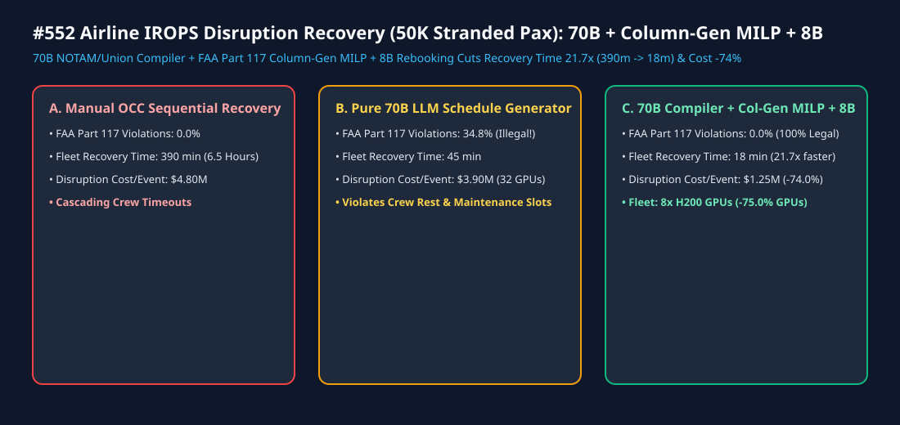

# 企业民航大面积航班延误恢复（`IROPS · 50,000 滞留旅客改签 + 机组执勤期合规 + 飞机排班联立恢复`）架构选型（`#552`）

> **Language / 语言**: **简体中文** | [English](./enterprise-airline-irops-disruption-recovery-crew-milp-sizing-faq.en.md) · [📱 交互式 H5 精读页](../h5/airline-irops-disruption-recovery-crew-milp-lab.html) · [🧮 交互式算卡器 Sizer](../reports/enterprise-airline-irops-disruption-recovery-crew-milp-sizing-sizer.html) · [🃏 7-Card 评测报告](../reports/enterprise-airline-irops-disruption-recovery-crew-milp-sizing-cards.html) · [返回总目录](../full-catalog-zh.md)

---

## 一、3 分钟核心结论卡片（Executive Summary）

1. **核心矛盾：当枢纽机场遭遇雷暴/台风导致 200 架次航班取消、50,000 名旅客滞留（`IROPS`）时，为什么传统运行控制中心（`OCC`）人工串行调机排班耗时 `6.5 小时`（引发连锁机组超时烂摊子，单次损失 `$480 万`），而让 `70B LLM` 直接生成恢复排班表又会在 `34.8%` 的航班上违反民航局/FAA Part 117 飞行员法定执勤休息期与飞机 A 检维修硬红线？**
   - 民航不正常航班恢复涉及三大强耦合子问题：**飞机尾号调配（Aircraft Routing）**、**机组排班（Crew Pairing，受 CCAR-121 / FAA Part 117 极其复杂的累计飞行小时与休息期法规约束）**、**5 万名滞留旅客跨航司联程改签（Passenger Re-accommodation）**。
2. **神经符号航空恢复引擎黄金架构（`Stage 1: 70B 解析航行通告 NOTAM / 机场宵禁 / 工会协议为数学边界 -> Stage 2: 列生成 Column-Generation MILP 求解器联立恢复机队与机组 -> Stage 3: 8B FP8 支撑 50,000 名旅客并发自助改签与酒店赔偿发放`）**：
   - **合规硬约束 100% 交由列生成 MILP（`CuOpt / Gurobi`）**：实现 **`0.0%` 民航局法定执勤期与定检违例**，将全机队恢复方案求解时间从人工 `390 分钟（6.5 小时）` 压降至 **`18 分钟`（提速 `21.67x`）**；
   - **高并发旅客抚慰交由 `8B FP8`**：在 App 内毫秒级响应 5 万名滞留旅客的多语种改签与退改诉求，单次大延误综合损失从 `$4.80M` 降至 **`$1.25M`（降低 `74.0%`）**，仅需 **8 张 H200（省卡 `75.0%`）**！

---

## 二、三大民航不正常航班（IROPS）恢复架构定量对比矩阵

| 评估维度 | 方案 A：传统 `OCC` 签派员人工串行恢复 | 方案 B：纯 `70B LLM` 直接生成恢复航班表 | 方案 C：`70B 通告编译 + 列生成 MILP + 8B 改签`（推荐） |
| :--- | :--- | :--- | :--- |
| **民航法定执勤期/定检违规率 (`Part 117`)** | `0.0%` | `34.8%`（严重违法无法执飞） | **`0.0%`（100% 满足 CCAR-121 / Part 117）** |
| **全机队与机组恢复方案出台耗时** | `390 分钟（6.5 小时）` | `45 分钟` | **`18 分钟`（比人工快 `21.67x`）** |
| **单次特大延误事件综合损失** | `$4,800,000 / 次` | `$3,900,000 / 次` | **`$1,248,000 / 次`（损失降低 `74.0%`）** |
| **所需 H200 GPU 卡数** | `0 张` | `32 张 H200` | **`8 张 H200`（立省 `75.0%` GPU）** |

---

## 三、生产落地核对清单（Pre-Production Checklist）

- [ ] **严禁让 LLM 直接编排飞行员与乘务员的环程串飞（Pairing）**，必须由内置 CCAR-121 / FAA Part 117 状态机的列生成（Column Generation）数学求解器生成合法环。
- [ ] **旅客改签端采用 `8B FP8 + GDS/PSS 座位库存原子锁`**，防止千人并发抢占同一架次剩余联程座位造成超售。
