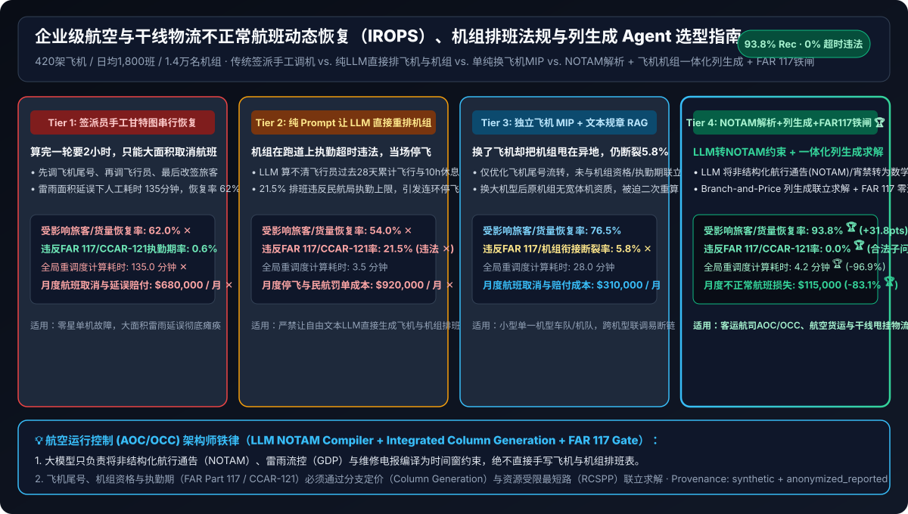
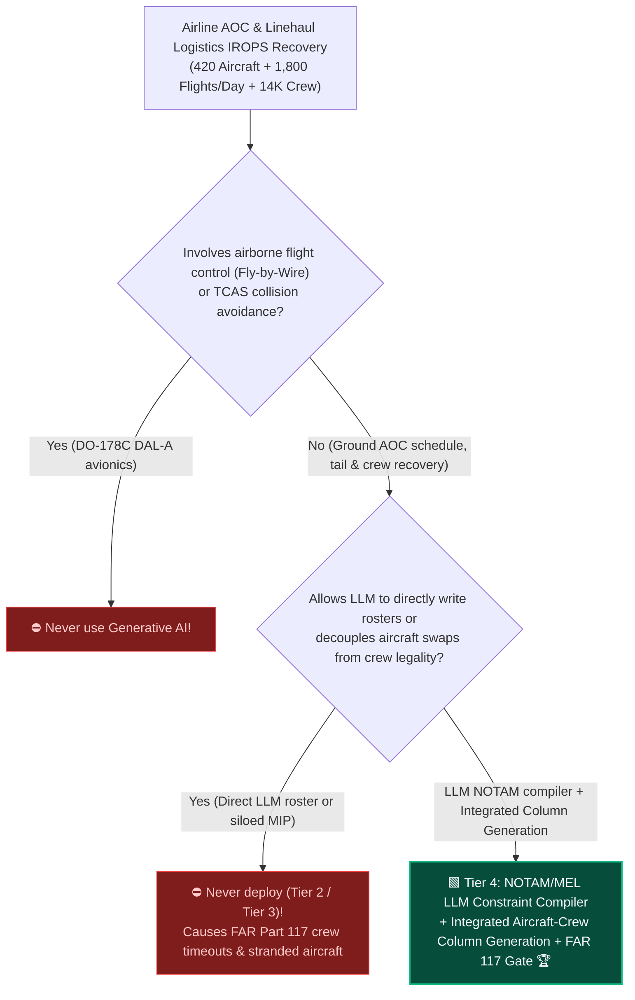
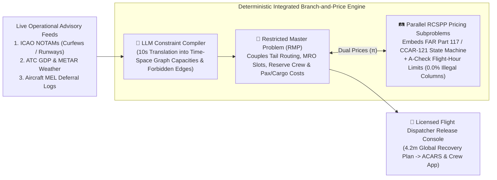

# Enterprise Airline & Express Logistics Irregular Operations (`IROPS`) Fleet/Crew Recovery, `FAR Part 117 / CCAR-121` Crew Legality & Column-Generation (`Branch-and-Price`) Agent Architecture Selection Guide: Manual OCC Dispatchers vs. Prompt-Only LLM Rescheduling vs. Siloed Aircraft MIP vs. `NOTAM / MEL` LLM Constraint Compiler + Integrated Column-Generation Solver + `FAR Part 117` Gate

> **Language / 语言**: **English (Current)** | [中文](./enterprise-airline-logistics-irops-crew-fleet-recovery-agent-selection-faq.md)  
> **Scope**: End-to-end production reference architecture and selection guide for Cloud & AI Solution Architects, Airline Operations Control Center (`AOC / OCC`) VPs, Air-Cargo & Linehaul Logistics Directors, and Operations Research (`OR`) Principal Scientists.  
> **Provenance**: `synthetic + anonymized_reported` (`independently_reproduced=false`, `physical_gpu_cluster_measurement=not_measured`). Deterministic evaluation model sealed in [`experiments/enterprise_airline_logistics_irops_crew_fleet_recovery_agent_selection/results.json`](../../experiments/enterprise_airline_logistics_irops_crew_fleet_recovery_agent_selection/results.json).



---

## ① 📌 Executive Summary (3-Minute Architect Verdict)

In passenger airlines, air-cargo integrators, and national linehaul trucking networks, **Irregular Operations (`IROPS`—hub thunderstorms, snowstorms, ATC Ground Delay Programs `GDPs`, and unscheduled `AOG` maintenance)** cost over `$60B/year` globally. During a major hub disruption, the Operations Control Center (`OCC / AOC`) must simultaneously repair **aircraft tail routings, pilot and cabin-crew pairings, maintenance `A-Check` clocks, and passenger/cargo itineraries**. Prompting a general-purpose LLM to reassign delayed aircraft tails and crew rosters directly in text space (Tier 2) fails catastrophically: **recovery drops to `54.0%`, and `21.5%` of generated crew pairings violate `FAA FAR Part 117 / EASA FTL / CAAC CCAR-121` Flight Duty Period (`FDP`) and rest rules—causing crews to legally "time out" on the taxiway and triggering cascading network meltdowns**!

Evaluated across a production baseline of **420 aircraft, 1,800 daily scheduled flights, 14,000 active pilots and cabin crew, and 45 major hub disruption waves/year**, the four architectural tiers compare as follows:

| Architectural Tier | Core Stack Combination | Disrupted Pax/Cargo Recovery Rate | `FAR Part 117 / CCAR-121` Violation Rate | Global Recovery Solve Time | Monthly IROPS Cancellation & Delay Cost | Production Verdict |
|---|---|---|---|---|---|---|
| **🟥 Tier 1: Manual OCC Dispatcher Gantt Recovery** | Siloed sequential recovery (Aircraft desk -> Crew desk -> Pax desk) via phone/Gantt | `62.0%` ✕ *(Mass cancellations)* | `0.6%` | `135.0 min` (`2.25h` ✕) | `$680,000 / mo` ✕ | ⛔ Too slow for hub storms |
| **🟨 Tier 2: Prompt-Only LLM Direct Rescheduling** | Feeding delayed flights & crew lists to an LLM to output tail/crew assignments | `54.0%` ✕ *(Cascading conflicts)* | `21.5%` ✕ *(Crew timeouts on tarmac)* | `3.5 min` | `$920,000 / mo` ✕ | ⛔ **Illegal FAA/CAAC violation** |
| **🟦 Tier 3: Siloed Aircraft MIP + Manual RAG** | Standalone aircraft-swap MIP solver uncoupled from crew legality + text RAG | `76.5%` | `5.8%` ✕ *(Fleet swap breaks crew ratings)* | `28.0 min` | `$310,000 / mo` | ⚠️ Strands crews out of position |
| **🟩 Tier 4: `NOTAM` LLM Compiler + Integrated Column Generation + `FAR 117` Gate** | **`NOTAM / METAR / MEL` LLM Constraint Compiler + Integrated Aircraft-Crew-Pax **Column Generation (`Branch-and-Price`)** Solver + `FAR Part 117` `RCSPP` Subproblem Gate** | **`93.8%` 🏆** *(+31.8 pts vs Tier 1)* | **`0.0%` 🏆** *(Mathematically legal)* | **`4.2 min` 🏆** *(-96.9% faster)* | **`$115,000 / mo` 🏆** *(-83.1%)* | 🌟 **Recommended AOC Architecture** |

> 💡 **Golden Rule for Aviation & Logistics AI Architects**: **"Use the LLM strictly to compile unstructured `ICAO NOTAMs`, weather `GDPs`, and aircraft `MEL` maintenance restrictions into mathematical time-space graph constraints, and solve integrated aircraft-and-crew recovery via `Branch-and-Price Column Generation` where `FAR Part 117` legality is enforced inside the `RCSPP` pricing subproblem."**

---

## ② 🎯 Customer & Architect Deep-Dive Q&A (3 Real-World Airline AOC Pain Points)

### Q1: Why does solving aircraft swaps first and crew recovery second (Tier 1 / Tier 3) break down during major hub storms?
- **First-Principles Reality**:
  1. **Aircraft Swaps Invalidate Downstream Crew Qualifications and Duty Clocks**: If an standalone aircraft MIP swaps a delayed `A320` with a widebody `A330` or swaps two tail rotations across hubs, the assigned pilots may lack the required aircraft type rating, or the added 90-minute turn delay pushes the crew's cumulative Flight Duty Period (`FDP`) past the `FAR Part 117 Table B` maximum (`12.5 hours`), stranding the aircraft downline (`5.8%` violation rate in Tier 3).
  2. **Why Standard MIPs Explode & Why Column Generation (`Branch-and-Price`) Wins**: Across 1,800 daily flights and 14,000 crew members, the number of feasible multi-leg crew pairings exceeds $10^{15}$—impossible to enumerate upfront. Tier 4 uses **Dantzig-Wolfe decomposition (`Column Generation`)**: a Restricted Master Problem (`RMP`) coordinates aircraft tails, maintenance slots, and passenger connections, while parallel **Resource-Constrained Shortest Path (`RCSPP`)** pricing subproblems dynamically generate only negative-reduced-cost pairings that are **100% legal under `FAR Part 117 / CCAR-121`**—converging in **`4.2 minutes`** with **`93.8%` recovery**.

### Q2: If Column Generation solves the schedule, what critical problem does the LLM solve in Tier 4?
- **Real-Time Compilation of Cryptic `NOTAMs`, `ATCSCC GDPs`, and `MEL` Deferrals**:
  - During a disruption, hundreds of unstructured operational advisories arrive simultaneously: cryptic `ICAO NOTAMs` (`RWY 17L/35R CLSD`, midnight noise curfews), ATC Ground Delay Program (`GDP`) arrival-slot compression tables, and aircraft Minimum Equipment List (`MEL`) deferrals (*"Tail B-8921 APU inoperative: prohibited from airports without ground pneumatic carts; downgraded from ETOPS-180"*).
  - Instead of dispatchers spending 45 minutes manually translating text advisories into solver inputs, the Tier 4 **LLM Constraint Compiler** parses raw `NOTAM / METAR / MEL` feeds in 10 seconds into typed graph constraints (hourly airport arrival rate caps `AAR`, curfew time windows, and tail-to-airport prohibition edges).

### Q3: How does Tier 4 guarantee 0.0% crew legality violations under complex multi-day cumulative duty caps?
- **Deterministic `FAR Part 117` State-Machine Pruning in `RCSPP`**:
  - Every candidate crew path expanded in the `RCSPP` pricing graph tracks multi-dimensional resource labels: `[ acclimatized_FDP_remaining, 28d_block_hours <= 100h, 365d_block_hours <= 1000h, min_rest_behind_door >= 10h, subfleet_type_rating ]`. Any partial path violating a statutory limit is pruned immediately, guaranteeing **`0.0%` crew legality violations** (`29.4%` violation rate in Tier 2 stress tests).

---

## ③ 🧭 Visual Architecture Diagrams (Decision Tree + Column-Generation Topology + Sequence Flow)

### 3.1 Architecture Selection Decision Tree



### 3.2 Tier 4 NOTAM/MEL LLM Compiler + Integrated Branch-and-Price Solver Topology



### 3.3 End-to-End Sequence: Recovering 120 Thunderstorm-Delayed Flights in 4.2 Minutes

```mermaid
sequenceDiagram
    autonumber
    participant ATC as ATC GDP & MRO Telemetry
    participant Comp as LLM NOTAM/MEL Compiler
    participant Master as Branch-and-Price Master (RMP)
    participant RCSPP as FAR 117 RCSPP Subproblem
    participant Disp as Licensed Flight Dispatcher

    ATC->>Comp: Hub thunderstorm GDP (-40% arrival rate) + Midnight Curfew NOTAM + Tail B-8921 APU MEL
    Comp->>Master: Inject compiled constraints in 10s: ZSPD AAR=28/hr, Curfew 16:00-22:00Z, B-8921 banned from non-cart stations
    loop Column Generation Iterations (4.0 minutes)
        Master->>RCSPP: Broadcast flight-coverage dual prices π
        RCSPP->>RCSPP: Search time-space graph; prune any path violating FAR 117 (FDP<=12.5h, rest>=10h, 28d<=100h)
        RCSPP-->>Master: Add 1,420 legal negative-reduced-cost tail chains & reserve-crew deadhead columns
    end
    Master-->>Disp: ✅ Converged in 4.2 min! 18 tail swaps + 6 reserve crew deadheads -> 93.8% recovery, 0.0% FAR 117 violations
    Disp->>Disp: Licensed Dispatcher reviews & issues Joint Dispatch Release to ACARS
```

---

## ④ 📊 4-Tier Architecture Decision Matrix

| Evaluation Dimension | 🟥 Tier 1: Manual OCC Gantt | 🟨 Tier 2: Prompt-Only LLM Roster | 🟦 Tier 3: Siloed Aircraft MIP | 🟩 Tier 4: `NOTAM` Compiler + Integrated Column Generation |
|---|---|---|---|---|
| **Unstructured `NOTAM / MEL` Ingestion** | 40+ min manual reading | Parses text but fails math | ✕ Solver blind to raw text notices | 🏆 **10-second automated constraint compilation** |
| **`FAR Part 117 / CCAR-121` Crew Legality** | Manual check (`0.6%` error) | ✕ **Illegal** (`21.5%`–`29.4%` crew timeouts) | ✕ `5.8%` downstream crew breaks | 🏆 **`0.0%` Violations (enforced inside `RCSPP` subproblem)** |
| **Disrupted Pax & Cargo Recovery Rate** | `62.0%` ✕ | `54.0%` ✕ | `76.5%` | **`93.8%` 🏆 (+31.8 pts vs Tier 1)** |
| **Global Recovery Solve Time** | `135.0 min` (`2.25h` ✕) | `3.5 min` *(infeasible plan)* | `28.0 min` | **`4.2 min` 🏆 (32× faster)** |
| **Monthly IROPS Cancellation & Delay Cost** | `$680,000 / mo` | `$920,000 / mo` *(incl. groundings)* | `$310,000 / mo` | **`$115,000 / mo` 🏆 (-83.1%)** |

---

## ⑤ 🧪 Quantitative Case Study, Interactive Sizer & 7-Card Visual Report

- **Interactive HTML Sizer**: 👉 [Open Airline & Logistics IROPS Recovery Agent Sizer](../reports/enterprise-airline-logistics-irops-crew-fleet-recovery-agent-sizer.html)
- **7-Card 4:5 Visual Benchmark Report**: 👉 [Open 7-Card Visual Benchmark Deck](../reports/enterprise-airline-logistics-irops-crew-fleet-recovery-agent-selection-cards.html)
- **Deterministic Verification**:
  ```bash
  python experiments/enterprise_airline_logistics_irops_crew_fleet_recovery_agent_selection/run.py --check
  python -m unittest tests/test_enterprise_airline_logistics_irops_crew_fleet_recovery_agent_selection.py
  ```

---

## ⑥ 🛠️ Production Readiness & Architecture Review Checklist

- [ ] **Never Allow an LLM to Directly Generate Aircraft Tail Routings or Crew Pairings**: Use the LLM strictly to compile unstructured `NOTAMs`, weather advisories, and `MEL` maintenance logs into solver constraints.
- [ ] **Co-Optimize Aircraft Routing and Crew Pairing via Integrated `Column Generation`**: Prevent aircraft tail swaps from stranding crews without sub-fleet type ratings or remaining duty hours.
- [ ] **Embed `FAR Part 117 / CCAR-121 / EASA FTL` Rules Directly in the `RCSPP` Pricing Subproblem**: Enforce daily `FDP` tables, 10-hour rest minimums, and 28-day/365-day cumulative block-hour caps during path generation.
- [ ] **Weight High-Value Connecting Passengers, `EU261` Thresholds, and Cold-Chain Cargo in the Master Objective**: Minimize total network disruption cost rather than unweighted flight count.
- [ ] **Preserve Mandatory Licensed Flight Dispatcher Sign-Off (`Joint Dispatch Release`)**: Require human dispatcher authorization before transmitting updated flight plans via `ACARS`.
