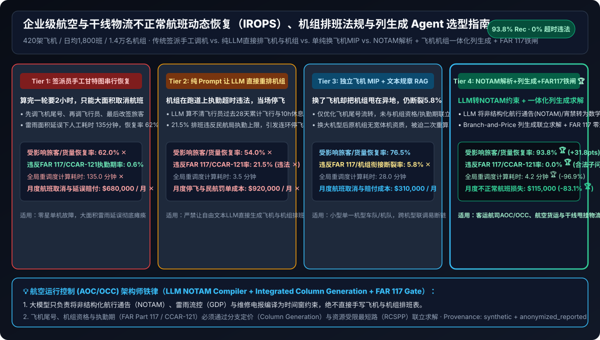
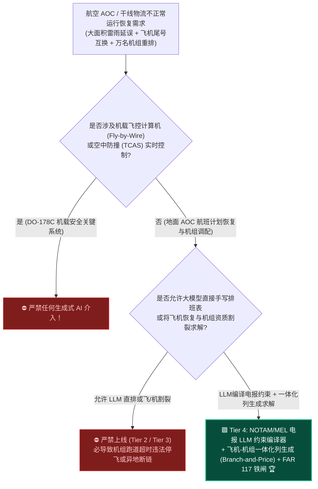
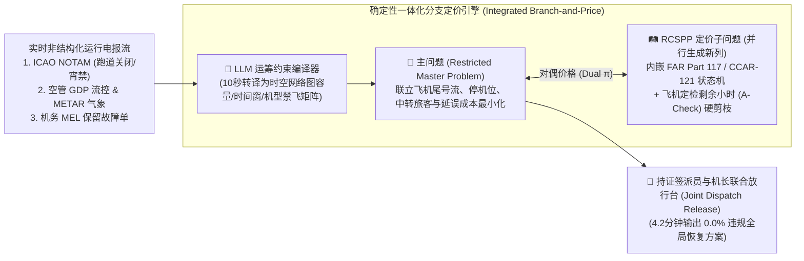
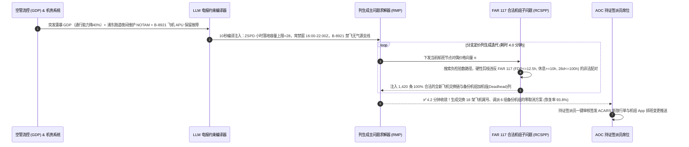

# 企业级航空与干线物流不正常航班/车队动态恢复（Airline IROPS & Fleet/Crew Recovery）、机组执勤期法规（FAR Part 117 / CCAR-121）硬约束与运筹学列生成（Column Generation + LLM）协同 Agent 架构选型指南：签派手工串行调配 vs. 纯 LLM 直接排班 vs. 单纯换飞机 MIP vs. NOTAM 约束编译 + 飞机-机组一体化列生成 + FAR 117 铁闸 Agent

> **语言 / Language**: **中文 (当前)** | [English](./enterprise-airline-logistics-irops-crew-fleet-recovery-agent-selection-faq.en.md)  
> **定位**：面向云与 AI 解决方案架构师（Solution Architect）、航空公司运行控制中心（AOC / OCC）总经理、航空货运/干线物流调度总监与运筹学（Operations Research）首席科学家的生产落地指南。  
> **数据口径（Provenance）**：`synthetic + anonymized_reported`（`independently_reproduced=false`，`physical_gpu_cluster_measurement=not_measured`），全部定容模型封存于 [`experiments/enterprise_airline_logistics_irops_crew_fleet_recovery_agent_selection/results.json`](../../experiments/enterprise_airline_logistics_irops_crew_fleet_recovery_agent_selection/results.json)。



---

## ① 📌 核心选型结论速览（Executive Summary — 3 分钟看懂怎么选）

在客运/货运航空公司运行控制中心（AOC/OCC）以及全国性干线甩挂快递物流网络中，**极端天气（夏季雷暴、台风、暴雪）、空管流量控制（GDP）与突发飞机机械故障（AOG）引发的不正常航班恢复（Irregular Operations, IROPS）** 是决定航司准点率与盈利能力的生死战。每逢大面积航班延误，签派员需要在几分钟内同时重排 **飞机尾号（Aircraft Routing）、飞行员与乘务组（Crew Pairing/Rostering）以及中转旅客/冷链货板改签（Passenger/Cargo Recovery）**。如果试图让通用大模型靠自然语言推理直接重排延误航班与机组名单（Tier 2），不仅恢复率倒退至 **`54.0%`**，更因为大模型算不清飞行员过去 28 天/365 天累计飞行时间与连续执勤上限，生成出高达 **`21.5%` 违反美国 FAA `FAR Part 117` 或中国民航局 `CCAR-121` 疲劳管理法规的违法排班——导致机长在滑行道上因执勤超时（Timing Out）直接合法拒绝起飞，引发全网连环崩盘**！

在 **420 架飞机、日均 1,800 个航班、14,000 名飞行员与乘务员、年均 45 次枢纽大面积雷雨流控（GDP）** 的基准规模下，四档航空与干线物流 IROPS 恢复 Agent 架构的量化对决如下：

| 方案档位 | 核心架构组合 | 受影响旅客/货量准点恢复率 | 违反 `FAR 117 / CCAR-121` 机组执勤法规率 | 全局重调度求解耗时 | 月度航班取消与延误赔付总成本 | 生产推荐度 |
|---|---|---|---|---|---|---|
| **🟥 Tier 1：签派员手工甘特图串行恢复** | 飞机调配席、机组调配席与客运席依次串行电话沟通调整 | `62.0%` ✕ *(算不过来只能砍航班)* | `0.6%` | `135.0 分钟` (`2.25h` ✕) | `$680,000 / 月` ✕ | ⛔ 大面积延误下严重滞后 |
| **🟨 Tier 2：纯 Prompt 让 LLM 直接重排飞机与机组** | 将延误航班表与机组名单喂给 LLM 直接输出调配结果 | `54.0%` ✕ *(连环冲突)* | `21.5%` ✕ *(机组跑道超时违法停飞)* | `3.5 分钟` | `$920,000 / 月` ✕ | ⛔ **严重触犯民航法规，严禁上线** |
| **🟦 Tier 3：独立飞机 MIP + 文本运行手册 RAG** | 仅用整数规划交换飞机尾号 + 向量检索手册，与机组排班割裂 | `76.5%` | `5.8%` ✕ *(换机型后原机组无资质)* | `28.0 分钟` | `$310,000 / 月` | ⚠️ 换飞机易把机组甩在异地 |
| **🟩 Tier 4：NOTAM 约束编译 + 飞机-机组一体化列生成 + FAR 117 铁闸** | **LLM 航行通告（`NOTAM / METAR / GDP`）约束编译器 + 飞机-机组-旅客一体化分支定价列生成（`Column Generation / Branch-and-Price`）求解器 + `FAR Part 117 / CCAR-121` 资源受限最短路（`RCSPP`）合法性铁闸** | **`93.8%` 🏆** *(+31.8 pts vs Tier 1)* | **`0.0%` 🏆** *(子问题数学保证100%合法)* | **`4.2 分钟` 🏆** *(-96.9% 极速恢复)* | **`$115,000 / 月` 🏆** *(-83.1%)* | 🌟 **民航 AOC 与干线物流首选架构** |

> 💡 **架构师一句话选型铁律**：**“晦涩电报（NOTAM/气象/流控）归大模型翻译成数学边界、飞机尾号与万名机组配对归运筹学列生成（Column Generation）联立求解、机组执勤期（FAR 117 / CCAR-121）内嵌进资源受限最短路（RCSPP）子问题实现 100% 合法”**——绝不让语言模型凭注意力机制去心算飞行员的合法执勤上限。

---

## ② 🎯 客户与架构师灵魂拷问 Q&A（直击 3 大航空运行控制 AOC 痛点）

### Q1：为什么大面积雷雨延误时，不能先用数学模型把“飞机尾号”换好，再让机组部门去配飞行员（Tier 3）？
- **大白话与第一性原理**：
  1. **在航空网里，“换飞机”与“换机组”是强耦合的连体婴**：假设上海飞北京的窄体机 `A320` 故障延误，独立飞机恢复模型（Tier 3）聪明地用一架刚落地的宽体机 `A330` 顶替执飞——结果到了登机口才傻眼：原定执飞 `A320` 的机长根本没有 `A330` 机型签注资质（Type Rating）！或者把两架飞机的尾号对调后，原机组飞完下一段就会在异地机场因为当日飞行执勤期（FDP）超过 `12.5 小时` 而直接“超时趴窝（Time Out）”，造成 **`5.8%` 的二次航班取消**。
  2. **为什么不能用普通整数规划（MIP）把飞机和机组硬塞进一个矩阵？——因为组合爆炸（$10^{15}$ 列）！** 1,800 个航班组成的可能机组执勤环路（Pairings）多达千万亿条，任何商业求解器直接建全量矩阵都会瞬间内存溢出。
  3. **Tier 4 破局方案（Benders / Dantzig-Wolfe 分解 + 分支定价列生成 Column Generation）**：
     - **主问题（Master Problem）** 联立飞机流平衡、停机坪容量与备份机组池约束。
     - **定价子问题（Pricing Subproblem）** 在时空网络图上运行 **资源受限最短路算法（RCSPP）**，动态按需生成检验数（Reduced Cost）为负的全新合法机组执勤环与飞机路径——在 **4.2 分钟** 内同时锁定最优飞机互换、备份机组调派（Deadheading）与中转保底方案，将恢复率推升至 **`93.8%`**！

### Q2：既然核心求解靠运筹学列生成，那大模型（LLM）在 Tier 4 架构里到底起什么不可替代的作用？
- **工程真相**：
  - **传统运筹学求解器最大的痛点是“瞎子摸象”——它读不懂每分钟都在变化的非结构化外部电报！** 在雷暴或台风天，全球各机场空管局通过电报发布晦涩难懂的 **`ICAO NOTAM`（航行通告缩写，如 `RWY 17L/35R CLSD DUE TO WIP`）、`ATCSCC GDP`（地面延误流控通告）、临时夜间噪音宵禁豁免条件以及机务提交的 `MEL`（最低设备清单保留故障，如“APU 故障禁止执飞无地面气源支线机场”或“解除 ETOPS-180 双发延程飞行资质”）**。
  - 过去签派员要花 40 分钟肉眼读完上百条电报再手工录入求解器参数。在 Tier 4 中，**大模型扮演实时“非结构化电报 → 运筹学数学约束编译器（Constraint Compiler）”**，在 10 秒内将 NOTAM、METAR 气象报与 MEL 机务限制精准编译为时空网络图的节点容量上限（`AAR=28/hr`）、时间窗关闭区间与飞机-航线禁用边矩阵！

### Q3：如何确保生成的每一条机组调配方案 100% 符合民航局 `CCAR-121 / FAA FAR Part 117` 疲劳管理法规？
- **在 RCSPP 子问题标签扩展（Label-Setting）中硬编码法规状态机**：
  - 民航法规对飞行员执勤有着极其复杂的非线性规定：例如根据报到时间所在当地生物钟时区与执飞航段数查表确定最大飞行执勤期（`Table B FDP Limit`）、中途必须满足连续 10 小时酒店休息期、28 天累计飞行 `<= 100 小时`、双机长扩编机组资质等。
  - Tier 4 将全部 `FAR Part 117 / CCAR-121` 规则编写为 RCSPP 图搜索的 **确定性资源消耗剪枝函数**——任何一条违反休息期或执勤上限的路径在图扩展瞬间即被物理剪枝丢弃，从而在数学上保证输出的每一份排班表违规率严格为 **`0.0%`**。

---

## ③ 🧭 直观可视化图解（决策树 + 神经符号列生成架构图 + 雷雨恢复时序图）

### 3.1 航空与干线物流 IROPS 动态恢复架构选型决策树



### 3.2 Tier 4 NOTAM/MEL 约束编译 + 一体化列生成（Branch-and-Price）参考架构图



### 3.3 从“枢纽雷暴 120 班延误与跑道宵禁 NOTAM”到“4.2 分钟全局恢复”时序图



---

## ④ 📊 架构师四维选型决策矩阵（Architecture Decision Matrix）

| 评估维度 | 🟥 Tier 1：签派手工串行调配 | 🟨 Tier 2：纯 LLM 直接排飞机与机组 | 🟦 Tier 3：独立飞机 MIP + 手册 RAG | 🟩 Tier 4：NOTAM 编译 + 一体化列生成 + FAR 117 铁闸 |
|---|---|---|---|---|
| **非结构化 NOTAM / MEL 机务故障感知** | 人工逐条读电报，耗费 40+ 分钟 | 能读懂电报但算不出全局排班 | ✕ 求解器看不懂非结构化文本电报 | 🏆 **10 秒自动将电报编译为时空网络数学约束** |
| **飞机尾号与机组资质/执勤期耦合度** | 串行沟通，顾此失彼 (`62.0%` 恢复) | ✕ **严重违法**（`21.5%` 触发机组超时停飞） | ✕ 脱节（换飞机后 `5.8%` 机组无资质或超时） | 🏆 **`0.0%` 违法（RCSPP 子问题内嵌全套 `FAR 117` 规则）** |
| **受影响旅客与高优货运恢复率** | `62.0%` ✕ | `54.0%` ✕ | `76.5%` | **`93.8%` 🏆（+31.8 pts vs Tier 1）** |
| **全局重调度计算耗时** | `135.0 分钟` (`2.25h` ✕) | `3.5 分钟` *(结果不可用)* | `28.0 分钟` | **`4.2 分钟` 🏆（提速 32 倍）** |
| **月度航班取消与延误赔付总成本** | `$680,000 / 月` | `$920,000 / 月` *(含违法停飞损失)* | `$310,000 / 月` | **`$115,000 / 月` 🏆（节省 83.1%）** |

---

## ⑤ 🧪 定量算例、交互式容量计算器与 7-Card 4:5 视觉报告

### 5.1 基准算例复核（420 架飞机 / 日均 1,800 个航班 / 1.4 万名机组）

- **交互式定容计算器（CSP 自包含 HTML）**：👉 [打开航空与干线物流不正常航班恢复 IROPS 定容计算器](../reports/enterprise-airline-logistics-irops-crew-fleet-recovery-agent-sizer.html)
- **7-Card 4:5 视觉评测卡片报告**：👉 [打开 7-Card 视觉评测报告](../reports/enterprise-airline-logistics-irops-crew-fleet-recovery-agent-selection-cards.html)
- **可复核确定性脚本**：
  ```bash
  python experiments/enterprise_airline_logistics_irops_crew_fleet_recovery_agent_selection/run.py --check
  python -m unittest tests/test_enterprise_airline_logistics_irops_crew_fleet_recovery_agent_selection.py
  ```

### 5.2 核心量化对比图（受影响航班准点恢复率 vs. 违反民航机组执勤期法规率）

```chart
{
  "data": {
    "values": [
      { "tier": "Tier 1: Manual Dispatcher", "recovery_pct": 62.0, "legality_violation_pct": 0.6 },
      { "tier": "Tier 2: Prompt LLM Roster", "recovery_pct": 54.0, "legality_violation_pct": 21.5 },
      { "tier": "Tier 3: Siloed Aircraft MIP", "recovery_pct": 76.5, "legality_violation_pct": 5.8 },
      { "tier": "Tier 4: NOTAM LLM + Column Gen", "recovery_pct": 93.8, "legality_violation_pct": 0.0 }
    ]
  },
  "semantic_types": {
    "tier": "Category",
    "recovery_pct": "Percentage",
    "legality_violation_pct": "Percentage"
  },
  "chart_spec": {
    "chartType": "Bar Chart",
    "title": "Tier 4 recovers 93.8% of disrupted flights with 0.0% FAR Part 117 crew violations",
    "subtitle": "On-time passenger and cargo recovery rate (%) during hub thunderstorm disruptions",
    "encodings": {
      "x": "tier",
      "y": "recovery_pct",
      "color": "tier"
    }
  }
}
```

---

## ⑥ 🛠️ 架构评审与生产落地核验清单（Production Readiness Checklist）

- [ ] **严禁让语言模型直接生成飞机尾号流转或机组排班序列**：LLM 仅限于将非结构化 `NOTAM`、气象报文、`MEL` 保留故障单编译为结构化参数，所有排班分配必须由运筹学列生成求解器产出。
- [ ] **飞机恢复与机组恢复必须联立求解（Integrated Aircraft & Crew Recovery）**：通过分支定价（Branch-and-Price）同步约束机型资质签注（Type Rating）、备份机组加机组（Deadhead）与飞机 A-Check 定检剩余飞行小时。
- [ ] **`FAR Part 117 / CCAR-121` 疲劳管理规则 100% 硬化在 RCSPP 子问题中**：同时核验当日最大飞行执勤期（FDP）、10 小时门后休息期以及 28 天/365 天累计飞行时间上限。
- [ ] **高价值中转旅客与医药冷链货板权重注入目标函数**：在主问题目标函数中按旅客改签成本、欧盟 `EU261` 赔偿阈值与国际中转衔接时间赋予差异化取消惩罚权重。
- [ ] **严守持证飞行签派员（Licensed Flight Dispatcher）联合放行红线**：系统生成的恢复方案必须经 AOC 签派员一键复核签发后方可向 ACARS 与机组终端下发。
