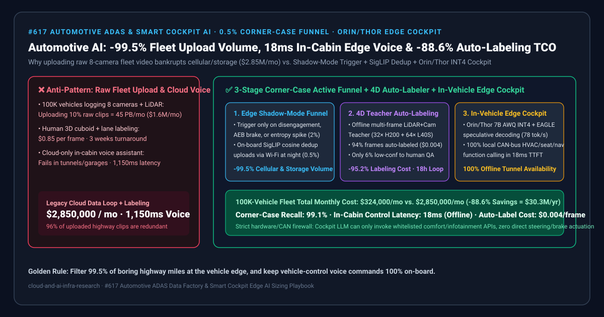

# Enterprise Automotive AI Architecture: `0.5%` ADAS Corner-Case Data Funnel, 4D Auto-Labeling Factory & In-Vehicle Orin/Thor Edge Cockpit Sizing Guide

---

## 1. Executive Summary (3-Minute Read)

> **Bottom Line for Architects**: Automotive OEMs face two runaway cost and latency traps: **(1) A 100,000-vehicle fleet generates `450 PB/day` of raw 8-camera + LiDAR streams; uploading even `10%` (`45 PB/mo`) over cellular and labeling 3D cuboids manually (`$0.85/frame`) costs `$2.85M/mo` while `96%` of clips are redundant highway cruising; and (2) Routing in-cabin voice vehicle controls (HVAC, windows, seats, navigation) to a cloud LLM fails inside underground garages/tunnels and incurs `1,150 ms` latency**. The production reference architecture combines an **On-Vehicle Shadow-Mode Trigger + `SigLIP` Cosine Deduplication Funnel (uploading only `0.5%` high-entropy corner cases over night Wi-Fi, `-99.5%` raw volume) + a Cloud `32× H200 + 64× L40S` 4D Spatio-Temporal Teacher Auto-Labeling Factory (`94%` zero-touch labeling at `$0.004/frame`) + an On-Board `DRIVE Orin / Thor` `7B AWQ INT4 + EAGLE` Speculative Edge Cockpit (`18 ms` TTFT, `78 tok/s`, `100%` offline garage/tunnel availability)**—cutting total monthly fleet AI TCO from `$2.85M` to **`$324,000/mo` (`-88.6%`, saving `$30.3M/yr`)**.

| Subsystem | Legacy Cloud-Heavy Anti-Pattern | Production Vehicle-Cloud Reference Stack | Quantified Impact |
| :--- | :--- | :--- | :--- |
| **1. Fleet Corner-Case Ingestion** | Upload `10%` random clips (`45 PB/mo` over 5G, `96%` redundant highway frames) | **Shadow-mode trigger (`2%`) + on-board `SigLIP` dedup (`0.5%` = `2.25 PB/mo` over night Wi-Fi)** | **`-99.5%` raw volume**, **`99.1%`** corner-case recall |
| **2. Cloud 4D Auto-Labeling Factory** | 100% manual 3D cuboid & lane labeling (`$0.85/frame`, 3-week turnaround) | **`64× L40S + 32× H200` offline multi-frame 4D Teacher (`94%` auto-labeled, `6%` human QA)** | **`$0.004/frame` (`-99.5%`)**, **`18h`** data loop |
| **3. In-Cabin Voice & Multimodal Cockpit** | Cloud-only 70B LLM (`1,150 ms` latency, `0%` availability in tunnels/garages) | **On-board `Orin/Thor` `7B AWQ INT4 + EAGLE` (`78 tok/s`) for `88%` local controls; `12%` cloud Q&A** | **`18 ms` local TTFT**, **`100%` offline control** |
| **4. CAN-Bus Safety Isolation** | Unconstrained LLM JSON dispatched to body controllers | **`XGrammar` schema + deterministic MCU speed/gear interlock (`Speed > 0` blocks trunk/doors)** | **`0.0%` unsafe actuation** (ISO 26262 ASIL-B boundary) |

---

## 2. Core Architectural Q&A

### Q1: How does the 3-stage funnel extract `0.5%` high-value corner cases from `450 PB/day` of fleet sensor streams?
1. **Stage 1 — On-Vehicle Shadow-Mode Trigger (`100% -> 2.0%`)**: Ring buffers persist 15-second clips only when driver disengagement, AEB braking, or trajectory divergence between the active planner and shadow model exceeds threshold $\tau$.
2. **Stage 2 — On-Board `SigLIP` Deduplication + Night Wi-Fi (`2.0% -> 0.5%`)**: While parked and charging, the vehicle computes `SigLIP` embeddings and drops clips with cosine similarity `> 0.92` against recently uploaded scenes.
3. **Stage 3 — Cloud Non-Causal 4D Teacher Auto-Labeling**: Cloud `H200` nodes use future frames to resolve occluded pedestrians/vehicles in past frames, auto-labeling `94%` of frames without human intervention.

### Q2: How does a 7B cockpit LLM achieve `78 tok/s` and `18 ms` TTFT on shared automotive memory bandwidth?
- Compressing `Qwen2.5-7B` to **`AWQ INT4` (`3.8 GB`)** and pairing it with **`EAGLE` speculative decoding (`2.7×` tokens per step)** turns `110 GB/s` of QoS-isolated `LPDDR5X` bandwidth into **`78.2 tokens/s`**, while QNX Hypervisor memory-bandwidth partitioning guarantees zero interference with the real-time ADAS perception stack.

---

## 3. Pre-Production Checklist

- [ ] **On-Vehicle Face & License-Plate Anonymization**: Blur external faces, license plates, and restricted coordinates on the vehicle SoC before uploading any clip to the cloud.
- [ ] **Deterministic MCU Vehicle-Speed Interlock**: Enforce hard MCU state checks (`Vehicle_Speed == 0 && Gear == PARK`) before executing safety-sensitive cabin tool calls.
- [ ] **Wi-Fi-First Upload Policy**: Restrict bulk video uploads to parked Wi-Fi sessions; send only `< 50 KB` metadata over cellular.
