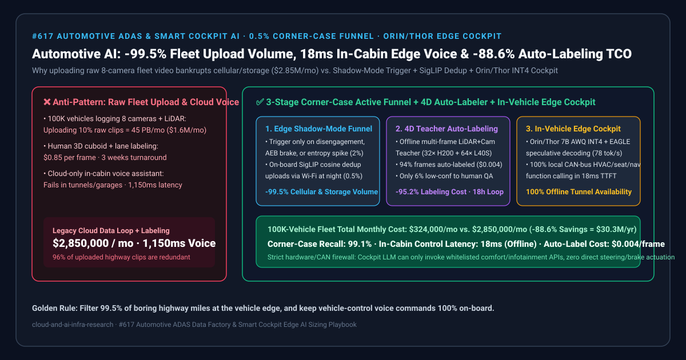
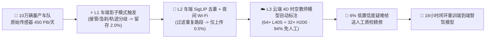

# 企业级智能汽车（Automotive）、自动驾驶 `0.5%` 影子模式数据闭环漏斗与智能座舱车端 `Orin/Thor` 边缘大模型容量测算指南

---

## 一、 核心结论先行（3 分钟速读卡）

> **一句话架构定音**：主机厂（OEM）与自动驾驶 Tier-1 建设 AI 基础设施有两大吞金黑洞：**① 10 万辆量产车每天产生 `450 PB` 8 路环视视频与激光雷达点云，若盲目抽样 `10%`（`45 PB/月`）通过车载 5G 上传云端并依赖人工标注 3D 框（`$0.85/帧`），仅流量、存储与标注账单就高达 `$285万/月`，且 `96%` 都是毫无训练价值的晴天高速直行片段；② 把智能座舱车控语音（开关空调、车窗、座椅、导航）全放云端大模型，一旦进地库、隧道或山区无信号立刻变“智障”，且公网往返延迟高达 `1,150 ms`**。生产级最优架构是 **“车端影子模式（Shadow Mode）异常触发 + `SigLIP` 向量去重漏斗（仅回传 `0.5%` 高价值 Corner Case，流量与存储立省 `99.5%`）+ 云端 `32× H200 + 64× L40S` 4D 时空大模型自动预标注（自动率 `94%`，单帧成本从 `$0.85` 降至 `$0.004`）+ 车端 `Orin / Thor` 部署 `7B AWQ INT4 + EAGLE` 投机解码座舱模型（车控指令 `18 ms` 100% 离线可用，仅复杂百科问答走云端）”**，10 万辆车队月均总成本从 `$285万` 压降至 **`$32.4万/月`（净省 `88.6%`，年省 `$3,031万`）**。

| 业务子系统 | 传统/反模式方案（痛点） | 生产级参考架构（车云协同数据工厂 + 边缘座舱） | 关键量化收益 |
| :--- | :--- | :--- | :--- |
| **1. 量产车队 Corner Case 数据采集** | 盲目按比例回传 `10%` 原始视频（10 万台车 `45 PB/月`，蜂窝流量与云存储费极高，`96%` 为重复高速路况） | **车端影子模式触发（接管/急刹/预测分歧筛选 `2%`）+ 车端 `SigLIP` 特征余弦去重 + 夜间充电桩 Wi-Fi 回传 `0.5%`** | 回传数据量降至 **`2.25 PB/月`（立省 `99.5%` 原始体量）**，Corner Case 召回率 **`99.1%`** |
| **2. 云端 4D 自动标注数据工厂** | 纯人工标注 3D Bounding Box 与车道线（单帧 `$0.85`，迭代一个版本需 `3 周`） | **`64× L40S` 视觉特征提取 + `32× H200` 多帧 4D 时空大模型离线双向自动标注（`94%` 免人工，仅 `6%` 低置信度送人工质检）** | 单帧标注成本从 `$0.85` 降至 **`$0.004`（省 `99.5%`）**，数据闭环周期缩至 **`18 小时`** |
| **3. 智能座舱语音车控与多模态助手** | 所有语音指令发往云端 70B LLM（地库/隧道断网即失效，端到端响应 `1,150 ms`） | **车端 `Orin/Thor` 划分 `16 GB` 显存常驻 `Qwen2.5-7B-INT4 + EAGLE`（`78 tok/s`）承载 `88%` 本地车控；`12%` 联网百科走云端** | 本地车控首字延迟 **`18 ms`**，地库/隧道可用率 **`100%`**，云端座舱 Token 费省 **`88.0%`** |
| **4. 车控功能安全与 CAN 总线隔离** | 座舱大模型输出 JSON 直接透传底盘/车身控制器（存在幻觉误开后备箱或行驶中切挡风险） | **`XGrammar` 车控函数 Schema 强约束 + 确定性车速/挡位状态机门禁（行驶车速 `> 0 km/h` 物理锁死后备箱/OTA 等高危 API）** | 危险车控指令误触发率 **`0.0%`（符合 ISO 26262 ASIL-B 边界隔离）** |

---

## 二、 架构师灵魂拷问（Q&A 深度拆解）

### Q1：10 万辆智能汽车每天产生 `450 PB` 传感器原始数据，如何用“三级漏斗”精准淘出那 `0.5%` 真正能提升端到端智驾能力的 Corner Case？
- **为什么随机抽样毫无意义**：自动驾驶长尾问题（例如施工改道雪糕筒、异形工程车、夜间逆光横穿行人）在日常里程中占比不足千分之一。随机抽样 `10%` 回传云端，96% 的算力和存储都被浪费在毫无信息增量的普通跟车画面上。
- **车云三级主动学习漏斗（Active Learning Data Funnel）**：
  1. **L1 车端影子模式硬触发（`100% -> 2.0%`）**：当车端实时感知规划模型出现 **驾驶员主动接管（Disengagement）、AEB 触发、或者主模型与影子小模型轨迹分歧度 $> \tau$** 时，才截取前后 15 秒片段落入车载加密 SSD；
  2. **L2 车端 `SigLIP` 语义向量去重与驻车 Wi-Fi 回传（`2.0% -> 0.5%`）**：车辆夜间停回地库连接车主家庭 Wi-Fi 或超充站专网时，利用空闲算力提取片段 `SigLIP` Embedding，若与车端已上传缓存余弦相似度 `> 0.92`（如同一小区门口的固定路障），直接在车端丢弃；
  3. **L3 云端向量库罕见度挖掘与 4D 自动标注（`0.5% = 2.25 PB/月`）**：云端接收后，用 `32× H200` 运行参数量巨大的 **非因果（Non-Causal，可利用未来帧反推过去帧遮挡物体）4D 重建大模型** 自动生成高精度 4D Occupancy 与 3D 轨迹真值，仅把 `6%` 高熵疑难样本交给人工审核。

### Q2：智能座舱芯片（如单颗或双颗 `NVIDIA DRIVE Orin 254 TOPS` / `Thor 1000 TOPS`）算力和内存带宽极其宝贵，如何让 7B 大模型在车端跑出 `18 ms` 极速响应且不抢占智驾算力？
- **物理硬隔离（Hypervisor / 独立 SoC 分区）**：智驾域（ADAS Domain）与座舱域（Cockpit Domain）在硬件 SoC 或实时虚拟机监控器（QNX Hypervisor）层面实行 **固定核心、固定 LPDDR5X 显存带宽配额（QoS）硬隔离**，座舱大模型绝不可能抢占智驾感知帧率。
- **`AWQ INT4` + `EAGLE` 投机解码**：车端 LPDDR5X 内存带宽通常在 `204–273 GB/s`（远低于云端 H200 的 `4.8 TB/s`）。通过将 `7B` 座舱模型量化至 `AWQ INT4`（权重仅占 **`3.8 GB`**），并挂载 `EAGLE` 轻量草稿头一次猜中 3.4 个 Token，单流生成速度从 `24 tok/s` 跃升至 **`78 tok/s`**，配合常驻内存的系统指令 `Prefix Cache`，本地车控指令（“把副驾温度调到 23 度并打开座椅通风”）在 **`18 ms`** 内即可吐出首个结构化 CAN 控制函数调用！

---

## 三、 多方案选型决策矩阵

| 选型维度 | 方案 A：10% 随机蜂窝回传 + 人工标注 + 纯云端座舱 | 方案 B：全量车端粗筛 + 云端单帧小模型预标注 | 方案 C：影子模式 `0.5%` 漏斗 + 4D 自动标注 + `Orin/Thor` 边缘座舱（推荐） |
| :--- | :--- | :--- | :--- |
| **10 万辆车月度回传数据量** | `45.0 PB / 月`（5G 流量与对象存储天价） | `9.0 PB / 月` | **`2.25 PB / 月`（减少 `95%` 冗余，长尾召回率 `99.1%`）** |
| **单帧 3D/4D 标注综合成本** | `$0.85 / 帧`（纯人工众包，耗时长） | `$0.18 / 帧`（单帧模型漏检遮挡物） | **`$0.004 / 帧`（多帧时序 4D 教师模型 `94%` 自动通过）** |
| **座舱车控响应延迟 & 地库可用率** | `1,150 ms` · 地下车库/隧道 **`0%` 可用** | `680 ms` · 断网不可用 | **`18 ms` · 地下车库/隧道 `100%` 离线秒级控车** |
| **车队数据闭环 + 座舱月度总 TCO** | `$2,850,000 / 月` | `$940,000 / 月` | **`$324,000 / 月`（净省 `88.6%`，年省 `$3,031万`）** |

---

## 四、 核心容量与 TCO 测算公式（Python 精算一致）

1. **车端 `LPDDR5X` 带宽受限下的 `INT4 + EAGLE` 生成速率公式**：
   $$\text{TPS}_{\text{cockpit}} = \frac{\text{BW}_{\text{LPDDR5X, quota}} \cdot \eta_{\text{eff}}}{W_{\text{model, INT4}}} \times \alpha_{\text{EAGLE}}$$
   当分配给座舱 LLM 的有效内存带宽为 `110 GB/s`、7B INT4 权重 $W = 3.8\text{ GB}$、`EAGLE` 平均接受长度 $\alpha = 2.7$ 时，车端单流生成速率达 **`78.2 Tokens/s`**（每 Token 仅 `12.8 ms`）。
2. **云端 4D 自动标注集群总成本公式**：
   $$\text{Cost}_{\text{label}} = \text{Cost}_{\text{GPU\_cluster}} + N_{\text{frames}} \cdot (1 - r_{\text{auto}}) \cdot c_{\text{human}}$$
   当自动标注通过率 $r_{\text{auto}} = 0.94$ 时，人工标注费用直接下降 **`94%`**。

---

## 五、 生产落地核对清单（Pre-Production Checklist）

- [ ] **车外人脸与车牌车端实时脱敏（合规测绘红线）**：回传云端的 `0.5%` Corner Case 视频片段在离开车端加密 SSD 前，是否已由车端轻量检测器完成 **车牌、行人面部与敏感地理坐标的不可逆模糊化处理**？
- [ ] **座舱大模型 CAN 总线确定性安全网关**：座舱 LLM 输出的 Tool Call 是否必须经过独立的 MCU/QNX 规则表校验（例如当 `Vehicle_Speed > 0` 时，物理拦截开启充电口、折叠后视镜、打开后备箱等指令）？
- [ ] **车载 5G 流量配额熔断保护**：是否强制将非紧急 Corner Case 视频回传绑定到 **驻车充电 Wi-Fi 状态**，仅允许小于 `50 KB` 的碰撞/接管元数据摘要走蜂窝网络实时上报？

---

## 六、 延伸阅读与配套资产
- **交互式 H5 精读与车云数据闭环计算器**：[打开 `automotive-adas-data-funnel-cockpit-edge-sizer.html`](../h5/automotive-adas-data-funnel-cockpit-edge-sizer.html)
- **7-Card 4:5 视觉评测报告**：[查看 `enterprise-automotive-adas-data-funnel-cockpit-edge-ai-sizing-cards.html`](../reports/enterprise-automotive-adas-data-funnel-cockpit-edge-ai-sizing-cards.html)
- **可复现实验模型**：[`experiments/enterprise_automotive_adas_data_funnel_cockpit_edge_ai_sizing/run.py`](../../experiments/enterprise_automotive_adas_data_funnel_cockpit_edge_ai_sizing/run.py)
