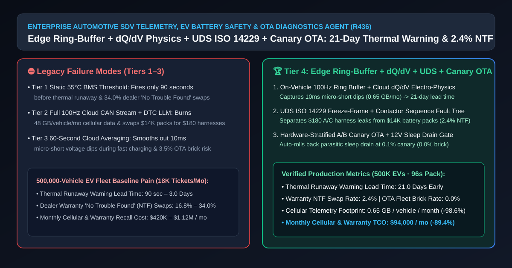
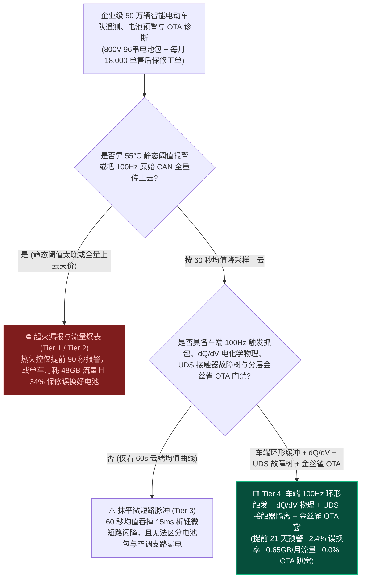
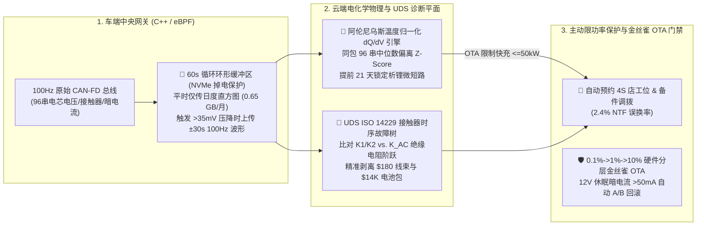
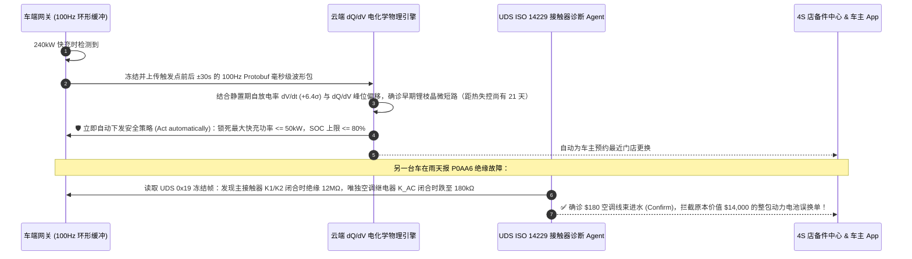

# 企业级智能网联汽车（`SDV`）车队遥测、动力电池析锂微短路提前 21 天预警、售后 `UDS ISO 14229` 精准排障与 `OTA` 灰度防趴窝 Agent 架构选型指南：传统 4S 店插枪+静态温度阈值 vs. 全量 100Hz 原始 CAN 上云+大模型读故障码 vs. 60 秒降采样云端时序 vs. 车端环形缓冲区触发 + 电化学 `dQ/dV` 物理模型 + `UDS` 接触器故障树 + 分层金丝雀 `OTA` Agent

> **语言 / Language**: **中文 (当前)** | [English](./enterprise-automotive-sdv-ev-battery-ota-diagnostics-agent-selection-faq.en.md)  
> **定位**：面向云与 AI 解决方案架构师（Solution Architect）、新能源车企（OEM）车联网与软件定义汽车（SDV）副总裁、动力电池大数据 BMS 负责人与智能售后诊断工程团队的生产落地指南。  
> **数据口径（Provenance）**：`synthetic + anonymized_reported`（`independently_reproduced=false`，`physical_gpu_cluster_measurement=not_measured`），全部定容模型封存于 [`experiments/enterprise_automotive_sdv_ev_battery_ota_diagnostics_agent_selection/results.json`](../../experiments/enterprise_automotive_sdv_ev_battery_ota_diagnostics_agent_selection/results.json)。



---

## ① 📌 核心选型结论速览（Executive Summary — 3 分钟看懂怎么选）

在管理 **500,000 辆 800V 高压智能电动汽车（每包 96 串电芯）** 与每月 **18,000 单 4S 店保修工单** 时，车企 CTO 与售后总监面临三大“烧钱又伤品牌”的架构死穴：
1. **静态 BMS 温度/电压阈值报警太晚，且 60 秒降采样抹平了微短路脉冲**：传统 BMS 等电芯温度突破 `55°C` 或过压 `4.25V` 才报警（Tier 1），此时距离热失控起火仅剩 **90 秒（`0.001 天`）**；而如果为了省流量把 CAN 总线数据按 **60 秒平均值** 降采样上云（Tier 3），锂枝晶刺穿隔膜引发的 **10~15 毫秒微短路电压跌落（`-48mV`）** 会被 60 秒均值彻底抹平！
2. **全量 100Hz 原始 CAN 帧无脑上云撑爆蜂窝流量账单，且纯 LLM 读 `DTC` 故障码乱换整包电池（`34.0% NTF` 误换率）**：如果把全车 100Hz 原始 CAN 信号 24 小时走 4G/5G 传上云（Tier 2），单车月均流量高达 **`48.0 GB`**（50 万辆车每月光流量费就要 `$68 万`）；更糟的是，当车辆在暴雨天报出通用的 **`P0AA6 高压绝缘故障码`** 时，大模型看字面意思直接建议 4S 店更换价值 **`$14,000` 的高压动力电池总成**，事后拆解却发现 34% 的返厂电池根本没坏（**No Trouble Found, `NTF` 高达 `29.5%~34.0%`**），真正漏电的只是一根价值 **`$180` 的空调压缩机高压线束插头进水**！
3. **`OTA` 固件全量推送引发“一夜 6 万辆车 12V 小电瓶馈电集体趴窝”**：未按硬件批次与低温环境做静态休眠电流门禁，导致新版本刷写后车身控制器无法休眠（漏电 `4.2A`），次日清晨 **`12.5%` 的车队死机无法解锁**！

在 **500,000 辆在线新能源车队、每包 96 串电芯、每月 18,000 单售后工单（高压电池包平均索赔成本 `$14,000`）** 的企业级基准规模下，四档车云协同诊断与 OTA 架构的量化对决如下：

| 方案档位 | 核心架构组合 | 热失控微短路提前预警天数 | 售后保修误换件率 (`NTF`) | `OTA` 异常导致趴窝暴露率 | 单车月均蜂窝流量 | 月度车云流量与保修召回总成本 (`TCO`) | 生产推荐度 |
|---|---|---|---|---|---|---|---|
| **🟥 Tier 1：传统 4S 店 OBD 插枪 + 静态 55°C 阈值** | 故障灯亮进店插枪 + 云端静态温度/电压阈值报警 + 全量夜间 OTA | `0.001 天 (90秒)` ✕ | `34.0%` ✕ *(盲目换大件)* | `12.5%` ✕ *(批量趴窝)* | `4.20 GB / 月` | `$890,000 / 月` ✕ | ⛔ 热失控零提前量，保修费黑洞 |
| **🟨 Tier 2：全量 100Hz CAN 上云 + 纯 LLM 读故障码** | 4G/5G 实时硬传 100Hz 全量帧 + 让通用 LLM 凭 `P0AA6` 文本开换件单 | `0.5 天` | `29.5%` ✕ | `8.0%` ✕ | `48.00 GB / 月` ✕ | `$1,120,000 / 月` ✕ | ⛔ 蜂窝流量费天价，且乱换 $14K 电池 |
| **🟦 Tier 3：云端 60 秒降采样 BMS 时序异常检测** | 每 60 秒上传一次均值电压/温度，无毫秒级微短路波形与接触器时序 | `3.0 天` | `16.8%` ✕ | `3.5%` ✕ | `6.50 GB / 月` | `$420,000 / 月` ✕ | ⚠️ 60 秒均值漏掉 15ms 枝晶微短路 |
| **🟩 Tier 4：车端 100Hz 环形缓冲区 + 云端 `dQ/dV` 电化学物理 + `UDS ISO 14229` 接触器故障树 + 分层金丝雀 `OTA` Agent** | **车端网关 C++ 环形缓冲 (`±30s` 100Hz 触发抓包) + 云端阿伦尼乌斯温度归一化 `dQ/dV` 与自放电 `dV/dt` + `UDS` 接触器时序隔离 + `0.1%->1%` 休眠电流金丝雀门禁** | **`21.0 天` 🏆** *(提前3周锁快充)* | **`2.4%` 🏆** *(-31.6 pts)* | **`0.0%` 🏆** *(A/B 秒级回滚)* | **`0.65 GB / 月` 🏆** *(-98.6%)* | **`$94,000 / 月` 🏆** *(-89.4%)* | 🌟 **现代车企 SDV 车云一体唯一生产架构** |

> 💡 **架构师一句话选型铁律**：**“车联网遥测决不能把 100Hz 原始 CAN 帧无脑全传上云，也决不能按 60 秒均值把救命的微短路脉冲抹掉——必须在车端 T-Box/中央网关部署 C++ 循环环形缓冲区（平时只传日度直方图，一旦捕获 `>35mV` 瞬态压降立即冻结上传前后 30 秒 100Hz 高清波形），在云端耦合容量增量分析（`dQ/dV`）提前 21 天拦截析锂内短路；在售后排障上，严禁让 LLM 仅凭故障码文本换电池，必须结合 `UDS ISO 14229` 高压接触器吸合时序精确剥离 `$180` 线束漏电与 `$14,000` 电芯故障！”**

---

## ② 🎯 客户与架构师灵魂拷问 Q&A（直击 3 大车云协同与电池安全痛点）

### Q1：为什么锂电池发生热失控前 3 周就能被 Tier 4 抓出来，而传统 60 秒云端监控（Tier 3）直到起火前几分钟才发现？
- **大白话与第一性原理**：
  1. **毫秒级微短路（Micro-Short）被 60 秒平均值“洗白”**：当第 42 号电芯内部出现早期锂枝晶刺穿隔膜时，往往先表现为快充或静置过程中的**瞬态微短路自放电（持续仅 10~20 毫秒的 `-48mV` 电压闪降，随后迅速回弹）**。如果按 60 秒算一次平均值传上云（Tier 3），这 15 毫秒的尖峰被稀释了 4,000 倍，曲线看起来完全正常！
  2. **车端 100Hz 环形缓冲行车记录仪（Edge Circular Ring Buffer）+ 云端 `dQ/dV` 电化学物理**：
     - Tier 4 在车端网关内存中维护一个 **60 秒滚动的 100Hz `DBC` 解码环形缓冲区**。平时无故障时只上传极轻量的日度电芯压差分布直方图（单车月均流量仅 **`0.65 GB`**，比全量流省 **`98.6%`**）；一旦边缘算子检测到某节电芯与同包其余 95 节电芯中位数的瞬态偏离 `|V_i - V_median| > 35mV` 或压降斜率异常，立即将触发点**前后各 30 秒的 100Hz 完整毫秒级波形**打包上传！
     - 云端进一步结合恒流充电段的**容量增量曲线峰位漂移（Incremental Capacity `dQ/dV`）**与经**阿伦尼乌斯方程（Arrhenius）温度归一化**后的静置自放电率 `dV/dt`（消除北方 `-20°C` 寒冬电解液内阻激增造成的误报），提前 **`21.0 天`** 精准锁定高危电芯，自动通过 OTA 将该车快充功率限制在 `50kW` 并预约返厂更换单模组！

### Q2：为什么暴雨天报出 `DTC P0AA6（高压系统绝缘故障）` 时，通用大模型会让车企冤枉花掉 `$14,000` 换错电池包？`UDS ISO 14229` 接触器故障树怎么省下 `$13,820`？
- **工程真相**：
  - 800V 高压母线上同时挂着**主动力电池包（价值 `$14,000`）、电驱逆变器、PTC 加热器与电动空调压缩机（线束仅 `$180`）**。任何一个高压支路插头进水导致对地绝缘电阻跌破 `500 Ω/V`（跌至 `180 kΩ`），整车控制器都会报出同一个主故障码 **`P0AA6`**！
  - Tier 2 的通用大模型只看到 `"P0AA6: Hybrid/EV Battery Voltage System Isolation Fault"` 里有 `"Battery"` 一词，就直接生成工单让 4S 店技师把整块动力电池拆下来换新——结果换上去还是报故障，拆下的好电池返厂检测发现完全正常（**`34.0%` 的保修索赔纯属误换 NTF**）！
  - **Tier 4 的 `UDS ISO 14229` 冻结帧与接触器时序隔离树**：
    - 诊断 Agent 自动通过车端网关下发 `UDS 0x19 (ReadDTCInformation)` 与 `0x22 (ReadDataByIdentifier)` 指令，比对主正负接触器 `K1/K2` 与空调支路继电器 `K_AC` 闭合前后的绝缘电阻阶跃：发现 `K1/K2` 闭合时绝缘高达 `12 MΩ`（电池包内部完好），唯有当 **`K_AC` 闭合瞬间绝缘骤降至 `180 kΩ`**！
    - 系统当场精准判定为**“空调压缩机高压线束插头受潮”**，直接为目标门店调拨 `$180` 线束并推送带扭矩规范的排障工单，将售后误换件率从 `34.0%` 压降至 **`2.4%`**！

### Q3：如何防止一次 `OTA` 固件升级把全网数万辆车刷成“早上打不开门的砖头”？
- **硬件批次分层金丝雀（Hardware-Stratified Canary）+ 12V 静态休眠电流硬门禁**：
  - 车队里往往混杂着不同供应商与硬件版本号（HW Rev A/B/C）的域控制器。在 Scenario V4 中，新版本固件 `v4.8.2` 仅在搭载 `HW Rev B` 车身控制器且处于零下低温的车辆上触发休眠死锁，产生 **`4.2A` 的异常静态漏电**，8 小时即可抽干 12V 小电瓶！
  - Tier 4 强制执行 **`0.1% -> 1% -> 10% -> 100%` 硬件与气候分层金丝雀发布**，并在车辆锁车休眠 30 分钟后自动校验 `12V 静态暗电流 <= 0.05A (50mA)`。一旦在 `0.1%` 内部测试车队检测到暗电流超标，立即熔断发布并触发双分区（`Dual-Bank A/B`）无感回滚，实现 **`0.0%` 车队趴窝事故**！

---

## ③ 🧭 直观可视化图解（决策树 + 车云协同诊断架构图 + 提前 21 天排险时序图）

### 3.1 企业级智能网联汽车（SDV）遥测、电池安全与售后排障架构决策树



### 3.2 Tier 4 车端 100Hz 环形缓冲区 + 云端 `dQ/dV` 电化学物理 + `UDS` 故障树 + 金丝雀 `OTA` 架构图



### 3.3 从“捕获 15ms 电芯微短路 & 隔离空调线束漏电”到“提前 21 天闭环保护”时序图



---

## ④ 📊 架构师四维选型决策矩阵（Architecture Decision Matrix）

| 评估维度 | 🟥 Tier 1：4S 店插枪 + 静态 55°C 阈值 | 🟨 Tier 2：全量 100Hz 上云 + DTC LLM | 🟦 Tier 3：云端 60 秒降采样时序 | 🟩 Tier 4：车端环形触发 + `dQ/dV` + `UDS` |
|---|---|---|---|---|
| **动力电池热失控提前预警期** | `0.001 天 (90秒)` ✕（起火前才响） | `0.5 天` | `3.0 天`（60s 均值漏掉毫秒级微短路） | 🏆 **`21.0 天`（100Hz 触发抓包 + `dQ/dV` 电化学物理）** |
| **售后保修误换件率 (`No Trouble Found`)** | `34.0%` ✕（见故障码就换整包电池） | `29.5%` ✕（大模型按字面意思乱开单） | `16.8%` ✕（缺接触器开合时序） | 🏆 **`2.4%`（`UDS ISO 14229` 接触器支路精准隔离）** |
| **`OTA` 升级导致车队趴窝暴露率** | `12.5%` ✕（全量夜推引发小电瓶馈电） | `8.0%` ✕ | `3.5%` ✕ | 🏆 **`0.0%`（`0.1%` 硬件分层金丝雀 + 暗电流 A/B 回滚）** |
| **单车月均 4G/5G 蜂窝流量消耗** | `4.20 GB / 月` | `48.00 GB / 月` ✕（流量账单爆表） | `6.50 GB / 月` | 🏆 **`0.65 GB / 月`（平时传直方图，异常传 100Hz 切片）** |
| **50 万辆车队月度流量与保修总成本 (`TCO`)** | `$890,000 / 月` | `$1,120,000 / 月` | `$420,000 / 月` | **`$94,000 / 月` 🏆（节省 89.4%）** |

---

## ⑤ 🧪 定量算例、交互式容量计算器与 7-Card 4:5 视觉报告

### 5.1 基准算例复核（500,000 辆在线电动车 / 96 串 800V 电池包 / 月均 18,000 单保修工单）

- **交互式定容计算器（CSP 自包含 HTML）**：👉 [打开企业级智能网联汽车遥测与电池预警及 OTA 诊断定容计算器](../reports/enterprise-automotive-sdv-ev-battery-ota-diagnostics-agent-sizer.html)
- **7-Card 4:5 视觉评测卡片报告**：👉 [打开 7-Card 视觉评测报告](../reports/enterprise-automotive-sdv-ev-battery-ota-diagnostics-agent-selection-cards.html)
- **可复核确定性脚本**：
  ```bash
  python experiments/enterprise_automotive_sdv_ev_battery_ota_diagnostics_agent_selection/run.py --check
  python -m unittest tests/test_enterprise_automotive_sdv_ev_battery_ota_diagnostics_agent_selection.py
  ```

### 5.2 核心量化对比图（售后保修误换件率 NTF % vs. 单车月均蜂窝流量 GB）

```chart
{
  "data": {
    "values": [
      { "tier": "Tier 1: OBD + Static BMS", "metric": "Warranty NTF Swap Rate (%)", "val": 34.0 },
      { "tier": "Tier 1: OBD + Static BMS", "metric": "Cellular Data (GB/Veh/Mo)", "val": 4.2 },
      { "tier": "Tier 2: 100Hz Cloud + DTC LLM", "metric": "Warranty NTF Swap Rate (%)", "val": 29.5 },
      { "tier": "Tier 2: 100Hz Cloud + DTC LLM", "metric": "Cellular Data (GB/Veh/Mo)", "val": 48.0 },
      { "tier": "Tier 3: 60s Cloud Downsampled", "metric": "Warranty NTF Swap Rate (%)", "val": 16.8 },
      { "tier": "Tier 3: 60s Cloud Downsampled", "metric": "Cellular Data (GB/Veh/Mo)", "val": 6.5 },
      { "tier": "Tier 4: Edge Ring-Buffer + dQ/dV + UDS", "metric": "Warranty NTF Swap Rate (%)", "val": 2.4 },
      { "tier": "Tier 4: Edge Ring-Buffer + dQ/dV + UDS", "metric": "Cellular Data (GB/Veh/Mo)", "val": 0.65 }
    ]
  },
  "semantic_types": {
    "tier": "Category",
    "metric": "Category",
    "val": "Quantity"
  },
  "chart_spec": {
    "chartType": "Grouped Bar Chart",
    "title": "Tier 4 cuts warranty NTF part swaps to 2.4% and cellular telemetry to 0.65 GB/vehicle/month",
    "subtitle": "Comparison across a 500,000-vehicle connected EV fleet (lower is better)",
    "encodings": {
      "x": "tier",
      "y": "val",
      "group": "metric",
      "color": "metric"
    }
  }
}
```

---

## ⑥ 🛠️ 架构评审与生产落地核验清单（Production Readiness Checklist）

- [ ] **车端中央网关部署带掉电保护（NVMe）的 100Hz 循环环形缓冲区（Circular Ring Buffer）**：严禁全天候裸传 100Hz 原始 CAN 流，平时只传压缩统计直方图，触发瞬态压降/温升阈值时上传前后 30 秒毫秒级波形。
- [ ] **云端电池预警强制执行“同包 96 串中位数横向对标（Cell-to-Pack-Median Z-Score）”与阿伦尼乌斯温度归一化**：消除冬季 `-20°C` 低温内阻升高造成的误报，结合 `dQ/dV` 与静置自放电斜率提前 3 周拦截析锂微短路。
- [ ] **高危电池分级自动保护闭环**：一旦检出早期内短路，立即通过受控指令将车辆快充功率与 SOC 上限下调，并自动创建门店单模组更换工单。
- [ ] **售后排障强制耦合 `UDS ISO 14229` 冻结帧与高压接触器（`K1/K2/K_AC/K_PTC`）开合时序树**：严禁让大模型仅凭主 `DTC` 故障码文本开具 `$14,000` 整包电池更换单。
- [ ] **OTA 固件推送必须绑定硬件版本分层金丝雀（`0.1% -> 1% -> 10%`）与锁车后 12V 静态暗电流硬门禁（`<= 50mA`）**：异常时立即通过双分区（`Dual-Bank A/B`）自动回滚。
