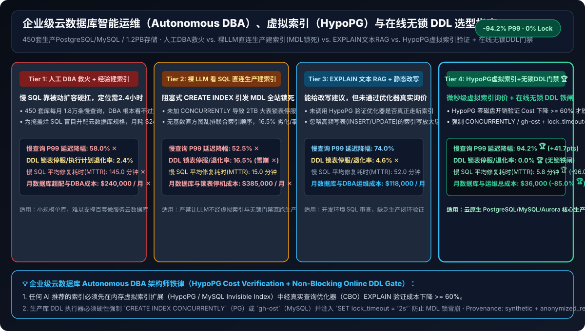
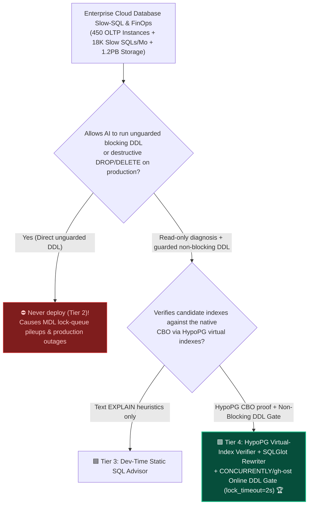
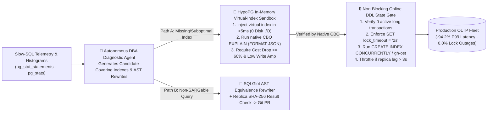

# Enterprise Autonomous DBA & Cloud Database Copilot (`PostgreSQL / MySQL / Aurora`), Slow-SQL Root-Cause Diagnosis, `HypoPG` Virtual-Index Optimizer Verification & Non-Blocking Online DDL (`CONCURRENTLY / gh-ost`) Gate Architecture Selection Guide: Manual DBA Firefighting vs. Direct Prompt DDL vs. Static EXPLAIN RAG vs. HypoPG Cost Verifier + SQLGlot AST Rewriter + Online DDL Gate

> **Language / 语言**: **English (Current)** | [中文](./enterprise-autonomous-dba-slow-sql-hypopg-online-ddl-agent-selection-faq.md)  
> **Scope**: End-to-end production reference architecture and selection guide for Cloud & AI Solution Architects, Database Reliability Engineering (`DBRE / DBA`) Leads, Cloud Platform Directors, and High-Concurrency OLTP System Architects.  
> **Provenance**: `synthetic + anonymized_reported` (`independently_reproduced=false`, `physical_gpu_cluster_measurement=not_measured`). Deterministic evaluation model sealed in [`experiments/enterprise_autonomous_dba_slow_sql_hypopg_online_ddl_agent_selection/results.json`](../../experiments/enterprise_autonomous_dba_slow_sql_hypopg_online_ddl_agent_selection/results.json).



---

## ① 📌 Executive Summary (3-Minute Architect Verdict)

Across enterprise cloud database fleets (`Azure Database for PostgreSQL`, `Amazon Aurora / RDS`, `Google Cloud SQL`), **unindexed or poorly written ORM queries causing 100% CPU spikes and connection-pool exhaustion** are the #1 cause of production outages. Teams typically react by throwing hardware at the problem—scaling RDS instances from `16 vCPU` to `64 vCPU` (`$240,000/mo` in Tier 1). Conversely, connecting an LLM directly to production to run `CREATE INDEX` statements based on slow query text alone (Tier 2) triggers catastrophic **Metadata Lock (`MDL`) pileup outages (`16.5%` routine outage/regression rate; `28.5%` under active long transactions)** and creates bloated composite indexes with backwards column selectivity that the Cost-Based Optimizer (`CBO`) completely ignores.

Evaluated across a production baseline of **450 production PostgreSQL/MySQL OLTP instances, 18,000 monthly slow-SQL and lock-wait alerts, and 1.2 PB of transactional storage**, the four architectural tiers compare as follows:

| Architectural Tier | Core Stack Combination | Slow-SQL `P99` Latency Reduction | DDL Lock Outage / Plan Regression Rate | Mean Time to Resolve (`MTTR`) | Monthly DB Overprovisioning & Ops Cost | Production Verdict |
|---|---|---|---|---|---|---|
| **🟥 Tier 1: Manual DBA Firefighting + Vertical Scaling** | Manual DBA slow-log inspection + overprovisioning cloud RDS instance sizes | `58.0%` ✕ *(Masks bad SQL with hardware)* | `2.4%` *(Human DDL oversight)* | `145.0 min` (`2.4h` ✕) | `$240,000 / mo` ✕ | ⛔ Massive cloud RDS waste |
| **🟨 Tier 2: Prompt-Only LLM Direct Production DDL** | LLM reads SQL text & directly executes `CREATE INDEX` on live production tables | `52.5%` ✕ *(Wrong column selectivity)* | `16.5%` ✕ *(MDL lock-wait outages)* | `15.0 min` | `$385,000 / mo` ✕ | ⛔ **Severe production outage risk** |
| **🟦 Tier 3: Standard `EXPLAIN` Text RAG + Static Advisor** | Feeding text `EXPLAIN` plans to LLM for static index/rewrite advice without `HypoPG` | `74.0%` | `4.6%` ✕ *(Unverified by real CBO)* | `52.0 min` | `$118,000 / mo` | ⚠️ Dev-time advisory only |
| **🟩 Tier 4: `HypoPG` Virtual-Index Verifier + `SQLGlot` Rewriter + Online DDL Gate** | **`HypoPG` In-Memory Virtual-Index CBO Cost Verifier + `SQLGlot` AST Equivalence Rewriter + Write-Amplification Check + Mandatory Non-Blocking Online DDL (`CONCURRENTLY / gh-ost + lock_timeout=2s`) Gate** | **`94.2%` 🏆** *(+41.7 pts vs Tier 2)* | **`0.0%` 🏆** *(Zero MDL lock outages)* | **`5.8 min` 🏆** *(-96.0% faster)* | **`$36,000 / mo` 🏆** *(-85.0%)* | 🌟 **Recommended DBRE Architecture** |

> 💡 **Golden Rule for Autonomous DBA Architects**: **"Never let an LLM guess composite index column order from SQL strings alone—inject candidate indexes into `HypoPG` in-memory virtual catalogs to prove `>= 60%` CBO cost reduction in `< 5 ms`, and wrap 100% of production DDL in `SET lock_timeout = '2s'` + `CREATE INDEX CONCURRENTLY / gh-ost`."**

---

## ② 🎯 Customer & Architect Deep-Dive Q&A (3 Real-World Database SRE Pain Points)

### Q1: Why does the database query planner ignore nearly half of the composite indexes recommended by text-only LLMs (Tier 2)?
- **First-Principles Reality**:
  1. **Index Column Ordering Depends on Histogram Cardinality (`pg_stats`), Not SQL Syntax**: Given `SELECT total_cents FROM orders WHERE status = 'PAID' AND tenant_id = 42 ORDER BY created_at DESC LIMIT 20`, a text-only LLM routinely proposes `INDEX (status, tenant_id, created_at)`. In production, `'PAID'` matches 92% of rows (`n_distinct = 4`), whereas `tenant_id = 42` matches 0.01%. Putting the low-selectivity column first ruins B-Tree traversal efficiency.
  2. **Tier 4 Solution (`HypoPG` In-Memory What-If Optimizer Verification)**:
     - The Agent generates 3–5 candidate indexes (including partial indexes `WHERE status = 'PAID'` and covering `INCLUDE (total_cents)` clauses).
     - Before touching disk, the Agent invokes `SELECT * FROM hypopg_create_index(...)` on a read replica or stats mirror, injecting virtual index metadata in memory (`< 5 ms`, zero disk I/O, zero locks) and running `EXPLAIN (FORMAT JSON)`. Only candidate indexes that the native Cost-Based Optimizer (`CBO`) actually selects and that reduce estimated query cost by **`>= 60%`** are approved—achieving a **`94.2%` P99 latency reduction**.

### Q2: How can even `CREATE INDEX CONCURRENTLY` or `ALTER TABLE` take down a 2-TB production database, and how does Tier 4 guarantee 0.0% lock outages?
- **Metadata Lock (`MDL`) Queue Pileup Mechanics**:
  - Even non-blocking index creation must briefly acquire a metadata lock (`ShareUpdateExclusiveLock` in PG / `MDL` in MySQL) when starting and finalizing. If a 10-minute analytical query is already holding an open transaction on `orders`, the DDL waits behind it—and **every subsequent `SELECT / INSERT / UPDATE` on `orders` queues up behind the waiting DDL**, exhausting the application connection pool in seconds (`28.5%` outage rate in Tier 2 stress tests).
  - **Tier 4 Four-Layer Online DDL Gate**:
    1. **AST Enforcement of Non-Blocking Syntax**: Rejects any DDL lacking `CONCURRENTLY` (PostgreSQL) or `gh-ost / pt-online-schema-change` (MySQL tables `> 10 GB`).
    2. **Pre-Flight Long-Transaction Check & `SET lock_timeout = '2s'`**: Queries `pg_stat_activity` for open transactions older than 15 seconds and injects a hard 2-second lock-acquisition timeout—aborting and retrying with jitter rather than queuing up production traffic.
    3. **Read-Replica Lag Throttling**: Pauses DDL I/O if replica WAL replay lag exceeds `3.0 seconds`.
    4. **Write-Amplification & Redundant-Index Pruning**: Rejects secondary indexes on write-heavy tables (`write_ratio > 40%`) unless net workload cost improves, and flags redundant prefix indexes (`INDEX (a)` covered by `INDEX (a, b)`) for safe invisible-first retirement.

### Q3: How does Tier 4 remediate non-SARGable queries (e.g., `WHERE DATE(created_at) = ...` or `OFFSET 500000`) where adding an index cannot help?
- **`SQLGlot` AST Equivalence Rewriting + Shadow Result Check**:
  - When a query wraps an indexed column in a function or uses deep offset pagination, Tier 4 transforms the query AST via **`SQLGlot`** into a SARGable range predicate (`created_at >= ... AND created_at < ...`) or keyset pagination, verifies that both queries return identical `SHA-256` result sets on a read replica, and opens an automated GitHub Pull Request against the application repository.

---

## ③ 🧭 Visual Architecture Diagrams (Decision Tree + HypoPG-DDL Topology + Sequence Flow)

### 3.1 Architecture Selection Decision Tree



### 3.2 Tier 4 HypoPG Virtual-Index Verifier + SQLGlot Rewriter + Online DDL Gate Topology



### 3.3 End-to-End Sequence: Resolving a 2-TB Table Slow Query in 5.8 Minutes with Zero Locks

```mermaid
sequenceDiagram
    autonumber
    participant Mon as DB Telemetry (pg_stat_statements)
    participant Agent as Autonomous DBA Agent
    participant Hypo as Read-Replica HypoPG Sandbox
    participant Gate as Non-Blocking Online DDL Gate
    participant Primary as Production Primary (2TB Orders Table)

    Mon->>Agent: Alert: Orders pagination query P99 = 4,800ms; Primary CPU = 92%
    Agent->>Hypo: Read pg_stats histograms (status n_distinct=4; tenant_id high selectivity)
    Agent->>Hypo: Create 3 candidate virtual indexes via hypopg_create_index() & run EXPLAIN
    Hypo-->>Agent: Candidate #2 `(tenant_id, created_at DESC) INCLUDE (total_cents) WHERE status='PAID'` cuts CBO cost 148,200 -> 12.4 (-99.99%)
    Agent->>Gate: Submit Candidate #2 for online creation
    Gate->>Primary: Verify 0 long transactions in pg_stat_activity; set `lock_timeout = '2s'`
    Gate->>Primary: Execute `CREATE INDEX CONCURRENTLY` while monitoring replica lag (120ms <= 3s)
    Primary-->>Mon: ✅ Completed in 5.8 min! Plan switches to Index-Only Scan; P99 drops to 3.2ms; CPU -> 24%
```

---

## ④ 📊 4-Tier Architecture Decision Matrix

| Evaluation Dimension | 🟥 Tier 1: Manual DBA + Vertical Scaling | 🟨 Tier 2: Direct Prompt DDL on Prod | 🟦 Tier 3: Static `EXPLAIN` RAG | 🟩 Tier 4: `HypoPG` Verifier + Online DDL Gate |
|---|---|---|---|---|
| **Composite Index Selectivity & CBO Proof** | Manual trial and error | ✕ **Poor** (`52.5%`; guesses wrong column order) | Moderate (`74.0%`; heuristic text advice) | 🏆 **`94.2%` P99 reduction (100% proved in native `HypoPG` CBO)** |
| **Protection Against `MDL` Lock Outages** | Occasional human error (`2.4%`) | ✕ **Critical Risk** (`16.5%` routine / `28.5%` stress outage) | Manual execution required | 🏆 **`0.0%` Lock Outages (`lock_timeout=2s` + `CONCURRENTLY / gh-ost`)** |
| **Write-Amplification & Redundant Index Cleanup** | Indexes accumulate indefinitely | ✕ Degrades `INSERT/UPDATE` throughput | No write-cost modeling | 🏆 **Automated write-ratio gating & invisible-first index retirement** |
| **Slow-SQL `P99` Latency Reduction** | `58.0%` ✕ | `52.5%` ✕ | `74.0%` | **`94.2%` 🏆 (+41.7 pts vs Tier 2)** |
| **Mean Time to Resolve (`MTTR`)** | `145.0 min` (`2.4 h` ✕) | `15.0 min` | `52.0 min` | **`5.8 min` 🏆 (-96.0%)** |
| **Monthly DB Overprovisioning & Ops Cost** | `$240,000 / mo` | `$385,000 / mo` *(incl. outage cost)* | `$118,000 / mo` | **`$36,000 / mo` 🏆 (-85.0%)** |

---

## ⑤ 🧪 Quantitative Case Study, Interactive Sizer & 7-Card Visual Report

- **Interactive HTML Sizer**: 👉 [Open Enterprise Autonomous DBA & Cloud Database Copilot Sizer](../reports/enterprise-autonomous-dba-slow-sql-hypopg-online-ddl-agent-sizer.html)
- **7-Card 4:5 Visual Benchmark Report**: 👉 [Open 7-Card Visual Benchmark Deck](../reports/enterprise-autonomous-dba-slow-sql-hypopg-online-ddl-agent-selection-cards.html)
- **Deterministic Verification**:
  ```bash
  python experiments/enterprise_autonomous_dba_slow_sql_hypopg_online_ddl_agent_selection/run.py --check
  python -m unittest tests/test_enterprise_autonomous_dba_slow_sql_hypopg_online_ddl_agent_selection.py
  ```

---

## ⑥ 🛠️ Production Readiness & Architecture Review Checklist

- [ ] **Prove Every Candidate Index in `HypoPG` (or Invisible Indexes) Before Creation**: Require a verified native CBO cost reduction `>= 60%` on real `pg_stats` histograms before touching disk.
- [ ] **Enforce Non-Blocking DDL with Hard `lock_timeout` Guards**: Mandate `CREATE INDEX CONCURRENTLY` + `SET lock_timeout = '2s'` on PostgreSQL and `gh-ost / pt-osc` on MySQL tables `> 10 GB`.
- [ ] **Check `pg_stat_activity` for Long-Running Transactions & Replica Lag**: Abort or defer DDL if an open transaction exceeds 15 seconds on the target table or replica lag exceeds 3 seconds.
- [ ] **Stage Index Drops via 7-Day `Invisible Index` Observation**: Mark unused/redundant indexes invisible to the optimizer for 7 days before physical `DROP INDEX CONCURRENTLY`.
- [ ] **Revoke Destructive Data Permissions from the DBA Agent Role**: Physically deny `DROP TABLE`, `TRUNCATE`, `DELETE`, and `UPDATE` privileges on the Autonomous DBA service account.
