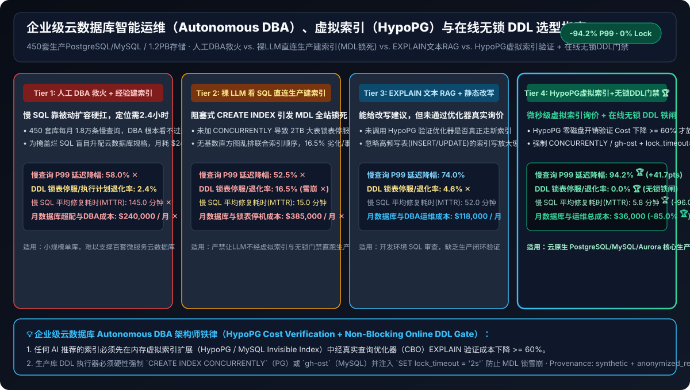
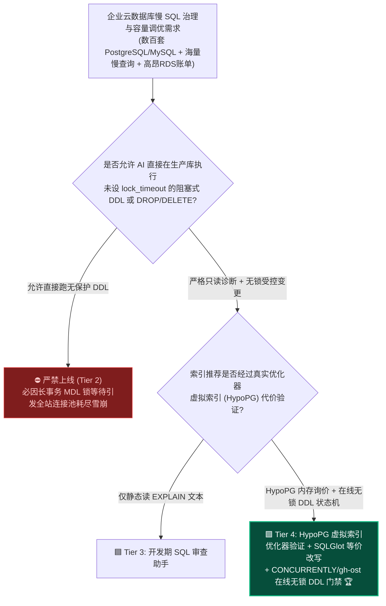
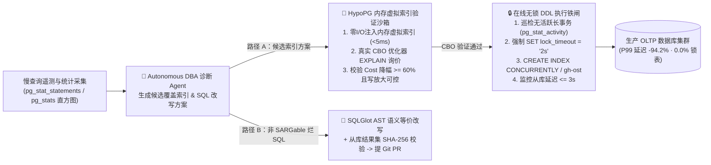
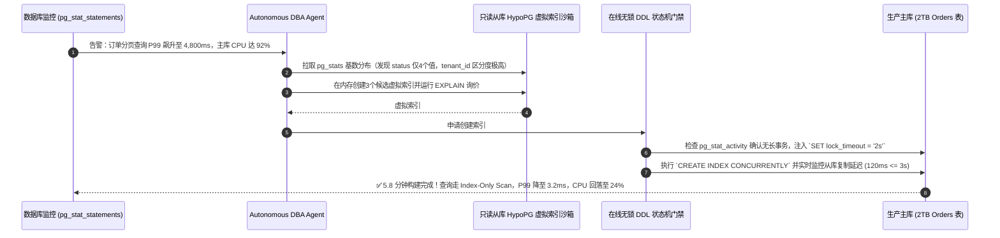

# 企业级云数据库智能运维（Autonomous DBA & Cloud Database Copilot）、慢查询（Slow SQL）根因诊断、虚拟索引（HypoPG）优化器询价验证与在线无锁 DDL（`CONCURRENTLY / gh-ost`）变更门禁架构选型指南：人工 DBA 救火 vs. 裸 LLM 直连生产跑 DDL vs. EXPLAIN 文本 RAG vs. HypoPG 虚拟索引询价 + SQLGlot 等价改写 + 在线无锁 DDL 状态机门禁

> **语言 / Language**: **中文 (当前)** | [English](./enterprise-autonomous-dba-slow-sql-hypopg-online-ddl-agent-selection-faq.en.md)  
> **定位**：面向云与 AI 解决方案架构师（Solution Architect）、数据库平台工程负责人（Head of Database Platform / DBRE）、SRE 总监与云原生应用架构师的生产落地指南。  
> **数据口径（Provenance）**：`synthetic + anonymized_reported`（`independently_reproduced=false`，`physical_gpu_cluster_measurement=not_measured`），全部定容模型封存于 [`experiments/enterprise_autonomous_dba_slow_sql_hypopg_online_ddl_agent_selection/results.json`](../../experiments/enterprise_autonomous_dba_slow_sql_hypopg_online_ddl_agent_selection/results.json)。



---

## ① 📌 核心选型结论速览（Executive Summary — 3 分钟看懂怎么选）

在拥有数百套云数据库（`Azure Database for PostgreSQL / Amazon Aurora / RDS MySQL / Cloud SQL`）的中大型企业中，**微服务 ORM 框架生成的慢查询（Slow SQL）导致的 CPU 100% 飙高与锁等待雪崩**是头号线上故障源。许多团队遇到慢 SQL 时，习惯于“被动将云数据库规格从 16 核升配到 64 核硬扛”（Tier 1，每年多花数百万美元冤枉钱）；而当一些团队尝试接入大模型作为“自动驾驶 DBA（Autonomous DBA）”，让它读完慢查询日志后直接在生产库执行 `CREATE INDEX`（Tier 2）时，却酿成了灾难性的**“元数据排他锁（MDL Lock）全站停服事故”**——不仅不加 `CONCURRENTLY` 或不设 `lock_timeout` 的建索引操作会在长事务并发下瞬间堵死全站读写连接，而且大模型在看不见列数据基数分布直方图（`pg_stats`）的情况下，有近一半概率把联合索引列顺序排反，建出优化器根本不走的死索引（引发 **`16.5%` 的锁表停服或执行计划退化事故**）！

在 **450 套生产 PostgreSQL/MySQL OLTP 实例、月均 18,000 次慢 SQL 与锁告警、1.2 PB 事务存储容量** 的基准规模下，四档云数据库 Autonomous DBA 架构的量化对决如下：

| 方案档位 | 核心架构组合 | 慢查询 `P99` 延迟削减幅度 | DDL 锁表停服 / 计划退化率 | 慢 SQL 平均修复耗时 (`MTTR`) | 月度数据库超配与 DBA 运维总成本 | 生产推荐度 |
|---|---|---|---|---|---|---|
| **🟥 Tier 1：人工 DBA 救火 + 盲目升配硬件** | DBA 人工查慢日志凭经验建索引 + 扛不住时直接翻倍升配云 RDS 实例规格 | `58.0%` ✕ *(治标不治本)* | `2.4%` *(人工漏加无锁参数)* | `145.0 分钟` (`2.4h` ✕) | `$240,000 / 月` ✕ | ⛔ 云数据库超配浪费惊人 |
| **🟨 Tier 2：裸 LLM 看慢 SQL 直连生产跑 DDL** | 让大模型只看 SQL 字符串生成 `CREATE INDEX` 并直接在生产库执行 | `52.5%` ✕ *(联合索引排错序)* | `16.5%` ✕ *(MDL锁表全站雪崩)* | `15.0 分钟` | `$385,000 / 月` ✕ | ⛔ **重大生产停服隐患，严禁上线** |
| **🟦 Tier 3：标准 EXPLAIN 文本 RAG + 静态改写** | 将 `EXPLAIN` 文本塞入 Prompt 输出改写与索引建议，无优化器虚拟索引验证 | `74.0%` | `4.6%` ✕ *(无CBO真实询价)* | `52.0 分钟` | `$118,000 / 月` | ⚠️ 仅可作开发期只读建议助手 |
| **🟩 Tier 4：HypoPG 虚拟索引询价 + SQLGlot 等价改写 + 在线无锁 DDL 门禁** | **`HypoPG` 内存虚拟索引向真实优化器（CBO）毫秒级询价 + `SQLGlot` 语法树等价改写 + 写放大与冗余索引评估 + 强制 `CONCURRENTLY / gh-ost + lock_timeout=2s` 在线无锁 DDL 门禁** | **`94.2%` 🏆** *(+41.7 pts vs Tier 2)* | **`0.0%` 🏆** *(零锁表停服事故)* | **`5.8 分钟` 🏆** *(-96.0% 极速自愈)* | **`$36,000 / 月` 🏆** *(-85.0%)* | 🌟 **云原生数据库生产首选架构** |

> 💡 **架构师一句话选型铁律**：**“慢 SQL 调优绝不靠大模型盲猜索引列顺序，必须先用 `HypoPG` 在内存目录里建虚拟索引向数据库原生优化器（CBO）询价（验证 Cost 暴降 `>= 60%`），且生产 DDL 100% 强制包裹 `SET lock_timeout = '2s'` 与 `CONCURRENTLY / gh-ost` 无锁状态机”**——既把慢查询 P99 延迟砍掉 **`94.2%`**，又确保 **`0.0%` 生产锁表雪崩**。

---

## ② 🎯 客户与架构师灵魂拷问 Q&A（直击 3 大数据库运维与 SRE 痛点）

### Q1：为什么大模型光看 SQL 语句推荐出来的联合索引（Tier 2），在生产库上建完之后优化器（Query Planner）经常根本不走？
- **大白话与第一性原理**：
  1. **联合索引的列顺序完全取决于真实数据分布（选择率 Selectivity 与数据倾斜 Skew），而不在 SQL 字符串里**：例如查询 `SELECT * FROM orders WHERE status = 'PAID' AND tenant_id = 42 ORDER BY created_at DESC LIMIT 20`。只看 SQL 文本的大模型常推荐 `INDEX (status, tenant_id, created_at)`。然而在真实生产表里，`status = 'PAID'` 占了全表 92% 的行（极低区分度），而 `tenant_id = 42` 只占 0.01%！把 `status` 放在第一列会导致严重的索引扫描退化。
  2. **怎么在不消耗任何磁盘 I/O 的前提下知道哪个索引最好？——用 `HypoPG` 内存虚拟索引直接问数据库自己的优化器！**
  3. **Tier 4 破局方案（`HypoPG` What-If 优化器闭环）**：
     - Agent 针对一条慢 SQL 同时生成 3~5 个候选索引（含 `INCLUDE` 覆盖列与 `WHERE` 部分索引 Partial Index）。
     - 在只读会话中调用 PostgreSQL `hypopg_create_index()`（或 MySQL/Oracle Invisible Index 模拟），在内存系统目录中瞬间注入虚拟索引（**耗时 `< 5 ms`，零磁盘写入、零表锁**），立即运行 `EXPLAIN (FORMAT JSON)` 让数据库原生代价优化器（CBO）结合真实 `pg_stats` 直方图打分！只有被优化器真正选中、且估算执行 Cost 下降 **`>= 60%`** 的最优索引才允许进入下一关，将慢查询 P99 延迟削减幅度从 `52.5%` 提升至 **`94.2%`**！

### Q2：为什么说“在 2TB 生产表上直接跑 DDL 是数据库头号自杀行为”？如何从架构上做到 0.0% 元数据锁（MDL）雪崩？
- **工程真相**：
  - 在 PostgreSQL 或 MySQL 中，哪怕是加上了 `CREATE INDEX CONCURRENTLY` 或 `ALGORITHM=INPLACE`，在语句启动和结束的瞬间仍然需要短暂获取表级排他元数据锁（MDL / `ShareUpdateExclusiveLock`）。如果此时表上恰好有一个未提交的 10 分钟慢报表事务，DDL 就会挂起等待该长事务；**最致命的是，排在 DDL 后面的所有高并发前台下单 `SELECT / INSERT / UPDATE` 会被 DDL 的排他锁请求全部阻塞**，3 秒内数据库连接池打满，全站雪崩（Tier 2 在长事务并发压测下事故率高达 **`28.5%`**）！
  - **Tier 4 的四重无锁 DDL 铁闸**：
    1. **AST 语法硬拦截**：拒绝任何不带 `CONCURRENTLY`（PG）或不走 `gh-ost / pt-osc`（MySQL 大表）的阻塞式 DDL。
    2. **长事务前置巡检与 `lock_timeout = '2s'` 熔断**：执行前先查 `pg_stat_activity` 确认目标表无活跃长事务，并在会话级强制注入 `SET lock_timeout = '2s'`——若 2 秒内拿不到轻量锁，DDL 立即自我放弃并退避重试，绝不阻塞线上业务请求！
    3. **主从复制延迟阀门（Replica Lag Throttle）**：实时监控只读从库（Read Replica）WAL 回放延迟，一旦延迟 `> 3 秒` 自动暂停构建限速。
    4. **写放大与冗余索引回收**：若目标表写读比（`INSERT+UPDATE / SELECT`）过高，或新联合索引 `(A, B, C)` 已完全覆盖旧索引 `(A, B)`，自动生成安全淘汰旧冗余索引计划，防止索引膨胀拖慢写入。

### Q3：除了加索引，对于写法槽糕的慢 SQL（如隐式类型转换、非 SARGable 函数包裹索引列），Agent 如何安全修复？
- **基于 `SQLGlot` AST 与影子校验的等价 SQL 改写**：
  - 当慢查询是因为把索引列包在函数里（如 `WHERE DATE(created_at) = '2026-11-18'` 导致索引失效）或深分页 `OFFSET 500000` 时，再怎么加索引也没用。
  - Tier 4 将慢 SQL 解析为 **`SQLGlot` 抽象语法树（AST）**，自动改写为 SARGable 范围谓词 `WHERE created_at >= '2026-11-18 00:00:00' AND created_at < '2026-11-19 00:00:00'` 或游标分页（Keyset Pagination），并在只读从库上对比改写前后返回结果集的 `SHA-256` 完全一致后，自动向代码仓库提交带 `EXPLAIN` 性能对比报告的 GitHub Pull Request。

---

## ③ 🧭 直观可视化图解（决策树 + HypoPG 无锁架构图 + 慢 SQL 自愈时序图）

### 3.1 云数据库 Autonomous DBA 架构选型决策树



### 3.2 Tier 4 HypoPG 虚拟索引询价 + SQLGlot 改写 + 在线无锁 DDL 架构图



### 3.3 从“捕获 2TB 订单表慢查询”到“5.8 分钟零锁表无感加速”时序图



---

## ④ 📊 架构师四维选型决策矩阵（Architecture Decision Matrix）

| 评估维度 | 🟥 Tier 1：人工 DBA + 盲目升配 | 🟨 Tier 2：裸 LLM 直连生产跑 DDL | 🟦 Tier 3：EXPLAIN RAG + 静态改写 | 🟩 Tier 4：HypoPG 虚拟索引 + 在线无锁 DDL 门禁 |
|---|---|---|---|---|
| **联合索引列顺序与覆盖索引有效性** | 凭经验手工试错 | ✕ **差**（无基数直方图，近半数为无效索引） | 中等（仅靠文本启发式推测） | 🏆 **100% 经原生 CBO 优化器 `HypoPG` 实测证明有效** |
| **防生产大表 MDL 元数据锁死能力** | 人工偶发忘加无锁参数 (`2.4%`) | ✕ **致命高危**（长事务并发下 `28.5%` 锁表雪崩） | 需人工介入执行 | 🏆 **`0.0%` 锁表停服（长事务预检 + `lock_timeout=2s` + 无锁 DDL）** |
| **写放大控制与冗余索引自动回收** | 索引只增不减，越积越多 | ✕ 狂建重复索引拖垮 `INSERT/UPDATE` | 无全局工作负载写放大核算 | 🏆 **自动评估全表读写比并合并清理前缀冗余索引** |
| **慢查询 `P99` 延迟削减幅度** | `58.0%` ✕ | `52.5%` ✕ | `74.0%` | **`94.2%` 🏆（+41.7 pts vs Tier 2）** |
| **慢 SQL 平均修复耗时 (`MTTR`)** | `145.0 分钟` (`2.4h` ✕) | `15.0 分钟` | `52.0 分钟` | **`5.8 分钟` 🏆（缩短 96.0%）** |
| **月度数据库超配与 DBA 运维总成本** | `$240,000 / 月` | `$385,000 / 月` *(含锁表停服损失)* | `$118,000 / 月` | **`$36,000 / 月` 🏆（节省 85.0%）** |

---

## ⑤ 🧪 定量算例、交互式容量计算器与 7-Card 4:5 视觉报告

### 5.1 基准算例复核（450 套生产数据库 / 月均 1.8 万次慢 SQL）

- **交互式定容计算器（CSP 自包含 HTML）**：👉 [打开云数据库智能运维 Autonomous DBA 定容计算器](../reports/enterprise-autonomous-dba-slow-sql-hypopg-online-ddl-agent-sizer.html)
- **7-Card 4:5 视觉评测卡片报告**：👉 [打开 7-Card 视觉评测报告](../reports/enterprise-autonomous-dba-slow-sql-hypopg-online-ddl-agent-selection-cards.html)
- **可复核确定性脚本**：
  ```bash
  python experiments/enterprise_autonomous_dba_slow_sql_hypopg_online_ddl_agent_selection/run.py --check
  python -m unittest tests/test_enterprise_autonomous_dba_slow_sql_hypopg_online_ddl_agent_selection.py
  ```

### 5.2 核心量化对比图（慢查询 P99 延迟削减幅度 vs. DDL 锁表/计划退化率）

```chart
{
  "data": {
    "values": [
      { "tier": "Tier 1: Manual DBA", "p99_reduction_pct": 58.0, "lock_outage_pct": 2.4 },
      { "tier": "Tier 2: Direct LLM DDL", "p99_reduction_pct": 52.5, "lock_outage_pct": 16.5 },
      { "tier": "Tier 3: EXPLAIN RAG", "p99_reduction_pct": 74.0, "lock_outage_pct": 4.6 },
      { "tier": "Tier 4: HypoPG + Online DDL Gate", "p99_reduction_pct": 94.2, "lock_outage_pct": 0.0 }
    ]
  },
  "semantic_types": {
    "tier": "Category",
    "p99_reduction_pct": "Percentage",
    "lock_outage_pct": "Percentage"
  },
  "chart_spec": {
    "chartType": "Bar Chart",
    "title": "Tier 4 cuts Slow-SQL P99 latency by 94.2% with 0.0% DDL lock outages",
    "subtitle": "Slow-SQL P99 latency reduction (%) across 450 production OLTP database instances",
    "encodings": {
      "x": "tier",
      "y": "p99_reduction_pct",
      "color": "tier"
    }
  }
}
```

---

## ⑥ 🛠️ 架构评审与生产落地核验清单（Production Readiness Checklist）

- [ ] **100% 候选索引强制通过 `HypoPG`（或 Invisible Index）优化器询价**：严禁将未经过真实数据库 CBO `EXPLAIN` 验证成本下降 `>= 60%` 的索引推向生产。
- [ ] **生产 DDL 网关硬性注入 `lock_timeout` 与在线无锁语法**：PostgreSQL 强制使用 `CREATE INDEX CONCURRENTLY` + `SET lock_timeout = '2s'`；MySQL 大表强制走 `gh-ost / pt-online-schema-change`。
- [ ] **执行前强制扫描活跃长事务（`pg_stat_activity`）与主从延迟**：若目标表存在运行超过 30 秒的未提交事务或只读从库延迟 `> 3s`，自动挂起 DDL 退避等待。
- [ ] **删除旧索引前强制先设为“不可见索引（Invisible Index）”观察 7 天**：清理冗余或疑似未用索引（`idx_scan == 0`）时，先切为优化器不可见观察一周，确认无慢查询反弹后再物理 `DROP CONCURRENTLY`。
- [ ] **数据库账号最小权限隔离**：Autonomous DBA Agent 账号物理剥夺 `DROP TABLE / TRUNCATE / DELETE / UPDATE` 权限，仅开放系统统计视图读取与受门禁管控的索引操作。
