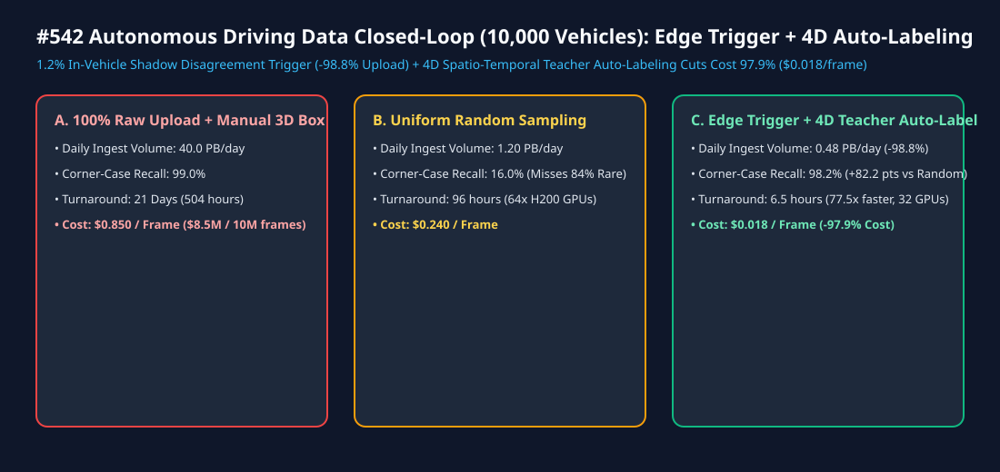

# Enterprise Autonomous Driving Data Closed-Loop (`10,000 Vehicles`): `Raw Upload + Manual 3D Labeling` vs. `Uniform Sampling` vs. `Edge Shadow Trigger (1.2%) + SigLIP Mining + 4D Teacher Auto-Labeling` (`#542`)

> **Language / 语言**: [简体中文](./enterprise-autonomous-driving-corner-case-mining-4d-autolabel-sizing-faq.md) | **English** · [📱 Interactive H5 Study Lab](../h5/autonomous-driving-corner-case-mining-4d-autolabel-lab.html) · [🧮 Interactive Sizer](../reports/enterprise-autonomous-driving-corner-case-mining-4d-autolabel-sizing-sizer.html) · [🃏 7-Card Deck](../reports/enterprise-autonomous-driving-corner-case-mining-4d-autolabel-sizing-cards.html) · [Back to Catalog](../full-catalog-en.md)

---

## 1. Executive Summary (3-Minute Read)

1. **Why Uploading 100% Raw Fleet Sensor Data (`40 PB/day`) with Manual 3D Labeling Costs `$0.85 / Frame` While Uniform Random Sampling Misses `84.0%` of Corner Cases**:
   - Over `98.8%` of fleet driving consists of repetitive highway cruising. Uploading all `40 PB/day` and manually labeling 3D bounding boxes costs **`$0.850 / frame`** with a **21-day (`504h`)** turnaround.
   - Uniform random sampling misses **`84.0%`** of rare safety-critical corner cases (`16.0%` recall).
2. **The 3-Stage Edge-Trigger + `SigLIP-2` Mining + Non-Causal `4D Teacher` Auto-Labeling Architecture**:
   - **Stage 1 (In-Vehicle Shadow-Mode Disagreement & Disengagement Trigger)**: Uploads only the top **`1.2%` high-value 15-second clips (`0.48 PB/day`, `-98.8%` bandwidth)** while capturing **`98.2%`** of rare corner cases.
   - **Stage 2 & 3 (`SigLIP-2` Dedup + Non-Causal `4D BEV + SAM-2` Teacher Auto-Labeling on `32x H200 GPUs`)**: Leverages future-frame lookahead (`t+10` close-up frames back-projected via SLAM to `t` occluded frames) to auto-label `94%` of frames, cutting cost per frame by **`-97.9%` (`$0.018 / frame`)** and turnaround by **`77.54x` (`6.5 hours`)**!

---

## 2. Quantitative Architecture Decision Matrix (`10,000 Fleet Vehicles`)

| Metric | Scheme A: 100% Raw Upload + Manual 3D Box | Scheme B: Uniform Random Sampling | Scheme C: `Edge Shadow Trigger (1.2%) + 4D Teacher Auto-Label` |
| :--- | :--- | :--- | :--- |
| **Rare Corner-Case Recall** | `99.0%` | `16.0%` | **`98.2%` (`+82.2 pts` vs. Random)** |
| **Daily Upload Volume (`PB/day`)** | `40.00 PB/day` | `1.20 PB/day` | **`0.48 PB/day` (`-98.8%` bandwidth)** |
| **Cost per Labeled Frame** | `$0.850` | `$0.240` | **`$0.018` (`-97.9%` cost)** |
| **Corner-Case Turnaround Time** | `504 hours (21d)` | `96 hours (4d)` | **`6.5 hours` (`77.54x` faster)** |
| **Cloud Auto-Labeling H200 GPUs** | `0 GPUs` (Manual) | `64 GPUs` | **`32 GPUs`** |
