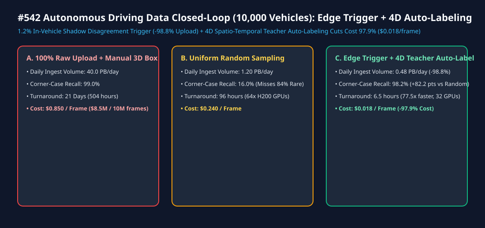
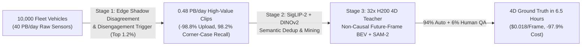

# 企业智能驾驶数据闭环（`10,000 台量产测试车 · 长尾 Corner-Case 挖掘与 4D 自动标注`）架构选型：全量回传人工标注 vs. 随机抽样 vs. `车端影子分歧触发 (1.2%) + 云端 SigLIP 向量挖掘 + 4D 时空大模型自动标注`（`#542`）

> **Language / 语言**: **简体中文** | [English](./enterprise-autonomous-driving-corner-case-mining-4d-autolabel-sizing-faq.en.md) · [📱 交互式 H5 精读页](../h5/autonomous-driving-corner-case-mining-4d-autolabel-lab.html) · [🧮 交互式算卡器 Sizer](../reports/enterprise-autonomous-driving-corner-case-mining-4d-autolabel-sizing-sizer.html) · [🃏 7-Card 评测报告](../reports/enterprise-autonomous-driving-corner-case-mining-4d-autolabel-sizing-cards.html) · [返回总目录](../full-catalog-zh.md)

---

## 一、3 分钟核心结论卡片（Executive Summary）

1. **核心矛盾：为什么 `10,000` 台智能驾驶车辆如果全量回传传感器原始数据（`4 TB/车/天`）会产生不可承受的 `40 PB/天` 存储洪峰且人工 3D 标注高达 `$0.85/帧`（周期 `21 天`），而均匀随机抽样又漏掉 `84.0%` 的极端长尾危险场景（Corner Cases）？**
   - 量产智驾车队行驶里程中 **`98.8%` 都是毫无训练价值的晴天高速跟车重复片段**。若全量落盘加人工拉 3D 点云包围盒（方案 A），日入湖容量高达 **`40.0 PB/天`**，标注 1,000 万帧需 **`$850 万`（`$0.85/帧`）** 且闭环迭代长达 **21 天（504 小时）**；
   - 若简单按时间均匀随机抽样 `3%` 回传（方案 B），则会漏掉 **`84.0%`** 的夜间暴雨逆行非机动车、异形施工锥桶、交警手势等低频高危长尾样本（召回率仅 `16.0%`）。
2. **三级车云协同数据闭环与 4D 自动标注黄金架构（`Stage 1: 车端 Orin 影子模式分歧与接管触发 [仅回传 1.2% 高价值切片，带宽降 98.8%] -> Stage 2: 云端 SigLIP/DINOv2 多模态向量语义检索去重 -> Stage 3: 非因果全序列 4D BEV + SAM-2 教师大模型自动标注 + 6% 高不确定性人工复核`）**：
   - **车端触发层（In-Vehicle Trigger）**：当驾驶员急刹接管（Disengagement）、感知模型帧间跳变（Temporal Flicker）或车端双模型影子模式预测轨迹分歧超阈值时，仅截取前后 `15 秒` 高清片段回传，日入湖量从 `40 PB` 骤降至 **`0.48 PB/天`（立降 `98.8%`）**，长尾高危场景召回率高达 **`98.2%`**；
   - **云端 4D 自动标注层（`32x H200`）**：利用云端不受实时延迟约束的优势，将一段 `15 秒` 的多相机视频与多帧激光雷达点云融合进 **非因果未来帧可见的 `4D Spatio-Temporal Teacher (BEVFormer-Large + SAM-2 + GroundingDINO)`**（当第 `t` 帧远端行人被遮挡时，云端教师模型可利用 `t+10` 帧近距离清晰观测反推第 `t` 帧真值！），自动完成 `94%` 样本的高精度 4D 标注，仅 `6%` 高熵样本送人工质检——单帧标注成本从 `$0.85` 暴降至 **`$0.018`（立省 `97.9%`）**，数据闭环耗时从 `21 天` 缩短至 **`6.5 小时`（提速 `77.54x`）**！

---

## 二、典型业务场景与灵魂拷问 Q&A

### Q1：为什么云端 4D 自动标注教师大模型（Offboard 4D Teacher）能标出车端实时感知模型看不清的远距离遮挡目标？
- **答**：车端在线推理受限于 **因果律（Causality）与算力（`< 50ms`）**：在第 `t` 秒相距 120 米处只有一个模糊的 5 像素黑影，车端模型无法预知未来。而云端离线自动标注拥有 **“上帝后视镜（Non-Causal Future Lookahead）”**：当车辆在 `t + 3 秒` 驶近该物体至 20 米处时，激光雷达与高清相机已能 `100%` 确认那是一个倒地的交通路牌，云端 4D 时空重建算法通过高精度 SLAM 位姿直接将该路牌的 3D 真值逆向投影回 `t` 秒的远距离图像上，自动生成超越人类肉眼标注精度的远距真值！

### Q2：如何在 PB 级历史切片库中，用自然语言在 2 秒内找出“雨夜隧道出口处压线的白色水泥罐车”？
- **答**：片段入湖时由 `SigLIP-2 + VLM` 提取关键帧跨模态向量与天气/道路/障碍物标签写入 `Milvus / LanceDB`。算法工程师只需输入一句自然语言描述或一张示例图，即可秒级跨亿级帧检索召回同分布训练样本，针对性修复特定 Badcase。

---

## 三、三大智能驾驶数据闭环与标注架构定量对比矩阵

| 评估维度 | 方案 A：全量原始回传 + 纯人工 3D 点云标注 | 方案 B：均匀随机抽样 + 2D/3D 半自动标注 | 方案 C：`车端影子触发 (1.2%) + SigLIP 挖掘 + 4D 教师自动标注`（推荐） |
| :--- | :--- | :--- | :--- |
| **长尾高危 Corner-Case 召回率** | `99.0%` | `16.0%`（漏掉 `84%` 低频极端风险） | **`98.2%`（比随机抽样提升 `+82.2 pts`）** |
| **车队日均入湖带宽与存储 (`PB/天`)** | `40.00 PB / 天` | `1.20 PB / 天` | **`0.48 PB / 天`（存储与流量立降 `98.8%`）** |
| **单帧 4D 真值综合标注成本** | `$0.850 / 帧` | `$0.240 / 帧` | **`$0.018 / 帧`（成本暴降 `97.9%`）** |
| **Badcase 发现到真值产出周期** | `504 小时（21 天）` | `96 小时（4 天）` | **`6.5 小时`（提速 `77.54x`）** |
| **云端自动标注集群规模** | `0 张`（全靠数千名标注员） | `64 张 H200` | **`32 张 H200`（高纯度触发免算无用帧）** |

---

## 四、生产落地核对清单（Pre-Production Checklist）

- [ ] **车端配置多级动态触发器（接管事件 + 轨迹预测分歧 + 感知帧间闪烁 + 云端下发文本 Embedding 搜车端）**，严禁无差别回传正常高速巡航数据。
- [ ] **入湖前在边缘/前置机强制执行车牌与人脸模糊脱敏（测绘与隐私合规）**。
- [ ] **云端 4D 自动标注必须融合前向+后向全时序点云拼接（4D Occupancy / 3DGS 重建）**，利用近处清晰帧反推远处遮挡帧真值。
