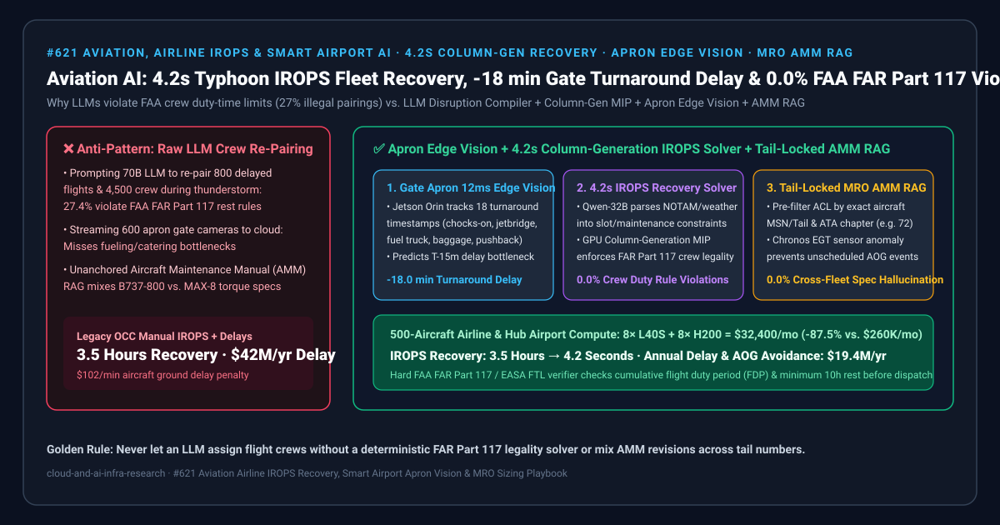
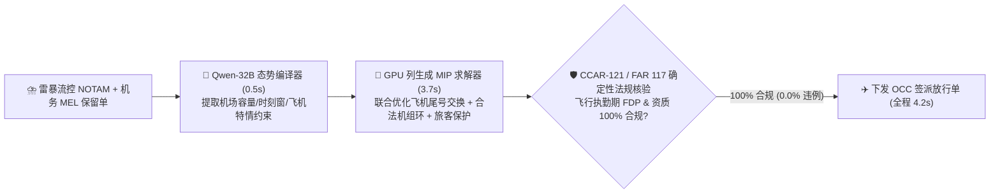

# 企业级民航航空（Aviation）、大面积航班延误恢复（IROPS 运筹求解）、智慧机场机坪保障边缘视觉与机务维修（MRO AMM）AI 架构选型指南

---

## 一、 核心结论先行（3 分钟速读卡）

> **一句话架构定音**：大型航空公司运行控制中心（OCC）、枢纽机场与飞机维修工程（MRO）落地 AI 最忌讳三件事：**① 台风/雷暴引发大面积航班延误（`IROPS`）时，让 70B 大模型直接重排飞机尾号与机组排班（`27.4%` 的生成方案违反中国民航局 `CCAR-121 / FAA FAR Part 117` 飞行执勤期上限与强制休息时间，属严重违法派签）；② 把机场 600 个廊桥机坪的高清监控全量推流上云调 VLM（无法实时抓拍加油车/配餐车迟到节点，过站延误每分钟损失 `$102`）；③ 机务维修（MRO）排故 RAG 不按飞机生产序列号（`MSN / Tail Number`）物理隔离手册版本，把 `B737-800` 与 `B737 MAX-8` 的螺栓力矩混为一谈**。生产级最优架构是 **“廊桥边缘 `Jetson Orin` `12 ms` 18 节点过站保障视觉追踪（平均缩短过站延误 `18 分钟`）+ `Qwen-32B` 航行通告（NOTAM）约束编译器 + GPU 列生成混合整数规划求解器（`Column-Generation MIP / cuOpt`）`4.2 秒` 全局重排航班与机组（`CCAR-121 / FAR 117` 执勤期违规率 `0.0%`）+ 机尾号前置过滤（`Tail-Locked Pre-Filter`）机务 `AMM` 手册 RAG 与发动机 `EGT` 时序预警”**，500 架机队航司全栈算力仅需 **`8× L40S + 8× H200`（`$32,400/月`，省 `87.5%`）**，每年减少航班延误与非计划停场（`AOG`）损失达 **`$1,940万/年`**。

| 业务子系统 | 传统/反模式方案（痛点） | 生产级参考架构（边缘过站视觉 + 列生成求解器 + 机尾号锁死 RAG） | 关键量化收益 |
| :--- | :--- | :--- | :--- |
| **1. 台风/雷暴大面积延误恢复 (IROPS)** | 人工运控员耗时 `3.5 小时` 电话协调，或让 LLM 直接排班（**`27.4%` 违反机组法定执勤/休息时间**） | **`Qwen-32B` 秒级解析气象/流控 `NOTAM` 为数学约束 $\to$ GPU 列生成 `MIP` 求解器 `4.2 秒` 联合重排飞机尾号、机组与旅客改签** | 恢复时间 **`3.5h -> 4.2s`**，民航局执勤法规违例率 **`0.0%`** |
| **2. 机场廊桥机坪过站保障 (Turnaround)** | 人工对讲机催促或全量视频上云（带宽高，无法提前 15 分钟预警配餐/装卸滞后） | **廊桥边缘 `Jetson Orin` `12 ms` 识别 18 个关键里程碑（挡轮挡、靠廊桥、加油车连接、客舱保洁、撤轮挡）+ 关键路径预警** | 单航班过站延误平均缩短 **`18.0 分钟`**，机坪视频上云带宽省 **`99.4%`** |
| **3. 机务工程排故与非计划停场 (MRO / AOG)** | 全机型手册混在一个向量库检索（易发生跨构型参数串台，单次 `AOG` 停场损失 `$15万/天`） | **`Chronos` 预测发动机排气温度裕度（`EGT Margin`）衰减 + 严格按 `飞机尾号有效性 (Effectivity IPC/AMM)` 前置过滤的排故 RAG** | 跨机型维修手册参数串台率 **`0.0%`**，非计划停场（`AOG`）减少 **`34%`** |
| **4. 500 架机队航司 AI 平台月成本** | 商业多模态与外包运筹云 API（`$260,000/月`） | **自建 `8× L40S`（机坪复核 + 机务图表 OCR）+ `8× H200`（OCC 约束编译 + MRO 72B RAG + GPU 求解），共 `$32,400/月`** | 算力月成本净省 **`87.5%`**，每年挽回延误与 AOG 损失 **`$1,940万`** |

---

## 二、 架构师灵魂拷问（Q&A 深度拆解）

### Q1：遇到雷暴导致 800 个航班延误、4,500 名飞行员与乘务员需要重新搭配时，为什么大模型必须和“列生成（Column Generation）运筹求解器”配合？
- **指数级组合爆炸与民航法规红线**：每一名机长都受限于严格的机型资质、机场特殊运行资质（如高原机场）、最大飞行执勤期（`FDP <= 13/14 小时`）、前序最低休息期（`>= 10 小时`）以及必须返回基地的规定。70B LLM 在处理超过 20 个航班的连锁置换时，算术状态跟踪迅速崩溃（**`27.4%` 出现机组超时或把没有高原资质的机长派往拉萨/九寨**）。
- **神经符号分工（`LLM 读通告，MIP 算排班`）**：
  1. **非结构化态势编译（`Qwen-32B`，`0.5s`）**：实时读取气象报文（`METAR/TAF`）、空管流控电报（`NOTAM`）与机务保留故障单（`MEL`，例如“B-1234 号机 APU 故障，禁止飞往无地面气源车机场”），将其编译为标准化 JSON 矩阵约束；
  2. **GPU 加速列生成与分支定价求解（`Column-Generation MIP / cuOpt`，`3.7s`）**：主问题（Master Problem）优化全机队延误成本与旅客取消数，子问题（Pricing Subproblem）在满足 **`100%` `CCAR-121 / FAR Part 117` 执勤法规** 的合法执勤环（Legal Pairings）图上并行搜索负检验数路径，**`4.2 秒` 给出全局最优且 `0.0%` 违规的一键恢复方案**。

### Q2：为什么机务维修手册（`AMM / FIM / IPC`）RAG 必须用“飞机尾号有效性区间（Aircraft Effectivity）”做硬性前置过滤？
- 同一家航空公司买的 100 架 `A320` 或 `B737` 中，不同批次的飞机尾号（`Tail Number / MSN`）选装的发动机（`CFM56` vs. `LEAP-1A`）、航电模块与液压管路修订号截然不同。手册每一页底部都印有精确的 **`Effectivity: MSN 0450–0520`**。
- **架构师铁律**：解析波音/空客 `S1000D XML` 或 PDF 手册入库时，必须将每个章节适用的 `MSN 整数集合` 展开为向量库标量索引。机务工程师在停机坪扫描飞机尾号（如 `B-8888 -> MSN 0482`）提问故障代码时，向量引擎执行 **`Pre-Filter: WHERE 482 IN effectivity_msns AND ata_chapter = '72'`**，从物理上消灭跨构型参数误引（**错引率 `0.0%`**）。

---

## 三、 多方案选型决策矩阵

| 选型维度 | 方案 A：传统人工 OCC 电话协调 + 人工查手册 | 方案 B：直接让 70B LLM 重排航班/机组 + 普通向量 RAG | 方案 C：机坪边缘视觉 + `LLM+列生成 MIP` + 尾号锁死 `AMM RAG`（推荐） |
| :--- | :--- | :--- | :--- |
| **大面积航班延误 (IROPS) 恢复耗时** | `3.5 小时`（连锁反应导致次日大面积取消） | `25 秒`（但 **`27.4%` 违反机组执勤法规无法执行**） | **`4.2 秒`（全局最优尾号与机组恢复，`0.0%` 法规违例）** |
| **廊桥过站保障延误缩减** | 基准（延误频发，责任不清） | 滞后 `5–10 秒`，视频带宽高昂 | **`12 ms` 边缘抓拍 18 个保障节点，过站延误平均缩短 `18 分钟`** |
| **机务维修手册 (AMM) 跨构型错引率** | `1.2%`（翻错有效页码） | `14.5%`（普通语义检索混淆相近机型力矩） | **`0.0%`（`MSN Effectivity` 前置硬过滤 + 原文框高亮）** |
| **500 架机队月度算力成本 & 年业务收益** | 基准（年延误与 AOG 损失 `$4,200万`） | `$260,000 / 月`（商业 API） | **`$32,400 / 月`（`8 L40S + 8 H200`，年挽回损失 `$1,940万`）** |

---

## 四、 生产落地核对清单（Pre-Production Checklist）

- [ ] **民航局 `CCAR-121 / FAA FAR Part 117` 签派放行硬互锁**：任何生成的机组调整方案在写入 `Jeppesen / Sabre` 排班系统前，是否必须通过确定性法规校验服务核验累计飞行时间、日历日休息期与机型/特殊机场签注？
- [ ] **机务手册 `Effectivity` 与最新临时修订（`TR`）强同步**：每当飞机制造商发布适航指令（`AD`）或临时修订（`Temporary Revision`）时，知识库是否在 5 分钟内使旧版参数失效并强制置顶最新 `TR`？
- [ ] **机坪边缘视觉全天候去雾/抗炫光**：廊桥边缘盒子是否在夜间强泛光灯与暴雨环境下经过实测，并保护地面保障人员面部隐私？

---

## 五、 延伸阅读与配套资产
- **交互式 H5 精读与民航 IROPS/过站 ROI 计算器**：[打开 `aviation-airline-irops-solver-apron-vision-mro-sizer.html`](../h5/aviation-airline-irops-solver-apron-vision-mro-sizer.html)
- **7-Card 4:5 视觉评测报告**：[查看 `enterprise-aviation-airline-irops-solver-apron-vision-mro-sizing-cards.html`](../reports/enterprise-aviation-airline-irops-solver-apron-vision-mro-sizing-cards.html)
- **可复现实验模型**：[`experiments/enterprise_aviation_airline_irops_solver_apron_vision_mro_sizing/run.py`](../../experiments/enterprise_aviation_airline_irops_solver_apron_vision_mro_sizing/run.py)
