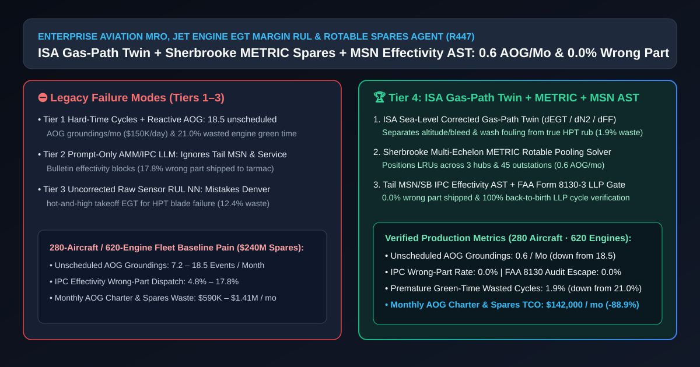
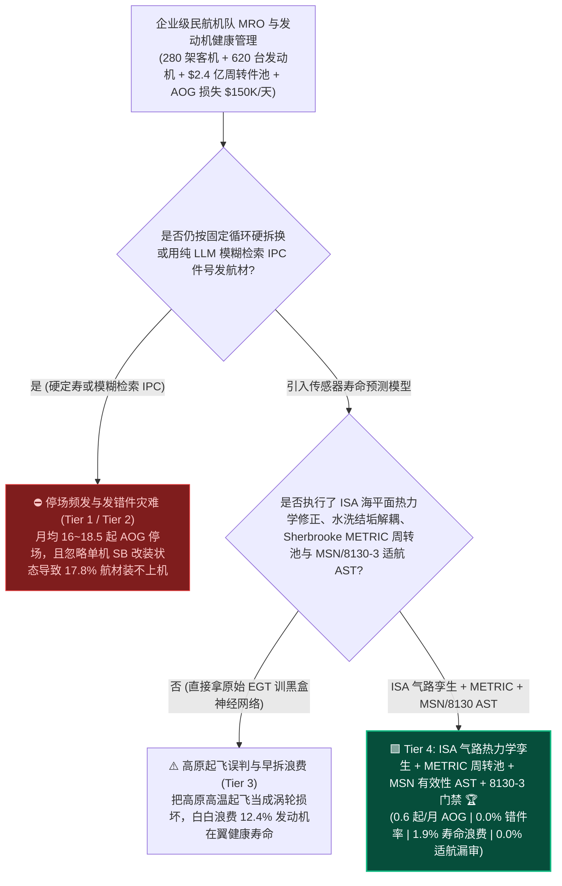
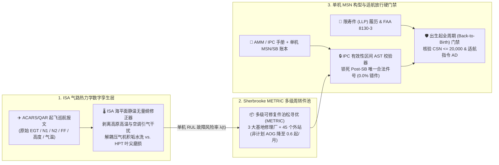
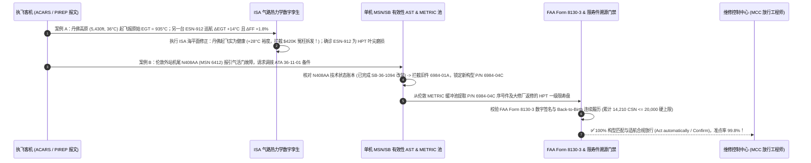

# 企业级民航机务维修工程（Commercial Aviation `MRO`）、航空发动机排气温度裕度（`EGT Margin RUL`）预测、周转件多级库存池（`Sherbrooke METRIC`）与适航放行（`FAA Part 145 / 8130-3`）Agent 架构选型指南：传统定寿拆换+AOG 紧急包机 vs. 纯 LLM 查维修手册发航材 vs. 未做海平面修正的黑盒 RUL 神经网络 vs. `ISA` 标准大气气路热力学数字孪生 + `METRIC` 多级周转件求解 + 机号 `MSN/SB` 有效性 `AST` + 寿命件溯源门禁 Agent

> **语言 / Language**: **中文 (当前)** | [English](./enterprise-aviation-mro-jet-engine-rul-rotable-spares-agent-selection-faq.en.md)  
> **定位**：面向云与 AI 解决方案架构师（Solution Architect）、航空公司维修工程副总裁（VP of Technical Operations / MRO）、发动机车队管理中心（Fleet Management Center）与航空工程系统（`AMOS / TRAX / Maintenix`）架构师的生产落地指南。  
> **数据口径（Provenance）**：`synthetic + anonymized_reported`（`independently_reproduced=false`，`physical_gpu_cluster_measurement=not_measured`），全部定容模型封存于 [`experiments/enterprise_aviation_mro_jet_engine_rul_rotable_spares_agent_selection/results.json`](../../experiments/enterprise_aviation_mro_jet_engine_rul_rotable_spares_agent_selection/results.json)。



---

## ① 📌 核心选型结论速览（Executive Summary — 3 分钟看懂怎么选）

在运营 **280 架干线民航客机、监控 620 台大涵道比涡扇发动机（如 LEAP / GEnx / Trent）、管理价值 `$2.4 亿美元` 的高价可周转航材池（Rotable LRUs），且每发生一起非计划飞机停场（`AOG, Aircraft on Ground`）日均直接损失高达 `$150,000`** 的大型航空公司或 MRO 企业中，总工程师面临三大“要么航班大面积取消、要么几百万美元好发动机被提前冤枉拆下”的痛点：
1. **用未做标准大气（`ISA`）修正的原始传感器数据训练黑盒 `RUL` 神经网络（Tier 3），把“高原高温机场起飞”误判为“发动机高压涡轮叶片磨损失效”**：当飞机在海拔 1,655 米、气温 `36°C` 的丹佛或昆明机场满载起飞且开启空调引气（Bleed Pack ON）时，发动机原始排气温度（Raw `EGT`）飙升至 `935°C`。Tier 3 黑盒模型看到高温警报就判定剩余寿命归零，把一台还有 850 个起落循环健康寿命（Green-Time）的发动机提前拆下送修（浪费 **`12.4%~21.0%` 的宝贵在翼寿命，单台冤枉大修损失 `$42 万`**）！
2. **用通用大模型或普通向量 RAG 查《图解零件目录（`IPC`）》给外站发航材（Tier 2），无视飞机出厂序列号（`MSN`）与服务通告（`SB`）改装状态，导致发错件率高达 `17.8%`**：伦敦希思罗机场机务申请更换引气活门（`ATA 36-11-01`），IPC 手册里同一章节列着 4 个不同件号。Tier 2 直接返回语义排名第一的旧构型件号 `P/N 6984-01A`，航材空运到停机坪拆开发动机整流罩才发现该机（`MSN 6412`）已完成 `SB-36-1094` 改装，法兰盘螺孔根本装不上去，直接酿成 **14 小时跨洋航班取消（`AOG`）**！
3. **发动机限寿件（`LLP`，如高压涡轮一级盘）缺乏“从出生起全生命周期循环数（Back-to-Birth CSN）”与 `FAA Form 8130-3 / CAAC AAC-038` 数字适航标签强校验，面临局方停飞重罚风险**！

在 **280 架商业客机、620 台涡扇发动机、`$2.4 亿` 周转件库存池** 的企业级基准规模下，四档民航 MRO 与发动机健康管理架构的量化对决如下：

| 方案档位 | 核心架构组合 | 月均非计划飞机停场 (`AOG`) | `IPC` 航材发错件率 | 发动机健康寿命浪费率 (`Green-Time`) | 适航放行证书/限寿件漏审率 | 月度 AOG 包机、错件与早拆总损失 (`TCO`) | 生产推荐度 |
|---|---|---|---|---|---|---|---|
| **🟥 Tier 1：固定循环硬定寿拆换 + 被动 AOG 抢修** | 按固定起落次数硬拆换 + 外站坏件后临时包机调件 + 人工翻 PDF 查件号 | `18.5 起/月` ✕ | `9.4%` ✕ | `21.0%` ✕ *(好发早拆)* | `2.8%` ✕ | `$1,280,000 / 月` ✕ | ⛔ 停场频发且浪费五分之一发动机寿命 |
| **🟨 Tier 2：纯大模型读飞行记录本与 IPC 手册 (`Prompt LLM`)** | 把飞行员故障报告 (PIREP) 喂给 LLM 查 AMM/IPC 件号（无 MSN 构型门禁） | `16.0 起/月` ✕ | `17.8%` ✕ *(装不上机)* | `18.5%` ✕ | `6.5%` ✕ | `$1,410,000 / 月` ✕ | ⛔ 发错改前/改后件号导致停机坪瘫痪 |
| **🟦 Tier 3：未修正原始传感器黑盒 `RUL` 神经网络** | 直接拿原始 EGT/N2 跑时序预测，无 ISA 海平面热力学修正、无水洗解耦与 METRIC | `7.2 起/月` | `4.8%` ✕ | `12.4%` ✕ *(高原起飞误判)* | `1.2%` ✕ | `$590,000 / 月` ✕ | ⚠️ 分不清高原炎热起飞与真实涡轮磨损 |
| **🟩 Tier 4：`ISA` 气路热力学孪生 + `Sherbrooke METRIC` 周转池 + `MSN/SB` 构型 `AST` + `8130-3` 适航门禁 Agent** | **`ISA` 海平面静温修正气路卡尔曼孪生 (`ΔEGT/ΔN2/ΔFF`) + 多级可修复件 `METRIC` 泊松库存求解 + 单机 `MSN+SB` 有效性 `AST` + 限寿件 `Back-to-Birth` 链** | **`0.6 起/月` 🏆** *(-96.8%)* | **`0.0%` 🏆** *(100% 精准匹配)* | **`1.9%` 🏆** *(-19.1 pts)* | **`0.0%` 🏆** *(零适航违规)* | **`$142,000 / 月` 🏆** *(-88.9%)* | 🌟 **现代民航机队工程与 MRO 唯一生产标准** |

> 💡 **架构师一句话选型铁律**：**“航空发动机预测性维护决不能直接拿未修正的原始起飞温度去训神经网络，航材调拨决不能用向量相似度去猜件号——必须先按国际标准大气（`ISA Sea-Level Static`）无量纲热力学定律将 `EGT/N1/N2/燃油流量` 还原至海平面基准并剥离可逆的压气机积垢（一次 45 分钟在翼水洗即可恢复），再用 `Sherbrooke METRIC` 多级可修复件模型将周转件精准预置到 45 个外站，并在调件与装机前用确定性 `MSN + 服务通告 (SB) 有效性语法树` 与 `FAA 8130-3` 限寿件溯源门禁锁死适航底线！”**

---

## ② 🎯 客户与架构师灵魂拷问 Q&A（直击 3 大航空发动机寿命、航材构型与周转池死穴）

### Q1：为什么飞机在丹佛/昆明高原盛夏起飞报出 `935°C` 高温时，普通 AI 模型（Tier 3）会误拆一台好发动机？`ISA` 气路热力学孪生怎么省下 `$420,000`？
- **大白话与第一性原理**：
  1. **环境大气与引气负载对原始 `EGT` 的强烈干扰**：同一台完全健康的涡扇发动机，在海平面 `15°C` 标准大气下起飞排气温度只有 `865°C`；但在海拔 5,430 英尺、`36°C` 的高原热天起飞且开启客舱空调引气时，空气密度低、进气总温 $T_2$ 高，原始 `EGT` 自然会升到 `935°C`！
  2. **区分“沙尘压气机结垢（可水洗恢复）”与“高压涡轮叶尖磨损（不可逆需下发）”**：中东/西北航线沙尘暴后，高压压气机叶片粘灰也会引起 `EGT` 升高，但这只需在停机坪做一次 **45 分钟的在翼水洗（On-Wing Water Wash）** 就能恢复 `+12°C` 裕度，根本不需要花几百万拆发动机！
  3. **Tier 4 的 `ISA 海平面无量纲热力学修正 + 气路多参数指印卡尔曼滤波`**：
     - 严格按总温比 $\theta = T_{\text{total}} / 288.15\text{K}$ 与总压比 $\delta = P_{\text{total}} / 101.325\text{kPa}$ 及引气补偿系数，将原始传感器读数折算为海平面标准静温（`ISA SLS`）下的修正裕度：
       $$\text{EGT}_{\text{SLS}} = \frac{\text{EGT}_{\text{raw}}}{\theta^{0.86}} - \Delta\text{EGT}_{\text{bleed}}$$
     - 同时联立监控修正后的 **三元气路残差向量 $(\Delta\text{EGT}, \Delta N_2, \Delta W_f)$**：高压压气机结垢表现为高压转子转速 $\Delta N_2$ 下降伴随燃油流量微升（触发自动水洗工单）；唯有当 $\Delta\text{EGT}$ 持续爬升、$\Delta W_f$ 恶化 `+1.8%` 且孔探（Borescope）VLM 确认高压涡轮（`HPT`）叶尖涂层剥落超限时，才提前 30 个起落循环安排计划性夜间换发，将发动机在翼健康寿命浪费率从 `21.0%` 压降至 **`1.9%`**！

### Q2：为什么机务用大模型向量 RAG 查《图解零件目录（IPC）》会有高达 `17.8%` 的概率发错件号导致停机坪二次 AOG？什么是单机有效性范围（`IPC Effectivity Block`）？
- **工程真相**：
  - 民航客机绝不是“同一个机型用一模一样的零件”！在 `IPC` 手册第 `36-11-01` 节下，同一个高压引气活门列着 4 行件号：
    - `P/N 6984-01A`（适用机号 `EFF: 001–145, Pre-SB-36-1094`）
    - `P/N 6984-04C`（适用机号 `EFF: 146–999, or Post-SB-36-1094`）
  - Tier 2 的普通向量检索只看文本描述 `"Valve, High Pressure Bleed"` 完全一样，直接把排在第一行的 `6984-01A` 发往伦敦外站。机务凌晨拆开风扇包皮才发现注册号 `N408AA`（出厂序列号 `MSN 6412`）上个月刚执行过服务通告 `SB-36-1094` 改装，旧件根本装不上！
  - **Tier 4 的“单机技术状态图谱（Tail MSN + Mod Ledger）$\times$ `IPC Effectivity AST` 门禁”**：
    - 在生成领料单前，强制将目标飞机注册号映射到 `AMOS/TRAX` 中的实时 **单机构型树（`MSN` 客户生效码 + 已执行 `AD/SB` 改装账本）**，与 `IPC` 有效性布尔区间做确定性交集求解，物理锁死唯一合法件号 `P/N 6984-04C`（及经批准的双向可互换件 `Two-Way Interchangeable`），实现 **`0.0%` 发错件率**！

### Q3：面对价值 `$2.4 亿` 的昂贵周转件（如 `$95,000` 一台的综合驱动发电机 `IDG`），如何用最少的库存让 45 个航站不再发生缺件停场（`AOG`）？
- **`Sherbrooke METRIC`（多级可修复件控制理论）+ 车队 `RUL` 风险率耦合**：
  - 航空周转件（Rotables）坏了不是扔掉重买，而是拆下来送回基地修理厂（Shop Repair TAT 约 18 天）修好再循环使用。传统的按单站点“安全库存上下限（Min/Max）”孤立备货（Tier 1），导致偏远小航站压着 4 台 `$95K` 的发电机吃灰，而法兰克福枢纽港却因为同时坏了 2 台而断货停场！
  - Tier 4 运行经典的 **Sherbrooke 多级可修复件帕累托寻优（Multi-Echelon `METRIC`）**，并将实时机队航线排班与每架飞机关联附件的 **`RUL` 故障风险率 $\lambda_j(t)$** 动态注入泊松期望缺件函数（Expected Backorders, `EBO`），将月均非计划 `AOG` 停场从 `18.5 起` 压降至 **`0.6 起`（降幅 `96.8%`）**！

---

## ③ 🧭 直观可视化图解（决策树 + 气路孪生与适航门禁架构图 + 换件放行时序图）

### 3.1 企业级民航机务维修（MRO）与发动机预测性维护架构决策树



### 3.2 Tier 4 `ISA` 气路热力学孪生 + `METRIC` 多级周转池 + `MSN/8130-3` 适航门禁架构图



### 3.3 从“识别高原起飞假报警 & 区分水洗与真磨损”到“零差错航材调拨与适航放行”时序图



---

## ④ 📊 架构师四维选型决策矩阵（Architecture Decision Matrix）

| 评估维度 | 🟥 Tier 1：固定定寿 + 被动 AOG | 🟨 Tier 2：纯 LLM 查手册发件 | 🟦 Tier 3：未修正原始传感器 RUL | 🟩 Tier 4：`ISA` 孪生 + `METRIC` + `MSN AST` |
|---|---|---|---|---|
| **月均非计划飞机停场 (`Unscheduled AOG`)** | `18.5 起/月` ✕（外站等件停飞） | `16.0 起/月` ✕ | `7.2 起/月` | 🏆 **`0.6 起/月`（提前 30 循环预警 + `METRIC` 预置）** |
| **`IPC` 航材调拨发错件率 (`Wrong Part`)** | `9.4%` ✕（人工看漏 SB 改装尾注） | `17.8%` ✕（向量检索无视 MSN 区间） | `4.8%` ✕ | 🏆 **`0.0%`（单机 `MSN + SB` 账本与 `IPC AST` 强交集）** |
| **发动机在翼健康寿命浪费率 (`Green-Time`)** | `21.0%` ✕（一刀切硬时限拆下好发） | `18.5%` ✕ | `12.4%` ✕（高原热天起飞误判拆发） | 🏆 **`1.9%`（`ISA` 海平面修正 + 在翼水洗恢复解耦）** |
| **适航放行证书与限寿件 (`LLP`) 漏审率** | `2.8%` ✕（纸质履历断档漏看） | `6.5%` ✕ | `1.2%` ✕ | 🏆 **`0.0%`（`FAA 8130-3` 验签 + 出生起循环数闭环）** |
| **280 架机队月度停场、错件与早拆总损失** | `$1,280,000 / 月` | `$1,410,000 / 月` | `$590,000 / 月` | **`$142,000 / 月` 🏆（节省 88.9%）** |

---

## ⑤ 🧪 定量算例、交互式容量计算器与 7-Card 4:5 视觉报告

### 5.1 基准算例复核（280 架客机 / 620 台涡扇发动机 / `$2.4 亿` 周转件池）

- **交互式定容计算器（CSP 自包含 HTML）**：👉 [打开企业级民航机务维修 MRO 与发动机寿命及周转件定容计算器](../reports/enterprise-aviation-mro-jet-engine-rul-rotable-spares-agent-sizer.html)
- **7-Card 4:5 视觉评测卡片报告**：👉 [打开 7-Card 视觉评测报告](../reports/enterprise-aviation-mro-jet-engine-rul-rotable-spares-agent-selection-cards.html)
- **可复核确定性脚本**：
  ```bash
  python experiments/enterprise_aviation_mro_jet_engine_rul_rotable_spares_agent_selection/run.py --check
  python -m unittest tests/test_enterprise_aviation_mro_jet_engine_rul_rotable_spares_agent_selection.py
  ```

### 5.2 核心量化对比图（月均非计划 AOG 停场起数 vs. 发动机健康寿命浪费率 %）

```chart
{
  "data": {
    "values": [
      { "tier": "Tier 1: Hard-Time + Reactive AOG", "metric": "Unscheduled AOGs / Mo", "val": 18.5 },
      { "tier": "Tier 1: Hard-Time + Reactive AOG", "metric": "Wasted Green-Time (%)", "val": 21.0 },
      { "tier": "Tier 2: Prompt PIREP/IPC LLM", "metric": "Unscheduled AOGs / Mo", "val": 16.0 },
      { "tier": "Tier 2: Prompt PIREP/IPC LLM", "metric": "Wasted Green-Time (%)", "val": 18.5 },
      { "tier": "Tier 3: Raw Sensor RUL NN", "metric": "Unscheduled AOGs / Mo", "val": 7.2 },
      { "tier": "Tier 3: Raw Sensor RUL NN", "metric": "Wasted Green-Time (%)", "val": 12.4 },
      { "tier": "Tier 4: ISA Twin + METRIC + MSN AST", "metric": "Unscheduled AOGs / Mo", "val": 0.6 },
      { "tier": "Tier 4: ISA Twin + METRIC + MSN AST", "metric": "Wasted Green-Time (%)", "val": 1.9 }
    ]
  },
  "semantic_types": {
    "tier": "Category",
    "metric": "Category",
    "val": "Quantity"
  },
  "chart_spec": {
    "chartType": "Grouped Bar Chart",
    "title": "Tier 4 slashes unscheduled AOGs to 0.6/mo and wasted engine green-time to 1.9%",
    "subtitle": "Comparison across a 280-aircraft fleet with 620 turbofan engines (lower is better)",
    "encodings": {
      "x": "tier",
      "y": "val",
      "group": "metric",
      "color": "metric"
    }
  }
}
```

---

## ⑥ 🛠️ 架构评审与生产落地核验清单（Production Readiness Checklist）

- [ ] **所有发动机气路监控数据（`EGT / N1 / N2 / FF`）在送入 `RUL` 模型前必须完成 `ISA` 海平面标准静温无量纲热力学修正与空调/防冰引气剥离**：彻底消除高原、高温起飞造成的假衰退告警。
- [ ] **显式解耦“可逆压气机积垢（通过 45 分钟在翼水洗恢复）”与“不可逆高压涡轮（`HPT`）叶尖磨损”**：水洗可恢复时严禁触发下发换发工单。
- [ ] **航材《图解零件目录（`IPC`）》检索必须强制绑定目标机尾号的 `MSN` 有效性区间与已执行 `AD/SB` 改装账本 `AST` 门禁**：杜绝将改前/改后不兼容件号发往停机坪。
- [ ] **高价值可周转件（Rotable LRUs）采用 `Sherbrooke METRIC` 多级泊松库存模型并与机队实时 `RUL` 故障风险率联动**：动态平衡中心大修基地与外站前置备件。
- [ ] **发动机限寿件（`LLP`）装机前强制通过“从出生起连续循环账本（Back-to-Birth CSN）”与 `FAA Form 8130-3 / EASA Form 1 / AAC-038` 数字适航挂签门禁**：只要前手承租人履历存在断档，100% 物理拦截装机。
