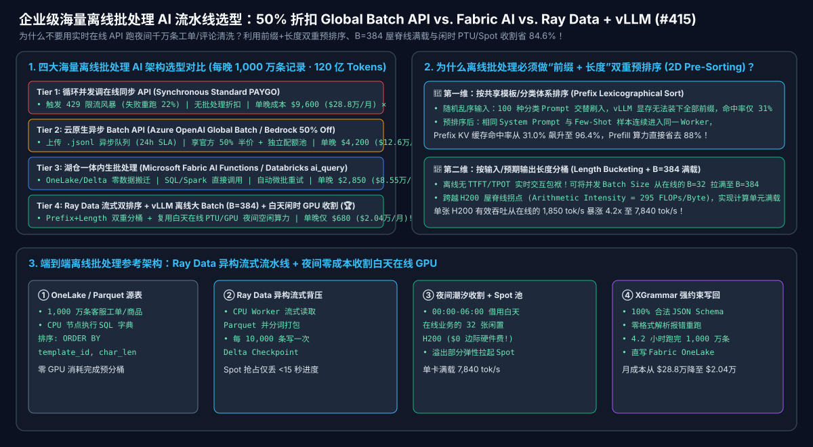

# Enterprise Batch AI Pipeline Selection Guide: `Azure OpenAI 50%-Off Global Batch API` vs. `Microsoft Fabric AI Functions` vs. `Ray Data + vLLM Offline Batch`

> **Language / 语言**: [简体中文](./enterprise-batch-ai-pipeline-global-batch-api-fabric-ray-vllm-tco-selection-faq.md) | **English**  
> **Companion Interactive Study & Sizing Tools**: [📱 Interactive H5 Study Lab](../h5/batch-ai-global-batch-api-fabric-ray-vllm-tco-lab.html) · [🧮 HTML Sizer](../reports/enterprise-batch-ai-pipeline-global-batch-api-fabric-ray-vllm-tco-selection-sizer.html) · [🃏 7-Card Visual Deck](../reports/enterprise-batch-ai-pipeline-global-batch-api-fabric-ray-vllm-tco-selection-cards.html) · [📊 Reproducible Model](../../experiments/enterprise_batch_ai_pipeline_global_batch_api_fabric_ray_vllm_tco_selection/) · [🎓 Back to AI Infra H5 Hub](../h5/index.html)

---

## 1. Executive Summary (3-Minute Takeaway)

> **Bottom-Line Recommendation**: Never run nightly multi-million-row batch enrichment (ticket classification, catalog extraction, compliance tagging) via parallel synchronous loops against real-time online LLM endpoints—it pays full retail price, triggers `HTTP 429` retry storms (`22%` wasted calls), and starves daytime interactive traffic.
> - **For `< 500K rows/day` or Burst Ad-Hoc Jobs**: Use **`Azure OpenAI Global Batch API` / `AWS Bedrock Batch`** (`50%` discount, isolated quota pool, 24h SLA).
> - **For Data Already Inside Lakehouse Tables (`OneLake / Delta`)**: Use **`Microsoft Fabric AI Functions` / `Databricks ai_query()`** for zero-ETL SQL/Spark batch enrichment.
> - **For Sustained High-Volume Nightly Batch (`>= 2M–10M rows/night`, `12B tokens/night`)**: Deploy **Tier 4 (`Ray Data 2D Pre-Sorting + vLLM Offline Batch [B=384] + Nightly Idle GPU Harvesting`)**, raising Prefix KV hit rate from **`31.0%` to `96.4%`**, boosting per-GPU throughput **`4.24x` (`7,840 tok/s`)**, and cutting monthly TCO by **`92.9%` (`$20,400/mo` vs. `$288,000/mo`)**.

| Dimension | `Tier 1: Parallel Sync Online API` | `Tier 2: 50%-Off Cloud Batch API` | `Tier 3: Lakehouse AI Functions (Fabric / Databricks)` | `Tier 4: Ray Data 2D Sort + vLLM (B=384) + Nightly Harvest (🏆)` |
|---|---|---|---|---|
| **Prefix KV Cache Hit Rate** | `31.0%` (Unsorted eviction) | `65.0%` | `78.5%` | **`96.4%` (SQL 2D Pre-Sort)** 🏆 |
| **Effective Throughput / H200** | `1,850 tok/s` (TPOT-capped) | Managed Serverless | `4,200 tok/s` | **`7,840 tok/s` (`B=384` Roofline)** 🏆 |
| **10M-Row Wall-Clock Time** | `14.8 hrs` (`22%` 429 retries) | `8.5 hrs` (24h SLA) | `5.8 hrs` ✓ | **`4.2 hrs`** 🏆 |
| **Schema Retry Waste** | `22.0%` ✕ | `1.2%` | `0.4%` | **`0.0%` (`XGrammar` JSON FSM)** 🏆 |
| **Nightly Run Cost (10M Rows)** | `$9,600 / night` ✕ | `$4,200 / night` | `$2,850 / night` | **`$680 / night`** 🏆 |
| **Monthly Total TCO** | `$288,000 / mo` ✕ | `$126,000 / mo` (-56.3%) | `$85,500 / mo` (-70.3%) | **`$20,400 / mo` (-92.9%)** 🏆 |

---

## 2. Core Architectural Q&A

### Q1: How does `2D Pre-Sorting` (`ORDER BY template_id, text_length`) + `Batch Size = 384` multiply GPU throughput by `4.24x`?
1. **Prefix Lexicographical Sorting**: Sorting input rows by `template_id` ensures all records sharing a `2,000-token` system rubric and few-shot prompt arrive consecutively on the same worker, lifting Prefix KV cache hit rate from **`31.0%` to `96.4%`**.
2. **Crossing the Roofline Ridge Point (`B=384`)**: Removing interactive `TPOT <= 40ms` constraints allows batching `384` sequences per decode step, crossing the `H200` arithmetic intensity ridge (`295 FLOPs/Byte`) and reaching **`7,840 tok/s/GPU`**.

---

## 3. Provenance & Reproducibility

- **Provenance**: `synthetic + anonymized_reported (independently_reproduced=false)` — verified via [`experiments/enterprise_batch_ai_pipeline_global_batch_api_fabric_ray_vllm_tco_selection/run.py`](../../experiments/enterprise_batch_ai_pipeline_global_batch_api_fabric_ray_vllm_tco_selection/run.py).
