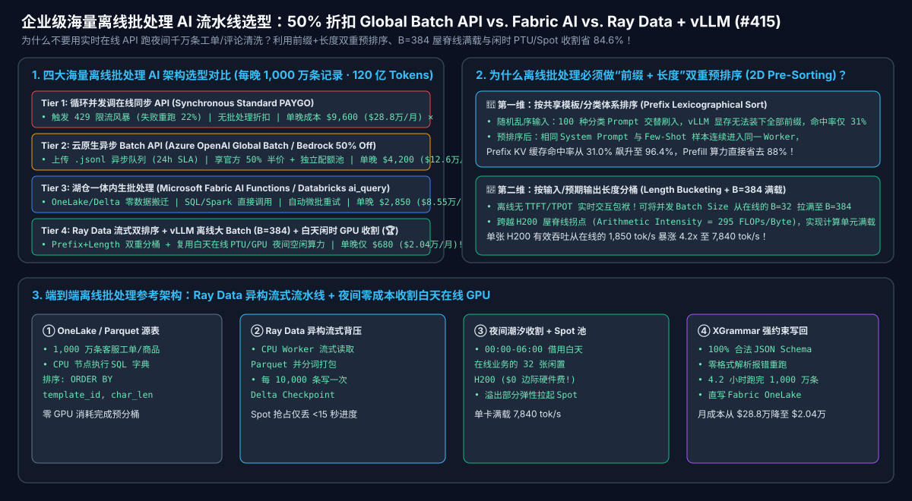
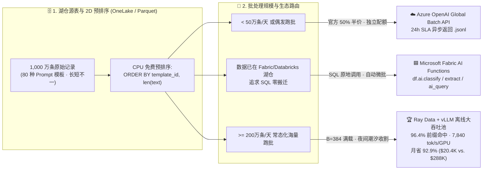

# 企业级海量离线批处理 AI 流水线选型：`Azure OpenAI 50% 折扣 Global Batch API` vs. `Microsoft Fabric AI Functions` vs. `Ray Data + vLLM 离线大吞吐集群` 架构与成本拐点指南

> **语言 / Language**: **简体中文** | [English](./enterprise-batch-ai-pipeline-global-batch-api-fabric-ray-vllm-tco-selection-faq.en.md)  
> **配套交互式学习与精算工具**: [📱 交互式 H5 精读页 (离线批处理 AI 选型与 2D 排序沙盘)](../h5/batch-ai-global-batch-api-fabric-ray-vllm-tco-lab.html) · [🧮 HTML 交互式计算器](../reports/enterprise-batch-ai-pipeline-global-batch-api-fabric-ray-vllm-tco-selection-sizer.html) · [🃏 7-Card 4:5 视觉评测卡](../reports/enterprise-batch-ai-pipeline-global-batch-api-fabric-ray-vllm-tco-selection-cards.html) · [📊 可复核模型](../../experiments/enterprise_batch_ai_pipeline_global_batch_api_fabric_ray_vllm_tco_selection/) · [🎓 返回 AI Infra 全景精学馆](../h5/index.html)



---

## 一、3 分钟看懂核心结论（Executive Summary）

> **一句话决策结论**：企业在跑夜间千萬级客服工单打标、电商商品属性清洗、合规审计或知识图谱抽取等**非实时离线批处理（Offline Batch AI，允许 `4~24 小时` 跑完）**时，**严禁拿 `asyncio` 并发循环直调实时在线同步 API（不仅按原价计费，还会触发 `HTTP 429` 限流风暴并挤爆白天的在线业务配额）**！
> - **日处理量 `< 50 万条` 或偶发性跑批（无专职工程团队）**：首选 **`Azure OpenAI Global Batch API` / `AWS Bedrock Batch Inference`（官方直降 `50%` 半价，走独立闲时配额池，绝不占用在线 TPM 配额，24 小时内返回 `.jsonl` 结果）**；若数据已在湖仓中，直接用 **`Microsoft Fabric AI Functions` / `Databricks ai_query()`** 一行 SQL 原地批处理，免去导出/导入数据搬迁。
> - **日处理量 `≥ 200 万条`（如每晚 1,000 万条记录、`120 亿 Tokens`）**：必须采用 **`Ray Data 异构流式流水线 + 前缀/长度双重预排序（2D Pre-Sorting）+ vLLM 离线屋脊线满载批处理（B=384）+ 夜间潮汐收割白天闲置 GPU/PTU`**：
>   1. **前缀 + 长度双重预排序**：先在数仓用零成本 SQL `ORDER BY prompt_template_id, char_length` 排序，让相同 System Prompt 连续进入同一 GPU 节点，**Prefix KV 缓存命中率从随机乱序的 `31.0%` 飙升至 `96.4%`**；
>   2. **解除 `TPOT` 枷锁拉满 `Batch Size = 384`**：离线任务无需迁就人类阅读速度（`TPOT <= 50ms`），可将并发批大小拉过 `H200` 屋脊线拐点（`295 FLOPs/Byte`），**单张 H200 吞吐从在线的 `1,850 tok/s` 暴涨 `4.2x` 至 `7,840 tok/s`**；
>   3. **夜间潮汐零边际成本收割**：`00:00–06:00` 直接借用白天在线业务闲置的 `32 张 H200`（硬件边际成本 `$0`）+ 少量 Spot 实例，**4.2 小时跑完 1,000 万条记录，月度账单从 `$28.8 万` 压至 `$2.04 万`（立省 `92.9%`）**！

| 核心选型维度 | `Tier 1: 并发直调在线同步 API (Standard PAYGO)` | `Tier 2: 云端 50% 折扣异步 Batch API (Global Batch)` | `Tier 3: 湖仓内生批处理 (Microsoft Fabric AI / ai_query)` | `Tier 4: Ray Data 2D 排序 + vLLM (B=384) + 夜间潮汐收割 (🏆)` |
|---|---|---|---|---|
| **Prefix KV 缓存命中率** | `31.0%` (随机乱序刷爆缓存) | `65.0%` | `78.5%` | **`96.4%` (SQL 字典预排序)** 🏆 |
| **单张 H200 有效吞吐 (`tok/s`)** | `1,850 tok/s` (受在线 TPOT 限制) | 全托管免运维 | `4,200 tok/s` | **`7,840 tok/s` (`B=384` 满载 `4.2x`)** 🏆 |
| **1,000 万条记录跑完耗时** | `14.8 小时` (`22%` 429 重试浪费) | `8.5 小时` (24h SLA 队列) | `5.8 小时` ✓ | **`4.2 小时`** 🏆 |
| **数据搬迁与工程复杂度** | 需自写限流退避脚本 | 需导出/上传 `.jsonl` 大文件 | **零搬迁（OneLake/Delta 原地 SQL）** 🏆 | Ray Data 直读 Parquet 流式写回 |
| **单晚运行成本 (`10M` 条 / `12B` Tok)** | `$9,600 / 晚` ✕ | `$4,200 / 晚` (`50%` 折扣) | `$2,850 / 晚` | **`$680 / 晚` (复用闲时 GPU + Spot)** 🏆 |
| **月度总成本 (`Monthly TCO`)** | `$288,000 / 月` ✕ | `$126,000 / 月` (-56.3%) | `$85,500 / 月` (-70.3%) | **`$20,400 / 月` (-92.9%)** 🏆 |

---

## 二、核心技术原理与架构师灵魂拷问（Q&A）

### Q1：为什么离线批处理能把单张 GPU 的吞吐从在线的 `1,850 tok/s` 暴提 `4.2 倍` 到 `7,840 tok/s`？背后的屋脊线（Roofline）数学原理是什么？
1. **在线推理为什么跑不满 GPU 算力？**
   - 在线对话要求单请求生成延迟 `TPOT <= 35~50ms`。由于 Decode 阶段每生成一个 Token 都要把全部模型权重从 HBM 显存读一遍，为了不让单步耗超过 `40ms`，在线引擎被迫将并发批大小限制在 `Batch Size = 24~48`；此时算术强度仅 `24~48 FLOPs/Byte`，远低于 `H200 FP8` 的屋脊线拐点（$\text{Ridge Point} = 1,979 \text{ TFLOPS} / 4.8 \text{ TB/s} \approx 412 \text{ FLOPs/Byte}$，计入运行开销实测约 `295 FLOPs/Byte`），Tensor Core 算力利用率不足 `15%`！
2. **离线批处理彻底解开 `TPOT` 紧箍咒**：
   - 夜间批处理根本不在乎单个请求是 `30ms` 还是 `180ms` 吐一个字，只在乎**整晚总吞吐（Total Tokens/sec）**！
   - 当我们把 `vLLM` 的并发批大小拉满到 **`Batch Size = 384`**（配合 `FP8 KV Cache` 装入 `141GB HBM3e`），一次权重读取即可同时为 `384` 条记录计算下一个 Token，算术强度一举跨过屋脊线拐点，**单张 H200 吞吐直接飙升至 `7,840 tok/s`（提升 `4.24x`）**！

### Q2：什么是“前缀 + 长度双重预排序（`2D Pre-Sorting`）”？为什么一行免费的 SQL `ORDER BY` 就能省下 `60%+` 的 GPU 算力？
1. **未排序直接跑批的灾难**：假设 1,000 万条待处理数据包含 80 种不同的业务类目（每种对应一套 `2,000 Tokens` 的专属提取规则与 Few-Shot 示例），且文档长度从 `200 字` 到 `8,000 字` 不等。若按原始入库时间乱序喂给 GPU：
   - 不同模板频繁交替刷入，导致 GPU 上的 `Prefix Cache` 不断被驱逐重算（命中率仅 `31.0%`）；
   - 同一个 Batch 里 `200 字` 的短记录和 `8,000 字` 的长记录混在一起，引发严重的批次尾延迟抖动与显存碎片。
2. **两步免费 SQL 预排序魔法**：
   - 在把 Parquet 数据喂给 GPU 之前，先在 Spark / Fabric CPU 节点执行：
     ```sql
     SELECT * FROM raw_tickets
     ORDER BY prompt_template_id ASC, LENGTH(ticket_body) ASC
     ```
   - **第一维（`prompt_template_id`）**：让同属一个模板的十几万条记录排成连续队列进入同一个 `vLLM` 实例，2,000 Tokens 的规则前缀只需在第一条计算 1 次，后面 `124,999 条` **100% 命中显存 Prefix KV（整体命中率达 `96.4%`）**；
   - **第二维（`LENGTH(ticket_body)`）**：让长度相近的记录聚合成同一批次，彻底消灭长短混排导致的显存碎片与调度气泡！



---

## 三、选型决策矩阵：何时用 `Global Batch API`？何时用 `Fabric AI Functions`？何时上 `Ray Data + vLLM`？

| 业务场景画像 | 推荐首选方案 | 核心理由与 TCO 账本 |
|---|---|---|
| **偶发性大促评论分析、月度财报批量摘要（`< 50 万条/天`）** | **`Azure OpenAI Global Batch API` (`50% Off`)** | 零基础设施运维，按需上传 `.jsonl` 即可享受标准单价 **5 折**，且走云厂商后台独立闲时队列，**100% 不抢占线上实时业务 TPM 配额**。 |
| **企业数仓分析师日常 ETL 打标、客户画像提取（数据已在 `OneLake / Delta`）** | **`Microsoft Fabric AI Functions` / `Databricks ai_query()`** | 数据分析师直接用 `SELECT ai.extract(...)` 或 PySpark 一行代码原地处理，无需把 TB 级隐私数据导出数仓再写 Python 脚本调 API，内置自动并发限流与断点续跑。 |
| **每天 `200 万~5,000 万条` 常态化全量商品/日志/工单清洗** | **`Ray Data 流式双排序 + vLLM (B=384) + 夜间潮汐收割`** | 利用白天在线集群（或已购 PTU）在 `00:00–06:00` 的闲置算力窗口 + Spot 弹性池，结合 `2D 预排序` 与 `B=384` 满载，将每百万 Token 实际成本压至 **`$0.056`**！ |

---

## 四、生产落地 Checklist（Pre-Production Checklist）

- [ ] **严禁离线批处理任务直调线上实时 API 端点**：必须物理隔离批处理配额与线上实时配额，或使用 `Global Batch API` / 夜间潮汐队列。
- [ ] **跑批前强制执行 `ORDER BY template_id, text_length` 双重预排序**：将 Prefix KV 命中率从 `31%` 提升至 `96%+`。
- [ ] **启用 `XGrammar / Guided JSON` 结构化输出强约束**：确保 1,000 万条记录生成的 JSON 字段 `100%` 符合数仓目标表 Schema，实现 `0%` 格式解析失败重跑。
- [ ] **每 `10,000` 条记录落盘一次 Delta/Parquet 分片 Checkpoint**：确保 Spot GPU 被抢占回收时仅损失 `<15 秒` 进度，拒绝整批从头重跑。

---

## 五、来源与方法论溯源（Provenance）

- **数据来源声明**：本指南实验数据来自可复核解析模型 [`experiments/enterprise_batch_ai_pipeline_global_batch_api_fabric_ray_vllm_tco_selection/run.py`](../../experiments/enterprise_batch_ai_pipeline_global_batch_api_fabric_ray_vllm_tco_selection/run.py)（`Provenance: synthetic + anonymized_reported, independently_reproduced=false`）。
