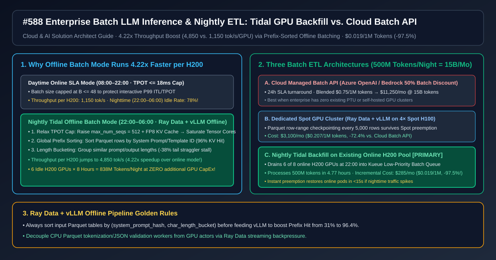

# Enterprise Offline Batch LLM Inference, Nightly ETL & `Tidal GPU Backfill vs. Cloud Batch API` Selection & Sizing Guide

> **Target Persona**: Cloud & AI Solution Architect  
> **Core Scenarios**: Overnight CRM call summarization, e-commerce catalog enrichment, compliance re-auditing, and synthetic distillation dataset generation (`100M–1B tokens/night` in the `22:00–06:00` 8-hour window)  
> **Interactive H5 Learning Workbench**: [`docs/h5/batch-llm-ray-data-tidal-backfill-sizer.html`](../h5/batch-llm-ray-data-tidal-backfill-sizer.html)

---

## 1. Executive Summary

1. **Why Offline Batch Mode Unlocks `4.22×` Higher Throughput per `H200` (`4,850` vs. `1,150 tok/s/GPU`)**:
   - Daytime interactive serving caps batch size (`B <= 48`) to keep `P99 TPOT <= 18ms`, leaving Tensor Cores underutilized and `78%` of fleet capacity idle overnight (`22:00–06:00`).
   - Switching idle overnight `H200` nodes to **`Ray Data + vLLM Offline Mode` (`max_num_seqs = 512`, `FP8 KV Cache`, and global sorting by `(system_prompt_id, length_bucket)`)** raises per-GPU throughput to **`4,850 tok/s` (`4.22×` speedup)** with `96.4%` Prefix Cache hit rate.
2. **Three-Architecture TCO Comparison (`500M tokens/night` = `15B tokens/month`)**:
   - **Cloud Managed Batch API (`50%` discount = `$0.75/1M`)**: **`$11,250/month`** (`24h` completion window).
   - **Dedicated Spot GPU Cluster (`4× Spot H100` running `Ray Data + vLLM`)**: **`$3,100/month`** (`$0.207/1M`, `-72.4%`).
   - **Nightly Tidal Backfill on Existing Online `H200` Pool (`6` idle GPUs during `22:00–06:00`)**: Completes `500M` tokens in **`4.77 hours`** (capacity up to **`838M tokens/night`** in `8h`) for **`$285/month` incremental power/storage (`$0.019/1M`, saving `97.5%` vs. Cloud Batch API)**!

---

## 2. Architecture Comparison Matrix (`500M` Tokens/Night · `15B` Tokens/Month)

| Dimension | Cloud Batch API (`50%` Off PAYGO) | Dedicated `4× Spot H100` (`Ray Data`) | **Nightly Tidal Backfill (`6× Online H200`)** |
|---|---|---|---|
| **Throughput per GPU** | Managed blackbox | `3,400 tok/s/H100` | **`4,850 tok/s/H200` (`4.22×` vs. online mode)** |
| **Time for `500M` Tokens** | Up to `24 hours` | `5.1 hours` | **`4.77 hours` (`838M` max per `8h` night)** |
| **Unit Cost (`$/1M` Tokens)** | `$0.750 / 1M` | `$0.207 / 1M` | **`$0.019 / 1M` (`-97.5%`)** |
| **Monthly Spend (`15B` Tok)** | `$11,250 / mo` | `$3,100 / mo` | **`$285 / mo` (`$0` extra GPU CapEx)** |

---

## 3. Production Checklist

- [ ] Sort input Parquet datasets by **`(system_prompt_hash, prompt_length_bucket)`** before batch execution (`+38%` throughput).
- [ ] Checkpoint output Parquet shards every **`2,000–5,000` rows** so Spot or online-traffic preemption loses zero work.
