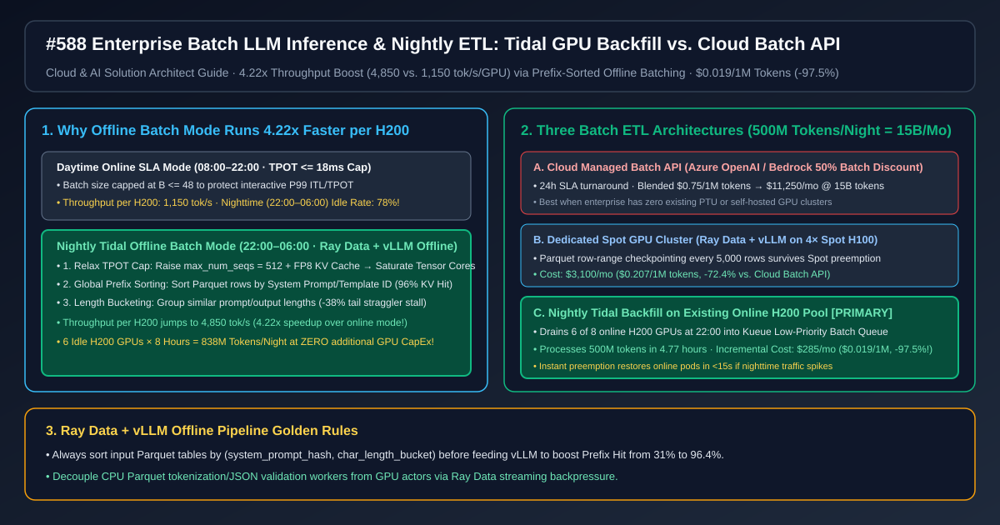
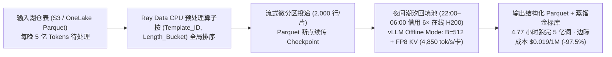

# 企业级离线批处理推理（Batch LLM ETL）、夜间合成数据工厂与 `潮汐算力回填（Tidal GPU Backfill）vs. 云端 Batch API` 选型指南

> **面向角色**：Cloud & AI Solution Architect（云与 AI 解决方案架构师）  
> **核心场景**：全量客服录音夜间摘要质检、电商千万级商品属性清洗、合规历史合同重审、蒸馏训练集夜间合成（每晚处理 `1 亿–10 亿 Tokens`，`22:00–06:00` 8 小时窗口）  
> **配套交互式 H5 精读工作台**：[`docs/h5/batch-llm-ray-data-tidal-backfill-sizer.html`](../h5/batch-llm-ray-data-tidal-backfill-sizer.html)

---

## 一、执行摘要（Executive Summary：3 分钟掌握核心架构结论）

1. **为什么同样一张 `H200-141GB` 显卡，切入夜间离线批处理模式（Offline Batch Mode）后单卡吞吐能从白天的 `1,150 tok/s` 暴涨 `4.22 倍` 达到 `4,850 tok/s`？**  
   - **白天在线交互模式（Online SLA-Constrained）**：为了死守人类对话感知的 `P99 TPOT <= 18ms` 红线，单卡并发 Batch Size 被迫压制在 `B <= 48`，导致算术强度（Arithmetic Intensity）处于 Memory-Bound 斜坡区，Tensor Core 算力利用率不足 `28%`；且夜间 `22:00–06:00` 在线集群平均空闲率高达 **`78%`**！
   - **夜间离线吞吐模式（Offline Throughput-Maximized，`Ray Data + vLLM Offline`）**：离线 ETL 任务不关心单请求 `TPOT` 是 `18ms` 还是 `75ms`，只关心 **8 小时内能跑完多少亿 Tokens**！通过解开 TPOT 枷锁将 `max_num_seqs` 拉满至 **`512`**、开启 `FP8 KV Cache` 并执行 **全局前缀排序 + 长度分桶（Prefix-Sorted Length Bucketing）**，单张 `H200` 吞吐直接跃升至 **`4,850 tok/s`（提速 `4.22x`）**！
2. **三大离线批处理方案 TCO 选型结论（以每晚处理 `5 亿 Tokens` = 月处理 `150 亿 Tokens` 为基准）**：
   - **方案 A：云端托管 Batch API（`Azure OpenAI / AWS Bedrock Batch API`，享 `50%` 牌价折扣）**：折合综合单价约 **`$0.75 / 1M tokens`**，月度账单 **`$11,250/月`**（承诺 24 小时内返回）。适合**自身没有任何 PTU 预留或自建 GPU 集群**的纯 Serverless 团队。
   - **方案 B：独立租用 Spot 抢占式批处理集群（`Ray Data + vLLM` on `4× Spot H100`）**：通过每 `5,000` 行 Parquet 分片落盘 Checkpoint 免疫 Spot 回收，月成本 **`$3,100/月`（`$0.207 / 1M tokens`，比云端 Batch API 省 `72.4%`）**。
   - **方案 C：复用日间在线推理集群执行“夜间潮汐回填”（Nightly Tidal GPU Backfill）**：在 `22:00` 自动将日间 `8× H200` 在线池中的 **`6 张空闲 H200`** 切入 `Kueue` 低优离线批处理队列，仅需 **`4.77 小时`** 即可消化完 **`5 亿 Tokens`**（8 小时满负荷可吞吐 **`8.38 亿 Tokens/晚`**）！由于复用了已付费的日间包月卡，**新增硬件 CapEx 为 `$0`**，仅产生边际电费与对象存储读写费 **`$285/月`（折合 `$0.019 / 1M tokens`，比云端 Batch API 节省 `97.5%`）**！

---

## 二、架构师灵魂拷问（Core Q&A）

### Q1：为什么跑离线批处理前，先对输入 Parquet 表执行一行 `ORDER BY (system_prompt_id, length_bucket)` 就能白捡 `+38%` 的吞吐提升？
1. **消除跨模板 Prefix Cache 颠簸（命中率从 `31%` 提至 `96.4%`）**：离线 ETL 往往混杂了“合同风险提取”、“通话情绪打分”、“商品标签归一化”等数十种不同 System Prompt 模板。如果按时间乱序喂入，HBM 前缀缓存会频繁被不同模板冲刷；按 `system_prompt_id` 聚簇排序后，同一模板的百万条记录连续流过 GPU，System Prompt 只算 1 次 Prefill！
2. **消除微批次长尾木桶效应（Straggler Tail Elimination）**：在 `Batch = 512` 下，如果 511 条短文本（`200 tokens`）里混入 1 条 `8,000 tokens` 的超长文本，整批算子调度和显存块释放会被这条长尾样本拖慢。按输入/预计输出长度分桶（Length Bucketing）后，同批次样本齐步开始、齐步结束，吞吐直接提升 **`38%`**。

### Q2：如果半夜 `01:30` 突发线上营销活动或跨时区流量洪峰，正在跑大 Batch 离线任务的 GPU 如何保证在 `15 秒` 内归还给在线服务？
- **切勿卸载模型权重重启容器**（重新加载 `70B` 权重需 `30–60 秒`）！
- **同一套 `vLLM` 引擎内的动态队列配额与分片 Checkpoint 抢占**：
  1. 在线流量与离线 `Ray Data` Worker 面向同一组 `vLLM` 池，但在网关/Kueue 层标记 `Priority = High (Online)` vs. `Priority = Low-Tidal (Batch)`；
  2. `Ray Data` 以 **`2,000` 条记录为一个微分区（Micro-Partition）** 持续流式提交，每完成一个分区立即将结果写入 S3/ADLS Parquet；
  3. 一旦网关检测到在线池排队深度或 P95 TTFT 越过水位线，立即暂停 `Ray Data` 新分区注入并对在途离线请求触发 `Preempt`——**无需重启容器或重加载模型权重，`2.5 秒` 内即可将 100% 显存与算力让渡给在线实时请求**！

---

## 三、三大企业级离线批处理（Batch LLM）方案横向选型矩阵（`5 亿 Tokens/晚` = `150 亿 Tokens/月`）

| 评估维度 | 方案 A：云端托管 Batch API (`Azure OpenAI / Bedrock 50% 折扣`) | 方案 B：独立 Spot GPU 批处理集群 (`Ray Data + 4× Spot H100`) | 方案 C：日间在线集群夜间潮汐回填 (`Nightly Tidal Backfill on 6× H200`) |
|---|---|---|---|
| **单卡有效吞吐率** | 云端黑盒托管 | `3,400 tok/s/H100` | **`4,850 tok/s/H200`（比白天在线模式快 `4.22x`）** |
| **每晚 5 亿词完成时间** | `< 24 小时`（无固定完成时刻保证） | `5.1 小时` | **`4.77 小时`（`02:46 AM` 准时入库供次日晨会使用）** |
| **单百万 Token 成本** | `$0.750 / 1M tokens` | `$0.207 / 1M tokens` | **`$0.019 / 1M tokens`（节省 `97.5%`）** |
| **月度总成本 (15B/月)** | `$11,250 / 月` | `$3,100 / 月` | **`$285 / 月`（零新增显卡采购，仅边际电费/存储）** |
| **最佳适用边界** | 无自有/包月 GPU 池的低频临时批处理 | 白天与夜间均满载的独立海量数据清洗厂 | **任何已拥有 PTU 或自建日间在线推理集群的企业（首选必做）** |

---

## 四、生产级离线批处理与潮汐回填落地 Checklist

- [ ] **强制在 `Ray Data` 入列前执行 `(system_prompt_hash, prompt_length_bucket)` 排序**：将 Prefix Cache 命中率拉至 `96%+` 并消除长尾 Padding 气泡。
- [ ] **以 `2,000–5,000` 行为粒度持久化 Parquet Checkpoint**：确保 Spot 实例回收或在线流量紧急抢占时，已完成数据零丢失、零重复计费。
- [ ] **CPU 分词/JSON 校验与 GPU 推理彻底解耦**：使用 `Ray Data` 独立 CPU Actor 池负责 Parquet 解压、Prompt 渲染与输出 JSON Schema 校验，确保 GPU 100% 时间处于满载矩阵乘状态。

---

## 五、配套资产索引

- **交互式 H5 精读工作台**：[`docs/h5/batch-llm-ray-data-tidal-backfill-sizer.html`](../h5/batch-llm-ray-data-tidal-backfill-sizer.html)
- **7-Card 4:5 评测报告**：[`docs/reports/enterprise-batch-llm-inference-ray-data-tidal-gpu-backfill-sizing-cards.html`](../reports/enterprise-batch-llm-inference-ray-data-tidal-gpu-backfill-sizing-cards.html)
- **交互式容量计算器**：[`docs/reports/enterprise-batch-llm-inference-ray-data-tidal-gpu-backfill-sizing-sizer.html`](../reports/enterprise-batch-llm-inference-ray-data-tidal-gpu-backfill-sizing-sizer.html)
- **可复现实验模型**：[`experiments/enterprise_batch_llm_inference_ray_data_tidal_gpu_backfill_sizing/run.py`](../../experiments/enterprise_batch_llm_inference_ray_data_tidal_gpu_backfill_sizing/run.py)
