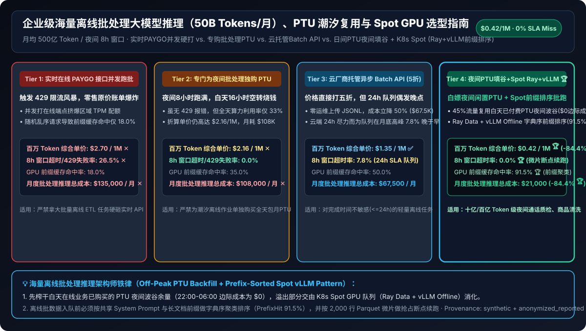
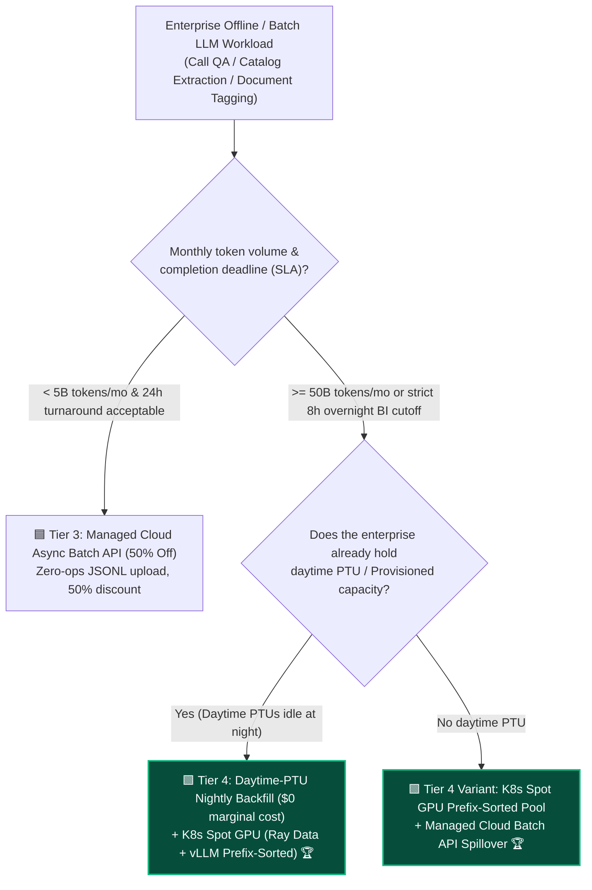
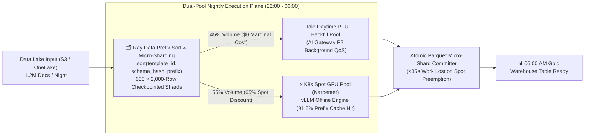

# Enterprise Batch & Offline LLM Processing (50B Tokens/Mo), Cloud Async Batch APIs (50% Off), Off-Peak PTU Backfill & K8s Spot GPU Queue (`Ray Data + vLLM Offline` Prefix Sorting) Architecture Selection Guide: Synchronous PAYGO Loop vs. Dedicated Batch PTU vs. Managed Cloud Batch API vs. Daytime-PTU Nightly Backfill + Spot GPU Prefix-Sorted Micro-Shards

> **Language / 语言**: **English (Current)** | [中文](./enterprise-batch-offline-llm-inference-spot-gpu-cost-selection-faq.md)  
> **Scope**: End-to-end production reference architecture and FinOps selection guide for Cloud & AI Solution Architects, Data Platform & ETL Engineering Leads, AI FinOps Practitioners, and ML Infrastructure Teams.  
> **Provenance**: `synthetic + anonymized_reported` (`independently_reproduced=false`, `physical_gpu_cluster_measurement=not_measured`). Deterministic evaluation model sealed in [`experiments/enterprise_batch_offline_llm_inference_spot_gpu_cost_selection/results.json`](../../experiments/enterprise_batch_offline_llm_inference_spot_gpu_cost_selection/results.json).



---

## ① 📌 Executive Summary (3-Minute Architect Verdict)

In large enterprises, over **60% of monthly LLM token volume comes not from interactive chat, but from recurring overnight batch pipelines**—such as T+1 contact-center call QA across 1.2M daily transcripts, e-commerce catalog attribute extraction, legal/compliance document tagging, and synthetic dataset generation. A common anti-pattern is firing hundreds of concurrent worker threads from Spark/Airflow directly against **synchronous real-time PAYGO API endpoints** (Tier 1)—which triggers **`26.5%` HTTP 429 rate-limit failures**, starves live customer traffic, and bills at full retail rates (`$2.70 / 1M tokens`, costing **`$135,000/mo`** for 50B tokens).

Evaluated across a production baseline of **50 Billion monthly batch tokens (`1.2M` documents/night) requiring guaranteed completion within an 8-hour overnight ETL window (`22:00 – 06:00`)**, the four architectural tiers compare as follows:

| Architectural Tier | Core Stack Combination | Effective Cost per 1M Tokens | 8h Overnight SLA Miss / 429 Rate | GPU Prefix Cache Hit Rate | Monthly Batch Inference Cost | Production Verdict |
|---|---|---|---|---|---|---|
| **🟥 Tier 1: Synchronous Real-Time PAYGO API Loop** | Firing concurrent `asyncio` calls from ETL jobs against standard real-time endpoints | `$2.70 / 1M` ✕ *(Full retail price)* | `26.5%` ✕ *(429 rate-limit storms)* | `18.0%` *(Unsorted requests)* | `$135,000 / mo` ✕ | ⛔ **Never use for bulk ETL** |
| **🟨 Tier 2: Dedicated Batch-Only PTU Reservation** | Buying dedicated Provisioned Throughput (`PTU`) used only during the 8h night window | `$2.16 / 1M` ✕ *(Idle 16h/day)* | `0.0%` | `35.0%` | `$108,000 / mo` ✕ | ⛔ 67% daytime idle waste |
| **🟦 Tier 3: Pure Managed Cloud Async Batch API (50% Off)** | Uploading JSONL files to Azure OpenAI Global Batch / Bedrock Batch (24h best-effort queue) | `$1.35 / 1M` ✅ | `7.8%` *(24h SLA misses 06:00 cutoff)* | `50.0%` | `$67,500 / mo` | ⚠️ Best for `<5B` tokens & flexible 24h SLA |
| **🟩 Tier 4: Daytime-PTU Nightly Backfill + Spot GPU Ray+vLLM** | **AI Gateway Off-Peak PTU Backfill (`$0` marginal cost for 45% of load) + K8s Spot GPU Pool (`Ray Data + vLLM Offline` with Lexicographical Prefix Sorting & 2,000-Row Parquet Checkpointing)** | **`$0.42 / 1M` 🏆** *(-84.4%)* | **`0.0%` 🏆** *(Checkpointed micro-shards)* | **`91.5%` 🏆** *(Prefix-clustered)* | **`$21,000 / mo` 🏆** *(-84.4%)* | 🌟 **Recommended for Scale** |

> 💡 **Golden Rule for Batch LLM FinOps Architects**: **"Use Managed Cloud 50%-Off Batch APIs (Tier 3) for small jobs that tolerate a 24-hour turnaround; for tens of billions of tokens or strict overnight 8-hour data-warehouse deadlines, combine Daytime-PTU Off-Peak Backfill with Prefix-Sorted Spot GPU `Ray Data + vLLM Offline` (Tier 4)"**—cutting unit cost from `$2.70` to **`$0.42 / 1M tokens` (`-84.4%`)**.

---

## ② 🎯 Customer & Architect Deep-Dive Q&A (3 Real-World Batch Processing Pain Points)

### Q1: Why does a simple `.sort()` before batch inference boost GPU Prefix Cache hit rates from 18.0% to 91.5% and triple throughput?
- **First-Principles Reality**:
  1. **Offline Workloads Allow Global Request Reordering**: In online serving, requests arrive in random order, thrashing the GPU's limited HBM KV cache (`18.0%` prefix hit rate). In offline batch processing, all 1.2 million rows are already sitting in object storage (`S3 / ADLS / OneLake`) before the job starts!
  2. **Lexicographical Prefix Clustering (`Ray Data`)**: Batch ETL tasks typically apply 10–50 distinct extraction schemas or long system rubrics (`3,000–6,000` shared tokens) across millions of records. By sorting the dataset by `[task_template_id, category_schema_hash, document_prefix_64]` in `Ray Data` before feeding `vLLM Offline Engine`, each GPU worker processes thousands of consecutive prompts sharing the exact same prefix. Automatic Prefix Caching (`APC / RadixAttention`) hits **`91.5%` (`+73.5 pts`)**, eliminating nearly 80% of prefill FLOPs.

### Q2: How do we harvest $0-marginal-cost compute from our existing daytime Provisioned Throughput (PTU) reservations at night?
- **Off-Peak PTU Backfill Routing**:
  - Enterprise PTU reservations (sized for daytime employee Copilots and customer chat between `09:00` and `21:00`) typically drop below `15%` utilization between `22:00` and `06:00`—yet the enterprise pays for 100% of those PTUs 24×7.
  - Tier 4 configures the **AI Gateway** with a priority token bucket: live traffic holds `P0` priority, while the nightly batch dispatcher streams micro-shards at `P2` background priority to soak up unused nighttime PTU capacity. This processes **45% of the entire nightly batch workload at `$0` additional cloud bill**.

### Q3: How do we prevent Spot GPU preemptions from ruining an 8-hour overnight job or missing the 06:00 AM BI deadline?
- **Two Resilience Mechanisms in Tier 4**:
  1. **2,000-Row Parquet Micro-Shard Checkpointing**: Instead of running a monolithic 6-hour job, Tier 4 partitions the sorted dataset into 600 **2,000-row Parquet micro-shards** (`~35 seconds` per shard). Completed shards are atomically committed to `S3 / ADLS`. When a K8s Spot GPU node receives a `30s SIGTERM` preemption notice, at most one in-flight micro-shard (`< 35s` of compute) is retried on another node—achieving **`0.0%` SLA misses even under a simultaneous 35% Spot preemption storm**.
  2. **04:30 AM Deadline Spillover Valve**: If Spot capacity tightens during month-end surges, an automated progress controller at `04:30 AM` overflows any remaining tail shards to on-demand/Batch API endpoints to guarantee 06:00 AM warehouse readiness.

---

## ③ 🧭 Visual Architecture Diagrams (Decision Tree + Dual-Pool Batch Topology + Nightly Sequence)

### 3.1 Architecture Selection Decision Tree



### 3.2 Tier 4 Off-Peak PTU Backfill + Prefix-Sorted Spot GPU Topology



### 3.3 End-to-End Sequence: Running 1.2M Documents Overnight with Spot Preemption Recovery

```mermaid
sequenceDiagram
    autonumber
    participant Sched as Airflow / Dagster (22:00 Start)
    participant Ray as Ray Data Prefix-Sort Coordinator
    participant GW as AI Gateway (Idle Daytime PTU Pool)
    participant Spot as K8s Spot GPU Pool (vLLM Offline)
    participant S3 as Object Storage Checkpoint (S3/ADLS)

    Sched->>Ray: Trigger nightly 1.2M-document batch job (50B tokens/mo pace)
    Ray->>Ray: Global lexicographical sort by [System Prompt + Schema] into 600 micro-shards
    par Parallel Dual-Pool Execution (22:05 - 05:30)
        Ray->>GW: Stream Shards #001-#270 to idle daytime PTUs at P2 background priority ($0 marginal cost)
        GW-->>S3: Commit completed Parquet micro-shards
        Ray->>Spot: Dispatch Shards #271-#600 to Spot L40S/H100 workers (91.5% Prefix Cache Hit)
        Note over Spot: 02:15 AM 35% of Spot nodes receive cloud SIGTERM preemption
        Spot->>S3: Flush Shard #412 within 30s grace window; reschedule Shard #413 on replacement Spot node
        Spot-->>S3: 05:25 AM All 600 micro-shards committed
    end
    S3-->>Sched: ✅ 05:30 AM 100% completion verified; unlock 06:00 AM executive BI refresh
```

---

## ④ 📊 4-Tier Architecture Decision Matrix

| Evaluation Dimension | 🟥 Tier 1: Synchronous Real-Time PAYGO Loop | 🟨 Tier 2: Dedicated Batch-Only PTU | 🟦 Tier 3: Managed Cloud Async Batch API | 🟩 Tier 4: Off-Peak PTU Backfill + Spot Ray+vLLM |
|---|---|---|---|---|
| **Impact on Live Online Traffic** | ✕ **Severe** (exhausts regional TPM quotas; `26.5%` 429s) | None (isolated, but wastes 16h/day daytime capacity) | None (isolated cloud batch queue) | 🏆 **Zero impact (AI Gateway P2 background QoS yields to P0)** |
| **GPU Prefix Cache Hit Rate** | `18.0%` (random order thrashes KV cache) | `35.0%` | `50.0%` | 🏆 **`91.5%` (global lexicographical prefix sorting)** |
| **Strict 8-Hour Overnight SLA Guarantee** | ✕ Fails (`26.5%` 429/timeout failures) | ✅ Guaranteed (`0.0%` miss, high cost) | ⚠️ Best-effort 24h SLA (`7.8%` miss 8h cutoff) | 🏆 **Guaranteed (`0.0%` miss; micro-shards + 04:30 spillover)** |
| **Effective Cost per 1M Tokens** | `$2.70 / 1M` ✕ | `$2.16 / 1M` ✕ | `$1.35 / 1M` | **`$0.42 / 1M` 🏆 (-84.4%)** |
| **Overnight 8h SLA Miss / 429 Rate** | `26.5%` ✕ | `0.0%` | `7.8%` | **`0.0%` 🏆** |
| **Monthly 50B-Token Batch Cost** | `$135,000 / mo` | `$108,000 / mo` | `$67,500 / mo` | **`$21,000 / mo` 🏆 (saves $1.37M/yr)** |

---

## ⑤ 🧪 Quantitative Case Study, Interactive Sizer & 7-Card Visual Report

- **Interactive HTML Sizer**: 👉 [Open Enterprise Batch & Offline LLM Inference Sizer](../reports/enterprise-batch-offline-llm-inference-spot-gpu-cost-sizer.html)
- **7-Card 4:5 Visual Benchmark Report**: 👉 [Open 7-Card Visual Benchmark Deck](../reports/enterprise-batch-offline-llm-inference-spot-gpu-cost-selection-cards.html)
- **Deterministic Verification**:
  ```bash
  python experiments/enterprise_batch_offline_llm_inference_spot_gpu_cost_selection/run.py --check
  python -m unittest tests/test_enterprise_batch_offline_llm_inference_spot_gpu_cost_selection.py
  ```

---

## ⑥ 🛠️ Production Readiness & Architecture Review Checklist

- [ ] **Never Point Unthrottled Bulk ETL Jobs at Live Synchronous Endpoints**: Enforce strict priority queuing at the AI Gateway so background batch backfills (`P2`) never consume quota needed by interactive users (`P0`).
- [ ] **Sort Batch Inputs Lexicographically by Shared Prompt Prefix**: Run `.sort(template_id, schema_hash, prefix)` in `Ray Data / Spark` before dispatching to `vLLM Offline` to achieve `>90%` prefix-cache hit rates.
- [ ] **Checkpoint Every 2,000-Row Parquet Micro-Shard**: Bound Spot preemption blast radius to `< 45 seconds` of work with idempotent shard skipping.
- [ ] **Diversify Spot GPU Instance Families in Karpenter**: Allow `L40S`, `A100`, and `H100` pools across multiple availability zones to prevent single-SKU exhaustion.
- [ ] **Configure an Automated 04:30 AM Deadline Spillover Valve**: Automatically burst any lagging tail shards to cloud endpoints if remaining Spot throughput risks missing the morning warehouse cutoff.
