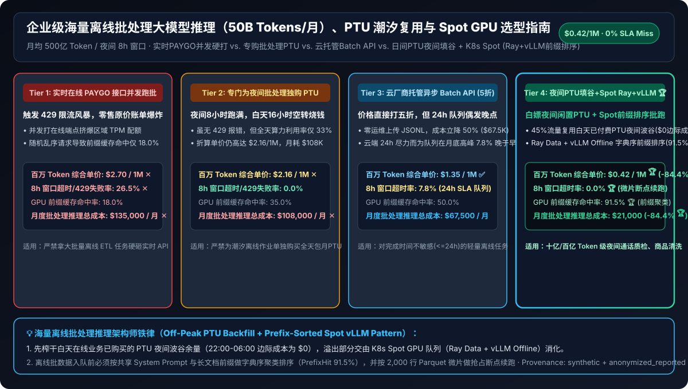
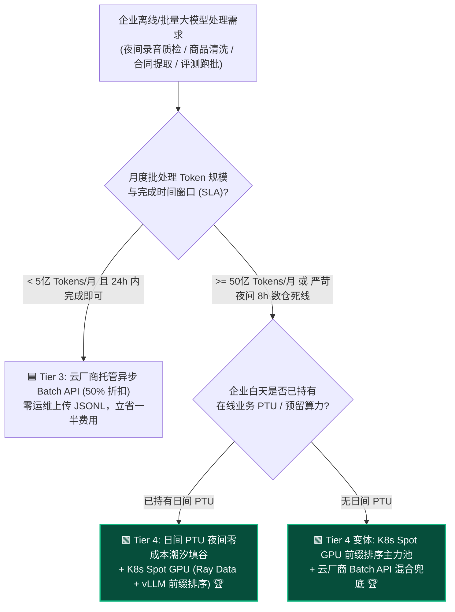
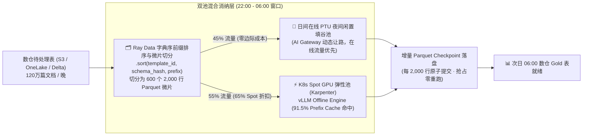
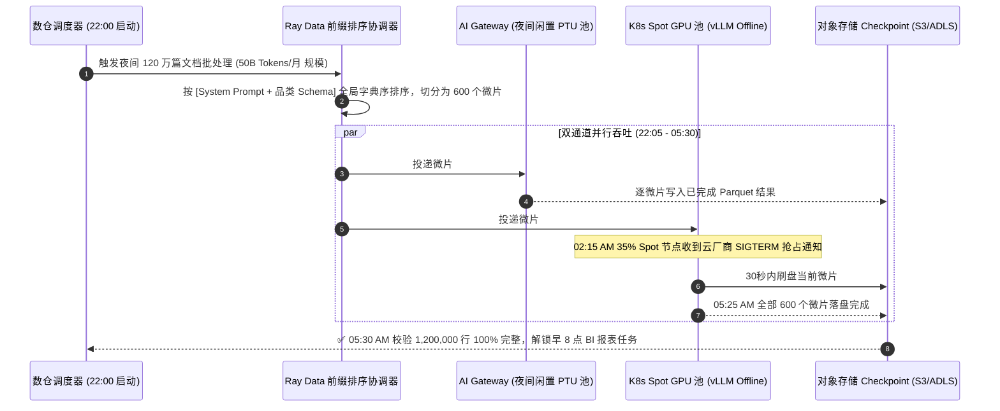

# 企业级海量离线批处理大模型推理（Batch & Offline LLM Processing）、云厂商异步 Batch API（50% 折扣）、夜间 PTU 潮汐复用与 K8s Spot GPU 抢占式队列（Ray Data + vLLM Offline 前缀排序）架构选型指南：实时 PAYGO 并发硬打 vs. 专购批处理 PTU vs. 云托管 Batch API vs. 日间 PTU 夜间填谷 + Spot GPU 前缀排序与微片续跑

> **语言 / Language**: **中文 (当前)** | [English](./enterprise-batch-offline-llm-inference-spot-gpu-cost-selection-faq.en.md)  
> **定位**：面向云与 AI 解决方案架构师（Solution Architect）、数据平台与数仓负责人（Head of Data Platform）、AI FinOps 架构师与大模型基础设施团队的生产落地指南。  
> **数据口径（Provenance）**：`synthetic + anonymized_reported`（`independently_reproduced=false`，`physical_gpu_cluster_measurement=not_measured`），全部定容模型封存于 [`experiments/enterprise_batch_offline_llm_inference_spot_gpu_cost_selection/results.json`](../../experiments/enterprise_batch_offline_llm_inference_spot_gpu_cost_selection/results.json)。



---

## ① 📌 核心选型结论速览（Executive Summary — 3 分钟看懂怎么选）

在企业生产环境中，往往超过 **60% 的大模型 Token 消耗并非来自实时聊天，而是来自夜间/周期性的海量离线批处理任务（Offline / Batch LLM Workloads）**——例如每晚对 120 万通客服录音做 T+1 合规质检、对千万级电商商品库做多语言属性提取、对历史合同/财报做批量实体抽取，或生成合成训练数据。许多数据工程团队图省事，直接在夜间 Spark/Airflow 任务里开 500 个并发线程调用 **实时在线 PAYGO API**（Tier 1），结果不仅触发高达 **`26.5%` 的 HTTP 429 限流风暴**、拖垮夜间全球在线业务，还按最昂贵的在线零售原价（`$2.70 / 1M Tokens`）每月白白烧掉 **`$135,000`**！

在 **月均 500 亿 Tokens（`50B Tokens/月`）、每晚需在 8 小时窗口内（`22:00 – 06:00`）准时跑完 120 万篇文档以供次日早 8 点 BI 报表使用** 的基准规模下，四档离线批处理推理架构的量化对决如下：

| 方案档位 | 核心架构组合 | 百万 Token 综合单价 | 夜间 8h 窗口超时 / 429 失败率 | GPU 前缀缓存命中率 (`Prefix Hit`) | 月度批处理推理总成本 | 生产推荐度 |
|---|---|---|---|---|---|---|
| **🟥 Tier 1：实时在线 PAYGO API 并发跑批** | 数据脚本用 `asyncio` 直接并发硬砸标准实时在线 API 端点 | `$2.70 / 1M` ✕ *(零售原价)* | `26.5%` ✕ *(429 限流风暴)* | `18.0%` *(请求随机乱序)* | `$135,000 / 月` ✕ | ⛔ **严禁拿离线任务硬打实时 API** |
| **🟨 Tier 2：专门为夜间批处理独购 PTU** | 单独签约全天包月预留吞吐（PTU / Provisioned）仅供夜间跑批 | `$2.16 / 1M` ✕ *(白天闲置 16h)* | `0.0%` | `35.0%` | `$108,000 / 月` ✕ | ⛔ 算力闲置浪费高达 67% |
| **🟦 Tier 3：纯云厂商托管异步 Batch API（5 折）** | 上传 JSONL 文件至 Azure OpenAI Global Batch / Bedrock Batch（24h 队列享 50% 折扣） | `$1.35 / 1M` ✅ | `7.8%` *(24h 队列偶发晚于早 8 点)* | `50.0%` | `$67,500 / 月` | ⚠️ 适合无早 8 点死线的中小规模任务 |
| **🟩 Tier 4：日间 PTU 夜间潮汐填谷 + Spot GPU 前缀排序队列** | **AI Gateway 夜间空闲 PTU 削峰填谷（$0 边际成本消化 45% 流量）+ K8s Spot GPU 抢占池（`Ray Data + vLLM Offline` 全局字典序前缀排序 + 2,000 行 Parquet 微片断点续跑）** | **`$0.42 / 1M` 🏆** *(-84.4%)* | **`0.0%` 🏆** *(微片续跑 + 兜底分流)* | **`91.5%` 🏆** *(字典序前缀聚类)* | **`$21,000 / 月` 🏆** *(-84.4%)* | 🌟 **百亿 Token 级生产首选架构** |

> 💡 **架构师一句话选型铁律**：**“小于 5 亿 Token/月且容忍 24 小时延迟直接用云厂商 5 折 Batch API（Tier 3）；大于 50 亿 Token/月或有严格夜间 8 小时数仓死线，必须采用‘日间已付 PTU 夜间零成本填谷 + Spot GPU 字典序前缀排序批跑’（Tier 4）”**——把百万 Token 成本从 `$2.70` 暴砍至 **`$0.42`（立省 `84.4%`）**！

---

## ② 🎯 客户与架构师灵魂拷问 Q&A（直击 3 大离线批处理痛点）

### Q1：为什么同样是跑批处理，先对输入数据做一次“字典序前缀排序（Lexicographical Prefix Sorting）”能让 GPU 吞吐翻倍、成本大降？
- **大白话与第一性原理**：
  1. **在线服务没法挑顺序，但离线批处理可以完全重排请求顺序！** 在实时在线场景下，不同用户的请求随机到达，GPU 显存容量有限，刚算完 A 品类 Prompt 的 KV Cache 很快就被 B、C、D 品类挤出去了（Tier 1 前缀缓存命中率仅 **`18.0%`**）。
  2. **离线任务的天然共性**：每晚 120 万条待处理数据，通常共享固定的几套长 System Prompt、Few-Shot 示例或长篇合规手册前缀（例如 4,000 Token 的质检规则前缀 + 800 Token 的单通电话录音）。
  3. **Tier 4 破局方案（`Ray Data` 全局字典序前缀聚类）**：在提交给 `vLLM Offline Engine` 之前，先用 `Ray Data / Spark` 按 `[任务模板 ID, 品类 Schema Hash, 文档前 64 字符]` 执行一行 `.sort()`。排序后，同一个 GPU Worker 连续几千个 Batch 处理的都是完全相同前缀的样本，自动前缀缓存（APC / RadixAttention）命中率从 `18.0%` 飙升至 **`91.5%`（`+73.5 pts`）**，接近 80% 的 Prefill 算力被直接免除！

### Q2：企业白天已经给在线客服和内部 Copilot 买了 Azure OpenAI PTU / AWS Bedrock Provisioned，晚上怎么“白嫖”这部分算力？
- **FinOps 黄金机会（日间 PTU 夜间潮汐填谷 Off-Peak Backfill）**：
  - 企业的在线业务流量呈现极强的昼夜潮汐效应：白天 09:00–21:00 PTU 利用率高达 85%，但到了**夜间 22:00–06:00，PTU 利用率往往跌至 10% 以下**——而 PTU 是按月/按小时固定计费的，晚上闲着也是付全款！
  - **Tier 4 的动态水位填谷路由**：AI Gateway 实时监控在线 PTU 的令牌桶水位；在夜间 `22:00–06:00` 期间，只要在线实时请求占用低于 `30%`，网关自动将离线批处理队列的请求以低优先级（Background QoS）注入 PTU 管道（一旦在线请求突发，毫秒级让路）。仅此一项即可按 **`$0` 边际成本** 消化掉全晚 **45%** 的批处理 Token！

### Q3：使用便宜 65% 的云端 Spot GPU（抢占式实例）跑剩余 55% 批处理时，遇到云厂商半夜回收节点怎么保证不丢数据、不耽误早 8 点报表？
- **Spot 抢占容错与死线兜底双保险**：
  1. **2,000 行 Parquet 微片级 Checkpoint（Micro-Shard Checkpointing）**：严禁把 120 万条数据做成一个持续 6 小时的大任务。Tier 4 将排序后的数据切分为 600 个 **2,000 行的微片（Micro-Shards，单块仅需约 35 秒跑完）**，每跑完一个微片立即原子落盘至对象存储（`S3 / ADLS Parquet`）。当 K8s Spot 节点收到云厂商 `30 秒 SIGTERM` 回收通知时，正在跑的微片优雅刷盘或由其他节点重跑，最多只损失 `< 35 秒` 算力（在 **35% Spot 节点同时被抢占** 压测下依然保持 **`0.0%` 数据丢失与 `0.0%` SLA 晚点**）。
  2. **凌晨 04:30 死线进度阀门（Deadline Spillover Valve）**：控制器在凌晨 `04:30` 自动核算剩余微片数；若因区域 Spot 库存紧缺导致预计完成时间晚于 `05:45`，自动将尾部 5%~10% 微片溢出至按量 API，确保早 8 点数仓报表 100% 准点交付。

---

## ③ 🧭 直观可视化图解（决策树 + 潮汐填谷与 Spot 架构图 + 夜间跑批时序图）

### 3.1 企业级离线批处理大模型推理选型决策树



### 3.2 Tier 4 日间 PTU 夜间潮汐填谷 + K8s Spot 前缀排序批处理架构图



### 3.3 从“22:00 夜间作业启动”到“Spot 抢占自愈与 05:30 准点收官”时序图



---

## ④ 📊 架构师四维选型决策矩阵（Architecture Decision Matrix）

| 评估维度 | 🟥 Tier 1：实时在线 PAYGO 并发硬打 | 🟨 Tier 2：专购夜间批处理 PTU | 🟦 Tier 3：云厂商托管异步 Batch API | 🟩 Tier 4：夜间 PTU 填谷 + Spot Ray+vLLM 前缀排序 |
|---|---|---|---|---|
| **对日间/夜间在线实时业务影响** | ✕ **严重冲击**（打满区域 TPM 配额触发 429） | 无影响（物理独立，但白天闲置浪费） | 无影响（云厂商独立异步队列） | 🏆 **零冲击（网关令牌桶优先保障在线，仅用闲置余量）** |
| **GPU 显存前缀缓存利用率** | `18.0%`（乱序请求频繁驱逐缓存） | `35.0%` | `50.0%`（云端黑盒调度） | 🏆 **`91.5%`（入队前全局字典序排序，免除 80% Prefill）** |
| **严格 8 小时夜间窗口保障** | ✕ 差（`26.5%` 因 429 限流中断失败） | ✅ 100% 准点（但代价昂贵） | ⚠️ 尽力而为（24h 队列有 `7.8%` 晚于早 8 点） | 🏆 **100% 准点（微片 Checkpoint + 04:30 死线溢出阀门）** |
| **百万 Token 综合有效单价** | `$2.70 / 1M` ✕ | `$2.16 / 1M` ✕ | `$1.35 / 1M` | **`$0.42 / 1M` 🏆（降低 84.4%）** |
| **夜间 8h 窗口超时 / 失败率** | `26.5%` ✕ | `0.0%` | `7.8%` | **`0.0%` 🏆** |
| **月度 50B Token 批处理总成本** | `$135,000 / 月` | `$108,000 / 月` | `$67,500 / 月` | **`$21,000 / 月` 🏆（年省 $136.8 万）** |

---

## ⑤ 🧪 定量算例、交互式容量计算器与 7-Card 4:5 视觉报告

### 5.1 基准算例复核（月均 500 亿 Tokens / 每晚 120 万篇文档）

- **交互式定容计算器（CSP 自包含 HTML）**：👉 [打开海量离线批处理大模型推理定容计算器](../reports/enterprise-batch-offline-llm-inference-spot-gpu-cost-sizer.html)
- **7-Card 4:5 视觉评测卡片报告**：👉 [打开 7-Card 视觉评测报告](../reports/enterprise-batch-offline-llm-inference-spot-gpu-cost-selection-cards.html)
- **可复核确定性脚本**：
  ```bash
  python experiments/enterprise_batch_offline_llm_inference_spot_gpu_cost_selection/run.py --check
  python -m unittest tests/test_enterprise_batch_offline_llm_inference_spot_gpu_cost_selection.py
  ```

### 5.2 核心量化对比图（百万 Token 综合单价 vs. GPU 前缀缓存命中率）

```chart
{
  "data": {
    "values": [
      { "tier": "Tier 1: Online PAYGO", "unit_cost_usd": 2.70, "prefix_hit_pct": 18.0 },
      { "tier": "Tier 2: Batch-Only PTU", "unit_cost_usd": 2.16, "prefix_hit_pct": 35.0 },
      { "tier": "Tier 3: Cloud Batch API", "unit_cost_usd": 1.35, "prefix_hit_pct": 50.0 },
      { "tier": "Tier 4: OffPeak PTU + Spot vLLM", "unit_cost_usd": 0.42, "prefix_hit_pct": 91.5 }
    ]
  },
  "semantic_types": {
    "tier": "Category",
    "unit_cost_usd": "Price",
    "prefix_hit_pct": "Percentage"
  },
  "chart_spec": {
    "chartType": "Bar Chart",
    "title": "Tier 4 slashes batch inference unit cost to $0.42 / 1M tokens (-84.4%)",
    "subtitle": "Effective cost per 1M tokens (USD) at 50 Billion tokens/month scale",
    "encodings": {
      "x": "tier",
      "y": "unit_cost_usd",
      "color": "tier"
    }
  }
}
```

---

## ⑥ 🛠️ 架构评审与生产落地核验清单（Production Readiness Checklist）

- [ ] **物理隔离离线批任务与在线实时 API 配额**：严禁离线 ETL 脚本直连生产实时端点而不设速率限制；若复用日间 PTU，必须在 AI Gateway 配置优先级队列（在线流量 `P0` 抢占，批处理 `P2` 仅用空闲水位）。
- [ ] **离线数据入队前强制执行字典序前缀聚类排序**：在 `Ray Data / Spark` 层按 `[System Prompt 模板 + Few-Shot 示例 + 行业分类]` 排序后再送入 `vLLM Offline`，确保自动前缀缓存（APC）命中率 `> 85%`。
- [ ] **2,000 行级 Parquet 微片 Checkpoint 防 Spot 抢占重跑**：将百万级大表切分为分钟级可完成的微片并开启已存在分片跳过（Idempotent Shard Skip），确保 Spot 节点被回收时损失 `< 60 秒` 工作量。
- [ ] **多机型异构 Spot 池配置（Karpenter Diversification）**：在 K8s Spot 节点池中同时声明 `L40S / A100 / H100` 等多种可用区机型，降低单一 SKU 被集中回收的概率。
- [ ] **设置凌晨死线进度检查点（Deadline Spillover Valve）**：在距离数仓截止时间前 90 分钟自动评估剩余分片速度，必要时自动将尾部微片溢出至托管 API 兜底。
