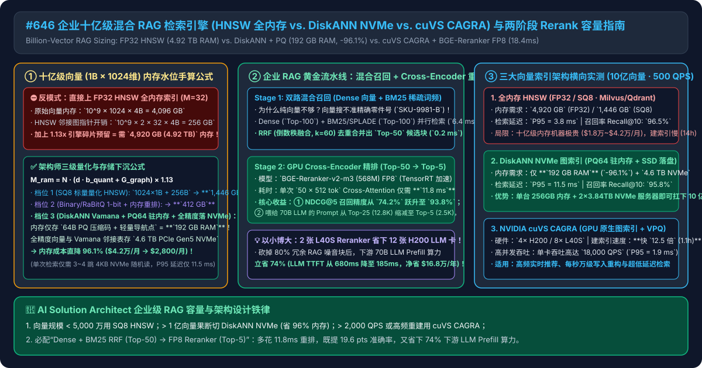

# Enterprise Billion-Scale Hybrid RAG Vector Search (`HNSW` vs. `DiskANN NVMe` vs. `cuVS CAGRA`), `PQ/SQ8` Memory Math & Two-Stage Reranker Sizer

> **Language / 语言**: [简体中文](./enterprise-billion-scale-hybrid-rag-hnsw-diskann-cuvs-reranker-faq.md) | **English** · [📱 Open Interactive H5 Study Lab](../h5/billion-scale-hybrid-rag-hnsw-diskann-cuvs-reranker-lab.html) · [🧮 Open Interactive Sizer](../reports/enterprise-billion-scale-hybrid-rag-hnsw-diskann-cuvs-reranker-sizer.html) · [🃏 View 7-Card 4:5 Benchmark Deck](../reports/enterprise-billion-scale-hybrid-rag-hnsw-diskann-cuvs-reranker-cards.html)

---

## 0. 3-Minute Executive Summary

When scaling enterprise RAG to **`1 Billion` vectors (`d = 1024`) at `500 QPS`**, Cloud & AI Solution Architects must avoid two costly anti-patterns: **(1) Storing uncompressed `FP32 HNSW` entirely in DRAM (`4.92 TB RAM` = `$42,000/mo`), and (2) Feeding raw `Top-25` (`12.8K tokens`) retrieved chunks directly into a `70B` LLM without a Cross-Encoder Reranker**.
1. **Billion-Vector Index Memory Formula & `DiskANN` `96.1%` DRAM Reduction**:
   - **In-Memory `HNSW` (`M=32`)**:
     $$M_{\text{HNSW}} = N \times (d \cdot b_{\text{elem}} + 2 \cdot M \cdot 4\text{B}) \times 1.13 = \mathbf{4,920\text{ GB}}\text{ (FP32) or }\mathbf{1,446\text{ GB}}\text{ (SQ8)}$$
   - **`DiskANN` (`Vamana Graph + PQ64 in RAM + Full Vectors on PCIe Gen5 NVMe`)**: Keeps only `64-byte` Product Quantization (`PQ`) codes in DRAM (**`192 GB RAM`, `-96.1%` memory**) and fetches full-precision candidates in `3–4` NVMe hops at **`P95 = 11.5 ms`** (`95.8%` `Recall@10`), cutting vector DB cost from `$42,000/mo` to **`$2,800/mo`**.
   - **`NVIDIA cuVS CAGRA` (GPU-Accelerated Graph Index)**: Builds billion-scale indexes **`12.7×` faster (`1.1 hr` vs. `14.0 hr`)** and serves `> 2,000 QPS` at **`1.9 ms`** `P95`.
2. **Two-Stage Hybrid Retrieval (`Dense + BM25 RRF Top-50`) + `FP8 Cross-Encoder Reranker (Top-5)` Saves `12× H200` LLM GPUs**:
   - Adding **`2× L40S`** running `BGE-Reranker-v2-m3 FP8` (`11.8 ms`) narrows `Top-50` candidates down to the golden `Top-5` (`2.5K tokens` vs. `12.8K`), lifting `NDCG@5` accuracy from `74.2%` to **`93.8%` (`+19.6 pts`)**, cutting downstream `70B` LLM `TTFT` from `680 ms` to **`185 ms`**, and reducing required LLM GPUs from **`28× H200` to `16× H200` (net full-stack savings of `$673K/yr` / `-66.1%`)**.

---

## 1. Quantitative RAG Stack Comparison (`1 Billion Vectors` · `500 QPS`)

| RAG Architecture Stack | Vector Index DRAM | Retrieval + Rerank `P95` | `NDCG@5` Accuracy | Downstream `70B` `TTFT` & GPUs | Total Monthly Stack TCO |
| :--- | :--- | :--- | :--- | :--- | :--- |
| **1. `FP32 HNSW` + Raw `Top-25` to LLM** | `4,920 GB` | `3.8 ms` | `74.2%` | `680 ms` (`28× H200`) | `$84,800 / mo` · ⛔ **Reject** |
| **2. `SQ8 HNSW` + Raw `Top-25` to LLM** | `1,446 GB` | `4.2 ms` | `73.8%` | `680 ms` (`28× H200`) | `$56,200 / mo` · ⚠️ **Heavy LLM Prefill** |
| **3. `DiskANN NVMe` + `BM25 RRF` + `FP8 Reranker (Top-5)`** | **`192 GB`** (`+4.6TB SSD`) | **`18.4 ms`** (`6.6+11.8ms`) | **`93.8%` (`+19.6 pts`)** | **`185 ms` (`16× H200`)** | **`$28,720 / mo` (`-66.1%`, saves `$673K/yr`)** 🏆 |
| **4. `cuVS CAGRA (GPU)` + `FP8 Reranker (Top-5)`** | `320 GB VRAM` (`8× L40S`) | **`12.8 ms`** (`12.7×` build) | **`94.1%`** | **`185 ms` (`16× H200`)** | `$33,200 / mo` · ✅ **Best for `>2K QPS`** |
