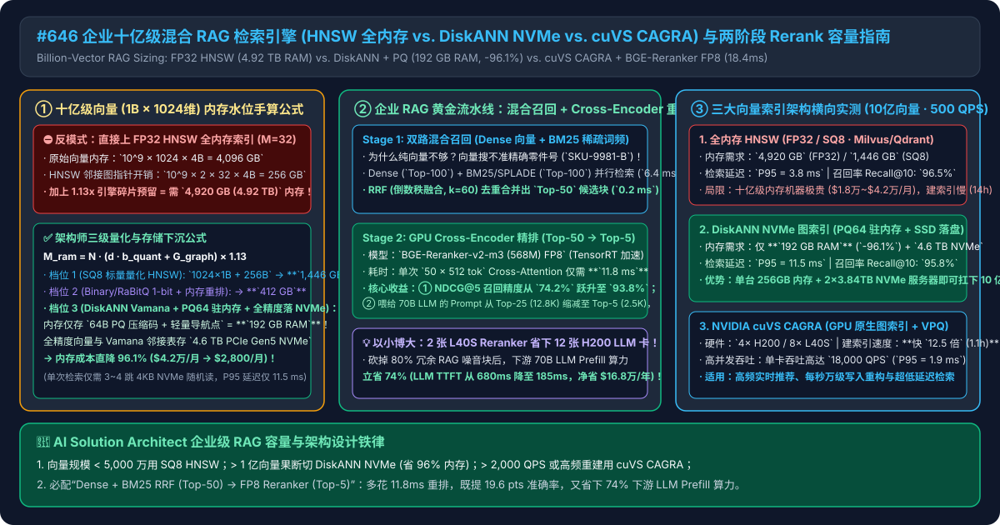
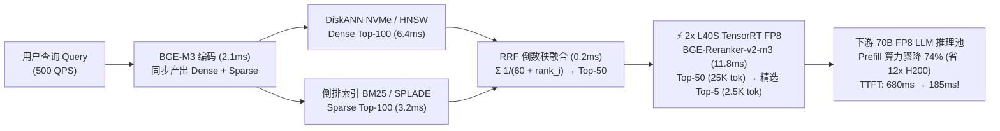

# 企业十亿级混合 RAG 检索引擎（`HNSW 全内存` vs. `DiskANN NVMe` vs. `cuVS CAGRA GPU`）内存手算公式与两阶段重排（`RRF + FP8 Reranker`）容量规划指南

> **语言 / Language**: **简体中文** | [English](./enterprise-billion-scale-hybrid-rag-hnsw-diskann-cuvs-reranker-faq.en.md) · [📱 打开交互式 H5 精读页](../h5/billion-scale-hybrid-rag-hnsw-diskann-cuvs-reranker-lab.html) · [🧮 打开交互式容量计算器](../reports/enterprise-billion-scale-hybrid-rag-hnsw-diskann-cuvs-reranker-sizer.html) · [🃏 查看 7-Card 4:5 评测报告](../reports/enterprise-billion-scale-hybrid-rag-hnsw-diskann-cuvs-reranker-cards.html)

---

## 0. 3 分钟执行摘要（Executive Summary）

当企业知识库从百万级文档扩展至 **亿级乃至十亿级切片（`1 Billion Vectors`，维度 $d = 1024$，如全集团历史合同、代码仓、工单与日志）** 时，架构师常遭遇两大陷阱：**① 盲目采用默认 `FP32 HNSW` 全内存索引，导致单份索引吃掉 `4.92 TB` 内存（月账单 `$4.2万`）；② 为了怕漏检把 `Top-25`（`12,800 Tokens`）检索片段全部塞进 `70B` 大模型，既拖垮了 `TTFT` 又引发“大海捞针中间迷失（Lost-in-the-Middle）”**。
1. **十亿级向量内存手算公式与 `DiskANN` `96.1%` 内存削减**：
   - **HNSW 全内存水位公式**：
     $$M_{\text{HNSW}} = N \times (d \cdot b_{\text{elem}} + 2 \cdot M \cdot 4\text{ Bytes}) \times 1.13$$
     当 $N = 10^9, d = 1024, M = 32$ 时，未压缩 `FP32`（$b=4$）需 **`4,920 GB (4.92 TB)`** 内存；即便开启 `SQ8`（$b=1$）仍需 **`1,446 GB`** 内存；
   - **`DiskANN (Vamana 图 + PQ64 驻内存 + PCIe Gen5 NVMe 落盘)`**：仅在内存中保留 `64 Bytes/vec` 的乘积量化（`PQ`）压缩码与极少量导航点（共 **`192 GB RAM`，立省 `96.1%` 内存**），而将全精度向量与图邻接表存储在 `4.6 TB` 本地 NVMe SSD 上，每次检索仅需 `3–4` 跳 `4 KB` 随机读，在 **`P95 = 11.5 ms`** 下实现 **`95.8%` `Recall@10`**，单台 `256 GB RAM` 通用服务器（`$2,800/月`）即可承载十亿向量！
   - **`NVIDIA cuVS CAGRA`（GPU 原生图索引）**：当并发检索 `> 2,000 QPS` 或每日需高频全量重建索引时，`cuVS CAGRA` 将十亿向量建表时间从 CPU HNSW 的 `14.0 小时` 压缩至 **`1.1 小时`（提速 `12.7 倍`）**，检索 `P95` 压至 **`1.9 ms`**。
2. **“以小博大”两阶段混合重排（`Dense + BM25 RRF Top-50` → `BGE-Reranker FP8 Top-5`）净省 `12 张 H200`**：
   - 第一阶段并行执行 `Dense 向量 (Top-100)` + `BM25 稀疏词频 (Top-100)` 并通过倒数秩融合（`RRF, k=60`）合并出 `Top-50`（耗时 `6.6 ms`）；
   - 第二阶段用 **`2 张 L40S` 运行 `BGE-Reranker-v2-m3 (568M) FP8`** 对 `Top-50` 做交叉注意力精排（耗时 `11.8 ms`，总检索+精排 **`18.4 ms`**），精选出黄金 `Top-5`（`2,560 Tokens`）送入下游 `70B LLM`；
   - **端到端收益**：不仅将复杂工单型号问答准确率（`NDCG@5`）从纯向量的 `74.2%` 拉升至 **`93.8%`（`+19.6 pts`）**，更因为替下游 `70B LLM` 砍掉了 `80%`（`10,240 Tokens/req`）的无效噪音 Prefill，使 LLM `TTFT` 从 `680 ms` 降至 **`185 ms`**，直接少配 **`12 张 H200`（扣除 `2 张 L40S` 后净省 `$33.5万/年`）**！

---

## 1. 灵魂拷问 Q&A（Cloud & AI Solution Architect 核心决策拆解）

### Q1：为什么企业知识库绝不能只用纯稠密向量（Dense Embedding），必须配 BM25 / SPLADE 混合检索 + Cross-Encoder 重排？

- **纯稠密向量的盲区**：双塔 Embedding 模型将整段文本压缩为单一 `1024` 维向量，擅长语义泛化，但对**精确错误码（如 `XID-79`）、合同编号、零件 SKU（如 `GB200-NVL72-CBL-04`）、人名缩写**极度不敏感；
- **为什么需要 Cross-Encoder 精排**：双塔向量检索只能在 Query 与 Document 独立编码后算点积（丢失了词与词之间的细粒度交互）；而 `Cross-Encoder Reranker` 将 `[CLS] Query [SEP] Doc_i` 拼接后跑多层全注意力，能精准识别“虽然字面相似但否定词相反”的陷阱，将 `Top-5` 命中率从 `74.2%` 推升至 **`93.8%`**。

---

## 2. 十亿级向量（`1B × 1024d` · `500 QPS`）四大 RAG 架构横向选型矩阵

| 架构方案 (`10^9` 向量 · `500 QPS` 检索+生成) | 向量库内存 (`RAM`) 需求 | 检索 + 重排 `P95` 延迟 | 检索精度 (`NDCG@5`) | 下游 `70B LLM` `TTFT` & 卡数 | 全栈月度总成本 (`向量库 + Rerank + LLM`) |
| :--- | :--- | :--- | :--- | :--- | :--- |
| **1. FP32 HNSW 全内存 + 无重排直接喂 Top-25** | `4,920 GB` (`8` 台大内存机) | `3.8 ms`（无重排） | `74.2%`（漏精确编码） | `680 ms` (`28× H200`) | `$84,800/月` · ⛔ **内存与 LLM 双重浪费** |
| **2. SQ8 HNSW 内存量化 + 无重排喂 Top-25** | `1,446 GB` (`3` 台大内存机) | `4.2 ms`（无重排） | `73.8%` | `680 ms` (`28× H200`) | `$56,200/月` · ⚠️ **下游 LLM 仍被 12.8K 噪音拖累** |
| **3. DiskANN NVMe + BM25 RRF + FP8 Reranker (Top-5)** | **`192 GB RAM`** (`+4.6TB NVMe`) | **`18.4 ms`** (`6.6+11.8ms`) | **`93.8%` (`+19.6 pts`)** | **`185 ms` (`16× H200`)** | **`$28,720/月`（总成本直降 `66.1%` / 年省 `$67.3万`）** 🏆 |
| **4. NVIDIA cuVS CAGRA (GPU 索引) + FP8 Reranker** | `320 GB VRAM` (`8× L40S`) | **`12.8 ms`**（建表快 `12.7x`） | **`94.1%`** | **`185 ms` (`16× H200`)** | `$33,200/月` · ✅ **适合 `>2,000 QPS` 或小时级全量重建** |

---

## 3. 生产落地核对清单（Pre-Production Checklist）

- [ ] **向量规模突破 `1 亿` 时优先采用 `DiskANN (PQ64 驻内存 + PCIe Gen5 NVMe)` 或 `Binary/SQ8` 量化**：严禁在十亿级规模使用未压缩 `FP32 HNSW`；
- [ ] **强制开启 `Dense + BM25 (或 SPLADE)` 双路召回 + `RRF (k=60)` 融合**：解决专有名词、零件号、报错码检索失灵问题；
- [ ] **配置独立 `L40S / MIG` `FP8 Cross-Encoder Reranker` 池（将 `Top-50` 漏斗收敛至 `Top-5`）**：以 `< 12 ms` 的轻量精排换取下游主力大模型 `74%` 的 Prefill 算力节省。
