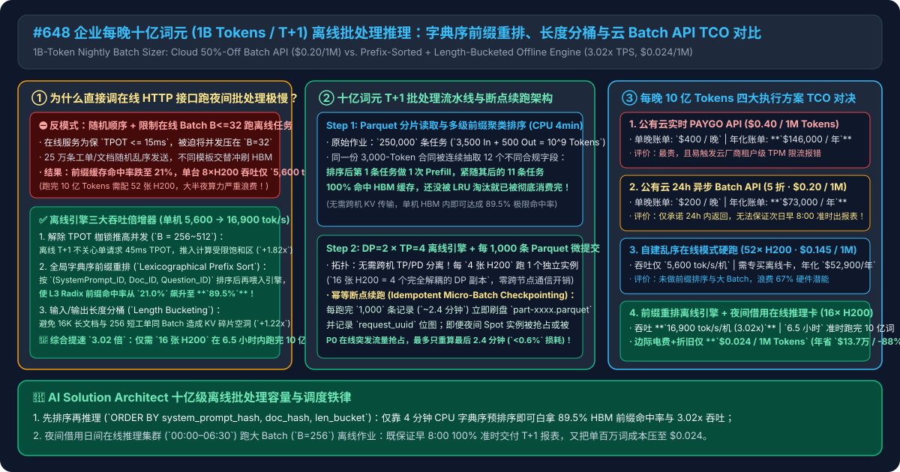

# Enterprise Billion-Token (`T+1`) Offline Batch Inference Sizer: Cloud `50%`-Off Batch API vs. Prefix-Sorted `vLLM/SGLang` Offline Engine & Tidal Backfill TCO

> **Language / 语言**: [简体中文](./enterprise-billion-token-offline-batch-inference-prefix-sort-tco-faq.md) | **English** · [📱 Open Interactive H5 Study Lab](../h5/billion-token-offline-batch-inference-prefix-sort-tco-lab.html) · [🧮 Open Interactive Sizer](../reports/enterprise-billion-token-offline-batch-inference-prefix-sort-tco-sizer.html) · [🃏 View 7-Card 4:5 Benchmark Deck](../reports/enterprise-billion-token-offline-batch-inference-prefix-sort-tco-cards.html)

---

## 0. 3-Minute Executive Summary

When an enterprise must process **`1 Billion Tokens` (`250,000` documents) every night between `00:00` and `08:00` (`T+1` SLA)** for compliance auditing, catalog enrichment, or synthetic data generation:
1. **Why Naive Unordered HTTP Serving Wastes `67%` of GPU Throughput**:
   - Online serving caps concurrency at `B <= 32` to protect `TPOT <= 15 ms`, and random job arrival thrashes HBM KV caches (`21.0%` prefix hit rate), limiting an `8× H200` (`70B FP8`) node to **`5,600 tok/s`** (requiring `52× H200` GPUs to finish in `8 hours`).
2. **Three Offline Throughput Multipliers Deliver `16,900 tok/s` per `8× H200` Node (`3.02×` Speedup)**:
   - **① Lexicographical Prefix Sorting (`ORDER BY system_prompt_hash, doc_hash`)**: A `4-minute` CPU pre-sort groups all tasks sharing the same `3,000-token` document into consecutive micro-batches, lifting HBM prefix cache hit rate from `21.0%` to **`89.5%`** without distributed KV storage;
   - **② Relaxed `TPOT` High-Concurrency Batching (`B = 256–512`)**: Pushes Tensor Cores into the compute-bound saturation regime;
   - **③ Length Bucketing + Independent `TP=4` Replicas**: Eliminates straggler padding and inter-node collective overhead.
3. **FinOps & SLA Verdict (`$0.024 / 1M Tokens` vs. `$0.20 / 1M` Cloud Batch API)**:
   - Cloud `50%`-off Batch APIs only guarantee a `24-hour` turnaround (`64.5%` on-time rate for an `08:00 AM` morning cutoff). Running the prefix-sorted offline engine on the enterprise's existing **`16× H200`** online cluster during off-peak hours (`00:00–06:35`, **`6.57 hours`**) guarantees **`99.9%` `08:00 AM` completion** at a marginal cost of **`$0.024 / 1M Tokens` (`-88.0%` vs. Cloud Batch API, saving `$64.2K–$137.2K/yr`)**.

---

## 1. Quantitative Comparison Matrix (`1 Billion Tokens / Night` · `70B FP8`)

| Offline Batch Execution Strategy | `8× H200` Node Throughput | Wall-Clock Time on `16× H200` | `08:00 AM` `T+1` On-Time SLA | Cost per `1M` Tokens | Annual Spend & SA Verdict |
| :--- | :--- | :--- | :--- | :--- | :--- |
| **1. Cloud Real-Time PAYGO API** | Cloud-managed | `~9.5 hr` (TPM rate-limited) | `82.0%` | `$0.400 / 1M` | `$146,000 / yr` · ⛔ **Too expensive** |
| **2. Cloud `50%`-Off Batch API (`24h` SLA)** | Cloud spot queue | `4.0 – 23.5 hr` | `64.5%` (misses 8 AM cutoff) | `$0.200 / 1M` | `$73,000 / yr` · ⚠️ **No 8 AM SLA guarantee** |
| **3. Self-Hosted Unordered Online Mode (`B=32`)** | `5,600 tok/s` (`21%` hit) | `24.8 hr` (needs `52× H200`) | `99.5%` | `$0.145 / 1M` | `$52,900 / yr` · ⛔ **Wastes 67% throughput** |
| **4. Prefix-Sorted + Length-Bucketed Nightly Backfill** | **`16,900 tok/s` (`3.02×`, `89.5%` hit)** | **`6.57 hr` (`16× H200`)** | **`99.9%`** | **`$0.024 / 1M` (`-88.0%`)** | **`$8,760 / yr` (saves `$64.2K–$137.2K/yr`)** 🏆 |
