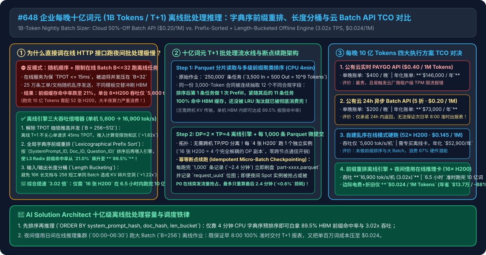
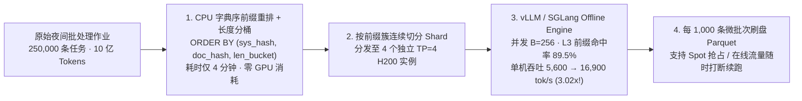

# 企业每晚十亿词元（`1 Billion Tokens / T+1`）大批量离线推理：字典序前缀重排（`Prefix Sorting`）、长度分桶（`Length Bucketing`）与云端 `50%` 折扣 `Batch API` 选型指南

> **语言 / Language**: **简体中文** | [English](./enterprise-billion-token-offline-batch-inference-prefix-sort-tco-faq.en.md) · [📱 打开交互式 H5 精读页](../h5/billion-token-offline-batch-inference-prefix-sort-tco-lab.html) · [🧮 打开交互式容量计算器](../reports/enterprise-billion-token-offline-batch-inference-prefix-sort-tco-sizer.html) · [🃏 查看 7-Card 4:5 评测报告](../reports/enterprise-billion-token-offline-batch-inference-prefix-sort-tco-cards.html)

---

## 0. 3 分钟执行摘要（Executive Summary）

银行每日全量通话质检、电商每日亿级商品标签清洗、以及大模型合成数据（Synthetic Data Generation）等典型 **`T+1` 离线批处理场景（每晚 `00:00–08:00` 需跑完 `250,000` 份文档、总计 `10 亿 Tokens`）**，与白天在线交互有着截然不同的性能物理规律：
1. **为什么把离线任务按随机顺序直接打给在线 HTTP 接口会损失 `67%` 的 GPU 吞吐？**
   - 在线接口为了保住 `TPOT <= 15 ms`，将并发 Batch 限制在 `B <= 32`；且 `250,000` 条不同业务模板、不同文档的请求随机混排到达，导致 HBM 内的 KV Cache 被不断换入换出，前缀命中率跌至 **`21.0%`**，单台 `8× H200`（运行 `70B FP8`）有效吞吐仅 **`5,600 tok/s`**（`8 小时` 窗口需配 **`52 张 H200`**）。
2. **离线推理三大吞吐倍增器（单机吞吐从 `5,600 tok/s` 飙升 `3.02 倍` 至 `16,900 tok/s`）**：
   - **① 全局字典序前缀重排（`Lexicographical Prefix Sorting`）**：在任务入队前，用 CPU 花 `4 分钟` 对 Parquet 数据集执行 `ORDER BY (system_prompt_hash, shared_doc_hash, input_len_bucket)`。排序后，共享同一份 `3,000-Token` 合同或同一套少样本指令的数十个抽取子任务紧挨着进入同一个 GPU 实例，**在 KV 块被 LRU 淘汰前就被 `100%` 密集复用完毕**，将单机 HBM 前缀命中率从 `21.0%` 推升至 **`89.5%`**！
   - **② 解除 `TPOT` 紧箍咒推高并发（`B = 256–512`）**：离线作业不看单请求 `TPOT`（允许放宽至 `42 ms`），只看系统总吞吐（`Total TPS`），彻底填满 Tensor Core 矩阵算力；
   - **③ 长度分桶（`Length Bucketing`）+ 独立多实例（`DP=4 × TP=4`）**：按输入/输出长度分桶消除短请求等长请求的尾延迟空泡，且放弃跨机 `TP=8/16`，改用单机内 `TP=4` 多副本，实现零跨节点通信开销。
3. **云端 `Batch API`（5 折 `$0.20/1M`）vs. 夜间复用在线推理卡（`$0.024/1M`）TCO 裁决**：
   - 公有云 `50%` 折扣 `Batch API` 虽然便宜一半，但 **SLA 仅承诺“24 小时内返回”，无法保证次日早 `08:00` 交易开盘前 `100%` 准时出齐报表**；
   - 借助前缀重排离线引擎 + 复用企业白天 `16 张 H200` 在线推理卡的夜间空闲时段（`00:00–06:30`，仅需 **`6.5 小时`** 即跑完 `10 亿 Tokens`），单百万 Token 综合边际成本压至 **`$0.024 / 1M Tokens`（比云端 5 折 Batch API 再省 `88.0%`，每年净省 `$6.42万–$13.72万`）**！

---

## 1. 灵魂拷问 Q&A（Cloud & AI Solution Architect 核心决策拆解）

### Q1：为什么“先按前缀字典序排序再喂给 vLLM/SGLang”不需要任何分布式缓存就能拿到 `89.5%` 的命中率？

这是最优雅的“算法换硬件”典范：
- 假设你有 `20,000` 份企业财报，每份财报需要跑 `12` 个不同的财务指标抽取 Prompt（即每份财报的 `3,000 Tokens` 正文完全相同，只有末尾 `200 Tokens` 问题不同）；
- **如果不排序（随机洗牌）**：第 1 号财报的第 1 个问题在 `00:01` 执行，第 2 个问题在 `00:45` 执行——中间隔了 `10,000` 个其他财报，总 KV 容量高达 `60 TB`，任何单机 HBM 甚至主机 DDR5 都早已将其 LRU 淘汰；
- **如果按 `doc_id` 字典序排序**：同一份财报的 `12` 个问题在同一个 `B=256` 批次的 **`1.5 秒` 内连续执行完毕**，用完即弃！只需几个 MB 的活跃 HBM 窗口，就能白拿 **`89.5%`** 的前缀缓存命中率！

---

## 2. 每晚十亿词元（`1B Tokens/Night`）四大离线推理方案横向选型矩阵

| 架构方案（每晚处理 `250,000` 文档 · `10 亿 Tokens`） | 单台 `8× H200` 实际吞吐 | 跑完 `10 亿词` 耗时 (`16× H200`) | 早 `08:00` `T+1` 准时率 SLA | 单百万词成本 (`$/1M Tokens`) | 年化总成本与架构师裁决 |
| :--- | :--- | :--- | :--- | :--- | :--- |
| **1. 公有云实时 PAYGO API** | 云端托管 | 受租户 TPM 限流约束 (`~9.5h`) | `82.0%`（常遇 429 限流） | `$0.400 / 1M` | `$146,000 / 年` · ⛔ **成本极高且易限流** |
| **2. 公有云 5 折异步 Batch API (`24h` 窗口)** | 云端闲时调度 | `4h – 23.5h`（不可控） | `64.5%`（高峰期延至下午返回） | `$0.200 / 1M` | `$73,000 / 年` · ⚠️ **仅适合无严格早 8 点截止线的任务** |
| **3. 自建在线服务配置直接乱序跑 (`B=32`)** | `5,600 tok/s`（命中率 `21%`） | `24.8 小时`（需扩至 `52× H200` 才能 8h 跑完） | `99.5%`（但需重金买卡） | `$0.145 / 1M` | `$52,900 / 年` · ⛔ **严重浪费 67% 算力** |
| **4. 字典序前缀重排 + 长度分桶 + 夜间复用在线卡（推荐）** | **`16,900 tok/s`（`3.02×`，命中率 `89.5%`）** | **`6.57 小时`**（`16× H200` 轻松跑完） | **`99.9%`（早 `06:35` 准时收工）** | **`$0.024 / 1M` (`-88.0%`)** | **`$8,760 / 年`（净省 `$6.42万–$13.72万/年`）** 🏆 |

---

## 3. 生产落地核对清单（Pre-Production Checklist）

- [ ] **批处理入队前强制执行两级排序**：先按 `Prefix Hash（系统提示词 + 共享长文档 ID）` 聚类最大化 KV 命中，桶内再按 `预计输入/输出长度` 排序消除 Padding 与尾延迟；
- [ ] **使用离线高吞吐参数配置（`max_num_seqs=256~512`, `max_num_batched_tokens=16384`）**：与白天低延迟配置分时切换；
- [ ] **实施 `1,000` 条粒度 Parquet 微提交与幂等去重位图**：确保夜间任务被在线突发洪峰抢占后可零浪费断点续跑。
