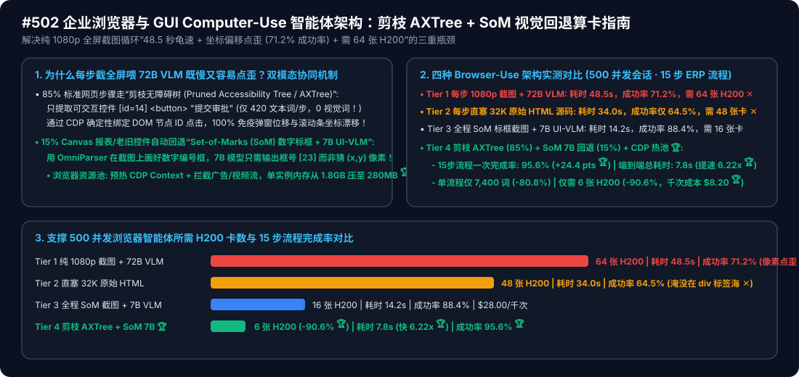

# Enterprise Browser-Use & GUI Computer-Use Agent (`Pruned AXTree + SoM 7B UI-VLM` vs. `1080p Screenshot VLM Loop`) Sizer Guide (#502)

> **Executive Summary**:
> Running `500 concurrent Browser-Use / Computer-Use RPA sessions` (15-step ERP/CRM workflows) with a naive **Every-Step `1080p` Screenshot Loop + `72B VLM` Pixel-Coordinate Clicking** suffers from **`71.2%` workflow completion rate** (due to pixel coordinate drift), stalls end-to-end execution at **`48.5 seconds`**, and requires **`64x H200 GPUs` (`$145 / 1,000 workflows`)**. For **Cloud & AI Solution Architects**, combining **Pruned DOM Accessibility Tree (`AXTree`, `420 text tokens/step` with deterministic DOM node-ID clicking for `85%` of steps) + `Set-of-Marks (SoM) / OmniParser` Numbered Bounding-Box Fallback on a `7B UI-VLM` (`15%` of steps) + Warm CDP Browser Context Pools** raises 15-step workflow completion rate to **`95.6%` (`+24.4 pts`)**, speeds up execution **`6.22x` to `7.8 seconds`**, and serves 500 concurrent browser sessions on just **`6x H200 GPUs` (`-90.6%` GPUs, `$8.20 / 1,000 workflows`)**.
>
> **⚡ Interactive H5 Study Lab**: [**Open the Browser-Use & GUI Agent (AXTree + SoM 7B VLM) Latency & GPU Sizer (`docs/h5/browser-computer-use-axtree-som-vlm-sizer-lab.html`)**](../h5/browser-computer-use-axtree-som-vlm-sizer-lab.html)

---

## 1. Quantitative Decision Matrix (`500 Concurrent Browser Sessions · 15-Step Workflow`)

| Browser-Use / GUI Agent Architecture | 15-Step Success Rate | Workflow E2EL | Tokens / Workflow | H200 GPUs (`500 Sess`) | Cost / `1k Workflows` |
| :--- | :--- | :--- | :--- | :--- | :--- |
| **Tier 1: Pure `1080p` Screenshot Loop + 72B VLM** | `71.2%` ✕ | `48.5 s` ✕ | `38,500` | `64 GPUs` ✕ | `$145.00` ✕ |
| **Tier 2: Raw Unpruned `32K HTML` Dump + Text LLM** | `64.5%` ✕ | `34.0 s` ✕ | `185,000` ✕ | `48 GPUs` ✕ | `$110.00` |
| **Tier 3: Uniform `Set-of-Marks (SoM)` + 7B UI-VLM** | `88.4%` ✓ | `14.2 s` | `22,000` | `16 GPUs` | `$28.00` |
| **Tier 4: Pruned `AXTree (85%)` + `SoM 7B (15%)` 🏆** | **`95.6% (+24.4 pts)` 🏆** | **`7.8 s (6.22x)` 🏆** | **`7,400 (-80.8%)` 🏆** | **`6 GPUs (-90.6%)` 🏆** | **`$8.20` 🏆** |
