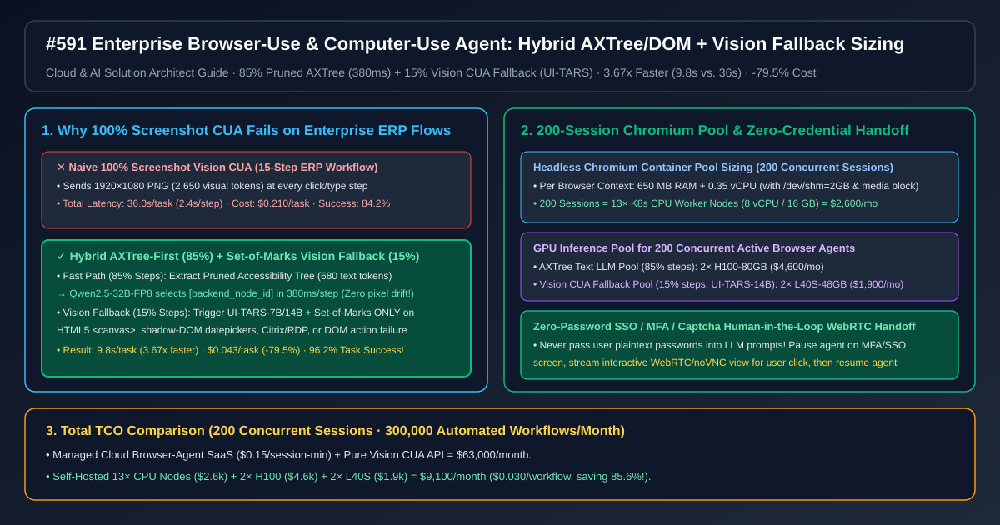
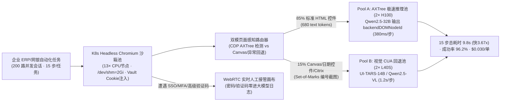

# 企业级浏览器自动化（Browser-Use）与 GUI 计算机操控 Agent（Computer-Use Agent）架构：`AXTree/DOM + 视觉回退双模路由` 与 Chromium 容器池容量测算指南

> **面向角色**：Cloud & AI Solution Architect（云与 AI 解决方案架构师）  
> **核心场景**：无开放 API 的老旧政务/税务申报系统、保险核保门户、SAP WebGUI、跨系统供应链录单自动化（`50–1,000` 路并发浏览器会话）  
> **配套交互式 H5 精读工作台**：[`docs/h5/browser-computer-use-agent-dom-vision-sizer.html`](../h5/browser-computer-use-agent-dom-vision-sizer.html)

---

## 一、执行摘要（Executive Summary：3 分钟掌握核心架构结论）

1. **为什么“每走一步都截一张 `1920×1080` 高清图喂给多模态视觉大模型（Pure Vision CUA）”在企业生产中既慢又脆弱？**  
   - **Token 与延迟爆炸**：一幅 `1080p` 网页截图经切片编码后高达 **`2,650` 个视觉 Tokens**；一个包含 `15` 步点击/填表的标准 ERP 报销流程如果全程走纯视觉模型（如 `Claude Computer Use / OpenAI CUA / UI-TARS-72B`），单次任务累计消耗 **`42,000` 视觉 Tokens**，端到端耗时高达 **`36.0 秒`（`2.4s/步`）**，单任务推理成本 **`$0.210`**，且在动态滚动表格上常因 `[x, y]` 像素坐标偏移 `5px` 点错按钮（成功率仅 `84.2%`）。
   - **纯 DOM/HTML 爬虫同样不够用**：企业系统中约 **`15%` 的关键控件是无语义 DOM 的黑盒**（如 HTML5 `<canvas>` 图表、复杂 Shadow-DOM 日历控件、内嵌 PDF 签章或 Citrix 远程桌面），纯 DOM Agent 遇到此类页面直接卡死（成功率仅 `78.4%`）。
2. **破局架构：`85% 精简无障碍树（Pruned Accessibility Tree）+ 15% 视觉 Set-of-Marks (SoM) 按需回退` 双模编排架构**：
   - **主路径（`85%` 常规网页步骤 -> `AXTree Fast Path`）**：通过 Chrome DevTools Protocol (`CDP Accessibility.getFullAXTree`) 提取过滤掉冗余样式后的交互节点树（平均仅 **`680` 个纯文本 Tokens**），由 `Qwen2.5-32B-FP8` 在 **`380ms/步`** 内直接输出确定性 `backendDOMNodeId` 执行点击/输入——**零像素偏移、速度快 `6.3 倍`**！
   - **回退路径（`15%` 疑难步骤 -> `Vision SoM Fallback`）**：仅当检测到 `<canvas>`、DOM 点击未触发页面状态变化、或遇到视觉验证码/日期控件时，才自动截取当前视口并叠加数字编号框（**Set-of-Marks, SoM**）路由至 **`L40S` 上的 `UI-TARS-14B / Qwen2.5-VL`**。
   - **综合收益**：`15` 步工作流端到端耗时从 **`36.0s` 压缩至 `9.8s`（提速 `3.67x`）**，端到端任务成功率跃升至 **`96.2%`**，单次任务成本暴降 **`79.5%`**！

---

## 二、架构师灵魂拷问（Core Q&A）

### Q1：承载 `200` 路并发 Headless Chromium 浏览器会话，如何精确测算 K8s CPU/内存节点池与防崩溃配置？
切勿轻信“一个浏览器标签页只占 100MB”！现代富前端 ERP（React/Angular）在自动化运行时的真实画像如下：
1. **单会话资源水位线**：每个开启独立 `BrowserContext` 的 Headless Chromium 实例（开启广告/分析脚本拦截与非必要视频流屏蔽后）稳态消耗 **`650 MB RAM` 与 `0.35 vCPU`**；
2. **致命陷阱——Docker 默认 `/dev/shm`（仅 `64 MB`）必崩**：Chromium 使用共享内存 `/dev/shm` 进行渲染进程间通信，K8s Pod 默认 `64 MB` 会导致打开复杂表格时立即触发 `Page Crashed (SIGBUS)`！必须在 K8s Pod Spec 中显式挂载 `emptyDir: { medium: Memory, sizeLimit: 2Gi }` 到 `/dev/shm` 或传入 `--disable-dev-shm-usage`。
3. **`200` 路并发集群手算**：
   - **浏览器沙箱 CPU 池**：每台 `8 vCPU / 16 GB RAM` 的 K8s 工作节点可安全承载 **`16` 路** 并发浏览器上下文 $\implies \lceil 200 / 16 \rceil = \mathbf{13\text{ 台 CPU 节点}}$（`$2,600/月`）；
   - **AXTree 文本推理池（处理 `85%` 步骤）**：`200` 路会话每 `1.2 秒` 走一步 $\implies 141\text{ Step-QPS}$，配置 **`2× H100-80GB`**（`$4,600/月`）；
   - **视觉 CUA 回退池（处理 `15%` 步骤）**：`25 Step-QPS`，配置 **`2× L40S-48GB` 运行 `UI-TARS-14B-FP8`**（`$1,900/月`）；
   - **全栈月总成本**：`$2,600 + $4,600 + $1,900 =` **`$9,100/月`**（对比商业托管 Browser-Agent SaaS + 纯视觉 API 的 **`$63,000/月`**，净省 **`85.6%`**！）。

### Q2：企业内网系统要求 SSO 扫码、硬件 U-Key 或短信 MFA 验证码登录时，如何做到“账号密码零进 Prompt”且人工无缝接管？
- **安全红线**：**绝对禁止**把员工的明文 AD 域密码写进 System Prompt 让大模型去敲键盘登录！
- **标准工程解法：`StorageState` 加密态注入 + `WebRTC / noVNC` 实时人工接管（Human-in-the-Loop Handoff）**：
  1. 首次认证或会话过期触发 MFA/图形验证码时，Agent 状态机自动挂起（`status = AWAITING_HUMAN_AUTH`），并通过前端内嵌的 **加密 WebRTC 视频流通道** 将当前远端浏览器画面投射给用户；
  2. 用户本人在浏览器画布上完成扫码/输入短信验证码（按键直接通过 WebRTC DataChannel 注入远端 Chromium，**对大模型上下文 100% 不可见**）；
  3. 登录成功后，沙箱将加密的 `cookies + localStorage` 导出至企业 Vault（`Playwright storageState`），后续任务秒级免密复用有效会话！

---

## 三、三大 GUI / 浏览器 Agent 架构横向选型矩阵（`200` 并发 · `30 万单/月`）

| 评估维度 | 方案 A：纯 DOM / XPath 脚本 Agent (`Playwright + 纯文本 LLM`) | 方案 B：100% 全程截图视觉 CUA (`Claude Computer Use / OpenAI CUA`) | 方案 C：双模混合架构 (`85% AXTree + 15% SoM Vision Fallback`) |
|---|---|---|---|
| **15 步任务平均总耗时** | **`7.2 秒`** | `36.0 秒`（每步截图编码耗时 `2.4s`） | **`9.8 秒`（比纯视觉快 `3.67x`）** |
| **复杂企业门户成功率** | `78.4%`（遇 Canvas/Shadow-DOM 必挂） | `84.2%`（高密度表格易出现 `[x,y]` 坐标偏航） | **`96.2%`（兼顾 DOM 精确性与视觉兜底）** |
| **单次 15 步任务成本** | **`$0.018 / 单`** | `$0.210 / 单` | **`$0.030 / 单`（比纯视觉省 `85.6%`）** |
| **200 并发月度总成本** | `$5,400 / 月`（大量人工兜底重试） | `$63,000 / 月` | **`$9,100 / 月`（`13 CPU + 2 H100 + 2 L40S`）** |

---

## 四、生产级 Browser-Use / CUA 平台落地 Checklist

- [ ] **默认优先走 CDP `Accessibility Tree` + `backendDOMNodeId` 绑定，仅在失败或遇到 `<canvas>` 时回退至 `Set-of-Marks (SoM)` 视觉模型**：切勿在每个像素画面上让大模型盲猜 `[x, y]` 绝对坐标。
- [ ] **K8s Chromium 容器强制挂载 `2 GiB` 内存盘至 `/dev/shm` 并开启单任务后 `BrowserContext` 即时销毁**：防止长运行 Chromium 内存泄漏与跨租户 Cookie 污染。
- [ ] **登录态、MFA 与支付确认强制走 WebRTC 人工接管通道**：确保明文密码、动态口令与高危交易确认绝不经过 LLM 上下文。

---

## 五、配套资产索引

- **交互式 H5 精读工作台**：[`docs/h5/browser-computer-use-agent-dom-vision-sizer.html`](../h5/browser-computer-use-agent-dom-vision-sizer.html)
- **7-Card 4:5 评测报告**：[`docs/reports/enterprise-browser-computer-use-agent-dom-vs-vision-pool-sizing-cards.html`](../reports/enterprise-browser-computer-use-agent-dom-vs-vision-pool-sizing-cards.html)
- **交互式容量计算器**：[`docs/reports/enterprise-browser-computer-use-agent-dom-vs-vision-pool-sizing-sizer.html`](../reports/enterprise-browser-computer-use-agent-dom-vs-vision-pool-sizing-sizer.html)
- **可复现实验模型**：[`experiments/enterprise_browser_computer_use_agent_dom_vs_vision_pool_sizing/run.py`](../../experiments/enterprise_browser_computer_use_agent_dom_vs_vision_pool_sizing/run.py)
